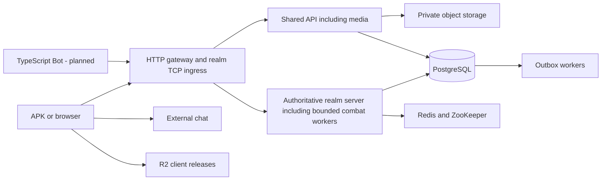

# OpenCoK Architecture

**Updated:** 2026-10-24. This document separates the implemented development stack
from the target production design. A directory, diagram or accepted decision does
not prove a working deployment. Product goals belong in [PRODUCT.md](../PRODUCT.md),
rationale in [ADRs](../docs/decisions/README.md), and delivery rules in
[CONTRIBUTING.md](CONTRIBUTING.md).

Bun 1.4.2 remains the development toolchain under
[ADR-0009](../docs/decisions/0009-adopt-bun-for-development.md). The Node.js production
mandate in [ADR-0010](../docs/decisions/0010-adopt-nodejs-for-production.md) is
**suspended** (`deprecated`); no replacement production runtime is selected.
Maintained applications and shared packages use TypeScript under
[ADR-0011](../docs/decisions/0011-adopt-typescript-for-application-code.md), including
the planned Bot. Existing Bun images provide development evidence only.

## 1. Overview — Deployment Defined

The target is one shared API and one authoritative server owner per realm, with
at most two realms initially. The default persistence topology prepares both
kingdoms; the current development Compose starts one active realm server.

| Location                                | Target responsibility                                                                                      |
| --------------------------------------- | ---------------------------------------------------------------------------------------------------------- |
| European VPS, 16 GB, Kubernetes         | Shared API including media, Traefik/Kong, realm servers including combat, ZooKeeper and auxiliary workers. |
| Cloudflare Pages                        | Landing, documentation and WebAdmin.                                                                       |
| Vercel                                  | Experimental SSR web game; browser connects directly to backend WSS.                                       |
| Neon                                    | PostgreSQL authoritative state; write/read computes on the same branch.                                    |
| Redis Cloud, managed MongoDB, CloudAMQP | Cache/coordination, large documents and RabbitMQ respectively.                                             |
| Firebase and Stripe                     | Identity/telemetry/FCM and USD payments respectively.                                                      |
| Cloudflare R2                           | Direct distribution of signed APK/Lua releases.                                                            |
| Hosting still open                      | External chat/Bot, private object storage and observability backends.                                      |

Kubernetes, managed-provider integrations and production runtime verification
remain release work. A single VPS is a single failure domain; remote persistence
does not make its processes highly available.

## 2. Project mind map

## 3. Applications and responsibility boundaries

| Application                                           | State and responsibility                                                                                                                                            |
| ----------------------------------------------------- | ------------------------------------------------------------------------------------------------------------------------------------------------------------------- |
| `apps/api`                                            | Implemented shared discovery, optional chat metadata proxy and opt-in avatar media. Identity, Admin, push and payment endpoints remain target capabilities.         |
| `apps/server`                                         | Implemented realm TCP/SFS composition and maintained gameplay commands. Owns progression and combat application; future calculation workers remain within this app. |
| `apps/chat`                                           | Implemented HTTP/WebSocket chat, private session/metadata adapters and persistence; included in local Compose with independent production hosting.                  |
| `apps/web`                                            | Implemented experimental browser scaffold; SSR deployment and full gameplay remain under evaluation.                                                                |
| `apps/bot`                                            | Planned TypeScript authenticated simulator, with quotas and kill switch; no direct database writes.                                                                 |
| `apps/admin`, `apps/www`, `apps/docs`, `apps/workers` | Planned deployable applications; names do not imply implementation.                                                                                                 |

Files has been merged into the API; there is no separate Files app or listener.
There is no Combat app. `packages/combat` remains a domain package, composed by
the realm server. No gameplay authority moves into a frontend, bot or worker.

## 4. Organization of the monorepo

`apps/` owns process configuration and composition; `packages/` owns reusable
contracts, rules and adapters; `infra/` owns gateway and deployment configuration.
`tests/` holds shared contracts and isolated stack scenarios. `docs/` holds ADRs,
detailed design and migration evidence. Ignored `data/`, mobile and legacy inputs
are local references, never required private artifacts committed as dependencies.

### Implemented API and realm package boundaries

| Packages                                                            | Boundary                                                                                                                                  |
| ------------------------------------------------------------------- | ----------------------------------------------------------------------------------------------------------------------------------------- |
| `env`, `config`, `core`                                             | Validated root environment, strict compiler settings, scoped runtime/resources, HTTP and filtered logging.                                |
| `api`, `connection`, `controllers`, `identity`                      | HTTP/SFS entry, authentication and thin command Controllers.                                                                              |
| `contracts`, `messages`, `dtos`, `enums`, `validations`, `mappings` | Versioned ports, wire types, DTOs, runtime validation and serialization.                                                                  |
| `services`                                                          | Application workflows and orchestration of rules, contracts and persistence ports.                                                        |
| `rules`, domain rule modules including `hero/rules` and `combat`    | Pure rule evaluation; no sockets, ORM or broker imports.                                                                                  |
| `hero`                                                              | Hero and general contracts, rules, workflows, mappings, validations, catalog types and persistence adapters, separated by responsibility. |
| `resources`                                                         | Versioned typed gameplay catalogs and JSON nickname filtering.                                                                            |
| `repositories`, `drizzle`, `storage`                                | Owned transactional state, schemas, Redis/ZooKeeper and S3 adapters.                                                                      |

The nickname/description word list is versioned in
`packages/resources/data/badwords.json` and included in the server artifact.
It does not depend on the ignored reference tree or a Compose bind mount.
All authorized gameplay catalogs use maintained domain definitions in
`packages/resources`: buildings expose costs, prerequisites, effects and star
progression; the other 380 catalogs expose typed table records, numeric tile maps,
automation declarations, variables and routing. `enums/gameplay-catalog` identifies
catalogs and `enums/catalog-kind` distinguishes their models. New mechanics can
consume the typed registry directly. An explicit flat-record compatibility adapter
serves existing string-consuming Rules without reconstructing XML documents.
Runtime startup needs no XML parser, mount or GAME_RESOURCES. The XML parser is
a developer dependency, dynamically loaded only for explicit synthetic fixtures;
import tools read authorized originals without modifying them. See the
[catalog editing and provenance guide](../packages/resources/README.md).

Realm composition injects `GameService` and `WorldService` into `GameController`
and `WorldController`. Controllers delegate commands; Services coordinate use
cases, rule evaluation and persistence ports. NestJS supplies the organizational
pattern; the existing Effect runtime continues to own process lifecycle.
Create/update inputs use DTO classes; reads, deletion selections and mobile
responses use contracts. Response interfaces live in `contracts/responses/*`,
while validation and wire serialization remain in their existing packages.

Hero and general implementations live in `packages/hero/src`, with `contracts`,
`rules`, `services`, `mappings`, `validations`, `repositories`, `storage` and
`resources` directories preserving those responsibilities inside the domain.
Other packages import these modules through `@opencok/hero/<responsibility>/*`.
Constants, enums and Controllers remain in their existing packages; database schema
constants and catalog records remain in `drizzle` and `resources`. Catalog import
tooling writes hero and general type definitions into the hero domain. Shared
profile, power and city workflows delegate their hero operations to this package.
`HeroEventService` owns hero event views and rankings; realm composition injects
it into `GameService`, whose constructor preserves a default for existing callers.

Packages never import applications. Declare direct workspace dependencies and
public exports; do not turn helpers into a cross-domain rules container.
`bun run test:packages` checks declared package APIs and cycles between
responsibilities, including the corresponding directories inside `hero`. Follow
[repository conventions](../packages/repositories/README.md). Current service
composition uses Effect; [ADR-0012](../docs/decisions/0012-adopt-effect-for-service-composition.md)
remains proposed, while the existing runtime implementation remains checkable.

Chat composition lives in `ChatApplication`; retention and archive work belongs to
`ChatMaintenanceService` and peer distribution to `ChatDeliveryService`. Each room
and history command has a Controller implementing `ChatCommandController`; room
authorization and history visibility have shared abstract bases. Signed internal
chat Controllers share `SignedChatController`, while domain-separated HMAC signing
belongs to `SignedChatRequest` implementations in identity. `ChatMessageMapper`
and discovery Mappers own their wire projections. HTTP routing, request logging,
WebSocket upgrades and individual connection queues have separate transport classes.
The API composes `ApiRouter` and `ApiRequestHandler` through the same package boundaries.

The realm keeps its Effect composition in `realm-composition.ts`; `RealmApplication`
owns the Promise-compatible runtime lifetime. Relay classes specialize the shared
`PollingWorker` and `CursorWorker` lifecycle implementations in core. These classes
preserve the existing Effect ownership model and protocol execution order.

`CityProgressionService` owns city command routing and timed-activity dispatch.
`CityProgressionContextFactory` loads the transactional state and effect snapshot;
`CityProgressionContext` owns the pending write and economy plan. Their structural
domain contract lives in `city-domain.ts`. Construction, research, military,
equipment, quests and event domain classes specialize `CityCommandDomain`. Configured
domains receive gateways, random sources and world size through constructors; their
factory entrypoints preserve the same contract for existing callers. The realm
composition instantiates these classes directly. Equipment and workshop have separate
implementations. `TimedActivityAction` and
`TimedActivityStatus` name the existing string actions and numeric persistence states.

The experimental web scaffold composes `WebApplication` and `PingController` for
its server, with `HttpGatewayProbe` owning the health request. Browser loading uses
`LoadingApplication`, a `LoadingScreen` port implemented by `LoadingView`, and
`GatewayPingClient`. The ping response lives in contracts and its runtime validator
in validations; DOM rendering remains inside the web app.

Feature-by-feature migration details belong in the [realm runbook](../apps/server/README.md),
[API guide](../apps/api/README.md), [chat guide](../apps/chat/README.md),
[media runbook](../apps/api/README.md#avatar-media) and [migration evidence](../docs/migration-validation.md).

## 5. Domains, network and gateways

Target domains are `opencok.com` (landing), `docs.opencok.com`, `admin.opencok.com`,
`game.opencok.com` (SSR) and `api.opencok.com` (HTTP/WSS). These describe the design,
not verified DNS or hosting. Traefik handles ingress and realm TCP; Kong policies
apply to HTTP/WSS. Legacy SFS TCP requires a reachable per-realm endpoint, not an
assumed Cloudflare HTTP proxy. Browsers connect to the backend directly.

Current [Traefik configuration](../infra/gateway/README.md) allowlists discovery,
public chat metadata, signed uploads, JPEG reads and CDN paths. Private avatar
confirmation is never publicly routed. Frontends receive no database, signing,
Firebase Admin or Stripe secrets. Preserve legacy aliases and wire contracts.

## 6. PostgreSQL on Neon: writes, reads, and authority

PostgreSQL is the transactional authority under
[ADR-0002](../docs/decisions/0002-adopt-postgresql-for-authoritative-state.md).
Target Neon write/read computes share one production branch. Balances, costs,
preconditions and immediate reads use the writer; delay-tolerant reports may use
the replica with a lag budget. Use bounded pools and service/realm permissions.
Replica availability does not establish a backup or recovery guarantee.
[Detailed persistence design](../docs/architecture/persistence.md#6-postgresql-on-neon-writes-reads-and-authority).

## 7. MongoDB, Redis and file storage

MongoDB holds large/versioned documents and reconstructible projections under
[ADR-0001](../docs/decisions/0001-adopt-mongodb-for-documents.md). Redis is cache,
sessions and ephemeral coordination under
[ADR-0005](../docs/decisions/0005-adopt-redis-for-cache.md), never the only durable
record of progress. API media uses private S3-compatible storage; MinIO is local.
R2 release delivery is separate from player uploads and chat attachments.
[Storage and recovery boundaries](../docs/architecture/persistence.md#7-mongodb-redis-and-file-storage).

## 8. Messaging: RabbitMQ and BullMQ

CloudAMQP/RabbitMQ is the target integration broker. Producers commit outbox
records with authoritative state; consumers deduplicate and acknowledge after
owned effects commit. Ordering, retry/backoff, dead letters and queue budgets are
explicit. BullMQ remains an optional TypeScript job alternative with a separate,
persistent Redis queue instance if adopted; it does not duplicate an event path.
[Messaging contract](../docs/architecture/persistence.md#8-messaging-rabbitmq-and-bullmq).

## 9. Authoritative server, ZooKeeper, and scaling

One logical owner executes mutations per realm/partition. ZooKeeper membership
and election do not fence stale writers alone: authoritative writes check a
monotonic persisted `ownerEpoch`. Losing authority stops mutations. Increasing
replicas does not scale a realm safely; transfers require draining, checkpoint,
routing and reconnect. Combat workers and media share their owning application's
resource budget. [Ownership and scaling](../docs/architecture/persistence.md#9-authoritative-server-zookeeper-and-scaling).

The implemented [mutation foundation](../apps/server/MUTATION_FOUNDATION.md) installs
transaction-scoped epoch checks on current-realm repository writes and supplies
atomic response receipts, credit/debit postings and outbox records. Reconnect
settlement adopts these records; future economic domains must explicitly integrate
the executor and define their operation identity and business rules.

Hero and general mutations use the same owned city transaction, with separate
legacy and numeric rosters. Assignment and effect changes settle production;
combat consumes immutable general snapshots. See [general progression](../docs/architecture/general-progression.md)
for native commands, recovery, draw catalog compatibility and acceptance limits.

[Advanced progression, local events and resident world](../docs/architecture/advanced-progression-events-world.md#implemented-scope-and-acceptance-boundaries)
records the implemented topics 25–27 families, integration checkpoints and combat
and native-device boundaries. Resident placement requires a known birth phase or
explicit operator adoption; shared noncombat gathering preserves owned party
checkpoints and pinned return rewards. Focused terrain, birth, supply and party
contracts remain linked from that inventory.

Basic alliances use ordered participant locks before alliance locks, with current
membership checked again inside the realm transaction. Shared research schedules
production effects at their saved deadlines, and gifts pin recipient outcomes
before individual claims. [Alliance mutation and recovery contract](../docs/architecture/basic-alliances.md).

## 10. Battle computation and bots

TypeScript combat runs through the realm app with bounded CPU workers, queue,
concurrency and memory outside its network loop. Pure calculations receive an
immutable snapshot and return a result; only the realm owner applies losses and
rewards, after version/epoch/idempotency checks. There is no standalone Combat
service or shared cross-realm calculation app.

Preserve Java integer/float behavior, rounding, ordering and random draws. Release
requires differential vectors, invariants, deterministic replay and measured
latency/capacity. Rust/Go remain alternatives requiring evidence and a reviewed
decision. TypeScript bots use normal authenticated player commands, quotas and a
kill switch; NPCs belong to the authoritative simulation. Bot has no application
implementation to port yet. [Numeric policy and verification](../docs/architecture/combat.md).

## 11. WebAdmin and rule control

Admin submits authorized versioned commands with operator, reason, scope and
before/after audit. Economic adjustments pass through realm invariants and ledger.
Rules move from draft through validation and simulation to versioned publication;
accepted battles retain their rule version. Rollback requires persisted-state
compatibility and cannot silently rewrite in-flight calculations.

## 12. Observability, Evelog and search

Current server/API services use Evlog through [shared logging](../packages/core/README.md#operational-logging)
and export filtered logs, traces, controlled exceptions and duration/process metrics to
Maple Local in Compose. [ADR-0013](../docs/decisions/0013-adopt-maple-for-local-operational-observability.md)
records the authorized implementation and suspends Grafana, Loki, Prometheus, Axiom and
Sentry for these signals while Maple passes verification. Production capacity remains open.
Operational events cover composed service/adapter calls, HTTP/TCP, PostgreSQL statements,
workers, generated media/frames and confirmed transaction effects. Bodies, SQL, credentials,
player identities and raw exception messages/stacks are excluded. Maple is an operational
projection; Evelog is the separate durable game audit concept. Local Maple has no native
automatic alerting. Elasticsearch remains optional derived search. Firebase product
telemetry and FCM never replace persisted state or session delivery.
[Observability and push design](../docs/architecture/operations.md#12-observability-evelog-and-search).

## 13. VPS Kubernetes, delivery, and continuity

Target production uses a single Kubernetes node with resource budgets and external
data providers. CI produces versioned artifacts, exercises staging and promotes
compatible releases. Drain/reconnect, dependency failures and restore tests are
release requirements. Backups cover databases, objects, rule configuration and
secrets consistently; VPS snapshots do not cover remote state.
[Delivery and recovery](../docs/architecture/operations.md#13-vps-kubernetes-delivery-and-continuity).

## 14. Failures and expected degradation

Writer failure stops mutations; uncertain commits resolve through receipts.
Ownership loss stops the affected realm. Broker failures retain bounded outbox
backlog; optional chat, media, telemetry and search fail promptly without blocking
core gameplay. Failed calculation keeps recoverable reservations and pending work,
never a fabricated victory. [Failure matrix](../docs/architecture/operations.md#14-failures-and-expected-degradation).

## 15. Sequence of evolution and pending decisions

Prioritize verified login/city/map contracts, modular realm commands, PostgreSQL
migration/cutover, controlled edge/Admin integration and measured production
recovery. Open choices include production runtime, provider plans/regions, chat/Bot
hosting, private object storage, observability capacity, SSR framework and two-realm
admission. Current experiments do not establish support for every client track.

### 15.1. PostgreSQL database package

`packages/drizzle` owns maintained PostgreSQL schemas, migrations and setup tools.
Use physical global/kingdom databases and least-privilege pools. Imported legacy
models remain isolated references. See the [database guide](../packages/drizzle/README.md)
and [migration design](../docs/architecture/migration.md#151-postgresql-database-package).

### 15.2. Shared server environment

One root `.env` and injectable validated environment snapshot per process come
from `packages/env`; disable ambient Bun dotenv loading. Keep secrets out of logs
and use root examples rather than app-local files. See the
[environment guide](../packages/env/README.md).

### 15.3. First PostgreSQL server migration slice

Read-only city/world/player projections and later command migrations preserve
wire types and authoritative transaction boundaries. Consult the
[realm runbook](../apps/server/README.md) and [migration evidence](../docs/migration-validation.md)
for actual coverage and deferred cases. Historical details remain in the
[migration design](../docs/architecture/migration.md#153-first-postgresql-server-migration-slice).

### 15.4. Local TypeScript stack

The implemented Compose stack runs Bun API/server, Traefik, PostgreSQL, Redis,
ZooKeeper, MinIO/CDN and development tools. Both `all`/`dev` profiles select the
same services, including Chat with a directly published WebSocket on port 8083.
Use base Compose plus `docker-compose.dev.yml` for local Redis startup ordering;
base API/server have no local Redis dependency and accept shared `REDIS_URL`.
Only Redis also has the `redis` profile. The realm joins the outbound network for
external Redis access; production URL/provider and image compatibility remain
subject to runtime verification, not established by this configuration.
Media uses API S3 configuration; API metadata and realm session issuance target Chat.
[Local stack guide](../infra/compose/README.md) and [API media](../apps/api/README.md#avatar-media)
cover configuration, isolated verification and recovery. Local containers do not
prove Kubernetes or production readiness.

## 16. Simulation execution and offline progress

Use server time, explicit persisted deadlines, versioned aggregate state and
idempotent completion. Offline progress uses bounded catch-up rather than a timer
per player or an unbounded replay. Independent calculations cannot bypass owner
ordering or economic invariants. [Simulation policy](../docs/architecture/persistence.md#16-simulation-execution-and-offline-progress).

## 17. Data model and write ownership

The realm owns game/economy/combat state; API owns identity, payment and media
metadata boundaries; chat owns messages. Workers mutate only their own projections
or send commands to the owner. State, ledger, receipt and outbox commit atomically.
Enforce quantity bounds, reservations, unique operation keys and version checks.
[Ownership and invariants](../docs/architecture/persistence.md#17-data-model-and-write-ownership).

## 18. Identity, protocols and reconnection

Target Firebase Guest/provider linking preserves internal identity and both realm
characters. Do not trust `loginFlag`, client realm IDs or cached authentication as
independent authorization. Preserve versioned SFS/TCP types and ordering; new
HTTP/WS adapters use explicit tickets and contracts. Reconnect restores committed
state and checks session ownership. [Identity and protocol design](../docs/architecture/clients-and-services.md#18-identity-protocols-and-reconnection).

## 19. Realms, partitions and operations between owners

Separate realm configuration, state, leases and pools. Cross-owner operations use
versioned commands/events with idempotent receipts, bounded reservations and
reconciliation; no unrestricted cross-domain SQL or informal distributed
transactions. [Cross-owner design](../docs/architecture/persistence.md#19-realms-partitions-and-operations-between-owners).

## 20. Global and alliance chat: delivery, archiving, and deletion

Target retention moves global/alliance messages out of active history after one
day and deletes them seven days after sending, including archives. Durable
sequence/cursor and deduplication govern delivery; Redis fan-out is ephemeral.
Membership, moderation and private attachments have explicit authorization.
[Retention and ordering](../docs/architecture/clients-and-services.md#20-global-and-alliance-chat-delivery-archiving-and-deletion)
and [implemented chat](../apps/chat/README.md).

## 21. File and media lifecycle

API media currently accepts authenticated JPEG/PNG uploads, re-encodes JPEG,
preserves immutable S3 sequence receipts and uses AWS SDK-presigned S3 image URLs.
The default replacement interval is three days. Successful replacement archives the
preceding receipt and deletes its JPEG; matching upload retries resume failed cleanup. Media uses the
API port; discovery keeps a 64 KiB body limit and uploads have a 2112 KiB cap.
Realm upload and private confirmation authorization uses purpose-bound Redis tickets;
S3 credentials remain API-only. Optional `S3_ENDPOINT` separates API storage traffic
from `S3_PUBLIC_ENDPOINT`, which signs client image URLs; local Compose uses service
DNS for storage to avoid host-port hairpin routing. Confirmation has no gateway route.
Full pending/validated/ready lifecycle, GIFs, background transformations and orphan
collection remain planned. [API media runbook](../apps/api/README.md#avatar-media) defines actual
configuration and rollback; [lifecycle design](../docs/architecture/clients-and-services.md#21-file-and-media-lifecycle)
describes future behavior.

Realm avatar grants, verified completion, signed legacy allocation and operator
approval/rejection now use PostgreSQL journals and per-owner publication revisions.
The signed Chat consumer fences those revisions independently of clock and sequence
wrap. Moderation runs through an explicit operator CLI with database authorization,
expected-version checks and replay receipts; it is not a public API capability.
Media grants and completion also work without Chat configured; publication intents
remain pending until that optional integration is enabled.
[Avatar integration](../apps/server/AVATAR_INTEGRATION.md) documents deployment,
restoration boundaries and synthetic TCP/SFS acceptance.

## 22. Mandatory testing strategy

Relevant changes require unit, disposable integration, contract/snapshot, E2E and
critical mutation evidence. Native-client rendering requires device/emulator
verification; synthetic SFS does not prove it. Pin rules, clock, order and RNG in
replays; never normalize economic or authorization semantics. Dependency failures,
restart and recovery are tested in isolated resources, without real player data.
[Testing strategy](../docs/architecture/operations.md#22-mandatory-testing-strategy).

## 23. Development environment and administrative tools

Use the [local stack guide](../infra/compose/README.md). pgAdmin, Redis Insight,
Portainer, Mongo Express and any gateway administration are development/operator
surfaces, never public game APIs. Existing named volumes and ignored authorized
resources remain intact. [Tool boundaries](../docs/architecture/operations.md#23-development-environment-and-administrative-tools).

## 24. Operational goals, capacity and incidents

The 16 GB/two-realm budget is provisional and unmeasured. Include combat in each
realm allocation and media in API, reserving system/ingress/coordination/headroom.
Measure command/calculation p99, CPU, memory, queue delay, reconnect and provider
RTT/quotas under simultaneous peaks. Scale capacity or relocate a realm only after
measurement. Define and test SLO/RPO/RTO and incident ownership.
[Capacity and incident plan](../docs/architecture/operations.md#24-operational-goals-capacity-and-incidents).

## 25. Compatibility between versions and promotion criteria

Recognized tracks are v5.36.0, v6.12.20, v9.27.0 and v12.06.0; recognition is not
verified support. Record client/resources/protocol/schema/rule compatibility and
evidence for each promoted artifact. Preserve accounts/progress and rehearse
migration, rollback and restore. [Promotion criteria](../docs/architecture/operations.md#25-compatibility-between-versions-and-promotion-criteria).

## 26. Stripe payments and package grants

Target packages cost USD $1–$5. API creates orders and validates signed webhooks;
only realm commands grant economic value through ledger/idempotent receipts.
Duplicate, delayed, out-of-order, refunded and uncertain events require bounded
reconciliation. Client redirects never prove payment. [Payment design](../docs/architecture/clients-and-services.md#26-stripe-payments-and-package-grants).

## 27. Transition client, R2 update and possible Flutter rewrite

The authorized Elex APK remains transitional. Keep extracted originals and keys
read-only; extract, patch and package in a separate area, with numbered patches
and installation artifacts. Never commit private client assets or keys.

Planned Lua/native updates use signed manifests, immutable R2 objects, verified
hash/package/certificate/version, temporary download and recoverable activation.
Android installation follows platform consent and must preserve signing identity,
Guest recovery and player state. Downloads do not prove installation. Flutter/Dart
is an evaluation with no replacement deadline, sharing the authoritative backend;
web SSR remains a separate experiment. [Client transition and validation](../docs/architecture/clients-and-services.md#27-transition-client-r2-update-and-possible-flutter-rewrite).
