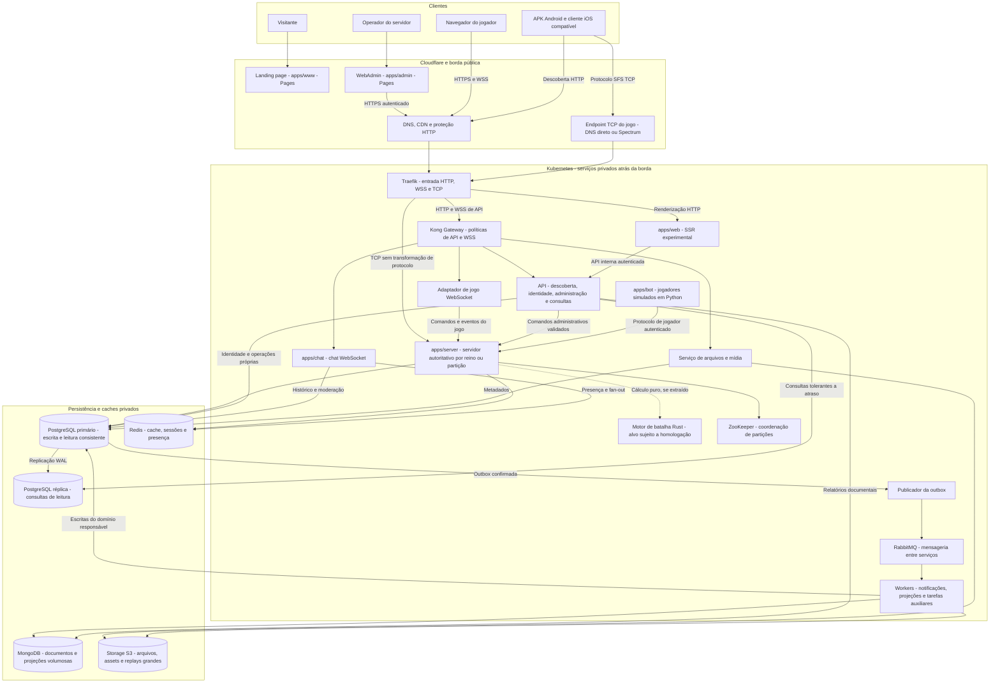
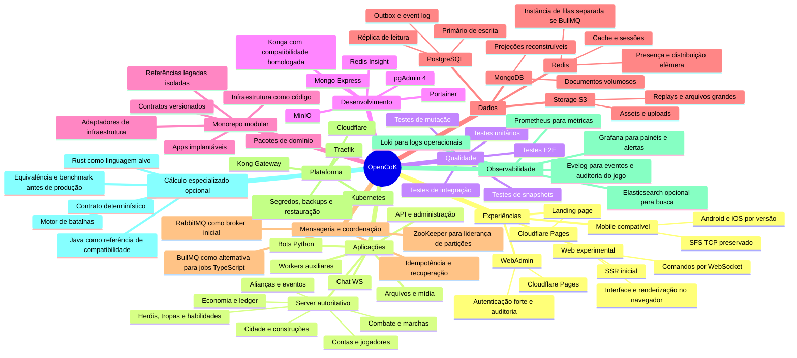
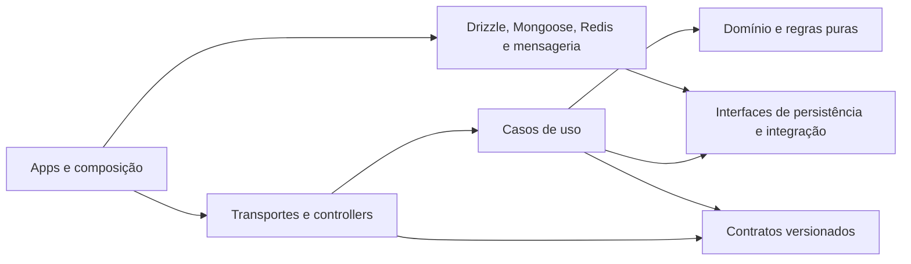
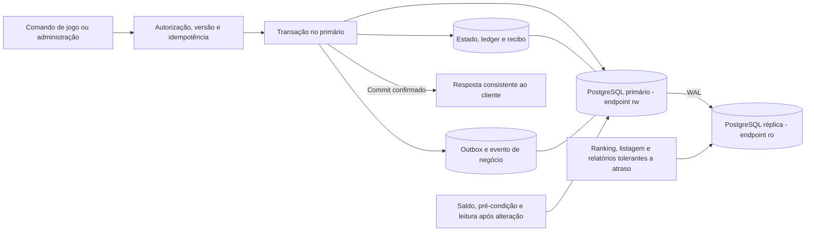
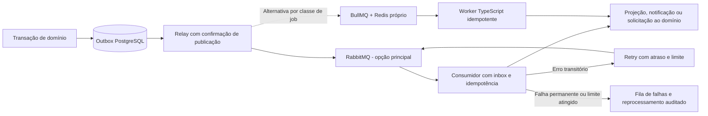
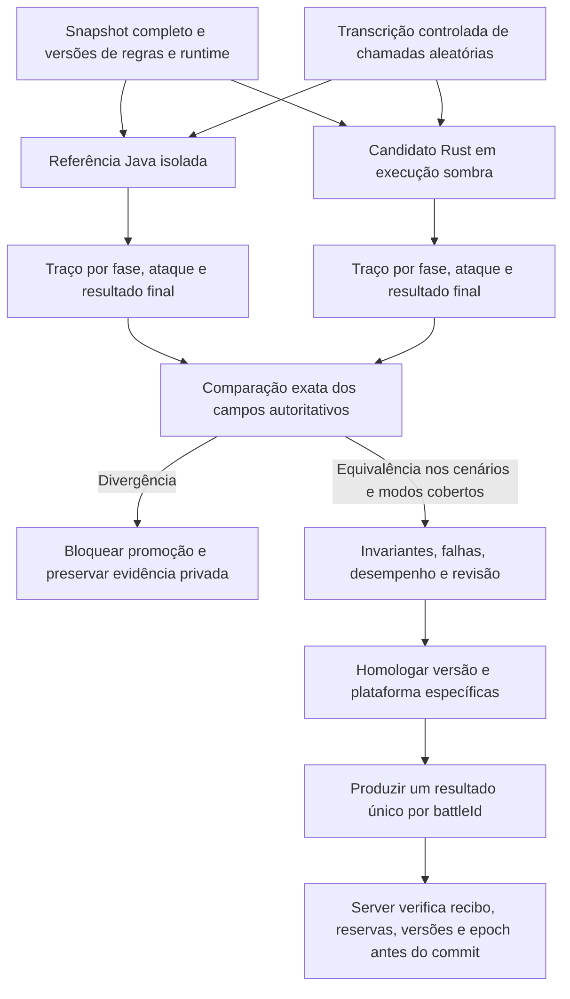
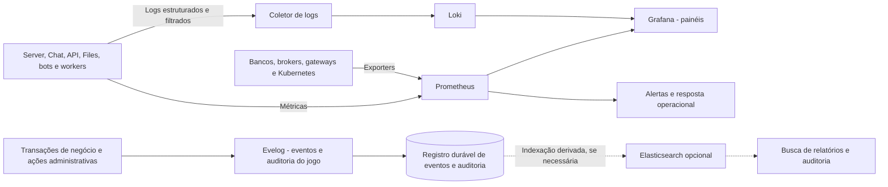

# OpenCoK — arquitetura de produção

**Estado:** arquitetura alvo, documentada em 23/10/2026. Os diagramas descrevem
o destino do projeto, não uma infraestrutura já implantada. Este checkout contém
a estrutura inicial do monorepo; diretórios e pacotes não comprovam implementação.

O objetivo é um monorepo modular com servidor autoritativo, chat WebSocket,
arquivos e serviços auxiliares independentes, painel administrativo, landing
page, cliente web experimental e bots Python. TypeScript/Bun é a base proposta
dos serviços de aplicação, preservando a possibilidade de processos em outras
linguagens quando houver uma necessidade medida.

A prova anterior com o APK v12.06.0 abriu cidade e tela do mapa usando Bun,
MariaDB, Redis e ZooKeeper. Essa evidência não valida PostgreSQL, Kubernetes,
o cliente web nem todos os sistemas do jogo. A passagem para a arquitetura
abaixo exige migração de dados e testes de compatibilidade próprios.

## 1. Visão geral — fluxograma



As setas de persistência representam conexões com permissões limitadas por
serviço. Elas não autorizam um processo a alterar tabelas de outro domínio.
O adaptador WS pode começar dentro de `apps/server`; separá-lo em processo
independente é uma evolução de implantação, preservando o mesmo contrato.

## 2. Mapa mental do projeto



## 3. Aplicações e limites de responsabilidade

| Aplicação | Execução proposta | Responsabilidade e limite |
| --- | --- | --- |
| `apps/server` | Bun, containers no Kubernetes | Autoridade sobre progresso, economia, construções, tropas, habilidades, marchas e combate. Cada partição tem um proprietário ativo. |
| `apps/chat` | Bun, HTTP + WebSocket | Sessões de chat, canais, autorização, presença, histórico e moderação. Escala separadamente do jogo. |
| `apps/files` — planejado | Bun e workers de mídia | Upload autorizado, validação, transformação, metadados e entrega de arquivos. Guarda os binários no storage S3. |
| `apps/api` — planejado | Bun, HTTP | Descoberta, autenticação, API de leitura e backend administrativo. Encaminha alterações de gameplay ao domínio autoritativo. |
| `apps/admin` | Cloudflare Pages | WebAdmin para gerenciar reinos, configurações, jogadores, NPCs, versões de regras e operação. Nenhuma credencial de banco no navegador. |
| `apps/www` | Cloudflare Pages | Landing page pública, documentação de acesso e informações públicas do projeto. |
| `apps/web` | SSR em container Bun no Kubernetes | Cliente web experimental: HTML inicial no servidor; interface, canvas/WebGL e interação contínua no navegador. |
| `apps/bot` | Python, containers no Kubernetes | Simula jogadores por contas e comandos normais do jogo; controla cenários, comportamento e intensidade. |
| `apps/workers` — planejado | Bun e processos especializados | Consome filas para notificações, projeções, arquivos, manutenção e integrações; separação por tipo de carga. |
| `apps/combat` — extração opcional | Rust como alvo; Java preservado até homologação | Calcula batalhas com contrato numérico explícito, snapshots e replay. Não escreve saldo, tropas nem recompensas diretamente. A recomendação não representa um motor Rust já implementado. |

Pages hospeda o painel e a landing page. Se precisarem de código no servidor,
Pages Functions executa no runtime de Workers, com sua compatibilidade própria;
não é o mesmo ambiente do Bun. O SSR do jogo fica inicialmente no Kubernetes,
evitando vincular o porte experimental a essa adaptação de runtime.
[Referência: Pages Functions](https://developers.cloudflare.com/pages/functions/).

O SSR entrega a entrada da aplicação e dados iniciais autorizados. A simulação
continua no servidor de jogo, e a renderização contínua ocorre no navegador.
O browser usa WSS; não depende de abrir o socket TCP nativo do APK.

## 4. Organização do monorepo

Os diretórios `apps/admin`, `apps/bot`, `apps/chat`, `apps/server`, `apps/web` e
`apps/www` já existem como estrutura inicial. `apps/api`, `apps/files`,
`apps/workers`, `apps/combat` e as subdivisões de infraestrutura abaixo são
propostas de organização; este documento não cria os serviços.

```text
opencok/
├── apps/
│   ├── server/         # composição do servidor autoritativo
│   ├── chat/           # HTTP e WebSocket do chat
│   ├── files/          # planejado: serviço de arquivos
│   ├── api/            # planejado: descoberta, consultas e backend do painel
│   ├── admin/          # WebAdmin -> Cloudflare Pages
│   ├── www/            # landing page -> Cloudflare Pages
│   ├── web/            # porte web experimental com SSR
│   ├── bot/            # simulador de jogadores em Python
│   ├── workers/        # planejado: execução de tarefas auxiliares
│   └── combat/         # opcional: cálculo especializado
├── packages/           # domínios, contratos e adaptadores compartilhados
├── infra/              # definições de execução e infraestrutura
│   ├── compose/        # proposto: desenvolvimento e testes locais
│   ├── kubernetes/     # proposto: workloads, serviços e políticas
│   ├── cloudflare/     # proposto: Pages, DNS e configuração de borda
│   ├── observability/  # proposto: painéis, métricas, logs e alertas
│   └── migrations/     # proposto: migrações e procedimentos de dados
├── mobile/             # clientes autorizados, patches e artefatos privados
├── legacy/             # referência de compatibilidade, isolada da aplicação
├── assets/             # assets próprios e manifestos autorizados
├── tests/              # proposto: E2E, contratos e fixtures sintéticas comuns
├── docs/               # contratos, decisões, operação e compatibilidade
├── .specs/             # especificações e critérios verificáveis
└── .github/            # contribuição, automações e arquitetura
```

### Grupos de pacotes

| Grupo | Pacotes existentes que podem assumir o papel | Regra de dependência |
| --- | --- | --- |
| Domínios | `account`, `player`, `building`, `city`, `hero`, `troops`, `combat`, `alliance`, `kvk`, `campaigns`, `npc`, `rules`, `ledger` | Regras puras e casos de uso; não importam sockets, controllers, ORM ou broker. |
| Contratos | `contracts`, `api-contracts`, `dtos`, `messages`, `events`, `enums`, `validations` | Schemas e envelopes versionados, com testes de compatibilidade. |
| Entrada e aplicação | `api`, `api-client`, `command`, `connection`, `controllers`, `middlewares`, `guard`, `identity`, `policy` | Validam e autorizam; chamam os casos de uso. Não duplicam regras econômicas. |
| Persistência e integração | `repositories`, `drizzle`, `mongoose`, `storage`, `queues`, `webhooks`, `notifications`, `email` | Implementam interfaces dos casos de uso. Escritas respeitam o proprietário do domínio. |
| Configuração e suporte | `config`, `env`, `errors`, `resources`, `i18n`, `constants`, `scripts`, `generators` | Dependências pequenas e explícitas, com validação de ambiente e recursos. |

Nomes como `core`, `base`, `share`, `helpers` e `utils` não devem acumular regras
de todos os domínios. Definir uma API pública para cada pacote e verificar ciclos
de importação no CI. Ter muitos pacotes não implica criar muitos microsserviços:
os módulos do jogo começam compostos em um servidor modular, com processos
separados onde existe uma responsabilidade ou carga independente.



Python e um possível motor nativo recebem contratos gerados a partir de schemas
JSON ou Protobuf; não importam arquivos TypeScript nem compartilham acesso livre
ao banco. Recursos de regras têm versão e hash, independentemente da linguagem.

## 5. Rede, Traefik e Kong

| Entrada | Caminho proposto | Política |
| --- | --- | --- |
| Landing e WebAdmin | Navegador → Cloudflare Pages | Conteúdo estático e frontend; painel protegido por identidade e permissões. |
| APIs públicas e administrativas | Cloudflare → Traefik → Kong → API | TLS, limites de corpo, autenticação apropriada, quotas e correlação. Autorização de domínio também no serviço. |
| Chat | Navegador/cliente → WSS → Traefik → Kong → Chat | Upgrade WS, validação de origem, sessão e autorização por canal. Rate limit de mensagens dentro do Chat. |
| Jogo web | HTTPS → Traefik → SSR; WSS → Kong → adaptador → Server | SSR sem cache público de dados privados; comandos seguem as regras do servidor. |
| APK TCP | Endpoint L4 → Traefik → Server | Preservação de SFS, limites de conexões e roteamento por reino/partição. Não atravessa plugins HTTP do Kong. |
| Arquivos | HTTPS → Kong → Files; downloads autorizados via CDN/storage | URL assinada quando necessária, limites de upload, MIME real e acesso privado por padrão. |

TLS protege HTTP e WSS de produção. A proteção do transporte do APK depende
do protocolo realmente suportado por sua versão; não se adiciona uma camada
TLS ao SFS sem validar o cliente. Borda, gateways e serviços têm timeouts,
limites de corpo/conexão e orçamentos de recursos próprios. Bancos, brokers,
ZooKeeper e interfaces administrativas da infraestrutura não são públicos.

Traefik é a entrada de rede do cluster. Kong concentra políticas de API HTTP e
WSS, sem se tornar um segundo controlador disputando as mesmas rotas. Serviços
internos usam a rede privada do Kubernetes, sem obrigatoriamente voltar pela borda.
Traefik suporta roteamento TCP; o caminho do protocolo legado deve ser testado
separadamente dos middlewares HTTP.
[Referência: roteadores Traefik](https://doc.traefik.io/traefik/v3.2/routing/routers/).

O proxy HTTP comum da Cloudflare não atende o TCP arbitrário do jogo em 9933.
Usar DNS direto para esse endpoint ou Spectrum, conforme suporte e plano
contratado; proteger o origin desse caminho separadamente. Não presumir que a
proteção HTTP se aplica ao socket SFS.
[Referência: portas Cloudflare](https://developers.cloudflare.com/fundamentals/reference/network-ports/).

Rotas novas podem usar `/api/v1/...`; aliases `.php` permanecem como adaptadores
para clientes antigos enquanto necessários. A alteração de endereço não altera
automaticamente o formato, a assinatura ou a semântica dos contratos legados.

## 6. PostgreSQL: escrita, leitura e autoridade

Os “dois bancos” são dois papéis de um conjunto replicado: uma instância
**primária de escrita** e uma **réplica de leitura** do mesmo conjunto de dados.
Não são duas bases independentes atualizadas manualmente. Endpoints/pools `rw`
e `ro` tornam a decisão explícita; o usuário SQL de leitura não recebe escrita.



Saldo, inventário, tropas, custos e pré-condições de comando usam o primário.
Uma leitura após uma construção confirmada também usa o primário ou o resultado
da transação. Rankings e relatórios podem usar a réplica com atraso informado.
Hot standby é somente leitura e pode apresentar dados atrasados; o serviço
não classifica toda requisição GET como segura para a réplica.
[Referência: PostgreSQL Hot Standby](https://www.postgresql.org/docs/current/hot-standby.html).

O primário mantém estado transacional e ledger; cada domínio possui seu schema
ou conjunto de tabelas e permissões. Separar pools de jogo, chat e administração,
limitar conexões e avaliar PgBouncer conforme o driver e as transações usadas.
Uma consulta lenta do painel não deve consumir o orçamento de conexões do jogo.

Replicação síncrona é a proposta para mutações econômicas confirmadas, alinhada
à meta de durabilidade da seção 24. Consultas e projeções continuam sujeitas a
atraso de aplicação na réplica; confirmar WAL não equivale a confirmar sua
aplicação em todas as consultas. A configuração efetiva deve ser homologada
antes da produção. Failover deve isolar o antigo primário,
atualizar endpoints e tratar transações de resultado incerto por idempotência.
Uma réplica não substitui backup ou restauração testada.
[Referência: replicação PostgreSQL](https://www.postgresql.org/docs/current/warm-standby.html).

## 7. MongoDB, Redis e armazenamento de arquivos

| Tecnologia | Dados previstos | Autoridade e recuperação |
| --- | --- | --- |
| PostgreSQL | Progresso, economia, contas, metadados, chat ativo e outbox | Autoridade transacional. Chat global/aliança sai do histórico ativo após 24h e expira aos 7 dias; detalhes na seção 20. Backup com recuperação pontual e testes de restauração. |
| MongoDB | Relatórios detalhados de batalha, documentos de simulação, projeções e arquivo temporário de chat | Documentos versionados por ID e schema. Chat global/aliança arquivado expira aos 7 dias contados do envio, não do arquivamento. Documentos únicos exigem backup próprio. |
| Redis de cache | Cache de consultas, sessões, presença, fan-out efêmero e limites de tráfego | TTL, invalidação e recuperação definidos. Não é o único registro de saldo, conclusão ou combate. |
| Redis de filas — se BullMQ | Jobs, retries e agendamentos auxiliares | Instância separada do cache, persistência e política `noeviction`. |
| S3 compatível | Avatares, assets, anexos, replays grandes, exportações e backups | MinIO ou R2 conforme a operação; objetos privados e políticas de retenção/versionamento. |

MongoDB alivia consultas e documentos que não precisam participar da transação
econômica. O primário guarda ID, versão e resumo necessários à consistência; um
worker publica o documento após o commit. Não fazer uma escrita obrigatória e
sem coordenação em PostgreSQL e MongoDB para aceitar o mesmo comando.

Filas, outbox, inbox e projeções têm retenção e limpeza por política explícita.
Históricos volumosos são particionados/arquivados por data, com índices e
orçamentos medidos. A janela de deduplicação cobre o período permitido de retry
e replay. A limpeza de jobs e projeções não remove o ledger autoritativo nem
registros necessários para recuperar uma operação ainda pendente.

“Dados maiores” não significa colocar arquivos arbitrários num documento BSON:
o limite por documento é 16 MiB. Replays ou binários grandes vão ao storage,
com referência e hash no documento; GridFS é alternativa apenas se houver um
caso operacional específico.
[Referência: MongoDB e GridFS](https://www.mongodb.com/docs/manual/core/gridfs/).

## 8. Mensageria: RabbitMQ e BullMQ

**Escolha inicial proposta:** RabbitMQ para comunicação assíncrona entre
linguagens e serviços. A presença do bot Python e de um possível motor de
cálculo favorece um contrato independente do runtime TypeScript.

BullMQ é uma alternativa para jobs controlados pelos workers TypeScript,
especialmente retries e agendamentos auxiliares. Não é necessário adotar os
dois para o mesmo trabalho. Se ambos existirem, cada fila terá proprietário,
contrato e responsabilidade definidos; não haverá publicação dupla informal.



Eventos contêm `eventId`, `eventType`, `schemaVersion`, `aggregateId`,
`aggregateVersion`, `occurredAt` e `correlationId`. Payloads grandes são
referenciados por ID; tokens e segredos não entram na fila. Consumidores lidam
com duplicatas, eventos fora de ordem e versões ainda não suportadas.

Assumir entrega **pelo menos uma vez**. O relay marca a publicação depois da
confirmação do broker; o consumidor confirma depois de persistir seu resultado.
Uma falha entre confirmação e atualização da outbox pode repetir o evento.
Inbox/recibos e chaves únicas impedem aplicar a mesma alteração duas vezes.
RabbitMQ exige tratar confirmações, reconexão e redelivery na aplicação.
[Referência: confiabilidade RabbitMQ](https://www.rabbitmq.com/docs/reliability).

No BullMQ, manter o Redis de filas separado das políticas de descarte do cache,
configurar persistência e testar recuperação de jobs interrompidos. Reiniciar
um worker não pode repetir uma recompensa.
[Referência: BullMQ em produção](https://docs.bullmq.io/guide/going-to-production).

Timers autoritativos de construção, marcha e combate permanecem registrados
como estado e prazos no PostgreSQL. Uma fila acorda o executor, mas não é a
única prova de que algo venceu; reconciliação recupera tarefas atrasadas.
Solicitações de jobs de outras linguagens usam contratos de broker/API, sem
escrever diretamente nas estruturas internas do BullMQ.

## 9. Servidor autoritativo, ZooKeeper e escala

O jogo inicia como monólito modular por reino. Chat, arquivos, SSR, bots e
workers têm processos próprios para que conexões e tarefas auxiliares não
consumam a capacidade reservada à simulação. Particionar o mundo é uma evolução
medida, com fronteiras explícitas de cidade, região ou reino.

ZooKeeper mantém registro de membros e eleição do proprietário de partições,
usando sessões e registros efêmeros. A perda de sessão suspende novas mutações
da partição até recuperar autoridade. Consultar ZooKeeper a cada ataque ou
movimento não faz parte do caminho normal de um comando.
[Referência: receitas ZooKeeper](https://zookeeper.apache.org/doc/current/recipes.html).

O protocolo de liderança inclui um `ownerEpoch` monotônico persistido no
PostgreSQL. Cada escrita autoritativa verifica o epoch vigente, bloqueando um
proprietário antigo que volte após pausa ou falha de rede. Uma eleição no
ZooKeeper, isoladamente, não impede esse processo antigo de continuar escrevendo.
Kubernetes fornece descoberta de serviços; ZooKeeper fica restrito à coordenação
do jogo, sem duplicar o controle do cluster ou o failover do PostgreSQL.

Não escalar um reino stateful apenas aumentando réplicas num Deployment.
Roteamento associa a sessão ao proprietário correto; troca de proprietário
requer drenagem, checkpoint, reconstrução do estado e reconexão. Ordenação por
agregado, locks/transações e versões de estado continuam necessários mesmo com
um único executor lógico por partição.

## 10. Cálculo de batalhas e bots

```mermaid
flowchart LR
  player[Jogador ou bot autenticado] --> command[Comando de combate]
  command --> reserve[Server valida e reserva recursos e tropas]
  reserve --> snapshot[Snapshot persistido e versionado]
  snapshot --> compute[Cálculo local ou serviço especializado]
  compute --> result[Resultado determinístico e hash]
  result --> check[Server verifica versões, epoch e idempotência]
  check --> commit[Transação aplica perdas, recompensas e evento]
  commit --> report[Worker produz relatório detalhado]
```



O motor recebe `battleId`, `rulesVersion`, `numericPolicyVersion`,
`rngAlgorithmVersion`, seed, versões dos agregados e snapshot completo. Produz
um resultado reproduzível, sem buscar estado mutável ou alterar bancos. O
servidor aplica o resultado uma única vez, validando reservas, versões e
`ownerEpoch`. Recursos não ficam presos em uma transação SQL aberta durante
o cálculo externo. Para comparar com o Java antigo, uma seed isolada não basta:
é necessário controlar todas as fontes de aleatoriedade, conforme abaixo.

### 10.1. Decisão de linguagem e critério de exatidão

**Linguagem alvo recomendada: Rust para o novo núcleo de cálculo.** A recomendação
combina compilação nativa, ausência de coletor de lixo no núcleo, tipos numéricos
explícitos e prevenção de classes de erros de memória no código seguro. Isso
permite controlar alocações e isolar o cálculo do loop de rede do Bun. Não é
uma afirmação de que Rust já superou Java em velocidade neste projeto: nenhum
benchmark de batalhas completas entre as duas linguagens foi executado.
[Referência: gerenciamento de memória em Rust](https://doc.rust-lang.org/book/ch04-01-what-is-ownership.html).

**Para preservar o comportamento existente antes dessa prova, manter o motor
Java como referência e, se necessário, executor de compatibilidade isolado.**
Um motor Rust só substitui um modo de batalha depois de homologação por modo,
versão de regras e plataforma. Não existe uma linguagem que garanta ausência
de erro de fórmula, arredondamento ou regra; o requisito é impedir que um
resultado não validado seja aplicado ao progresso.

| Opção | Avaliação para este projeto |
| --- | --- |
| **Rust** | Alvo do motor novo. Código seguro, operações verificadas e controle de alocação ajudam a construir um núcleo previsível. Requer reproduzir a semântica Java explicitamente e homologar a matemática usada. |
| **Java** | Menor mudança semântica para o motor já existente e oráculo da migração. Continua uma opção de produção se atender capacidade e latência; não há motivo para substituí-lo apenas por preferência de linguagem. |
| **C++** | Alternativa nativa viável, mas exige disciplina adicional contra acesso inválido, data races e overflow assinado. Não oferece uma vantagem demonstrada aqui que justifique esse custo frente ao Rust. |
| **TypeScript/Bun** | Mantém orquestração, validação e aplicação transacional. Usar `number` em todas as etapas não preserva os intermediários `float` do Java; o núcleo exigiria uma camada própria de compatibilidade e isolamento de CPU. |
| **Python** | Permanece nos bots e ferramentas de análise. Não é a escolha proposta para o loop autoritativo de batalha; decimal ou inteiro arbitrário, por si só, não reproduz o legado. |

### 10.2. Escopo e evidências da revisão Java

Revisão realizada em 23/10/2026 sobre as referências locais autorizadas do
workspace de recuperação, separado deste checkout de arquitetura. O levantamento
percorreu **3.586 arquivos Java** em `apps/server/modules`, identificou **28
arquivos e 6.002 linhas** no pacote central de batalha e **16 arquivos com
construção direta dos managers**. São contagens estáticas, não porcentagens de
cobertura de testes nem prova de que todos os caminhos foram executados.

A leitura dirigida acompanhou preparação, execução, resultados e aplicação
das perdas. A varredura também inventariou 34 arquivos de handlers/fábrica de
batalha do mundo, quatro arquivos de suporte a efeitos e os fluxos de bosses.
Dependências como perfis, marcha, hospital e eventos tornam o domínio maior
que uma única função de dano.

| Área da referência | O que foi observado e precisa entrar na especificação |
| --- | --- |
| `battle/manager/AbstractFightManager` | Preparação de participantes; turnos/subturnos; movimento; seleção de alvo; ataques de tropas, generais e dragões; dano; proteção do defensor; vitória e relatório. Os managers PVP, PVE, torre e desafio usam esse núcleo. |
| `battle/info/*`, `battle/role/*` | Atributos provenientes de XML e perfis, habilidades ponderadas, efeitos temporários, posições, forças, mortes e resto fracionário de dano. |
| `battle/manager/FightCalCache` | Cache contextual por papel/efeito/habilidade, invalidação por dependências e modo de comparação com recálculo. Mudar o cache pode mudar resultados se a invalidação estiver incorreta. |
| `gameengine/battle/*`, `UserProfile.getGameEffect` | Efeitos agregam várias fontes: VIP, equipamento, heróis, aliança, território, mundo, dragões e condições de evento. Parte depende de estado global e contexto de execução. |
| `world/normal/AbstractWorldFightHandler` e subclasses | Contexto PVP, cidade, recursos, território, reforços e outras modalidades; montagem das marchas; cálculo; distribuição de perdas; efeitos posteriores. |
| `WorldMarchGeneralArmy`, `FightResultObject`, bosses e relíquias | Perdas por participante, conversão de mortos em feridos, cura, proteção e modificadores por modo, além de efeitos periódicos fora do loop central. |
| `battle/report/*` | O contrato inclui a sequência de eventos/turnos usada pelo cliente, não apenas o lado vencedor. |

Para reduzir o risco de confiar numa reconstrução do decompilador, seis métodos
críticos foram confrontados com o **bytecode do JAR original**, usando `javap`
no JDK 8: dano convertido em baixas, ataque, defesa, poder, movimento e decisão
de acerto/dano. O bytecode confirma operações de ponto flutuante de 32 bits,
promoções para 64 bits e conversões para inteiro. Isso não constitui equivalência
integral entre todas as fontes recuperadas e todos os artefatos originais.

### 10.3. Riscos numéricos e comportamentais encontrados

| Evidência observada | Consequência para o motor novo |
| --- | --- |
| Mistura de `float`, `double`, `int`, parsing decimal e promoções intermediárias | `f32` e `f64` devem aparecer nos pontos correspondentes da avaliação. Um resultado guardado em `double` pode já ter perdido precisão numa multiplicação `float` anterior. |
| Uso de `Math.pow` com expoentes derivados de configuração | Copiar a fórmula para `powf` não prova equivalência de últimos bits ou de limiares inteiros. Fixar e homologar a implementação matemática. |
| Casts para inteiro, `floor`, `ceil` e `round` em lugares diferentes | Não substituí-los por uma função genérica de arredondamento. Preservar o momento de cada conversão, saturação e tratamento dos valores excepcionais. |
| `hurtAcc` conserva a parte fracionária do dano | Arredondar cada ataque sem carregar o resto muda o total de baixas ao longo da batalha. |
| Turnos, subturnos, ordem por lado/posição, torres, armadilhas e término antecipado | Paralelizar os ataques de uma batalha ou reorganizar o loop pode alterar alvos vivos, habilidades e vencedor. |
| `HashMap`, listas e multimap na formação, nas habilidades e nas somas | Ordenar tudo de outro modo não é uma otimização neutra. Capturar a ordem efetiva de entrada e explicitar os desempates. |
| `ThreadLocalRandom`, `Math.random`, `RandomUtil` com `SecureRandom`, `RandomUtils` e `Random` em helpers | Uma única seed não controla o legado. Comparação exige interceptar/reproduzir todas as chamadas aleatórias, seus tipos, limites e ordem. |
| Testes probabilísticos com limites e comparadores diferentes | Intervalos abertos/fechados, `<` e `<=` precisam de testes de fronteira; não normalizar todas as chances para uma Bernoulli genérica. |
| Efeitos podem consultar perfil, flags de função, reino e contexto durante o cálculo | Snapshot precisa capturar essas dependências e preservar os efeitos condicionais ao turno/alvo. Apenas serializar contagens de tropas é insuficiente. |
| Cálculo de resultado também contém regras e sorteios de recuperação | O replay deve cobrir a geração do resultado final, não terminar quando acaba o último ataque. Getters com efeitos não viram leituras livres e repetíveis. |
| Conversão para feridos e modificadores de modo acontecem fora do manager central | Comparar apenas dano ou vitória deixa de fora perdas reais, hospital e estado persistido. |
| Alguns inicializadores de habilidades capturam exceções e continuam | O Java de referência também pode produzir resultado degradado. Erros de configuração devem bloquear a homologação e exigir investigação, em vez de serem tratados como acerto do oráculo. |

O JDK também é parte do contrato. Fixar inicialmente o runtime de referência,
artefatos, arquitetura e recursos; não atualizar JDK ou trocar `Math` por
`StrictMath` e presumir resultados idênticos. A especificação de `Math.pow`
admite erro limitado em ulps, e não uma igualdade universal com qualquer
biblioteca nativa. [Referência: Java Math](https://docs.oracle.com/javase/8/docs/api/java/lang/Math.html).

### 10.4. Política numérica obrigatória do Rust

O primeiro perfil do motor é **compatibilidade com a versão Java homologada**,
não uma tentativa de tornar a matemática antiga “mais precisa”. Reproduzir
os tipos, a ordem das operações e os pontos de arredondamento observados.
Ponto fixo, decimal exato ou racional só podem substituir essas operações numa
nova versão explícita das regras, com análise do impacto no balanceamento.
Expoentes fracionários também exigem uma aproximação especificada; ponto fixo
não torna automaticamente toda a fórmula exata.

Conversões de quantidade, overflow e divisão recebem funções com política
explícita. Quantidades do estado usam inteiros com limites e operações
verificadas; intermediários podem usar largura maior para verificar limites.
Onde o perfil legado exigir uma semântica específica, ela fica numa função
testada, sem depender do comportamento diferente entre build debug e release.
Overflow ou entrada fora do domínio permitido não autoriza uma recompensa
negativa, wraparound ou saturação silenciosa no estado econômico.
[Referência: operadores e conversões Rust](https://doc.rust-lang.org/reference/expressions/operator-expr.html).

Criar adaptadores de semântica Java para arredondamento e conversões, com
vetores de fronteira. Por exemplo, `Math.round(-1.5f)` resulta em `-1`, enquanto
`f32::round(-1.5)` resulta em `-2`. Não trocar uma API pela outra por terem o
mesmo nome. [Referências: Java Math](https://docs.oracle.com/javase/8/docs/api/java/lang/Math.html),
[Rust f32](https://doc.rust-lang.org/std/primitive.f32.html#method.round).

`f64::powf` tem precisão não especificada entre plataformas/versões, portanto
Rust sozinho não garante replay idêntico. Homologar uma biblioteca ou
implementação matemática específica contra a referência; fixar toolchain,
dependências, flags e alvo. Começar com uma plataforma suportada e exigir os
mesmos vetores antes de liberar outra arquitetura. Não habilitar fast-math,
reassociação, aproximações ou FMA explícito sem provar equivalência da operação
afetada. [Referência: precisão de powf](https://doc.rust-lang.org/std/primitive.f64.html#method.powf).

IDs, timestamps e inteiros de 64 bits não atravessam JSON como `number` quando
isso perde precisão. Usar campos inteiros no contrato binário ou strings
decimais validadas; floats de referência podem exigir preservação dos bits no
snapshot e no replay. Versão e hash cobrem regras, política numérica e contrato.

### 10.5. Aleatoriedade, replay e aplicação segura



Na migração, registrar uma transcrição de sorteios com ponto de chamada,
índice, intervalo, tipo e valor/bits retornados. Java e Rust consomem a mesma
transcrição; chamada extra, ordem diferente ou transcrição não consumida são
divergências. Para o motor novo, especificar um PRNG e um mapeamento de intervalos
versionados, com seed de origem segura e estado independente por batalha.
Esse PRNG não torna o Java antigo reproduzível sem a adaptação de todas as fontes.

O snapshot captura participantes, formações, habilidades, atributos, efeitos
condicionais, flags, tipo de batalha, contexto de reino e configurações completas
necessárias. O cálculo não busca `UserProfile`, XML mutável, banco, relógio real
ou serviços globais durante o replay. O instante efetivo do combate faz parte
da entrada quando uma regra depende do tempo.

Uma solicitação produz um resultado final imutável e um hash; consultar ou
reenviar a mesma solicitação não sorteia cura novamente nem reaplica perdas.
O recibo de aplicação, ledger, alterações e evento são confirmados na mesma
transação autoritativa. Em timeout, resultado incerto ou falha de infraestrutura,
consultar o recibo e retomar a mesma operação. Se o cálculo violar um invariante,
ficar pendente para investigação/reprocessamento seguro; não escolher o vencedor
por fallback ou confirmar o resultado parcialmente.

### 10.6. Testes e critérios para liberar um modo de batalha

1. **Referência congelada:** inventário de artefatos originais, recursos, flags,
   runtime e protocolo; cenários sintéticos e dados privados somente no ambiente
   autorizado. Confrontar trechos ambíguos do decompilador com bytecode.
2. **Primitivas numéricas:** parsing, promoções `f32`/`f64`, casts, overflow,
   divisão, potências, limites, negativos, NaN e infinitos. Rejeitar valores
   excepcionais fora do contrato antes de aplicar o resultado.
3. **Equivalência por fase:** formação, alvos, sorteios, habilidades, status,
   dano inteiro, resto fracionário, forças, proteção, vencedor, cura, feridos,
   mortes e distribuição por participante. UUIDs e tempos de geração do
   relatório podem ser normalizados; perdas e decisões não recebem tolerância.
4. **Cobertura de modos:** PVE/PVP, cidade, recurso, território, tropas com
   estrelas, armadilhas/torres, generais, dragões, bosses e modos especiais
   autorizados, cada um com limites e flags próprios. Modos ainda não validados
   permanecem indisponíveis no motor novo.
5. **Casos de fronteira e propriedades:** entrada vazia ou inválida, uma unidade,
   dano quase inteiro, efeitos negativos e máximos, chance zero/total, empate,
   limite de turnos, reativação de status, proteção e capacidade de hospital.
   Conservação de tropas usa categorias disjuntas; cura é uma transição, não
   criação de unidades. Fuzzing gera casos e minimiza divergências.
6. **Efeitos colaterais:** retry, crash após cálculo, crash após commit, entrega
   duplicada, resultado atrasado, mudança de proprietário e versão antiga de
   regras. Provar que perdas e recompensas só são aplicadas uma vez.
7. **Liberação controlada:** execução sombra, comparação com referência,
   inspeção independente e ativação por versão/modo. Divergência autoritativa
   conhecida bloqueia a promoção. Guardar entradas, sorteios e versões para
   auditoria e replay privado.

O Java é referência de comportamento, não prova de correção absoluta. Uma
inconsistência confirmada no legado precisa de decisão de regra e teste de
regressão próprios; não copiar um erro silenciosamente nem corrigi-lo no meio
de uma migração sem versionamento. Ausência de divergências num conjunto de
testes também não é uma prova matemática de ausência de bugs.

### 10.7. Verificações executadas e desempenho ainda pendente

Além da inspeção estática e da leitura de bytecode, foram executadas sondas
numéricas independentes em **Temurin 8.0.504** e **Rust 1.99.0 com otimização**.
Elas são exemplos sintéticos de semântica, não um porte do código privado nem
batalhas completas. Exemplos observados:

| Sonda sintética | Resultado observado | Implicação |
| --- | --- | --- |
| Quantidade `16.777.217` passa por `float` antes de retornar a inteiro | `16.777.216`; o caminho só em `double` mantém `16.777.217` | Promover tudo para 64 bits pode mudar uma unidade. |
| Dez incrementos com resto fracionário, usando `0.1f` promovido a `double` ou `0.1` diretamente | Primeiro caminho contabiliza `1`; o segundo contabiliza `0` nessa sequência de piso e transporte do resto | Parsing e precisão intermediária afetam acumuladores. |
| Arredondamento de `-1.5` | Java `-1`; Rust padrão `-2` | A tradução direta de arredondamento já diverge. |
| Piso e cast de `-1.2` | Piso `-2`; cast para inteiro `-1` | Truncar e arredondar para baixo são operações diferentes. |

Não foram executados nesta revisão testes diferenciais de batalhas completas,
benchmark de throughput/p99, homologação de Rust para combate ou prova de
correção de todos os efeitos. Nenhum motor, regra, dado de jogador ou deploy
foi alterado por esta revisão documental.

Antes da extração, medir preparação do snapshot, cálculo, serialização, fila,
rede, validação e commit separadamente. Comparar Java aquecido e Rust otimizado
no mesmo hardware, entradas, sorteios e regras, incluindo batalhas pequenas,
grandes e muitas batalhas simultâneas. Registrar CPU por batalha, alocações,
memória máxima, throughput, p50/p95/p99 e tempo total percebido pelo jogador.
Os orçamentos de capacidade devem ser definidos antes de selecionar o vencedor
do benchmark. Uma chamada remota por ataque não faz parte do desenho.

Otimizar primeiro dados compactos, configuração compilada/versionada, redução
de parsing e alocações, cache validado e paralelismo entre batalhas independentes.
A sequência interna de uma batalha permanece serial até que uma transformação
seja provada equivalente. Avaliar processos Rust separados do Bun para conter
panics e cargas de CPU; biblioteca/FFI só depois de medir custo e isolamento.

### 10.8. Bots e NPCs

Bots Python consomem os mesmos comandos, custos, limites e autorizações de um
jogador. Contas simuladas têm marcação explícita, quotas, limite de concorrência
e chave de desligamento no painel. Eles não escrevem diretamente no banco.
Bots que se comportam como jogadores são diferentes de NPCs internos do mundo:
estes últimos pertencem ao módulo `npc` e à simulação autoritativa.
Execução em produção começa com cenários e população limitados, medindo impacto
na economia e capacidade, sem privilégios administrativos implícitos.

## 11. WebAdmin e controle das regras

O painel gerencia configurações, estatísticas, habilidades e regras por comandos
administrativos versionados. Cada alteração registra operador, motivo, valor
anterior, novo valor e escopo. Uma operação econômica usa os mesmos invariantes
do servidor e gera ledger; não é um editor SQL exposto no navegador.

Regras seguem o fluxo `rascunho → validação → simulação → publicação versionada`.
Batalhas já aceitas continuam vinculadas à sua versão; uma atualização não
muda silenciosamente cálculos em andamento. Rollback ativa uma versão anterior
para novas operações, com migração explícita se o estado persistido exigir.

Cloudflare Access/identidade corporativa pode proteger a entrada do painel,
mas o backend também valida identidade, funções e escopo de reino. Operações
críticas exigem autenticação reforçada e têm limites próprios. Frontends usam
HTTPS, cookies/tokens apropriados, proteção CSRF quando aplicável e CORS por
origens autorizadas; páginas privadas não entram no cache público.

## 12. Observabilidade, Evelog e busca



Prometheus coleta métricas; Loki centraliza logs; Grafana consulta e apresenta
os dois. Alertas cobrem atraso de filas, falhas de comando, conexões, consumo de
CPU/memória, replicação, latência por operação e falha de proprietário de partição.
Definir SLOs e capacidade a partir de testes de carga, não de uma quantidade
presumida de jogadores por pod.

Logs operacionais registram correlação, componente, operação conhecida, duração
e motivo controlado. Evitar payloads de jogadores, credenciais, tokens e chaves.
IDs de alta cardinalidade não viram labels de Loki ou séries por jogador no
Prometheus; a busca usa campos estruturados quando autorizados.
[Referência: cardinalidade no Loki](https://grafana.com/docs/loki/latest/get-started/labels/cardinality/).

**Evelog:** denominação do registro de eventos e auditoria do jogo, conforme
confirmado pelo operador; não representa uma ferramenta externa. O desenho
propõe um registro append-only no PostgreSQL, ligado à outbox, com detalhes
volumosos arquivados em MongoDB/storage conforme retenção. Eventos registram
ação, origem, versão de regras, correlação e resultado, com acesso restrito.
Isso não exige adotar event sourcing para todo o estado do jogo e não substitui
os logs operacionais do Loki.

Elasticsearch permanece opcional: usar somente se buscas e filtros em relatórios
justificarem o custo de um índice separado. Ele recebe projeções reconstruíveis,
com controle de acesso e deleção; sua indisponibilidade não bloqueia combate,
login ou gravação de progresso. Loki permanece o destino principal de logs.

## 13. Kubernetes, entrega e continuidade

| Camada | Implantação proposta |
| --- | --- |
| Entrada | Load balancer, Traefik e Kong, com configuração declarativa e health checks. |
| Aplicação | Deployments para APIs, Chat, SSR e Files; workers por classe de tarefa; Server com política explícita de propriedade de partição. |
| Dados | Serviços gerenciados ou operadores/StatefulSets com volumes persistentes, anti-affinity e distribuição por domínio de falha. |
| Coordenação | ZooKeeper em ensemble de três membros distribuídos; sem dados de gameplay como conteúdo de coordenação. |
| Isolamento | Namespaces, NetworkPolicies, contas de serviço, RBAC e segredos separados por ambiente e responsabilidade. |
| Observabilidade | Prometheus, Loki, Grafana, exporters e coleta com retenção e orçamento próprios. |

Um StatefulSet fornece identidade e associação de volumes, mas não implementa
sozinho replicação, backup ou failover de um banco. Persistência e recuperação
dependem do componente/operador escolhido e da infraestrutura de armazenamento.
[Referência: StatefulSets](https://kubernetes.io/docs/concepts/workloads/controllers/statefulset/).

Os dois endpoints PostgreSQL não limitam a implantação a duas máquinas. A
quantidade de réplicas, zonas e membros de quorum depende das metas de
disponibilidade. RabbitMQ e MongoDB também precisam de topologia e política de
quorum próprias; Redis de produção precisa de estratégia explícita de failover.
Kubernetes não transforma um único disco em armazenamento altamente disponível.

```mermaid
flowchart LR
  change[Alteração no monorepo] --> ci[Tipos, lint e testes unitários]
  ci --> contracts[Integração, snapshots e contratos]
  contracts --> mutation[Testes de mutação dos módulos críticos]
  mutation --> artifacts[Artefatos imutáveis e imagens versionadas]
  artifacts --> staging[Staging com dados sintéticos]
  staging --> e2e[Testes E2E por cliente e versão]
  e2e --> load[Testes de carga, falha e restauração]
  load --> release[Release com migrações compatíveis]
  release --> pages[Deploy de Admin e WWW no Pages]
  release --> k8s[Deploy gradual de serviços no Kubernetes]
  k8s --> observe[Observar SLOs e integridade]
  observe -->|Regressão| rollback[Rollback de aplicação e tratamento explícito do schema]
```



Deploys drenam conexões, limitam tempo de shutdown e permitem reconexão. HPA
escala componentes stateless e workers dentro do orçamento de banco/broker;
Chat requer fan-out entre pods e recomposição de presença. O Server escala
por partições controladas, sem criar dois escritores do mesmo estado.

Backups abrangem PostgreSQL/WAL, documentos não reconstruíveis do MongoDB,
objetos S3, configurações de regras e segredos operacionais. Definir RPO/RTO,
retenção, criptografia e testes periódicos de restauração. Restaurar metadados
e arquivos deve manter referências consistentes. Métricas de backup bem-sucedido
não substituem a comprovação de que a restauração funciona.

## 14. Falhas e degradação esperada

| Falha | Comportamento requerido |
| --- | --- |
| PostgreSQL primário | Suspender novas mutações; reconectar com timeout; resolver resultado incerto por recibo/idempotência. Não confirmar economia somente em memória. |
| Réplica atrasada | Consultar o primário para dados consistentes; reduzir relatórios ou informar atraso, sem sobrecarregar o primário com fallback ilimitado. |
| Redis de cache | Reduzir funcionalidades dependentes e aplicar fallback com limite; autenticação e quotas falham de forma explícita quando não houver alternativa segura. |
| Broker ou worker | Preservar a outbox e mostrar pendência; reprocessar sem duplicar efeitos. Impor limites de backlog e contrapressão. |
| ZooKeeper/sessão | Parar mutações da partição afetada até reafirmar propriedade; recusar epochs antigos. |
| Chat | Jogo continua; chat informa indisponibilidade e recupera histórico pela fonte persistida. |
| Files/MongoDB/busca | Upload, documentos e buscas degradam; comandos centrais não esperam indefinidamente por esses serviços. |
| Motor de batalha externo | Manter reserva recuperável e resultado pendente; timeout, retry idempotente e reconciliação. Não criar vitória fictícia. |
| Observabilidade | Conservar comportamento do jogo; buffers limitados e descarte controlado de logs operacionais, sem perder o registro transacional de auditoria. |
| Bots | Parar os simuladores sem interromper jogadores; permitir desligamento rápido por escopo. |

## 15. Sequência de evolução e decisões pendentes

1. **Contratos e core:** estabilizar login, cidade, construção persistente e mapa;
   criar testes diferenciais e cenários sintéticos por versão de cliente.
2. **Servidor modular:** consolidar domínios e adaptadores; separar Chat, Files,
   API administrativa e workers, com limites de conexão e recursos.
3. **Migração PostgreSQL:** mapear tipos e inteiros de 64 bits, IDs, timestamps,
   saldos, sentinelas de filas e transações; ensaiar cópia e reconciliação. Não
   trocar apenas o driver nem manter escrita dupla informal com MariaDB.
4. **Corte de dados:** copiar com backup, verificar contagens e invariantes,
   sincronizar o delta final numa janela controlada e escolher um único
   escritor. O retorno após novas escritas exige reconciliação planejada.
5. **Painel e borda:** publicar Admin e WWW no Pages; implantar identidade,
   auditoria e versionamento de regras; habilitar Kong e contratos de API.
6. **Produção controlada:** validar Kubernetes, replicação, backups, failover,
   observabilidade e carga antes de ampliar reinos e população de bots.
7. **Experimentos independentes:** evoluir o porte web e medir a necessidade
   de MongoDB, Elasticsearch, BullMQ complementar e motor de cálculo separado.

Decisões ainda abertas: homologação numérica e benchmark do motor Rust;
framework e contrato do cliente web; operador/serviço de PostgreSQL; storage
MinIO ou R2; topologia de HA e metas RPO/RTO; necessidade real de Elasticsearch;
   uso exclusivo de RabbitMQ ou divisão explícita de workloads com BullMQ.

Clientes em `mobile/` e referências em `legacy/` mantêm separação entre entradas
originais, patches e artefatos de instalação. Originais extraídos e chaves são
somente leitura; builds usam área separada. Materiais privados, dados de
jogadores e credenciais não entram no código ou nos diagramas. Nenhuma etapa
deste documento autoriza reset de progresso, execução de migrações ou deploy.
