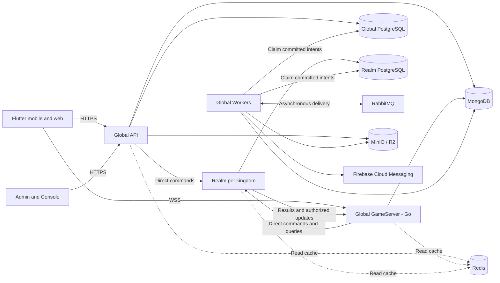

# OpenCoK Architecture

## Purpose and scope

OpenCoK is a self-hosted persistent strategy game with a shared Flutter + Flame client for mobile and web. Accounts and platform capabilities are global; character progress and gameplay authority belong to isolated kingdoms. OpenCoK owns its rules, account model, contracts and release lifecycle. Updates preserve valid accounts and progress.

This document defines system boundaries, infrastructure choices and cross-system guarantees. Detailed gameplay rules, commercial policies, schemas, endpoints, storage layouts and operating procedures belong in their respective designs. Accepted choices below are architectural decisions; runtime compatibility and recovery still require implementation evidence.

## System structure

API, Realm and Workers use TypeScript on Bun. Effect handles dependency composition, resource lifecycle, concurrency and typed failures in those applications; application-owned classes and Facades express use cases and domain rules. Effect scopes and repository Unit of Work share an explicit transaction context. Dependencies and production behavior must be validated on Bun. GameServer uses Go with native concurrency, explicit interfaces and bounded resource lifecycles; it does not depend on Bun or Effect.

API, GameServer and Workers are global applications serving multiple kingdoms and may have multiple replicas. Realm is deployed per kingdom with one logical authoritative gameplay writer. Bots/NPCs run in a separate bounded TypeScript/Bun automation application.

Connections indicate scoped owned operations. API and GameServer never write realm gameplay directly. Workers may update jobs, delivery receipts and projections under scoped credentials; authoritative changes go through the owning application.

| Application | Responsibility |
| ----------- | -------------- |
| API | Identity, accounts, kingdom discovery/admission, payments, media and account/operator HTTP interfaces. Gameplay provisioning, grants and administration become idempotent Realm commands. |
| GameServer (Go) | WSS connections, session admission, heartbeat, quotas, bounded buffers, Realm routing, authorized delivery, Chat and Social Delivery. Realm independently checks participant scope and authority. |
| Realm | Characters, cities, economy, inventory, troops, world, alliances, marches, gathering, combat, events and reward entitlement. Player and World share one transactional authority. |
| Workers | Committed background work: document publication, projections, email, push notifications, media processing, reconciliation and global maintenance. Executors have separate bounded workload budgets. |
| Automation | Bots/NPCs use the same versioned WSS contracts as players, with scoped credentials and no direct Realm store access or imports of private Realm implementations. |

Chat owns messages and conversation metadata in MongoDB, with authorized replay, deduplication and retention. Realm owns alliance membership; leaving or expulsion revokes channel access, including after reconnect. Global/alliance messages are archived after one day and deleted, including archives, seven days after sending. GameServer replica routing, fan-out and revocation require an explicit protocol independent of Redis.

## Modules and application design

Applications statically compose modules with explicit dependencies and public interfaces. TypeScript applications use Facades, command handlers, domain classes, repositories and query objects. Go GameServer modules use explicit interfaces and structs for their owned responsibilities. Reusable packages never import executable applications. Domain rules do not depend on transport or database startup. There is no initial dynamic plugin loader or independently deployed service per domain.

Internal CQRS separates mutations from representations without requiring Event Sourcing or separate services. The command handler owns one Unit of Work; participating repositories share the same Kysely transaction. Facades do not hide process-global mutable state or permit direct cross-module database writes.

Queries may use PostgreSQL directly or owned MongoDB projections, with explicit staleness. Successful commands return recorded results and state versions. Immediate-consistency reads use the authoritative store or an explicit projection watermark.

## Persistence and ownership

### PostgreSQL

PostgreSQL is the durable authority for accounts, economic effects, gameplay state, entitlement, receipts and required integration intent. Initially, one global database and one database per kingdom share a PostgreSQL instance. Credentials, migrations and connection/work budgets are scoped by owner; CPU, memory, disk and outage risk are shared. A kingdom database must be movable to another instance without changing gameplay contracts.

Kysely provides typed SQL and migration tooling. Application repositories and Unit of Work implement persistence boundaries. Relational columns hold identities, exact balances, constraints, versions, deadlines and indexed fields; JSONB holds structured aggregate state. Boundaries follow atomicity, contention and update frequency. Domain classes remain independent of database row types.

Economic changes, ledger entries, operation receipts and outbox records commit in one transaction. Repositories must not independently commit fragments of that effect. Important queries and lock behavior require representative plan/contention checks. Migrations are explicit, ordered and versioned, with one application-owned history per database; schemas are never synchronized automatically from classes at startup.

### MongoDB and object storage

MongoDB owns document content and rebuildable projections, with the category and owning module declared per collection.

| Data | Durable authority | Document or asset representation |
| ---- | ----------------- | -------------------------------- |
| Accounts, provider links, payments and global entitlement | API PostgreSQL | Account/support views |
| Character progress, balances, inventory, troops, marches and combat outcomes | Realm PostgreSQL | Profile/map projections and detailed reports |
| Deadlines, ranking finality, reward claims, ledger and gift entitlement | Owning PostgreSQL database | Published boards, mail bodies and notifications |
| Chat, conversations, preferences, layouts and other original document content | Named module in MongoDB | Versioned documents with retention |
| Runtime configuration, rules and catalogs | Immutable MongoDB publications | In-memory snapshots and published client/Wiki artifacts |
| Required jobs and integration intent | Owning PostgreSQL outbox/job records | Execution/support histories |
| Media and release bytes | S3-compatible object storage | PostgreSQL access/lifecycle metadata and owned descriptions |

Collections require validators, schema versions, indexes, bounded documents, authorization and retention. Unbounded histories are separate from hot metadata. Original documents require backup; projections require a documented reconstruction source.

There is no transaction across PostgreSQL and MongoDB. Workers publish after commit using stable identities and idempotent writes. Retain immutable outcomes and rule versions so publication never rerolls combat or reconstructs results from changed state. Publication failure cannot lose acknowledged entitlement. Change streams may accelerate observation but do not replace durable intent and reconciliation; TTL is eventual cleanup, never gameplay scheduling.

MinIO is used in development and Cloudflare R2 in production. Private uploads/receipts are separate from public immutable assets. API authorizes access and uploads; isolated bounded Workers transform media. Lifecycle cleanup retries independently of accepted uploads. Detailed access, replacement and delivery policies remain module-level design work.

## Configuration and cache

Deployment files/environment injection own endpoints and resource budgets; the deployment secret mechanism owns credentials and signing material. MongoDB owns versioned global/realm settings, rules and catalogs. Configuration is loaded into validated immutable in-process snapshots, never Redis.

Configuration follows draft, validation, publication and activation. Publications are immutable. A process loads a complete snapshot before atomically replacing its active reference. Realm activates gameplay rules at a command-processing boundary and records accepted versions with activities. In-flight work retains its accepted rules; production settles prior accrual before rate changes. Activation does not rewrite earned resources or accepted costs.

Instances report desired and active versions and reconcile against durable publications after missed notifications. Running instances may continue with a validated snapshot under defined outage policy. Fresh instances require the needed durable version or an explicitly supported persisted artifact. Retain versions needed by in-flight work and recovery. Publication/activation APIs and internal notification transport remain open.

Unleash handles feature admission and kill switches, separately from economic rules and Redis. Flags cannot establish reward entitlement or change competitive rules through player-level experiments. Cached feature behavior during outages needs explicit policy.

Redis is exclusively disposable read cache. It never owns configuration, progress, entitlement, sessions, Realm ownership, queues or required delivery. Use scoped/versioned keys, bounded memory, eviction, TTL, miss concurrency and post-commit invalidation that accounts for stale in-flight fills. Cache failure must not create unbounded fallback load; optional reads degrade when the backing store is saturated.

## Authoritative execution and recovery

Gameplay commands carry realm, authenticated participant, operation identity, contract version and expected aggregate version where needed. Realm checks authority and preconditions and atomically commits state, ledger, receipt and outbox. Duplicates return the recorded result; reusing an identity with different input is rejected. Receipt scope and retention cover supported retries and recovery.

A timeout means an uncertain outcome. Resolve it through operation lookup; never speculate by refunding, releasing troops or applying another economic effect. Result delivery retries independently of execution. API global intent and its Realm effect are separate confirmations, reconciled durably after uncertain outcomes.

Each Realm acquires a monotonically increasing PostgreSQL owner epoch. Every authoritative transaction protects its epoch check against concurrent ownership replacement through locking or conditional writes. A prior epoch read, discovery record or lease alone is insufficient. Lost authority stops admission. Scale by kingdom placement first; splitting Player and World writers is outside the initial design.

Realm's Scheduler discovers persisted deadlines in bounded indexed batches and invokes the same transitions as foreground access and reconnect. Due time, generation and predecessor ordering are checked with stable transition identities. Restart catches up in bounded work rather than one persistent timer per player. Exact arithmetic preserves fractional production and caps; reward claims and completions are idempotent.

World placement uses bounded spatial queries and persisted occupancy constraints, rechecked at commit. Marches persist reservations, accepted rules and transition checkpoints; return cannot duplicate troops, cargo or rewards. Combat runs reproducibly from immutable snapshots in a bounded Realm execution pool. Persist rule/random outcomes and recheck authority, input versions and reservations before committing. Detailed combat arithmetic and gameplay policies belong to domain designs.

## Contracts, clients and sessions

### Shared contracts

The TypeScript backend authors Zod runtime schemas and derives TypeScript contract types from them. TypeScript interfaces remain appropriate for internal domain and application boundaries; wire shapes must not be maintained independently of their schemas. External inputs are runtime-validated, and wire schemas use an exportable subset without backend-only transformations. GameServer consumes generated Go bindings and validates external messages against the same exported contracts; it does not execute Zod or maintain separate handwritten wire schemas. The first map slice uses the repository generator in `packages/contracts/scripts/generate.ts`; support beyond its documented schema subset remains future work.

Use JSON over HTTPS and versioned binary packets over WSS. The initial connection bootstrap uses the `opencok.binary.v1` WebSocket subprotocol; its fixed byte layout, heartbeat, limits and shared Go/Dart fixtures are defined in [gameserver/PROTOCOL.md](../gameserver/PROTOCOL.md). This is an OpenCoK protocol, not an SFS2X-compatible implementation. The current bootstrap is explicitly handwritten in Go/Dart; it contains no gameplay payloads and is the temporary exception to generated contract bindings above. The first read-only world query uses Zod schemas and a small in-repository binary codec generator for bounded u32 fields, UTF-8 strings, arrays and required objects. Generated Go/Dart codecs and shared TypeScript/Go/Dart fixtures enforce parity; see [gameserver/PROTOCOL.md](../gameserver/PROTOCOL.md). Export schema definitions from Zod into the OpenAPI contract; generate Dart models and the HTTP client with OpenAPI Generator (`dart-dio`). Realtime payloads use generated binary codecs through a WSS adapter, not generated HTTP methods; their semantic schemas must agree with the exported API contracts. Generated decoding and runtime validation must reject malformed required fields and unknown message kinds; TypeScript/Go/Dart fixtures and generation checks establish contract parity. Backend validation remains authoritative. Exact wire encodings for large identifiers, balances and counters must avoid JavaScript/browser precision loss; their field-level definitions remain protocol design work.

Patch releases within a supported `0.<minor>.x` line preserve contract compatibility. A different minor line is accepted only when the server explicitly supports it. Admission checks the declared client/protocol version and rejects incompatible clients before gameplay, with an update-required result. Content manifests also declare compatible client/catalog versions.

### Connection bootstrap and presence

The first implemented slice is a standalone Go GameServer and Flutter connection over binary WS locally (WSS behind TLS in production). A two-byte version/opcode header covers admission and application heartbeat packets; no polling or database writes are needed to keep a connection alive. The server bounds total connections including pending handshakes, message sizes, admission/read/write deadlines and heartbeat work. Flutter waits for admission, observes connection state and reconnects with capped exponential backoff and jitter. It closes on mobile pause and reconnects on resume.

Current presence is anonymous, in memory and local to one process. A completed handshake counts as an online session; disconnect, heartbeat timeout or shutdown removes it. The health endpoint reports only aggregate admitted sessions. This slice does not yet establish authenticated player presence, one session per account, cross-replica admission or gameplay authority. API-backed identity/admission and replica revocation are required before those guarantees apply. See the [GameServer run instructions](../gameserver/README.md).

### Identity and active sessions

Firebase Authentication supports Guest, Facebook, email/password, Google and Apple. API verifies provider tokens and maps identities to stable internal accounts. Linking a Guest to a provider preserves the account and progress. An unlinked Guest is not recoverable after losing its credentials; there is no separate Guest recovery flow.

Only one active player gameplay session/device is allowed per account. Backend-owned session replacement and revocation enforce this across GameServer replicas; Firebase sign-in alone does not enforce it. Player admission disconnects the Bot controlling the same character, and automation cannot take over while that player session is active. Detailed token lifetimes, refresh and handover protocols remain session design work. Operator authentication/roles and service credentials are separate from player sign-in.

GameServer handles bounded connections, payloads, subscriptions and outbound buffers; Realm independently authorizes commands and visibility. Reconnect uses a consistent snapshot with a watermark followed by versioned updates. Gaps outside bounded replay require a fresh snapshot. Interrupted operations resolve through receipts. Expiry, revocation, mobile resume and server drain belong to this recovery contract. An API/identity-provider outage alone must not invalidate an already admitted session.

Firebase Cloud Messaging provides push notifications through Workers. Push is advisory and separate from WSS updates and internal configuration notifications: it cannot confirm a command or establish entitlement. Clients fetch authorized current state on return. Platform support, permission handling and delivery receipts belong to the notification design.

### Flutter and downloaded assets

Flutter owns screens/forms/HUD; Flame owns city/map scenes and animation. Server-confirmed state is separate from presentation. Client state/navigation choices remain client design work.

A platform-independent asset repository downloads, verifies, activates and reuses immutable versioned assets. Keep a small required base and download optional content on demand, with bounded storage and version-aware cleanup. Manifests identify hashes, sizes, dependencies and compatible releases. Stage downloads separately and activate only complete verified versions, retaining a usable prior release after interruption.

Use content-appropriate compression and optimized media formats, with bounded download and decompression work. Packaging should allow optional content to be fetched independently. Specific codecs, package sizes and prefetch policies require measurement against Flutter/Flame and target devices.

Mobile uses persistent application-private files; credentials use platform credential stores separately. Web uses persistent browser-managed storage, with quota/eviction recovery and cross-tab activation coordination. The browser adapter remains open: Cache Storage plus IndexedDB is a candidate, with OPFS for file-like workloads. No bulk assets in localStorage. A service worker is optional. Manifest authenticity, safe extraction, CORS and cleanup are part of asset integrity; persistent assets do not enable offline authoritative gameplay.

## Messaging and integrations

Interactive API/GameServer–Realm commands and queries use direct service-authenticated calls; the first read-only map query uses a bounded binary HTTP request to Realm; authenticated RPC for player-scoped gameplay remains open. RabbitMQ is accepted for asynchronous tasks/events and may carry inter-replica asynchronous delivery. It does not carry interactive gameplay request/reply or establish Realm authority.

Required intent is committed first in the owning PostgreSQL outbox/job records. Bounded Workers polling with atomic claims discovers work; RabbitMQ distributes asynchronous work from committed intent. Publication acceptance and consumer acknowledgments are explicit, with acknowledgment only after the owned effect is committed or durably recorded. Broker redelivery and publisher retries require deduplication. Routing, ordering keys and fan-out/revocation contracts remain messaging design work.

Jobs use leases, crash recovery, retry backoff, attempt limits, dead-letter inspection and controlled replay. Delivery is at least once. External irreversible effects use provider idempotency and uncertain-outcome reconciliation. Queue depth, oldest pending age and admission limits prevent unbounded backlog/storage growth. Heavy CPU and untrusted media processing are isolated from game connections and Realm command processing.

Stripe owns payment/subscription processing. API PostgreSQL retains orders, entitlement and reconciliation state; verified provider events trigger idempotent Realm grants. Duplicate/reordered webhooks, cancellation, refunds and disputes require reconciliation. Redirects are not proof of payment. Products, tiers and mobile purchase/distribution integration belong to payment/product design.

Bots act through scoped, revocable delegation and verified entitlement; cancellation, refund or dispute revokes access. Allow-lists, quotas, audits and kill switches restrict activity, and automation cannot bypass manual limits or spend premium currency/change security/chat/make prohibited transfers. NPCs are operator-owned with isolated budgets and excluded from player payments, reward eligibility, ranking finality and analytics. Farms are Realm characters with durable ownership and normal production/combat rules. Their limits, transfer taxes and kingdom participation policies belong to product/domain designs.

## Web applications and public content

Admin, Console and Landing are separate React/Vite/TanStack applications with independent entrypoints, builds and deployments. Admin uses audited owner commands with operator identity, scope, reason and before/after records. Console manages player accounts, purchases and automation. Landing presents the project and links to the game/downloads/docs. None holds gameplay database credentials.

Wiki content uses Markdown/MDX and may incorporate published catalogs without gameplay database access or private player data. Docusaurus is a candidate, not a selection. Exact TanStack packages, public rendering/SEO, Wiki generator, repository placement, domains and publication remain web-platform design work.

## Deployment and operations

Traefik provides TLS, HTTP/WSS routing and balancing; Realm endpoints remain private and service-authenticated. Production asset delivery uses a Cloudflare asset domain/cache in front of R2, with immutable keys, cache headers and explicit CORS/private-media policies. Local asset routing may use MinIO. The exact production CDN route needs validation; R2 downloads need not pass through the game host.

Compose supports initial development. Production host/orchestration and automation remain open. Deployments require versioned definitions, secrets, ordered migrations, compatibility checks, rollback or forward recovery, resource budgets, readiness and graceful shutdown. WSS drain and Realm fencing require explicit protocols. Connection pooling must preserve transaction/locking behavior.

| Failure | Expected boundary |
| ------- | ----------------- |
| PostgreSQL | Affected authoritative confirmations stop safely. |
| MongoDB | Publication/configuration loading may stop; Chat may be unavailable. Unrelated gameplay may continue with validated active rules. |
| Redis | Read performance degrades within bounded fallback budgets. |
| Workers/RabbitMQ | Durable intent accumulates and is recovered without losing entitlement. |
| GameServer | Connections recover through replicas, snapshots and operation receipts. |

Observability uses Maple for logs/traces, Sentry for errors, Prometheus/Grafana/Alertmanager for metrics and alerts, and Firebase Analytics/Crashlytics for supported client targets. Validate SDK/runtime support and define signal ownership, sampling, redaction and retention. Correlate operations/jobs/projections without logging credentials, payment data or message bodies, or putting player/operation IDs in metric labels. Ledger/audit remain independent of diagnostics; analytics never establishes entitlement. ClickHouse is deferred until workload isolation is justified.

Track command/combat tail latency, event-loop delay, pools, deadline lateness, oldest pending intent, reconnect gaps, stale-owner rejection and desired/active configuration versions. Backups cover PostgreSQL, original MongoDB/configuration, required rules and private objects. Define RPO/RTO and test isolated restore with cross-store reconciliation and sufficient retained intent/configuration history. Replicas alone are not backups.

## Delivery and remaining decisions

The first playable slice authenticates, loads a city, starts construction, charges once, persists a deadline, disconnects/restarts and reconnects to finish once. Implement only the Facades, repositories/migrations, Unit of Work, receipts/outbox, configuration activation and Realm Scheduler needed by that flow. Then expand world/marches/combat and supporting integrations as needed.

Remaining architectural decisions:

- Internal direct-call protocol and GameServer replica routing, fan-out and revocation.
- Concrete Realm fencing, aggregate boundaries and contention budgets.
- Configuration publication/activation protocol and retained-version policy.
- Extending binary gameplay schema and codec generation beyond the first read-only map query, exact numeric wire encodings for economic values and supported gameplay protocol-version declarations; the bootstrap and map packets are documented separately.
- Client state/navigation and platform asset-storage adapters.
- Operator/service authentication and production abuse controls.
- Web/Wiki hosting/rendering, production orchestration, sizing and SLO/RPO/RTO.
- Observability runtime/platform support and telemetry budgets.

Detailed schemas, session lifetimes, asset codecs/layouts, payment lifecycles, commercial quotas and gameplay policies belong in focused designs rather than expanding this overview. Architectural acceptance does not prove implementation: validate duplicate/uncertain commands, stale owners, restore, publication failure, cache loss, configuration activation and mobile/browser recovery. All rollouts preserve valid progress and handle in-flight work; this document authorizes no destructive migration.
