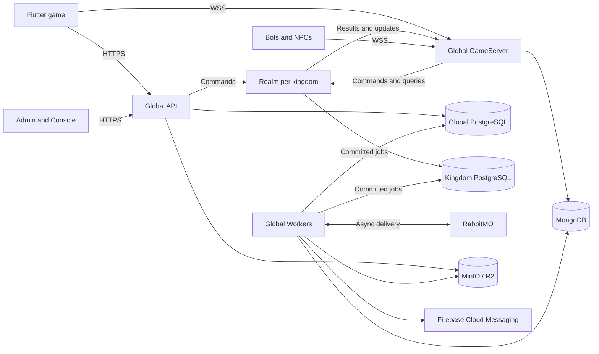

# OpenCoK Architecture

OpenCoK is a self-hosted persistent strategy game. Accounts and platform services are global; each kingdom has isolated gameplay state and one authoritative Realm. The architecture below defines service responsibilities and accepted infrastructure, not a claim that every capability is implemented.

## Services and communication

### API

The global TypeScript/Bun HTTP service manages identity, accounts, kingdom discovery and admission, payments, media access and player/operator interfaces. It verifies Firebase Authentication tokens and maps provider identities to stable internal accounts. Guest linking preserves the same account and progress.

API owns global PostgreSQL data. Provisioning characters, granting purchased benefits and administering gameplay require idempotent commands to Realm; API never writes kingdom gameplay directly. Stripe processes payments and subscriptions. API records orders and entitlement, verifies provider events and reconciles uncertain results before confirming Realm grants.

### GameServer

The global Go service owns WSS connections, admission, heartbeat, connection limits, subscriptions and outbound delivery. It routes gameplay commands and queries to the appropriate Realm and delivers authorized results and updates. Realm independently checks the participant's authority and visibility.

GameServer also owns Chat and conversation metadata in MongoDB, including authorized replay, deduplication and retention. Realm owns alliance membership; leaving or expulsion must revoke alliance-channel access across connections and reconnects.

The target session model allows one active player session per account across replicas. Player admission disconnects the Bot controlling that character. Reconnect restores an authoritative snapshot followed by versioned updates; missing replay history requires a fresh snapshot. The currently implemented connection bootstrap has anonymous, process-local presence; authenticated admission and cross-replica revocation are still required.

### Realm

Each kingdom runs a TypeScript/Bun Realm with one logical authoritative gameplay writer. Realm owns characters, cities, resources, inventory, troops, alliances, world occupancy, marches, gathering, combat, events and rewards. Player and world changes share the same transactional authority.

Every accepted command commits state, economic records, an operation receipt and required publication intent atomically in kingdom PostgreSQL. Retries return the recorded result. A timeout is resolved through receipt lookup rather than speculative refunds or repeated effects. A PostgreSQL ownership epoch prevents a replaced Realm writer from committing new gameplay changes.

Realm's Scheduler processes persisted deadlines through the same gameplay transitions used by foreground commands and reconnects. Restart catches up in bounded batches. Marches preserve troop/resource reservations and accepted rules; combat uses immutable inputs and reproducible outcomes before committing rewards and losses.

### Workers

Global TypeScript/Bun Workers execute committed background work: document publication, read projections, push/email, media processing, payment reconciliation and maintenance. They may update scoped jobs, delivery receipts and projections; authoritative account or gameplay changes go through the owning service.

Required work starts as durable PostgreSQL job/outbox records. RabbitMQ distributes asynchronous tasks and events with at-least-once delivery. Workers claim bounded batches, deduplicate effects and retry with backoff and crash recovery. Broker or Worker failure delays delivery without losing acknowledged entitlement. Heavy media and CPU work have separate execution budgets from gameplay and connections.

### Automation

A separate TypeScript/Bun service runs Bots and NPCs through the same versioned WSS contracts as players, without direct access to Realm storage. Bots require scoped, revocable delegation and verified entitlement, respect manual-play limits and yield to an active player.

NPCs are operator-controlled with isolated budgets and are excluded from player payments, rewards, final rankings and analytics.

### Clients and web applications

Flutter presents the game; Flame handles city/map scenes and animation. The server confirms gameplay outcomes. Clients verify and retain versioned assets, activate complete downloads and recover from interrupted updates. Local assets do not enable offline authoritative gameplay.

Admin sends audited operator commands through API. Console manages accounts, purchases and automation. Landing presents public project information; Wiki publishes documentation and catalogs. These applications have no gameplay database access. Firebase Cloud Messaging delivers advisory notifications through Workers; returning clients fetch current authorized state.

## Data and configuration

| System | Role |
| ------ | ---- |
| Global PostgreSQL | Accounts, provider links, orders, global entitlement, operation receipts and required integration intent. |
| Kingdom PostgreSQL | Authoritative gameplay, economic ledger, deadlines, reward entitlement, receipts and required jobs. |
| MongoDB | Original documents such as Chat, immutable configuration/rule publications and rebuildable read projections. |
| Redis | Disposable read cache only; never sessions, configuration, queues, entitlement or Realm ownership. |
| MinIO / Cloudflare R2 | Media and immutable release assets; MinIO serves development and R2 production. API controls access and Workers process uploads. |

Initially, global and kingdom databases share a PostgreSQL instance with scoped credentials and resource budgets. Kingdom databases can move to separate instances without changing gameplay contracts.

There is no transaction across PostgreSQL and MongoDB. Workers publish committed outcomes idempotently; delayed projections cannot erase earned rewards or rerun combat. Reads needing immediate consistency use authoritative state or a confirmed projection version.

Services load validated immutable configuration snapshots from MongoDB. Realm activates rules between commands and preserves accepted versions, costs and deadlines for work already in progress. Deployment settings and secrets are injected separately. Unleash controls feature admission and kill switches; it does not establish economic rules or reward entitlement.

## Service boundaries and recovery

Interactive API/GameServer–Realm calls are direct and service-authenticated. RabbitMQ handles asynchronous delivery. HTTPS uses JSON; WSS uses versioned binary packets. Shared contracts keep backend and client payloads compatible, and admission rejects unsupported versions before gameplay. Exact player-scoped RPC and cross-replica routing, fan-out and revocation remain open.

Traefik terminates TLS and routes HTTP/WSS traffic; Realm endpoints remain private. Cloudflare caches production assets in front of R2. Compose supports initial development; production orchestration remains undecided. API, GameServer and Workers can have global replicas; gameplay scales first by placing kingdoms on separate resources.

| Failure | Expected behavior |
| ------- | ----------------- |
| PostgreSQL | Affected authoritative confirmations stop safely. |
| MongoDB | Chat, publication and configuration loading may stop; unrelated gameplay may continue with validated active rules. |
| Redis | Reads fall back within bounded capacity or degrade. |
| Workers / RabbitMQ | Durable pending work accumulates and resumes after recovery. |
| GameServer | Clients reconnect and recover through snapshots, updates and operation receipts. |

Maple provides logs/traces, Sentry error reporting, and Prometheus/Grafana/Alertmanager operational metrics and alerts. Firebase Analytics/Crashlytics cover supported client targets. Diagnostics never replace economic ledgers or audit records. Backups cover authoritative PostgreSQL data, original MongoDB documents/configuration and required objects; recovery must reconcile pending work across stores.
