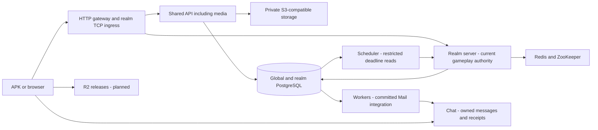

# OpenCoK Architecture

## 1. Overview — Deployment Defined

OpenCoK is a TypeScript monorepo with domain-owned packages and a staged transition from one gameplay writer per realm to independently fenced player/world authorities following the [realm authority design](#9-authoritative-server-zookeeper-and-scaling). Domain extraction and process separation are different migrations.

**Implemented:** API, realm Server, Chat and experimental Web; opt-in restricted Mail Workers and timed-activity Scheduler. `apps/server` still owns all gameplay mutations. Default persistence prepares two kingdoms with shared global state; development Compose starts one active realm server.

**Accepted target:** one gateway plus one active owner per `(realm, authority kind)`, initially Player and World, with Scheduler and integration Workers outside gameplay authority. Player/World processes, per-kind epochs and cross-owner economic protocols remain migration work; package ownership alone does not enable them.

**Production target:** a European 16 GB single-node Kubernetes VPS for API/media, gateway, realm workloads, coordination and workers; Pages for landing/docs/Admin, Vercel for experimental SSR, Neon PostgreSQL, managed Redis/MongoDB, CloudAMQP, Firebase, Stripe and R2 release distribution. Provider plans/regions, Chat/Bot hosting, private object storage, observability capacity and production runtime remain open. The two-realm resource budget is provisional; a single VPS remains one failure domain.

## 2. Project mind map

Current ownership and opt-in process boundaries:

The accepted split routes authenticated gateway commands to Player/World owners; it must not be inferred from this current-state diagram.

## 3. Applications and responsibility boundaries

| Application      | Current boundary                                                                                                                                                                                                       |
| ---------------- | ---------------------------------------------------------------------------------------------------------------------------------------------------------------------------------------------------------------------- |
| `apps/api`       | Shared discovery, optional Chat metadata proxy, account provisioning and opt-in avatar media. Broader identity/Admin/push/payment endpoints remain target capabilities.                                                |
| `apps/server`    | Realm TCP/SFS transport, Effect composition and current sole gameplay writer; progression, world and combat application remain here.                                                                                   |
| `apps/chat`      | HTTP/WebSocket chat, private session/metadata adapters, owned message persistence, replay receipts and social-feed composition.                                                                                        |
| `apps/workers`   | Opt-in Mail integration: one realm's committed queues, two global gift-projection fields and signed Chat delivery, with restricted credentials. No gameplay writer token, Rules catalog or Redis connection.           |
| `apps/scheduler` | Opt-in bounded deadline discovery and signed owner dispatch for twelve registered activity types/legacy restoration. Read-only scheduling metadata, no gameplay payloads/writes, writer token, Rules catalog or Redis. |
| `apps/web`       | Experimental browser scaffold and loading/health flow; full gameplay and SSR deployment remain evaluation work.                                                                                                        |

**Planned boundaries:** `apps/server` becomes the game gateway; `apps/player` owns character/city progression and economy; `apps/world` owns spatial state. No separate Player/World application exists yet. Bot, Admin, landing and documentation applications remain planned. Bot uses authenticated commands, quotas and a kill switch, never direct database writes. There is no separate Files listener or standalone Combat service; API owns media, while combat application stays with the authoritative owner.

API/realm entrypoints compose concrete collaborators; packages must not import applications. The realm keeps Effect wiring in `realm-composition.ts` and lifecycle in `RealmApplication`. Controller/Service organization follows the NestJS pattern without replacing the existing runtime. API routing, Chat Controllers/Mappers, WebSocket queues and shared polling/cursor lifecycles remain separate responsibilities.

## 4. Organization of the monorepo

`apps/` owns processes/configuration/composition; `packages/` owns reusable domains/contracts/adapters; `infra/` owns deployment/ingress; root `tests/` owns shared contracts and isolated stack scenarios. ADRs remain in `docs/decisions/`. Ignored `data/` contains authorized local references, never required shared private artifacts.

### Domain package migration convention

Keep workspaces flat at `apps/*` and `packages/*`, with cohesive medium-sized domains and responsibility directories inside `src`: `domain`, `contracts`, `dtos`, `rules`, `services`, `validations`, `mappings`, `controllers`, `repositories`, `resources`, `bindings`, `enums` and `constants`. Create only directories with real implementations; feature-first nesting requires a consistent layout documented by the package README. Pure entrypoints must not load ORM, broker, sockets, process composition or a universal catalog registry. Domain-specific declarations may move with their owner without changing native values or wire types.

Preserve direct workspace dependencies, selective public exports and source wildcard maps, including root entries/assets. Temporary facades re-export one implementation and have an owner, remaining callers and a linked removal task; no copied behavior/data. Check runtime and type-only dependency edges: existing cycle debt never authorizes new cycles. Moved tests must remain in discovery commands and pass before deleting old implementations/facades.

Review packages approaching 10–15k handwritten behavioral lines or files approaching 400–600 lines, counting catalogs, schemas and tests separately. These are cohesion-review triggers, not lint limits; unrelated domains need review regardless of size. Avoid one class per package, giant Player/World/activity packages and arbitrary empty scaffolding.

[Package responsibilities](../packages/README.md) and the [migration register](../packages/MIGRATION.md) distinguish confirmed dispositions, completed slices and remaining proposals. Horizontal packages still contain unmigrated workflows. Moving source neither changes realm authority nor approves a new process, schema or transport.

### Implemented API and realm package boundaries

| Owner                                                               | Implemented responsibility                                                                                                                                                                                    |
| ------------------------------------------------------------------- | ------------------------------------------------------------------------------------------------------------------------------------------------------------------------------------------------------------- |
| `env`, `config`, `core`                                             | Validated environment, compiler configuration, scoped Effect runtime/resources, transport helpers and filtered logging.                                                                                       |
| `api`, `connection`, `controllers`, `identity`                      | HTTP/SFS entry, authentication and thin command Controllers.                                                                                                                                                  |
| `contracts`, `dtos`, `enums`, `validations`, `mappings`, `messages` | Shared/versioned ports, input DTOs, wire types, SFS codecs and boundary primitives; migrated domain declarations stay with their owner.                                                                       |
| `rules`, `base`, `ledger`                                           | Remaining pure rules; concrete-need domain lifecycle bases; shared mutation/posting/outbox contracts and signed-64 validation, without domain/persistence dependencies in Ledger.                             |
| `account`, `player`                                                 | Global account discovery/reservation/activation; realm character provisioning, profiles, descriptions, preferences and nickname workflows respectively. Account identity is not a realm character.            |
| `economy`, `production`, `city`                                     | Balances/items/inventory/activity economics and persistence; accumulation/collection/effect settlement; aggregate plans, snapshots, dispatch, persistence and bootstrap.                                      |
| `building`, `research`, `troops`, `equipment`                       | Building catalogs/construction; ordinary/civilization research; training/healing/fortifications; equipment/sets/workshop. Each owns migrated workflows, rules, projections and transaction-bound persistence. |
| `tasks`, `skins`, `shop`, `policy`                                  | Quest/sign-in/target/recall/reconnect workflows; city cosmetics; mall/NPC trading; maintained content filtering and bounded adapters.                                                                         |
| `hero`, `dragon`, `resources`                                       | Hero/general workflows and named archetypes; named dragon definitions/catalog mapping; maintained typed gameplay catalogs. Dragon gameplay workflows are not all migrated.                                    |
| `alliance`, `share`, `ranking`                                      | Alliance workflows/context/locking/persistence; social feed visibility/expiration and native envelopes; permanent boards and published attribute/payment/consumption views.                                   |
| `world`                                                             | Map/search/favorites/spatial queries, point-detail presentation and resource/monster population admission, quotas, expiry, durable clocks and transactional persistence.                                      |
| `mail`, `queues`                                                    | System-mail leaf contract, gift projection and Chat intent relays; persisted timed-activity discovery and versioned owner dispatch contracts/transport.                                                       |
| `repositories`, `drizzle`, `storage`                                | Remaining owned persistence, PostgreSQL schemas and Redis/ZooKeeper/S3 adapters.                                                                                                                              |

Realm composition injects clocks, catalogs, numeric projections, effects and cross-domain collaborators. City preserves atomic aggregate ordering; `CityProgressionContextFactory` loads state/effects and `CityProgressionContext` plans writes/economics. Domain classes specialize `ActivityDomain`, `CityCommandDomain` or `CommandDomain`; shared weighted choice remains a bounded Rules algorithm. DTOs are create/update inputs; reads/deletes/responses use contracts. Wire Mappers preserve native names, widths and order.

World query adapters preserve original local/remote read-only snapshots; favorites/leave retain realm fencing. Population execution remains sequential by family with fence, advisory lock, captured clock and transactional outbox order. March/gathering lifecycle and multi-aggregate recovery are not completed by these extractions. Ranking publication does not acquire event finality/funding/reward authority. Share's opaque feed payloads do not establish dedicated battle-report rendering. Mail integration extraction does not migrate all gameplay mailbox/reward or avatar/postbox workflows.

### Client-backed semantic definitions

Maintained catalogs require no runtime XML parser, mount or `GAME_RESOURCES`. Building owns costs/prerequisites/effects/star progression; Resources exposes remaining typed tables/maps/declarations/variables/routing with an explicit flat-record compatibility adapter. Offline importers read authorized originals without modification; XML tooling is developer-only for explicit synthetic fixtures. The maintained policy dictionary ships in the server artifact, not an ignored bind mount.

Hero's 109 named archetypes own semantic definitions; injected numeric bindings retain native identities and stable unknown entries. Dragon has 14 client archetypes, 13 with server configuration; Vildrin stays client-only. Meaningful abstract bases own shared invariants/workflows, concrete classes factual archetypes, and typed curves/matrices ordinary homogeneous data—not subclasses per level, reward cell or table row. Definitions describe archetypes, not saved player instances.

Use explicit properties/units, typed relationships, stable English identities and deterministic ordered rosters, with separate versioned native bindings. Preserve numeric/string/leading-zero identities, aliases, cross-version reuse and save keys. Establish names from actual native-record/entity/localization/relationship linkage and cross-check server consumers, never icon similarity, ID prefixes, guessed translations or display-name matches. Locale changes do not automatically rename or merge identities.

Every catalog/family needs an owner, authoring source, client version/fingerprint and migrated/deferred/unresolved disposition. Offline discovery in `packages/catalog-tools` records safe relative provenance and deterministic collision/reference/coverage diagnostics, leaves originals byte-identical and never silently rewrites maintained source. Publish only approved metadata, not private paths/code/binaries or bulk localization. Runtime/tests/builds use maintained artifacts and synthetic fixtures without ignored inputs. Unresolved required bindings block family promotion; client-only or incomplete entries remain unavailable, never filled with invented effects, rewards or defaults.

Use one authoring source per family; derive compatibility records via injected Mappers from reviewed definitions/bindings rather than editing both representations. Compare every native record/field/type/default/alias/order against parity fixtures before cutover, then migrate semantic consumers too: recreating an XML-shaped bag for raw-ID callers is not completion. Track remaining consumers/facades until dependency and coverage checks pass; unrelated startup must not load the universal registry. See [catalogs/provenance and named definitions](../packages/resources/README.md).

## 5. Domains, network and gateways

Target domains: `opencok.com`, `docs.opencok.com`, `admin.opencok.com`, `game.opencok.com` and `api.opencok.com`; these are not verified DNS/hosting. Traefik owns current HTTP/realm TCP ingress; Kong HTTP/WSS policies remain target design. Legacy SFS needs a reachable per-realm TCP endpoint, not an assumed Cloudflare HTTP proxy; browsers connect directly to backend WSS.

The [gateway](../infra/gateway/README.md) allowlists discovery, public Chat metadata, signed uploads, JPEG reads and fixed-prefix CDN paths. Private avatar confirmation is not publicly routed. Preserve aliases/wire contracts and keep database, signing, Firebase Admin and Stripe credentials out of frontends.

## 6. PostgreSQL on Neon: writes, reads, and authority

[ADR-0005](../docs/decisions/0005-adopt-database-stack.md) makes PostgreSQL transactional authority. Global and physical per-kingdom databases remain. Target Neon read/write computes share one branch: balances, costs, preconditions and immediate reads use the writer; delay-tolerant reports may use replicas with a lag budget. Bound pools and service/realm permissions; replicas are not backups.

## 7. MongoDB, Redis and file storage

[MongoDB](../docs/decisions/0005-adopt-database-stack.md) owns large/versioned documents and reconstructible projections. [Redis](../docs/decisions/0006-adopt-redis-and-insight.md) owns cache/sessions/ephemeral coordination, never sole durable progress. Private media uses S3-compatible storage with local MinIO. R2 APK/Lua distribution is separate from player media and Chat attachments.

## 8. Messaging: RabbitMQ and BullMQ

RabbitMQ/CloudAMQP remains target integration infrastructure, not an implemented requirement of Scheduler/Mail Workers. Producers commit outbox with authoritative state; consumers deduplicate and commit owned effects before acknowledgment. Bound ordering, retry/backoff, dead letters and queue budgets. BullMQ is only an optional alternative with separate persistent Redis queues if adopted; do not duplicate event paths or claim exactly-once transport.

## 9. Authoritative server, ZooKeeper, and scaling

**Current:** one logical realm writer; `RealmAuthority` acquires a persisted monotonic `ownerEpoch`. Transactions fence stale writers, including recovery. State, ledger postings, command receipts and outbox commit together. Membership/election or a cache lock alone is not fencing; authority loss stops mutations. Domain extraction preserves these guards and existing participant/alliance lock ordering.

**Accepted split:** one initial active owner per `(realm, authority kind)`, not per character. Validate owner, epoch and readiness inside every authoritative transaction, including recovery/background paths; shared schemas do not grant shared write permission. Player owns progression, economy, inventory, owned troops and production; World owns occupancy, placement, populations and spatial march checkpoints. Each gets a distinct persisted epoch/instance, readiness and least-privilege role. Old commits and replacement acquisition must serialize. Do not share the current realm token among independent writers.

Cross-owner operations require registered table/aggregate/command ownership, durable factual reservations, versioned acceptance/results, pinned rule/RNG/reward outcomes and reconciliation. Carry realm, operation identity, participant, contract version and expected state version. World records accepted movement/checkpoints; Player applies owned releases/losses/rewards once. Define ordering, failure states and permitted compensation before separating participants. Timeouts are uncertain outcomes, not permission to release potentially consumed troops or grant again. Keep the atomic current path until equivalent protocols and database-denial/stale-writer tests pass.

Transfer admission through drain/checkpoint, fenced acquisition, readiness and routing/reconnect. Increasing replicas is not safe realm scaling. Cutover/rollback must account for in-flight protocol state, not merely revert an image; marches/gathering stay together until participant recovery is verified.

## 10. Battle computation and bots

Combat belongs to the authoritative gameplay boundary; no standalone Combat application is selected. Isolated calculations/generation must use immutable snapshots, bounded CPU/concurrency/queues/memory and return proposals only. The owner validates versions/epoch/idempotency before applying losses, rewards or occupancy. A package name or proposed worker does not establish a complete combat engine.

Preserve Java numeric behavior, rounding, ordering and random draws. Require differential vectors, deterministic replay, invariants and latency/capacity evidence; Rust/Go would need separate review. Planned TypeScript bots use player authentication, quotas and a kill switch; NPCs remain simulation-owned.

## 11. WebAdmin and rule control

Planned Admin submits authorized versioned commands with operator, reason, scope and before/after audit. Economic adjustments obey owner invariants/ledger. Rules progress from draft through validation/simulation to versioned publication; accepted calculations retain their rule version. Rollback must preserve persisted/in-flight compatibility.

## 12. Observability, Evelog and search

Current API/Server/Chat use Evlog via [Core logging](../packages/core/README.md#operational-logging) and filtered local Maple logs/traces/controlled exceptions/duration/process metrics. Gateway emits filtered access logs and HTTP metrics via Traefik OTLP; ingress tracing stays disabled to exclude URLs/client addresses. Maple is not a startup dependency and has no native automatic alerting; production capacity remains open.

Exclude bodies, SQL, credentials, identities and raw exception messages/stacks. Correlate operation start/result/duration and prepared/committed/delivered effects. Operational telemetry is a projection, not durable economic audit; Evelog remains the audit concept, Elasticsearch optional derived search, and Firebase telemetry/FCM do not replace state or delivery. [ADR-0004](../docs/decisions/0004-adopt-maple.md) accepts this stack and suspends Grafana/Loki/Prometheus/Axiom/Sentry for these signals; acceptance does not complete verification. Private/loopback access remains an enforcement gate: the current Compose port mapping is not itself loopback-bound.

## 13. VPS Kubernetes, delivery, and continuity

Kubernetes/managed production integration remains release work. Version artifacts, exercise staging and rehearse drain/reconnect, dependency loss and restore before promotion. Backups cover databases, objects, rules and secrets consistently; VPS snapshots omit remote state. Separate process resource budgets, including pools and coordination/headroom, before enabling more owners.

## 14. Failures and expected degradation

Writer/authority failure stops affected mutations; uncertain commits resolve through receipts. Broker failure retains bounded outbox work. Optional Chat/media/telemetry/search must fail promptly without blocking essential gameplay. Failed calculation leaves recoverable reservations/pending work, never fabricated victory. Process readiness, backlog exhaustion and successful durable delivery are distinct facts.

## 15. Sequence of evolution and pending decisions

Complete ownership/dependency registers, remaining domain extractions and equivalent failure/recovery protocols before Player/World writer cutover. Scheduler/Workers are initial restricted slices, not completion of #558 W15–W18. Preserve login/city/map/native contracts, existing economic identities and saved progress. Open decisions include production runtime, provider deployment, capacity, remaining deadline groups and finer partitioning.

### 15.1. PostgreSQL database package

[Drizzle](../packages/drizzle/README.md) owns maintained schemas/migrations/setup for global and kingdom databases. Imported legacy models remain isolated references. Additive migrations and operator-owned least-privilege provisioning precede process cutover; runtime apps neither migrate themselves nor repair grants.

### 15.2. Shared server environment

[Env](../packages/env/README.md) supplies validated injectable configuration; maintained API/realm configuration uses one root `.env`, not app-local files or ambient Bun dotenv loading. Restricted Scheduler/Worker entrypoints consume their explicit environment, never operator provisioning credentials. Keep secrets out of logs and examples.

### 15.3. First PostgreSQL server migration slice

The maintained server now composes migrated domains over transactional PostgreSQL while preserving native wire types. Legacy read/projection compatibility does not authorize resetting progress or moving writers. Use the [server guide](../apps/server/README.md), [domain register](../packages/MIGRATION.md) and per-package tests for actual coverage and remaining workflows; removed historical migration documents are not required inputs.

### 15.4. Local TypeScript stack

API/Chat/realm/Web retain Bun CLI builds with separate semantic checks; the compiler pilot and artifact CI were removed. [TypeScript](../docs/decisions/0001-adopt-typescript.md), [Bun](../docs/decisions/0002-adopt-bun.md) and [Effect](../docs/decisions/0008-adopt-effect.md) are accepted stack choices. The former Node.js production mandate remains suspended; no production runtime migration is selected. Source checks do not certify emitted artifacts/native releases.

Base Compose defines API/Server/Chat, Traefik, PostgreSQL/setup, MongoDB, Redis, ZooKeeper, MinIO/CDN, Maple and inspection tools. `docker-compose.dev.yml` adds local PostgreSQL/setup, Redis and MinIO readiness ordering; omitting it does not remove base service definitions. Shared external `DATABASE_URL`/`REDIS_URL` and configured S3/CDN endpoints do not require local database/storage dependencies in base app definitions. Server outbound networking supports external providers, not verified production compatibility.

`dev` includes Chat (direct WebSocket port 8083); `all` includes tools; `devops`, `database` and `redis` select their respective tools/dependencies. [Mail Workers](../infra/compose/README.md#opt-in-mail-integration-workers) and [Scheduler](../infra/compose/README.md#opt-in-timed-activity-scheduler) use explicit opt-in overlays/profiles, not automatic extra gameplay writers. See the [local stack guide](../infra/compose/README.md) for exact configuration/cutover. Local containers do not prove Kubernetes readiness.

## 16. Simulation execution and offline progress

Use server time, persisted deadlines, versioned aggregates, idempotent completion and bounded catch-up, not per-player timers/unbounded replay. Starting, cancelling or accelerating work updates version/deadline atomically with related effects. Scheduler and reconnect share the same owner transition and stable operation identity; duplicate, stale or reordered discovery must neither complete early nor duplicate effects. Independent calculations cannot bypass owner ordering/economic invariants.

[Scheduler](../apps/scheduler/README.md) discovers supported active legacy queues and due registrations through restricted metadata reads. Capabilities come from the owner; dispatch includes generation/version/deadline. The owner rechecks locked state, actual due time and earlier-activity ordering inside the same economic transaction. Reconnect/foreground recovery remains local even in external background mode; unsupported/failed work stays durable.

Finite scan horizons, periodic head retries, per-owner budgets and request/pool limits bound discovery, not arbitrary-backlog latency. Health counters are bounded observations, not cumulative throughput; limited counts are lower bounds. The additive due-cursor index requires an operator migration window and has storage/write cost. Read-only runtime permission checks supplement database grants; they do not establish cluster-wide CONNECT/HBA/network isolation.

Other deadlines—Alliance research, marches/gathering, World expiry, effects, event calendars/finality and integration retries—retain their current owners until separately migrated. The Scheduler guide records remaining W16 groups; integration retries are not automatically gameplay scheduling.

## 17. Data model and write ownership

Current realm gameplay writes remain atomic and fenced. API owns global identity/payment/media boundaries, Chat its messages, and external integrations only their explicitly registered projections. Enforce quantity bounds, reservations, unique operation keys and version checks. Target Player/World ownership follows section 9, not unrestricted cross-domain SQL.

[Mail Workers](../apps/workers/README.md) acknowledge one realm's committed queues after global gift projection or signed Chat receipt commit. Only `mail_gift_log.isOpened`/`receiveTime` are mutable globally; that table has no kingdom column, so this is explicit global integration ownership, not global row-level realm isolation. Queue roles also need narrow timestamp UPDATE privileges for row locking; maintained relays delete only acknowledged intents.

Gift global commit precedes realm acknowledgment; Chat deduplication/receipt commit precedes HTTP acknowledgment and intent deletion. Lost acknowledgment replays durable values; no cross-database exactly-once guarantee. Distinct restricted credentials/realm bindings are checked before and during delivery. Local delivery is default; external mode disables only the corresponding realm polling loops. Stop/drain consumers for cutover/rollback, preserving queues/receipts and avoiding deliberate dual consumers. Missing Chat configuration disables that consumer; it does not reroute pending work locally.

Scheduler/Worker grants do not prove connection-level isolation from every database. Audit foreign/PUBLIC grants and network policy separately; administrative provisioning credentials never belong in runtime processes.

## 18. Identity, protocols and reconnection

Target Firebase Guest/provider linking preserves internal identity and both realm characters. Do not trust client `loginFlag`, realm IDs or cached authentication as independent authorization. Preserve SFS/TCP types/order; HTTP/WS adapters require explicit tickets/contracts. Reconnect restores committed state and validates session ownership, not client-asserted progress.

## 19. Realms, partitions and operations between owners

Separate realm configuration, state, leases and pools. New owner boundaries require versioned commands/results, idempotent receipts, bounded reservations and reconciliation; no informal distributed transactions or shared unrestricted SQL. Per-character partitions are not the initial [realm authority model](#9-authoritative-server-zookeeper-and-scaling). Prove wrong-owner database denial, stale-epoch rejection, crash recovery and aggregate resource budgets before activation.

## 20. Global and alliance chat: delivery, archiving, and deletion

[Chat](../apps/chat/README.md) owns message persistence, authorization, retention, cursor/deduplication and signed internal updates; social feed belongs to Share. Target global/alliance retention archives after one day and deletes after seven days from sending, including archives. Redis fan-out is ephemeral; membership/moderation/private attachments require authorization. Distinct per-realm mailbox keys cannot be replaced by a shared broad Chat credential in external Workers.

## 21. File and media lifecycle

[API media](../apps/api/README.md#avatar-media) implements authenticated JPEG/PNG input, JPEG re-encoding, immutable S3 sequence receipts and SDK-presigned reads. Realm upload/confirmation use purpose-bound Redis tickets; credentials stay API-only and confirmation has no gateway route. Successful replacement archives the prior receipt/deletes its JPEG, defaults to three days and retries failed cleanup. Discovery/upload body limits remain 64/2112 KiB.

`S3_ENDPOINT` separates API storage traffic from `S3_PUBLIC_ENDPOINT` for signed client reads; local service DNS avoids host-port hairpin routing. PostgreSQL avatar journals/per-owner publication revisions and signed Chat consumers preserve ordered replay independently of clocks/sequence wrap. Moderation is an authorized operator CLI, not a public endpoint. Media works without Chat; optional publication intents stay pending.

GIFs, the complete pending/validated/ready lifecycle, background transforms and orphan collection remain planned. Avatar/media ownership is not implied by Skins or Mail package extraction.

## 22. Mandatory testing strategy

Use [contribution requirements](CONTRIBUTING.md#required-implementation-tests): unit, disposable integration, E2E, contract/snapshot and critical mutation evidence. Exercise real process entrypoints, permission denial, stale/replaced owners, retries/reordering, dependency loss, restart/drain and restore. Pin clock, rules and RNG; preserve economic/authorization semantics. Use synthetic data and isolated resources; native rendering still requires device/emulator evidence.

## 23. Development environment and administrative tools

The [Compose guide](../infra/compose/README.md) governs local operation. pgAdmin, Redis Insight, Portainer, Mongo Express and gateway administration are private operator/development surfaces, never public game APIs. Preserve named volumes/ignored authorized inputs; configuration alone does not prove network isolation or grant production access.

## 24. Operational goals, capacity and incidents

Measure aggregate command/calculation p99, CPU/RSS, event-loop delay, pools, queue age, deadline lateness, reconnect and provider RTT/quotas under simultaneous peaks, including two realms and recovery. Budget combat/media plus infrastructure headroom; the 16 GB target is not proven capacity. Set/test SLO/RPO/RTO, incident ownership and restore procedures. More processes do not establish performance improvement or high availability.

## 25. Compatibility between versions and promotion criteria

Recognized tracks: `v5.36.0`, `v6.12.20`, `v9.27.0`, `v12.06.0`; recognition is not verified support. Record client/resource/protocol/schema/rule evidence per promoted artifact. Preserve accounts/progress and rehearse migration, rollback and restore; successful startup or source tests alone are insufficient.

## 26. Stripe payments and package grants

Target packages cost USD $1–$5. API creates orders/verifies signed webhooks; authoritative realm commands alone grant value through ledger/idempotent receipts. Duplicates, delay, reordering, refunds and uncertainty need bounded reconciliation. Redirects/client claims never prove payment; the future Player boundary must preserve these invariants.

## 27. Transition client, R2 update and possible Flutter rewrite

Keep authorized Elex originals/keys read-only; extract, patch and package separately, with numbered patches and installation artifacts. Planned signed Lua/native R2 delivery requires immutable objects, manifest/hash/package/certificate/version checks, temporary download and recoverable activation. Android consent, signing identity, Guest recovery and progress remain mandatory; downloading is not installation. Flutter/Dart has no replacement deadline and shares authoritative identity/backend; SSR remains an independent experiment. Never commit private client assets or keys.
