# OpenCoK — Production Architecture

**Status:** target architecture, documented on October 23, 2026. The diagrams describe
the intended project architecture, not infrastructure already deployed. This checkout
contains the initial structure of the monorepo; directories and packages do not prove
implementation.

Accepted technology decisions and their implementation status are indexed in
[the Architecture Decision Records](../docs/decisions/README.md). Read the relevant
record before changing its governed components.

[ADR-0009](../docs/decisions/0009-adopt-bun-for-development.md) retains Bun for
development; [ADR-0010](../docs/decisions/0010-adopt-nodejs-for-production.md) selects
Node.js for production services and supersedes earlier Bun-production assumptions.
The checked-in API/server images and adapters still use Bun and remain development
implementations until the Node migration and its release verification are complete.

The goal is a Modular monorepo with an authoritative server, independent WebSocket chat,
file and supporting services, an administrative dashboard, a landing page, an
experimental web client, and Python bots. TypeScript is the foundation for application
services, with Bun in development and Node.js in production. Processes in other languages
remain possible when measurements justify them.

The previous proof of concept with APK v12.06.0 opened the city and map screens using
Bun, MariaDB, Redis and ZooKeeper. This evidence does not validate PostgreSQL,
Kubernetes, the web client, or all systems in the game. Moving to the architecture below
requires separate data migration and compatibility testing.

The transitional mobile client continues to be the validated Elex APK. Adaptation with
Lua scripts to query releases and initiate updates via Cloudflare R2 is planned,
depending on verified native support. Rewriting the client in Flutter/Dart is under
long-term evaluation; it is not a prerequisite for maintaining the current game. The
product direction is in [PRODUCT.md](../PRODUCT.md).

## 1. Overview — Deployment Defined

The initial deployment is hybrid: Kubernetes centralizes its own processes on the **16
GB European VPS**, while frontends and managed services are located on the providers
below. The API is **single and shared**, initially with one replica; do not create an
API per realm. Each realm has a separate authoritative Server, with an active logical
instance. The initial limit is **two realms**.

| Location                       | Defined components                                                                                                             |
| ------------------------------ | ------------------------------------------------------------------------------------------------------------------------------ |
| VPS Europe / Kubernetes        | Shared API, API Gateway, Traefik, ZooKeeper, one Server per realm, Combat TypeScript, workers/relay and Files.                 |
| Cloudflare Pages               | Landing page, public documentation and WebAdmin.                                                                               |
| Vercel                         | Experimental Web Game in SSR; runtime/adapter compatible with the chosen framework.                                            |
| Redis.io / Redis Cloud         | Redis for caching, sessions, presence and, only if adopted, separate Redis for BullMQ queues.                                  |
| Neon                           | PostgreSQL: write compute and read compute/replica of the same production branch.                                              |
| Managed MongoDB Cluster        | Large documents and temporary chat archive; exact provider/plan yet to be selected.                                            |
| CloudAMQP                      | Managed RabbitMQ.                                                                                                              |
| Firebase                       | Auth (Guest, Facebook, Google, Email/Password, Apple, Microsoft and GitHub), product telemetry and push notifications via FCM. |
| Stripe                         | Checkout/payments in USD, packages from $1 to $5.                                                                              |
| External hosting to be defined | WS chat and Python bot; outside the main VPS in the initial topology.                                                          |
| Cloudflare R2                  | Distribution of APK releases and Lua bundles/validated resources; direct downloads, without going through VPS.                 |
| Destinations to be defined     | Storage of other private objects and observability backend. MinIO remains the choice for development.                          |

A single Kubernetes node does not provide high availability for the VPS. Failure of this
machine affects API and realms hosted on it; remote data does not make processes
available. The default topology configures two kingdoms from the same persistence
model. Validate memory, CPU, provider latency and combat spikes for both kingdoms
before production admission.

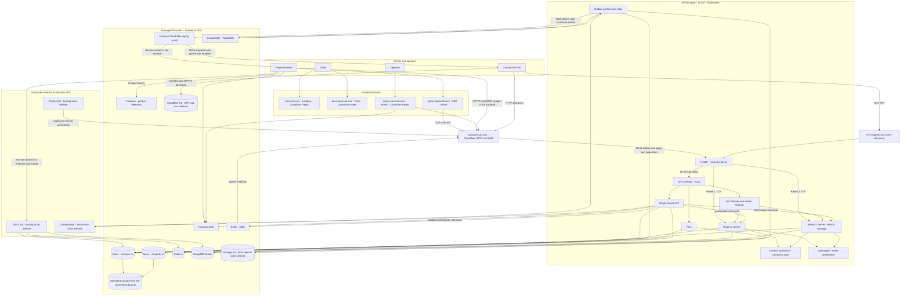

Servers share managed infrastructure with isolation per realm. No arrow authorizes a
service to edit tables from another domain. The browser connection to the game uses WSS
in the backend; SSR rendering on Vercel is not a new owner of the simulation. Chat uses
an external endpoint discovered by the API, avoiding unnecessary relay of all chat
connections through the VPS.

## 2. Project mind map

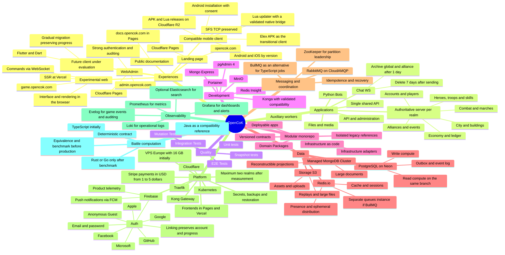

## 3. Applications and responsibility boundaries

| Application/component | Location and execution defined                                      | Responsibility                                                                                                                                                   |
| --------------------- | ------------------------------------------------------------------- | ---------------------------------------------------------------------------------------------------------------------------------------------------------------- |
| `apps/api`            | A shared API across VPS/Kubernetes, TypeScript/Node.js              | Discovery, Firebase validation, identity binding, push preferences/devices, queries, Admin backend, Stripe orders, and webhooks. It is not replicated per realm. |
| `apps/server`         | One active logical process/pod per realm on VPS, TypeScript/Node.js | Authority over city, economy, troops, skills, marches and combat. A maximum of two realms at this stage.                                                         |
| API Gateway + Traefik | VPS/Kubernetes                                                      | Ingress, routing, HTTP/WSS policies and TCP passthrough; configuration in `infra/`, without gameplay rules.                                                      |
| `apps/combat`         | VPS/Kubernetes, TypeScript initially                                | Limited calculation pool, separated from the network handling and economic state updates. Rust or Go are future alternatives after benchmarking and equivalence. |
| `apps/workers`        | VPS/Kubernetes, TypeScript/Node.js                                  | Outbox, CloudAMQP queues, projections, retention, push via FCM and auxiliary tasks; quotas per workload.                                                         |
| `apps/files`          | VPS/Kubernetes, TypeScript/Node.js                                  | Uploads, validation, metadata and access to external storage. Transformation CPU has its own limits.                                                             |
| `apps/chat`           | Service external to VPS, hosting to be defined                      | WS chat, channels, authorization, history, moderation and 1/7 day retention.                                                                                     |
| `apps/bot`            | Service external to VPS, Python                                     | Authenticated simulators with quotas without direct access to the realm state.                                                                                   |
| `apps/admin`          | Cloudflare Pages, `admin.opencok.com`                               | Administrative panel; uses shared API and authorized identity.                                                                                                   |
| `apps/www`            | Cloudflare Pages, `opencok.com`                                     | Public landing page.                                                                                                                                             |
| `apps/docs` — planned | Cloudflare Pages, `docs.opencok.com`                                | Documentation website; versioned content and publication.                                                                                                        |
| `apps/web`            | Vercel, `game.opencok.com`                                          | Experimental SSR Web Game, with continuous rendering and in-browser game connection.                                                                             |

Vercel is responsible for the SSR frontend, not the authoritative state of the realms.
Validate the framework, adapter, and deployment runtime; sharing TypeScript does not
mean that all environments run the same backend composition or runtime. The chosen strategy
connects the browser directly to the backend WSS, without using the SSR as a permanent
relay of match messages. [Reference: Vercel Functions](https://vercel.com/docs/functions/limitations).

Cloudflare Pages hosts Landing, Docs, and Admin. If they use Functions, their server
code follows the Workers runtime and the permissions specific to that environment.
Frontends do not receive database credentials, Stripe secret keys, or Firebase Admin
credentials. [Reference: Pages Functions](https://developers.cloudflare.com/pages/functions/).

## 4. Organization of the monorepo

The directories `apps/admin`, `apps/bot`, `apps/chat`, `apps/server`, `apps/web` and
`apps/www` already exist as the initial structure. `apps/api`, `apps/files`,
`apps/workers`, `apps/combat`, `apps/docs` and the subdivisions below are organizational
proposals; this document does not create the services.

```text
opencok/
├── apps/
│   ├── server/
│   ├── chat/
│   ├── files/
│   ├── api/
│   ├── admin/
│   ├── www/
│   ├── docs/
│   ├── web/
│   ├── bot/
│   ├── workers/
│   └── combat/
├── packages/
├── infra/
│   ├── compose/
│   ├── kubernetes/
│   ├── cloudflare/
│   ├── vercel/
│   ├── providers/
│   ├── observability/
│   └── migrations/
├── mobile/
├── legacy/
├── assets/
├── tests/
├── docs/
├── .specs/
└── .github/
```

### Migrated chat implementation

`apps/chat` composes the imported HTTP/WebSocket contracts through `contracts`,
`identity`, `controllers` and `connection` exports. `repositories/chat` uses existing
Drizzle PostgreSQL schemas and routes player reads through the global account realm.
`env/chat` owns configuration. The [chat runbook](../apps/chat/README.md) documents
24-hour retention, process-local broadcasts, startup, recovery and unvalidated client
integration. Seven-day archival and production Node execution remain pending.

### Migrated files implementation

`apps/files` composes `api/files`, `identity/avatar`, `validations/image` and
`storage/images` through the shared scoped HTTP runtime. `contracts/files` defines
storage ports and compatibility limits, while `env/files` validates configuration.
The [files runbook](../apps/files/README.md) covers private S3/MinIO provisioning,
signing keys, backup and the JPEG/PNG-only avatar contract. Full media lifecycle,
animated formats, realm grant issuance and production Node execution remain pending.

### Package groups

| Group                       | Existing packages that can fulfill this role                                                                                  | Dependency rule                                                                           |
| --------------------------- | ----------------------------------------------------------------------------------------------------------------------------- | ----------------------------------------------------------------------------------------- |
| Domains                     | `account`, `player`, `building`, `city`, `hero`, `troops`, `combat`, `alliance`, `kvk`, `campaigns`, `npc`, `rules`, `ledger` | Pure rules and use cases; they must not import sockets, controllers, an ORM, or a broker. |
| Contracts                   | `contracts`, `api-contracts`, `dtos`, `messages`, `events`, `enums`, `validations`                                            | Versioned schemas and envelopes, with compatibility tests.                                |
| Entry and application       | `api`, `api-client`, `command`, `connection`, `controllers`, `middlewares`, `guard`, `identity`, `policy`                     | Validate and authorize; call the use cases. They do not duplicate economic rules.         |
| Persistence and integration | `repositories`, `drizzle`, `mongoose`, `storage`, `queues`, `webhooks`, `notifications`, `email`                              | Implement use case interfaces. Writes respect domain ownership.                           |
| Setup and support           | `config`, `env`, `errors`, `resources`, `i18n`, `constants`, `scripts`, `generators`                                          | Small and explicit dependencies, with environment and resource validation.                |

Names such as `core`, `base`, `share`, `helpers`, and `utils`
should not accumulate rules from all domains. Define a public API for each package and
check import cycles in CI. Having many packages does not imply creating many
microservices: the game modules begin composed on a modular server, with separate
processes where there is an independent responsibility or load.

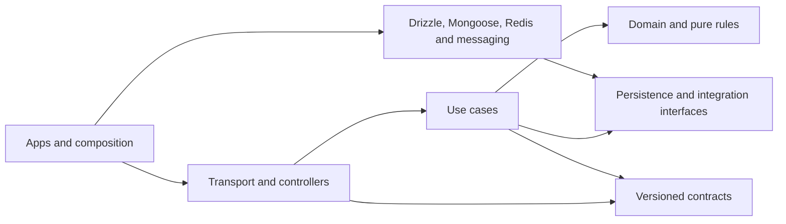

### Implemented API and realm package boundaries

`apps/api/src` and `apps/server/src` contain Effect configuration services, Layer
composition and process entrypoints. `packages/env` supplies one lazy injectable
environment snapshot per process and shared Zod validators; `packages/core` owns
the common Effect runtime, Promise resource bridge and HTTP adapter. Packages never
import applications. Their source exports and direct workspace dependencies are explicit in each manifest.

| Package               | Implemented responsibility                                                                                              |
| --------------------- | ----------------------------------------------------------------------------------------------------------------------- |
| `api`                 | Discovery use case, PHP request/response compatibility and injected HTTP handler.                                       |
| `connection`          | Realm listener lifecycle, readiness, socket sessions and backpressure; receives repositories and adapters from the app. |
| `controllers`         | Read-only city/bootstrap, public player summary and world command orchestration against persistence ports.              |
| `identity`            | Mobile signature, device, account, ban and realm authentication.                                                        |
| `messages`, `enums`   | SFS codec, frames and wire type tags.                                                                                   |
| `dtos`                | City, inventory, army, public player summaries, feature and clock serialization for the mobile client.                  |
| `contracts`           | Account readers, game snapshots, row values and realm configuration types.                                              |
| `rules`               | In-memory gameplay rule evaluation, without files, transport or ORM imports.                                            |
| `resources`           | Validated XML loading and construction of the rule catalog.                                                             |
| `repositories`        | Drizzle account lookup and read-only repeatable-read city/world/player snapshots, with configured public realm reads.   |
| `storage`             | Redis leases/readiness, ZooKeeper registration, dependency timeouts and validated server-directory files.               |
| `constants`, `errors` | Named connection limits, session TTL, mobile compatibility values and error types/codes.                                |

The reconnect friendship-mine use case adds a narrow realm write to the otherwise
read-only player-query repositories. The controller supplies a validated initial mine
from the treasure catalog. The repository reads the global account binding, verifies
the local owner and realm under a shared row lock, and reads or creates the mine by
its existing `(uid, fId)` key in a read-committed transaction. An insert conflict reads
the winner instead of overwriting progress or returning an unpersisted default. An
unbound account receives an ephemeral default without a mine-table write. This
cost-free initialization grants no reward and changes no existing mine. Global binding
and realm state are not one distributed transaction; each invocation uses the binding
observed at its start, and subsequent invocations observe a rebind under another key.
The provider has unit coverage with injected SQL clients; real database and native-client
validation remain deferred, and the complete `user.lv` command is not yet enabled.

Unit and integration suites consume public package exports. `bun run test:packages`
checks declared imports, package exports, dependency cycles and the rule/resource
boundary; CI runs it and triggers service integration checks on package changes.
Existing app test commands remain available. The auth mutation runner bundles each
mutant into a temporary directory without editing workspace source files.

Service composition follows proposed
[ADR-0012](../docs/decisions/0012-adopt-effect-for-service-composition.md): Effect
owns startup, scoped resources, signal shutdown and realm readiness monitoring.
The TCP/SFS session queue and synchronous rule evaluation retain their existing
execution models. The persistence and cache implementations retain
[ADR-0002](../docs/decisions/0002-adopt-postgresql-for-authoritative-state.md)
and [ADR-0005](../docs/decisions/0005-adopt-redis-for-cache.md) semantics under their
package paths. XML and directory file adapters use Node file APIs. Both service
HTTP listeners use the scoped Effect Bun adapter; Redis remains Bun-specific.
The production migration in
[ADR-0010](../docs/decisions/0010-adopt-nodejs-for-production.md) remains pending.

Python, an eventual Flutter/Dart client and a future Rust/Go engine receive contracts
generated from JSON or Protobuf schemas; they do not import TypeScript files nor share
free access to the database. Rule resources are versioned and hashed regardless of
language.

## 5. Domains, network and gateways

| Defined domain      | Destination                          | Usage                                                      |
| ------------------- | ------------------------------------ | ---------------------------------------------------------- |
| `opencok.com`       | Cloudflare Pages / `apps/www`        | Landing page.                                              |
| `docs.opencok.com`  | Cloudflare Pages / `apps/docs`       | Public documentation.                                      |
| `admin.opencok.com` | Cloudflare Pages / `apps/admin`      | Administrative panel.                                      |
| `game.opencok.com`  | Vercel / `apps/web`                  | Web Game SSR.                                              |
| `api.opencok.com`   | VPS HTTPS/WSS Input → Traefik → Kong | Shared API, discovery, game WS, files and Stripe webhooks. |

Frontend SSR, API calls and game session connection have different destinations. The
browser in `game.opencok.com` uses HTTPS/WSS from `api.opencok.com`, with authorized origin. Admin
and landing use the appropriate endpoints from this same API. Private credentials live
on the backends; Cookies, CORS, and CSRF protection are set for the explicit domains,
not an indiscriminate wildcard.

Traefik takes care of HTTP/WSS and L4 inbound to the cluster. Kong is the API Gateway
service, with applicable authentication, quotas, body limits, correlation and routes for
the single API, Files and WS adapter. Internal services use the Kubernetes private
network. SFS TCP does not traverse Kong's HTTP plugins.

The gateway resolves `realmId` to `server-realm-1` or `server-realm-2`; the API is not
duplicated per realm. Long-lived game connections go to the correct owner without
turning the shared API into the loop for every attack. Chat has an external endpoint
returned by discovery and a scoped ticket. Its additional hosting/domain will be defined
without moving the SSR to the VPS.

For APK, discovery advertises realm-specific L4 endpoint and port (e.g. distinct ports
on VPS). `game.opencok.com` belongs to the Vercel frontend and should not be advertised as an
SFS server. A host with a Cloudflare HTTP proxy does not automatically pass TCP on 9933:
use a direct IP or DNS-only hostname or validated Spectrum for the legacy endpoint.
[References: Cloudflare ports](https://developers.cloudflare.com/fundamentals/reference/network-ports/), [Traefik routing](https://doc.traefik.io/traefik/v3.2/routing/routers/).

TLS secures HTTP/WSS connections and connections to managed providers. The APK needs to
validate its actually supported transport before changing SFS to TLS. Gateway,
Kubernetes, and ZooKeeper administration APIs are not public. `.php` aliases
continue as legacy client adaptations as long as necessary; new URLs do not
automatically change signatures or protocol formats.

## 6. PostgreSQL on Neon: writes, reads, and authority

PostgreSQL is on **Neon, outside of VPS**. The two roles are a write compute
`rw` and a read replica/compute `ro` on the same production branch. Do
not create two independent branches as if they were synchronized writes and reads. In
Neon, computes read from shared managed storage: they do not represent two local copies
linked by a project-managed WAL replication. The read replica still has eventual
consistency. [Reference: Neon read replica architecture](https://neon.com/docs/introduction/read-replicas).

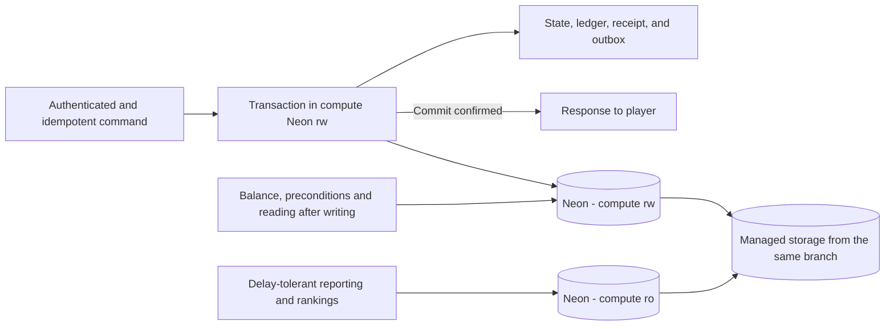

Balance, inventory, troops, costs, and preconditions use `rw`. A read after a
confirmed construction operation uses this compute or transaction result. Rankings and
reports can use `ro` with delay budget; A GET request does not imply that
reading from the replica is safe. Separate connection pools and permissions for the API,
each realm, Chat, and workers, with a global connection limit compatible with the Neon
plan.

Critical transactions do not make an unnecessary sequence of round trips between Europe
and another region. Select Neon region close to the VPS and measure RTT, cold start,
pool and commit latency. Use of pooler and scale-to-zero depends on the workload and the
validated plan; do not assume that the free plan fits the game.

High availability, WAL persistence, recovery and backups are features of the contracted
service/plan. Read replica is not, in itself, backup nor a promise of RPO 0. Set and
test recovery goals with real Neon guarantees, without documenting a manual promotion of
primary within the VPS. After uncertain commit results, consult the receipt before
repeating the mutation.

## 7. MongoDB, Redis and file storage

| Technology                               | Planned data                                                                          | Authority and recovery                                                                                                                                                                          |
| ---------------------------------------- | ------------------------------------------------------------------------------------- | ----------------------------------------------------------------------------------------------------------------------------------------------------------------------------------------------- |
| PostgreSQL on Neon                       | Progress, economy, accounts, metadata, active chat and outbox                         | Transactional authority. Global/alliance chat leaves the active history after 24 hours and expires after 7 days; details in section 20. Backup with point-in-time recovery and restore testing. |
| Managed MongoDB Cluster                  | Detailed battle reports, simulation documents, projections and temporary chat archive | Documents versioned by ID and schema. Archived global/alliance chat expires 7 days after submission, not archiving. Unique documents require their own backup.                                  |
| Redis.io / Redis Cloud                   | Cache of queries, sessions, presence, ephemeral fan-out and traffic limits            | TTL, invalidation and recovery set. It is not the only record of balance, completion or combat.                                                                                                 |
| Separate Redis.io for queues — if BullMQ | Jobs, retries and auxiliary schedules                                                 | An instance separate from the cache, with persistence and a `noeviction` policy.                                                                                                                |
| Cloudflare R2 — releases                 | APKs, Lua bundles and update manifests                                                | Versioned artifacts, integrity/authenticity check and release channel; see section 27.                                                                                                          |
| S3 compatible — other objects            | Avatars, assets, attachments, large replays, exports and backups                      | Provider per operation yet to be defined; MinIO in development, with access/retention policies.                                                                                                 |

MongoDB alleviates queries and documents that do not need to participate in the economic
transaction. The primary stores the ID, version and summary necessary for consistency; a
worker publishes the document after commit. Do not require uncoordinated writes to both
PostgreSQL and MongoDB to accept the same command.

Queues, outbox, inbox and projections have retention and cleaning by explicit policy.
Voluminous histories are partitioned/archived by date, with measured indices and
budgets. The deduplication window covers the allowed retry and replay period. Cleaning
jobs and projections does not remove the authoritative ledger or records necessary to
recover a pending operation.

“Larger data” does not mean putting arbitrary files in a BSON document: the limit per
document is 16 MiB. Replays or large binaries go to storage, with reference and hash in
the document; GridFS is an alternative only if there is a specific operational case.
[Reference: MongoDB and GridFS](https://www.mongodb.com/docs/manual/core/gridfs/).

Select nearby European regions for VPS and providers whenever supported on your chosen
plan. Measure actual RTT per operation, connection limits, quotas, and cold
start/auto-suspend behavior when applicable. Choosing a managed service does not prove
the plan's capacity or latency. Use TLS, secrets restricted by environment and network
access limited depending on the provider. Pools, retries and buffers have limits; do not
keep economic transactions open while waiting for telemetry or another optional third
party.

## 8. Messaging: RabbitMQ and BullMQ

**Defined choice:** RabbitMQ hosted on CloudAMQP for communication between languages and
services. The presence of the Python bot and a possible calculation engine favors a
contract independent of the TypeScript runtime.

BullMQ is an alternative for jobs controlled by TypeScript workers, especially retries
and auxiliary schedules. It is not necessary to adopt both for the same work. If both
exist, each queue will have a defined owner, contract, and responsibility; there will be
no informal double publication.

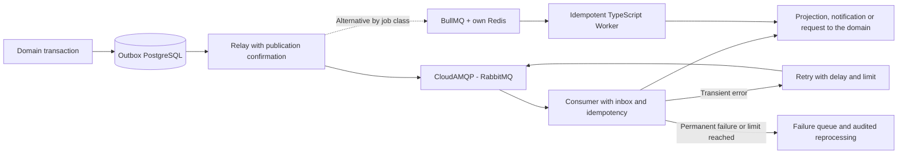

Events contain `eventId`, `eventType`, `schemaVersion`, `aggregateId`, `aggregateVersion`,
`occurredAt`, and `correlationId`. Large payloads are referenced by ID; tokens and secrets
are not queued. Consumers deal with duplicates, out-of-order events, and versions not
yet supported.

Assume **at-least-once** delivery. The relay marks publication complete after broker
confirmation; the consumer acknowledges it after persisting its result. A failure
between confirmation and updating the outbox may repeat the event. Inbox/receipts and
unique keys prevent applying the same change twice. RabbitMQ requires handling
confirmations, reconnection and redelivery in the application. [Reference: RabbitMQ reliability](https://www.rabbitmq.com/docs/reliability).

In BullMQ, keep Redis queues separate from cache discard policies, configure
persistence, and test recovery from stopped jobs. Restarting a worker cannot repeat a
reward. [Reference: BullMQ in production](https://docs.bullmq.io/guide/going-to-production).

Authoritative construction, march, and combat timers remain recorded as state and
deadlines in PostgreSQL. A queue wakes the executor, but it is not the only evidence
that a deadline has passed; reconciliation recovers late tasks. Job requests from other
languages use broker/API contracts, without writing directly to BullMQ's internal
structures.

## 9. Authoritative server, ZooKeeper, and scaling

The game starts with a modular Server per realm, separate from the shared API. There is
one initial realm and a maximum of two after capacity validation. Combat, Files and
Workers have their own limits on the VPS; Chat, bots and SSR are outside of it. Realms
can share the VPS if the peaks fit with margin. Increasing RAM/vCPU or moving a realm to
another VPS does not create another global API. Partitioning a realm into regions
remains an evolution, not the starting point.

ZooKeeper keeps track of membership and partition owner election using sessions and
ephemeral records. Session loss suspends further partition mutations until authority is
restored. Querying ZooKeeper for each attack or movement is not part of the normal
command path. [Reference: ZooKeeper recipes](https://zookeeper.apache.org/doc/current/recipes.html).

The leadership protocol includes a monotonic `ownerEpoch` persisted in PostgreSQL. Each
authoritative write in Neon checks the current epoch, blocking an old owner from
returning after a pause or network failure. A ZooKeeper election alone does not stop
this stale process from continuing to write. Kubernetes provides service discovery;
ZooKeeper is restricted to game coordination, without duplicating cluster control or
PostgreSQL failover.

Do not scale a stateful realm just by increasing replicas in a Deployment. Routing
associates the session with the correct owner; changing ownership requires draining,
checkpointing, rebuilding the state, and reconnecting. Aggregate ordering,
locks/transactions, and state versions are still necessary even with a single logical
executor per partition.

## 10. Battle computation and bots

```mermaid
flowchart LR
  player[Authenticated player or bot] --> command[combat command]
  command --> reserve[Server validates and reserves resources and troops]
  reserve --> snapshot[Persisted and versioned snapshot]
  snapshot --> compute[Local calculation or specialized service]
  compute --> result[Deterministic result and hash]
  result --> check[Server checks versions, epoch and idempotency]
  check --> commit[Transaction applies losses, rewards and event]
  commit --> report[Worker produces detailed report]
```

The engine receives `battleId`, `rulesVersion`, `numericPolicyVersion`, `rngAlgorithmVersion`, seed,
aggregate versions and complete snapshot. Produces a reproducible result, without
reading mutable state or modifying databases. The server applies the result once,
validating reservations, versions and `ownerEpoch`. Resources are not trapped in an open
SQL transaction during external calculation. To compare with old Java, an isolated seed
is not enough: it is necessary to control all sources of randomness, as shown below.

### 10.1. Current language choice and exactness criteria

**The engine starts in TypeScript**, maintaining the monorepo contracts and the backend
Node.js production runtime, with Bun for development. The previous recommendation to go directly to Rust is replaced by this
decision. Rust and Go are future candidates if measurements show that the compute, not
database/network/queue, is the relevant bottleneck.

Combat runs in CPU processes/workers separate from the Servers network loop and the API.
There is a limited pool shareable by both realms, with quotas and fairness per realm. Do
not create a process per attack or accept unlimited concurrency. The Server validates
and applies the result, regardless of the calculation language.

**Java remains as a compatibility reference.** A TypeScript combat mode is only released
after equivalence and invariants defined in this section. The validation also applies to
any later port to Rust/Go: migrating based on performance does not authorize changes to
casualties, random draws, or rewards. There is no language that automatically eliminates
rule or formula errors.

| Option                 | Defined role                                                                                                                                                                 |
| ---------------------- | ---------------------------------------------------------------------------------------------------------------------------------------------------------------------------- |
| **TypeScript/Node.js** | Initial implementation. Explicit layer for Java numeric semantics; calculation isolated from networking, with CPU/memory budget.                                             |
| **Java**               | Migration oracle and reference executor in the laboratory. The game does not rely on reintroducing the entire production Java server to use TypeScript.                      |
| **Rust**               | Future candidate to reduce CPU cost/latency/allocations if a benchmark warrants it. Requires new validation of mathematics and contract.                                     |
| **Go**                 | Future candidate, also subject to CPU measurement, allocations, GC pauses and numerical equivalence. Don't assume that switching to Go makes the formula accurate or faster. |
| **C++**                | No adoption planned at this stage.                                                                                                                                           |
| **Python**             | Bots and analysis tools, no authoritative battle calculation loop.                                                                                                           |

### 10.2. Java review scope and evidence

Review performed on 10/23/2026 on the authorized local references of the recovery
workspace, separate from this architecture checkout. The survey covered **3,586 Java
files** in `apps/server/modules`, identified **28 files and 6,002 lines** in the central battle
package and **16 files that directly instantiate the managers**. These are static
counts, not test coverage percentages or proof that all paths were executed.

The guided reading followed preparation, execution, results and application of losses.
The scan also inventoried 34 world handler/battle factory files, four effects support
files, and the boss flows. Dependencies such as profiles, marches, hospitals, and events
make the domain larger than a single damage function.

| Reference area                                                  | What was observed and needs to be included in the specification                                                                                                                                                          |
| --------------------------------------------------------------- | ------------------------------------------------------------------------------------------------------------------------------------------------------------------------------------------------------------------------ |
| `battle/manager/AbstractFightManager`                           | Preparation of participants; turns/subturns; movement; target selection; attacks by troops, generals and dragons; damage; defender protection; victory and report. PVP, PVE, tower and challenge managers use this core. |
| `battle/info/*`, `battle/role/*`                                | Attributes from XML and profiles, weighted abilities, temporary effects, positions, troop strengths, deaths, and fractional damage remainder.                                                                            |
| `battle/manager/FightCalCache`                                  | Contextual cache by role/effect/skill, invalidation by dependencies and comparison mode with recalculation. Changing the cache can change results if the invalidation is incorrect.                                      |
| `gameengine/battle/*`, `UserProfile.getGameEffect`              | Effects aggregate several sources: VIP, equipment, heroes, alliance, territory, world, dragons and event conditions. Part depends on global state and execution context.                                                 |
| `world/normal/AbstractWorldFightHandler` and subclasses         | PVP context, city, resources, territory, reinforcements and other modalities; march assembly; calculation; loss distribution; after effects.                                                                             |
| `WorldMarchGeneralArmy`, `FightResultObject`, bosses and relics | Losses per participant, conversion of dead to injured, healing, protection and modifiers per mode, as well as periodic effects outside the central loop.                                                                 |
| `battle/report/*`                                               | The contract includes the sequence of events/turns used by the client, not just the winning side.                                                                                                                        |

To reduce the risk of relying on a decompiler rebuild, six critical methods were checked
against the **original JAR bytecode**, using `javap` in JDK 8: damage converted to
casualties, attack, defense, power, movement, and hit/damage decision. The bytecode
confirms 32-bit floating point operations, promotions to 64 bits, and conversions to
integer. This does not constitute full equivalence between all recovered sources and all
original artifacts.

### 10.3. Numerical and behavioral risks found

| Observed evidence                                                                                           | Consequence for the new engine                                                                                                                                                    |
| ----------------------------------------------------------------------------------------------------------- | --------------------------------------------------------------------------------------------------------------------------------------------------------------------------------- |
| Mixture of `float`, `double`, `int`, decimal parsing and intermediate promotions                            | `f32` and `f64` must appear at the corresponding points in the evaluation. A result saved in `double` may have already lost precision in a previous `float` multiplication.       |
| Using `Math.pow` with Configuration Derived Exponents                                                       | Copying the formula to `powf` does not prove equivalence of last bits or integer thresholds. Pin and validate the mathematical implementation.                                    |
| Casts for integer, `floor`, `ceil` and `round` in different places                                          | Do not replace them with a generic rounding function. Preserve the moment of each conversion, saturation and treatment of exceptional values.                                     |
| `hurtAcc` preserves the fractional part of the damage                                                       | Rounding each attack without carrying the remainder changes the casualty total over the course of the battle.                                                                     |
| Turns, sub-turns, order by side/position, towers, traps and early termination                               | Parallelizing a battle's attacks or rearranging the loop can change live targets, abilities, and the winner.                                                                      |
| `HashMap`, lists and multimap in formations, skills, and sums                                               | Ordering everything differently is not a neutral optimization. Capture the effective order of entry and explain the tiebreakers.                                                  |
| `ThreadLocalRandom`, `Math.random`, `RandomUtil` with `SecureRandom`, `RandomUtils` and `Random` in helpers | A single seed does not control the legacy. Comparison requires intercepting/replaying all random calls, their types, thresholds and order.                                        |
| Probabilistic tests with different limits and comparators                                                   | Open/closed ranges, `<` and `<=` need boundary testing; do not normalize all chances to a generic Bernoulli.                                                                      |
| Effects can query profile, role flags, realm and context during calculation                                 | Snapshot needs to capture these dependencies and preserve turn/target-conditional effects. Just serializing troop counts is insufficient.                                         |
| Result calculation also contains recovery rules and draws                                                   | The replay must cover the generation of the final result, not end when the last attack ends. Getters with side effects must not become unrestricted, repeatable reads.            |
| Conversion to injured and mode modifiers happens outside of the central manager                             | Comparing only damage or victory leaves out real losses, hospital and persisted state.                                                                                            |
| Some skill initializers catch exceptions and continue                                                       | Reference Java may also produce degraded result. Configuration errors should block validation and require investigation, rather than being treated as a successful oracle result. |

The JDK is also part of the contract. Initially pin the reference runtime, artifacts,
architecture and resources; do not update JDK or swap `Math` for `StrictMath` and
assume identical results. The `Math.pow` specification allows for limited error in
ulps, not universal equality with any native library. [Reference: Java Math](https://docs.oracle.com/javase/8/docs/api/java/lang/Math.html).

### 10.4. TypeScript numerical policy and future portability

The first engine profile is **compatibility with the validated Java version**, not an
attempt to make old math “more accurate”. Reproduce the types, order of operations and
rounding points observed. Fixed point, exact decimal or rational can only replace these
operations in a new explicit version of the rules, with analysis of the impact on
balancing. Fractional exponents also require a specified approximation; Fixed point does
not automatically make the entire formula exact.

In TypeScript, `number` does not automatically reproduce Java `float`
intermediates. Materialize binary32 rounding at the necessary points, for example with
`Math.fround`, and keep binary64 at the rest. Java cast to integer is not synonymous with
JavaScript bitwise operator: create adapters for truncation, limits, NaN and infinities,
tested against the reference. Use `bigint` or strings validated for 64-bit integers
when the contract requires it.

Quantity conversions, overflow and division are given functions with explicit policy.
State quantities use integers with limits and checked operations; Intermediate values
can use greater width to check boundaries. Where the legacy profile requires specific
semantics, it remains in a tested function, without depending on the different behavior
between debug and release builds. Overflow or entry outside the permitted domain does
not authorize a negative reward, wraparound or silent saturation in the economic state.
[Reference: Rust operators and conversions](https://doc.rust-lang.org/reference/expressions/operator-expr.html).

Create Java semantic adapters for rounding and conversions, with boundary vectors. For
example, `Math.round(-1.5f)` results in `-1`, while `f32::round(-1.5)` results in
`-2`. Do not exchange one API for another because they have the same name.
[References: Java Math](https://docs.oracle.com/javase/8/docs/api/java/lang/Math.html), [Rust f32](https://doc.rust-lang.org/std/primitive.f32.html#method.round).

`f64::powf` has unspecified precision across platforms/versions, so Rust alone does not
guarantee identical replay. Validate a specific mathematical library or implementation
against the reference; pin the toolchain, dependencies, flags, and target. Start with a
supported platform and require the same vectors before releasing another architecture.
Do not enable fast-math, reassociation, approximations or explicit FMA without proving
equivalence of the affected operation. [Reference: powf accuracy](https://doc.rust-lang.org/std/primitive.f64.html#method.powf).

In the initial engine, `Math.pow` and other mathematical functions of the JavaScript
runtime also need to pass through Java vectors. Pin the Node.js production engine and Bun development versions, architecture
and dependencies; TypeScript does not promise numerical equivalence to legacy per se.
The Rust examples above are risks of a future port, not a change from the current choice
of TypeScript.

IDs, timestamps, and 64-bit integers do not traverse JSON as `number` when doing so
loses precision. Use integer fields in the binary contract or validated decimal strings;
reference floats may require preservation of bits in snapshot and replay. Version and
hash cover rules, numeric policy, and contract.

### 10.5. Randomness, replay, and safe application

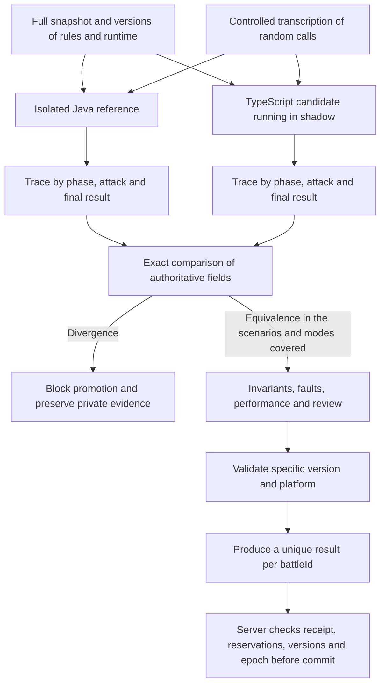

During migration, record a transcript of draws with call point, index, range, type and
returned value/bits. Java and TypeScript consume the same transcript; extra call,
different order or unconsumed transcript are discrepancies. For the new engine, specify
a PRNG and a mapping of versioned intervals, with seed of safe origin and independent
state per battle. This PRNG does not make old Java reproducible without adapting all
sources.

The snapshot captures participants, formations, skills, attributes, conditional effects,
flags, battle type, realm context and complete required settings. Calculation does not
look for `UserProfile`, mutable XML, database, real clock, or global services during
replay. The effective instant of combat is part of the input when a rule depends on
time.

A request produces an immutable end result and a hash; querying or resending the same
request does not draw healing again or reapply losses. The application receipt, ledger,
changes and event are confirmed in the same authoritative transaction. In case of a
timeout, uncertain result or infrastructure failure, consult the receipt and resume the
same operation. If the calculation violates an invariant, it is pending for safe
investigation/reprocessing; do not choose the winner by fallback or partially confirm
the result.

### 10.6. Tests and criteria for releasing a battle mode

1. **Frozen reference:** inventory original artifacts, resources, flags, runtime, and
   protocol; use synthetic scenarios and keep private data only in the authorized
   environment. Compare ambiguous decompiler output with bytecode.
2. **Numeric primitives:** parsing, `f32`/`f64` promotions, casts,
   overflow, division, powers, boundaries, negatives, NaN, and infinities. Reject
   exceptional values outside the contract before applying the result.
3. **Equivalence by phase:** formations, targets, random draws, skills, status, integer
   damage, fractional remainder, troop strengths, protection, winner, healing, wounded
   troops, deaths, and distribution per participant. UUIDs and report generation
   timestamps may be normalized; losses and decisions allow no tolerance.
4. **Mode coverage:** PVE/PVP, city, resource, territory, starred troops, traps/towers,
   generals, dragons, bosses, and authorized special modes, each with its own boundaries
   and flags. Modes not yet validated remain unavailable in the new engine.
5. **Boundary cases and properties:** empty or invalid input, a single unit, damage
   close to an integer, negative and maximum effects, zero/full probability, ties, turn
   limits, status reactivation, protection, and hospital capacity. Troop conservation
   uses disjoint categories; healing is a transition, not unit creation. Fuzzing
   generates cases and minimizes divergences.
6. **Side effects:** retries, crashes after calculation or commit, duplicate delivery,
   delayed results, ownership changes, and old rule versions. Prove that losses and
   rewards are applied only once.
7. **Controlled release:** shadow execution, reference comparison, independent
   inspection, and activation per version/mode. Known divergence in authoritative
   results blocks promotion. Preserve inputs, random draws, and versions for auditing
   and private replay.

Java is a reference for behavior, not proof of absolute correctness. A confirmed
inconsistency in the legacy needs its own rule decision and regression testing; Don't
copy an error silently or fix it in the middle of an unversioned migration. The absence
of divergences in a test suite is also not a mathematical proof of the absence of bugs.

### 10.7. Checks performed and performance still pending

In addition to static inspection and bytecode reading, independent numeric probes were
run on **Temurin 8.0.504** and **Rust 1.99.0 with optimization**. They are synthetic
examples of semantics, not a port of private code nor full battles. Observed examples:

| Synthetic probe                                                                               | Observed result                                                                                                  | Implication                                             |
| --------------------------------------------------------------------------------------------- | ---------------------------------------------------------------------------------------------------------------- | ------------------------------------------------------- |
| Quantity `16,777,217` passes through `float` before returning to integer                      | `16,777,216`; the path only in `double` keeps `16,777,217`                                                       | Promoting everything to 64-bit can change a unit.       |
| Ten increments with fractional remainder, using `0.1f` promoted to `double` or `0.1` directly | First path accounts for `1`; the second accounts for `0` in this sequence of flooring and carrying the remainder | Parsing and intermediate precision affect accumulators. |
| Rounding of `-1.5`                                                                            | Java `-1`; default Rust `-2`                                                                                     | The direct translation of rounding already diverges.    |
| Floor and cast by `-1.2`                                                                      | Floor `-2`; cast to integer `-1`                                                                                 | Truncate and round down are different operations.       |

Differential tests of complete battles, throughput/p99 benchmark, Rust validation for
combat or proof of correctness of all effects were not performed in this review. No
engines, rules, player data or deploys were changed by this document review.

Before extraction, measure snapshot preparation, calculation, serialization, queue,
network, validation, and commit separately. First compare Java and TypeScript on the
same hardware, entries, draws and rules, including small battles, large battles and many
simultaneous battles. Record CPU per battle, allocations, maximum memory, throughput,
p50/p95/p99 and total time perceived by the player. Capacity budgets must be defined
before selecting the benchmark winner. A remote call per attack is not part of the
design.

Optimize compact data first, compiled/versioned configuration, reduced parsing and
allocations, validated cache, and parallelism across independent battles. The internal
sequence of a battle remains serial until a transformation is proven equivalent. Isolate
Combat TypeScript to CPU processes and measure the cost of this boundary. If necessary,
compare Rust and Go under the same contract, hardware, and load before selecting a
migration. The Rust probes above are historical semantic evidence, not TypeScript engine
benchmarking.

### 10.8. Bots and NPCs

Python bots consume the same commands, costs, limits and authorizations as a player.
Simulated accounts have explicit tagging, quotas, concurrency limit, and kill switch on
the dashboard. They don't write directly to the database. Bots that behave like players
are different from internal NPCs in the world: the latter belong to the `npc`
module and the authoritative simulation. Production execution starts with limited
scenarios and population, measuring impact on economics and capacity, without implicit
administrative privileges.

## 11. WebAdmin and rule control

The dashboard manages settings, statistics, skills and rules via versioned
administrative commands. Each change records operator, reason, previous value, new value
and scope. An economic operation uses the same invariants as the server and generates a
ledger; it is not a SQL editor exposed in the browser.

Rules follow the flow `draft → validation → simulation → versioned publication`. Battles already accepted remain linked to their
version; an update does not silently change ongoing calculations. Rollback activates a
previous version for new operations, with explicit migration if the persisted state
requires it.

Cloudflare Access/enterprise identity can secure access to the dashboard, but the
backend also validates identity, roles, and realm scope. Critical operations require
strong authentication and have their own limits. Frontends use HTTPS, appropriate
cookies/tokens, CSRF protection where applicable, and CORS by authorized origins;
private pages do not enter the public cache.

## 12. Observability, Evelog and search

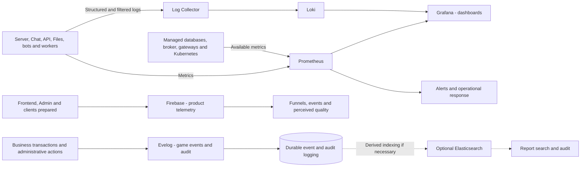

Firebase collects product telemetry: game entry, screen flows, controlled errors, and
usage events. It is not authority for balance, purchase or battle outcome. Mobile
integration depends on the SDK and APK version preparation; do not assume that the
legacy client already sends these events. Analytics does not receive player secrets,
tokens, message bodies, or dumps. Its unavailability does not block the game.
[Reference: Google Analytics for Firebase](https://firebase.google.com/docs/analytics).

Prometheus collects operational metrics; Loki centralizes logs; Grafana queries both.
Firebase is not a replacement for runtime and infrastructure visibility. To maintain the
VPS budget, destination/hosting of these backends will be defined outside of the main
node or only after explicit capacity reservation. Alerts cover queue delay, command
failures, connections, CPU/memory consumption, replication, per-operation latency, and
partition owner failure. Set SLOs and capacity from load testing, not an assumed number
of players per pod.

Operational logs record correlation, component, known operation, duration, and
controlled reason. Avoid player payloads, credentials, tokens and keys. High-cardinality
IDs must not become Loki labels or per-player Prometheus series; the search uses
structured fields when authorized. [Reference: cardinality in Loki](https://grafana.com/docs/loki/latest/get-started/labels/cardinality/).

**Evelog:** name of the game's event and audit log, as confirmed by the operator; does
not represent an external tool. The design proposes an append-only record in PostgreSQL,
linked to the outbox, with voluminous details archived in MongoDB/storage as per
retention. Events record action, origin, rule version, correlation and result, with
restricted access. This does not require adopting event sourcing for the entire game
state and does not replace Loki's operational logs.

Elasticsearch remains optional: use only if searches and filters in reports justify the
cost of a separate index. It receives reconstructable projections, with access and
deletion control; its unavailability does not block combat, login or progress recording.
Loki remains the primary destination for logs.

### Push notifications with Firebase Cloud Messaging

FCM is the channel for notifications outside the session: for example, construction
completed, march returning, attack alert or alliance event, depending on preferences and
permissions. Does not replace WS, chat history, or persisted state. Firebase Auth,
Analytics, and FCM have independent responsibilities and faults.

Server/Chat confirms the event and its outbox; the worker consumes the notification
intent and sends it through FCM from a trusted environment. It runs on `apps/workers` on
the VPS, using the defined messaging, without a new server per realm. The external call
does not enter the gameplay transaction. Use SDK/Admin or HTTP v1 with an adapter
validated for the Node.js production runtime and credentials restricted to the backend. [Reference: FCM architecture](https://firebase.google.com/docs/cloud-messaging/fcm-architecture).

The API associates each FCM installation/token with the authenticated account, platform,
environment and preferences; recipient per character/realm is validated by the backend.
An account can have multiple devices. FCM token is not login token. Update rotated
tokens, remove invalid ones and unlink the installation upon logout/account switch so as
not to send warnings from the previous user. Do not record tokens in logs or telemetry;
restrict access to registration. [Reference: FCM token lifecycle](https://firebase.google.com/docs/cloud-messaging/manage-tokens).

Maintain `notificationId`, cause, recipient, deadline and status of the attempt. Retries use
backoff and limit; Expired notification is not resent. The queue deduplicates intents
and the client deduplicates the ID when controlling the presentation; a failure after
sending may cause duplicates, therefore do not promise single delivery or confirm
reading because FCM accepted the message. TTL and collapse are set by category: a
delayed attack alert should not appear as current. Push is not a guarantee of real-time
warning; opening or reconnecting queries the API. [Reference: FCM message deadline](https://firebase.google.com/docs/cloud-messaging/customize-messages/setting-message-lifespan).

Preferences include categories, mute, and opt-out. Send minimal text and validated
navigation routes; never session tokens, full chat body or unnecessary private data on
the locked screen. Before sending alliance notices, revalidate recipient and scope.
Clicking requires current session and authorization; the payload does not authorize
command or grant benefit. Do not use public topics as an authorization mechanism for
private messages.

Web Push depends on browser support, HTTPS, permission, service worker and VAPID
configuration; is not performed by SSR. Mobile requires SDK/configuration and
permissions per version/platform, including APNs in the Apple client. The legacy APK
does not gain push just because of the backend configuration. Denying permission or
losing FCM does not prevent login, construction or combat. Validate each platform
without assuming that they all receive notifications under the same conditions.
[References: FCM Web integration](https://firebase.google.com/docs/cloud-messaging/web/get-started), [receiving by platform](https://firebase.google.com/docs/cloud-messaging/receive-messages).

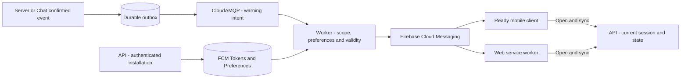

## 13. VPS Kubernetes, delivery, and continuity

The VPS's executable infrastructure lives on Kubernetes. SaaS services and frontends are
not pods in this cluster. Initial deployment is **a single node**; a lightweight
distribution like K3s is a candidate, after measuring its actual cost. [Reference: K3s requirements](https://docs.k3s.io/installation/requirements).

| Layer                       | Initial deployment                                                                                                                                   |
| --------------------------- | ---------------------------------------------------------------------------------------------------------------------------------------------------- |
| Entrance                    | Traefik and Kong/API Gateway on VPS Kubernetes, with declarative configuration.                                                                      |
| API                         | A shared Deployment, initially one replica; not duplicated per realm.                                                                                |
| Realms                      | `server-realm-1` and, if supported, `server-realm-2`; one active owner per realm and separate settings/pools.                                        |
| Calculation and auxiliaries | Combat TypeScript, workers/relay and Files with independent limits.                                                                                  |
| Coordination                | A ZooKeeper instance with persistent volume on the initial node; it is not an HA installation. Distributed ensemble is evolution for multiple hosts. |
| Data and queues             | External Neon, Redis.io, MongoDB Cluster and CloudAMQP; do not install your production copies on the VPS.                                            |
| Frontends                   | Pages for WWW/Docs/Admin; Vercel for Web Game SSR.                                                                                                   |
| Chat and bots               | Services external to the VPS; hosting and quotas still to be selected.                                                                               |
| Observability               | Light collectors/exporters in the cluster; target of Prometheus/Loki/Grafana outside of core budget or dedicated capacity yet to be defined.         |

Three ZooKeeper pods on the same VPS cannot survive machine loss. Kubernetes does not
create RAM, vCPU, or physical availability. It also does not automatically duplicate a
realm's Server. `ownerEpoch`, durable state and reconnection remain part of recovery
after VPS reboot or replacement.

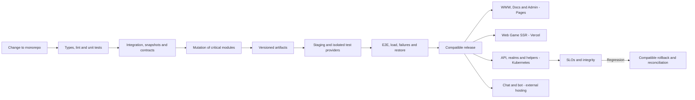

Deploys drain connections and allow reconnection. Workers and calculation only increase
concurrency within the VPS and providers budget. API remains unique at this stage; no
HPA policy creates one API per realm. External chat follows its own scaling and recovery
mechanism.

Backups and restores include Neon, unique MongoDB documents, storage, rule
configurations, operational state, and secrets. Validate restoration by provider and
consistency of references, without assuming that snapshots of the VPS disk contain data
kept outside of it. VPS disaster and regional disaster are different scenarios, both
with tested procedures.

## 14. Failures and expected degradation

| Failure                                           | Required behavior                                                                                                                                       |
| ------------------------------------------------- | ------------------------------------------------------------------------------------------------------------------------------------------------------- |
| Neon / writing compute                            | Suspend new mutations; reconnect with timeout; resolve uncertain result by receipt/idempotency. Do not confirm economic changes only in memory.         |
| Neon / compute ro delayed or unavailable          | Query compute rw for consistent data; reduce reporting or indicate lag, without burdening the primary with unlimited fallback.                          |
| Cache Redis                                       | Reduce dependent functionalities and apply limit fallback; Authentication and quotas explicitly fail when there is no safe alternative.                 |
| Broker or worker                                  | Preserve the outbox and show pending status; reprocess without duplicating effects. Impose backlog and backpressure limits.                             |
| ZooKeeper/session                                 | Stop mutations of the affected partition until reasserting ownership; refuse stale epochs.                                                              |
| Chat                                              | Game continues; chat reports unavailability and retrieves history via the persisted source.                                                             |
| Files/MongoDB/search                              | Uploading, documents and searches degrade; Central commands do not wait indefinitely for these services.                                                |
| External Battle Engine                            | Maintain recoverable reserve and pending result; timeout, idempotent retry and reconciliation. Do not create fictitious victory.                        |
| Observability                                     | Maintain game behavior; limited buffers and controlled disposal of operational logs, without losing the transactional audit record.                     |
| Bots                                              | Stop simulators without interrupting players; allow quick shutdown by scope.                                                                            |
| Firebase Auth                                     | Login/renewal may be unavailable; Existing sessions comply with validity and revocation policy. Do not accept invalid token to work around the flaw.    |
| Firebase telemetry                                | Discard/buffer events in a limited way; do not block game commands.                                                                                     |
| Firebase Cloud Messaging / push permission denied | Game continues; retry limited to warnings still valid, with discard after expiration. Recover state on open/reconnect, without relying on notification. |
| Stripe                                            | Suspend new purchases or show pending status; receive/reconcile events later without granting credit based on the success page.                         |
| VPS/Single Node Kubernetes                        | API and local realms stop until host recovers; External data services preserve what has been confirmed according to their guarantees.                   |

## 15. Sequence of evolution and pending decisions

1. **Contracts and core:** stabilize login, city, persistent construction, and the map;
   create differential tests and synthetic scenarios per client version.
2. **Modular server:** consolidate domains and adapters; separate Chat, Files, the
   shared API, and workers, with connection and resource limits.
3. **PostgreSQL migration:** map types and 64-bit integers, IDs, timestamps, balances,
   queue sentinels, and transactions; rehearse copying and reconciliation. Do not merely
   replace the driver or maintain informal dual writes with MariaDB.
4. **Data cutover:** copy with a backup, verify counts and invariants, synchronize the
   final delta in a controlled window, and choose a single writer. Rolling back after
   new writes requires planned reconciliation.
5. **Dashboard and edge:** publish WWW/Docs/Admin on Pages and Web Game on Vercel;
   integrate Firebase, auditing, and rule versioning; enable Kong and API contracts.
6. **Controlled production:** validate Kubernetes, replication, backups, failover,
   observability, and load before expanding realms and bot populations.
7. **Independent experiments:** evolve the web port and measure the need for MongoDB,
   Elasticsearch, complementary BullMQ, and a separate computation engine. Evaluate the
   Flutter client alongside the current APK; validate the Lua/native updater and R2
   distribution before enabling updates.

Decisions still open: numerical validation and Combat TypeScript benchmark; SSR
framework/adapter at Vercel; Neon, Redis.io, MongoDB Cluster, and CloudAMQP plans and
regions; Chat/bot hosting; storage of other objects; observability backend; validation
of the 16 GB VPS and admission capacity for both default kingdoms; eventual migration from Combat
TypeScript to Rust/Go; complementary use of BullMQ and version/fork of Konga;
feasibility of the Lua/native bridge, APK signing identity and scope/rendering of the
eventual Flutter client. The Auth, payment, R2 releases, and core hosting providers
defined in this document do not remain open.

Clients in `mobile/` and references in `legacy/` maintain separation between
original inputs, patches, and installation artifacts. Extracted originals and keys are
read-only; builds use separate area. Private materials, player data and credentials do
not go into the code or diagrams. No step in this document authorizes progress reset,
migration execution or deployment.

### 15.1. PostgreSQL database package

`packages/drizzle` is the application's PostgreSQL persistence package. Its maintained
Drizzle schemas in `src/schema` are the source of truth: 773 tables and 6,319 fields,
with one module per table. The package root exposes a typed PostgreSQL client, and
`schema/global` / `schema/kingdom` provide the corresponding role-specific models.

The default physical databases are `opencok_global`, `opencok_kingdom_1` and
`opencok_kingdom_2`, with configured kingdom IDs 1 and 2. The global database contains
`opencok_global`, `opencok_pay` and `opencok_chat` (113 tables). Both kingdom databases
contain the same `opencok_kingdom` namespace (660 tables each). One set of kingdom
table modules and migrations serves every configured kingdom; there are no per-ID
schema copies. Table/field names and values remain stable. Database names and
credentials are configuration. Pools and local transactions belong to one physical database; there
is no cross-database atomic commit. The future chat service/storage transition is a
separate domain change.

Standard Drizzle Kit generation maintains independent PostgreSQL migrations and
snapshots per role. The migration command applies only pending SQL using Drizzle's
journal and serializes deployments with a PostgreSQL advisory lock. Generated SQL statement breakpoints are disabled to
keep migrations comment-free. Removing historical breakpoint comments changes file
hashes but not SQL statements or journal timestamps; existing applied migration
records are retained, and no migration history or player data is reset. It refuses a
database containing the other role's application schemas. New kingdoms apply the same
kingdom migrations to separate databases. Default setup creates missing configured
databases and applies pending migrations. Typed connection routing selects a kingdom
by validated ID. Namespace-renaming migrations preserve existing PostgreSQL records;
physical database names can be overridden for existing deployments. No schema generation reads another engine's
SQL, and no transfer/checkpoint/comparison infrastructure is part of the runtime.

Schemas use PostgreSQL builders, declared keys/checks, native identities/sequences,
exact bigint/numeric handling and a minimal bytea Buffer adapter. Calendar-string
columns retain their existing text/value contracts, including sentinel values, with
inline format/calendar checks. Changing those data contracts requires its own domain
migration. Automatic application update timestamps use Drizzle's onUpdate callback;
explicit SQL writers must supply the required update fields. Text comparisons use
the database's PostgreSQL collation and ordinary SQL operators. `mail.rewardId` is
an explicit exception: the application still reads/writes a string, while its
Drizzle adapter stores UTF-8 `bytea` to preserve embedded NUL characters. The
incremental kingdom migration converts existing text without interpreting escapes;
raw SQL writers use UTF-8 bytes. This enables lossless legacy data import without
removing characters or adding player-specific exceptions to application code.

Unit tests, one snapshot per table, and PostgreSQL persistence E2E cover the complete
schema, defaults/constraints, transactions, migration repeatability, realm isolation
and restart. The [package guide](../packages/drizzle/README.md) documents imports,
generation/migration commands, data representations and verification.

### 15.2. Shared server environment

`packages/env` owns server environment configuration validated with Zod and inferred
TypeScript types. It locates the workspace root from its own module and loads only the root `.env`, independently of the working
directory. Explicit process/CI variables override file values. The file is optional
for CI and offline tooling; each operation requires the settings it actually needs.
The root `.env.example` documents the supported keys; private env files are ignored.
Validation reports variable names without exposing supplied values.

Effect applications consume `EnvironmentLive` and `readEnvironment` through
`@opencok/env/effect`; configuration failures occur inside their startup Effect.
Database/offline consumers can still import `env` / `requireEnv` from
`@opencok/env` for general settings
and `@opencok/env/database` for database-only settings, instead of reading configuration
directly from `process.env`. Each subpath validates and exposes only its domain.
The package does not mutate `process.env` and must not be imported into browser/mobile bundles. Runtime composition passes
validated settings to adapters. Bun's root configuration disables automatic dotenv
variants; the Drizzle package links that configuration for package-local invocation
and pins Drizzle Kit's own dotenv loader to the same root file. See the
[environment guide](../packages/env/README.md) for commands and deployment assumptions.

### 15.3. First PostgreSQL server migration slice

`apps/server` now contains the first port of the working Bun `apps/new-server`
experiment: SFS/TCP transport for mobile 12.06.0, existing-account authentication,
city bootstrap, deferred login data and base-world viewport reads. Transport,
compatibility DTOs and the persistence adapter remain colocated for this initial
slice; shared package extraction can follow once contracts stabilize.

The adapter implements explicit read interfaces using existing `@opencok/drizzle`
tables, with separate global/selected-kingdom connections. Snapshot transactions
are read-only, repeatable read and UTC. Redis session keys and ZooKeeper ephemeral
registrations include the kingdom ID; map rows come from the selected PostgreSQL
database rather than the experiment's shared `world1` hash. Runtime setup does not
apply migrations or provision player state.

Public player summary queries can read a second explicitly configured realm through
`GAME_PLAYER_KINGDOMS`. The global account directory routes missing numeric player
IDs to the authoritative database; each realm uses its own read-only snapshot.
This grants no cross-realm write authority and does not enable cross-realm gameplay.
Only public fields and required presentation metadata are selected, with a separate
allowlisted wire DTO. Missing routes and dependency failures reject the response;
remote availability does not gate local login readiness. Update markers use the
realm-scoped Redis `player-update` namespace. See the server guide for exact key
format, configuration and legacy compatibility details. This incremental query
work is currently validated with unit tests and synthetic adapters only.

The full `get.user.info` public query also uses configured realm reads. It routes
through the global directory first, with a local-realm fallback only when the
directory has no entry. The selected realm supplies a repeatable-read snapshot of
identity/progression, statistics, general previews, equipment, medals, flowers,
offices and alliance presentation. The observer's authenticated membership controls
alliance capacity visibility. Target identity and realm mismatches reject the query;
no public command grants cross-realm write authority. Legacy getter repairs and
write side effects remain documented gaps in the server guide, not migrated mutations.

Ordinary-realm power, kill and level ranking queries read the requester, bounded
candidates and fallback position in a single read-only repeatable-read transaction.
The rules layer preserves each board's exclusions and candidate-window semantics;
the DTO layer exposes only public ranking fields. These commands read persisted
scores without introducing score writers or Redis ranking state. Fresh snapshots
and deterministic final UID ordering replace the legacy cache lifecycle and
unspecified ties; the server guide records collation and verification limitations.
Alliance power/kill queries follow the same snapshot boundary, aggregating persisted
member statistics and, for candidate power, alliance-science power. Batched science
and video reads supply public presentation. The rules preserve distinct candidate
windows and member-only fallback positions; these reads grant no alliance write
authority and introduce no cache or schema dependency.
The castle board reuses the player-ranking boundary with distinct candidate and
fallback ordering. Its fallback offset uses a SQL window within the snapshot;
construction queues and persisted power are never recalculated by the query.
Material-contribution rankings read the existing contribution table with their own
window and empty-list response contract; score writers and activity resets remain
outside the query boundary.
Expedition ranking reads use the shared Redis instance with a global realm-pairing
record and lower-realm score/metadata keys. A read-only Lua evaluation revalidates
pairing and returns a consistent bounded board; one retry handles a rematch. The
controller authenticates the local owner, decodes integer-preserving metadata and
projects only public fields. Importing authoritative event state and maintaining
pairings/scores remain separate from the reader; namespace and verification details
are in the server guide.

Mailbox category status reads the authenticated recipient's grouped counts with the
owner profile in a read-only repeatable-read snapshot. Contents and reward payloads
stay outside this read interface. Pure rules retain the combined versus selected
category distinctions and numeric widths. The status query grants no mutations.
Mailbox save/cancel commands use a separate recipient-scoped write interface. A locked
owner profile authorizes each realm transaction; conditional saved-flag updates and
durable `mail_update` markers commit together. Marker timestamps never decrease and
only matched owned messages receive markers. The additive kingdom migration supplies
the marker table; synchronization consumers, cleanup, read marking, deletion and
redemption remain separate work. This follows ADR-0002/0005 without dual writes to
Redis. Absolute flag assignments preserve repeat-request state absent intervening
changes; correlation fields do not provide durable command receipts. The server guide
records these limits, compatibility differences and unit-only validation.

Construction, queue settlement and combat remain unavailable. Porting them next
requires PostgreSQL receipts/activity models, atomic resource changes, epoch
fencing and recovery tests before enabling writes. Account provisioning,
controlled player-data cutover and native APK validation remain separate work.
Synthetic TCP tests validate the two PostgreSQL realms, dependencies and unchanged
player state; they do not prove APK rendering. See the [server guide](../apps/server/README.md)
for configuration, supported commands, limitations and verification.

### 15.4. Local TypeScript stack

The root Compose environment now composes Traefik, the shared Bun discovery API,
one read-only Bun realm server, PostgreSQL, Redis and ZooKeeper. MinIO and its one-shot setup job supply the client CDN. Chat and media/files
have no services or gateway routes in this stage. All services use `all`/`dev`
profiles, including pgAdmin, Redis Insight and Portainer. The broader production architecture remains the target;
this local stack does not establish TLS, Firebase or production readiness.

The API reads global account/mapping tables through existing Drizzle models. It
preserves the three mobile discovery aliases and wire encodings while removing
account reactivation, legacy Redis counters, hardcoded country/server selection,
GeoIP/upload-key setup and unrelated external update metadata. Only existing active
accounts resolve to an existing realm; discovery never provisions or mutates state.
Server-directory metadata is configured separately from bind addresses. The API
exposes liveness and bounded PostgreSQL/Redis readiness with sanitized logs.

Compose is local development only, with direct service values and no host-IP
prefixes on published ports. The root env contains `NODE_ENV`, `DATABASE_ROLE`,
`DATABASE_URL` and the private game-login-secret exception. Application values
still pass the dedicated API/server Zod schemas. Container database URLs are
direct Compose values, separate from the host-side root URL. The authorized
server reference is copied under ignored `data/reference/server`; runtime XML
is mounted from that local copy, without another checkout dependency. Persistent PostgreSQL/Redis/ZooKeeper volumes are
retained; initialization applies pending migrations before app readiness. The
initial active TCP route is `server:9933` for COK1, and discovery advertises the
configured host-facing port. Both kingdom databases retain the shared schema;
activating another server/endpoint requires its own prepared account state.

See the [local stack guide](../infra/compose/README.md) for profiles, configuration,
private resource mounts and recovery. A disposable Compose test builds images and
exercises PostgreSQL discovery and real SFS login through Traefik, preserving
synthetic state and testing dependency failure without using player databases.

## 16. Simulation execution and offline progress

The Server executes a logical queue of commands per aggregate/partition, with
transactions for conflicts between aggregates. Deadlines are persisted UTC instants; the
monotonic clock measures duration and timeout within the process. The client clock does
not determine completion, production or reward. Tests are given an injectable clock to
advance days without waiting for real days.

| System                              | State and authoritative transitions                                                                                                                              |
| ----------------------------------- | ---------------------------------------------------------------------------------------------------------------------------------------------------------------- |
| Construction, research and training | `queued → running → completed`; permitted cancellation uses an exclusive transition with a versioned refund policy.                                              |
| Resources and production            | Record `lastSettledAt`, production rates, caps, and rate changes; settle the unprocessed range once.                                                             |
| Marches                             | `scheduled → marching → arrived → returning → returned`, with deadline, destination and troop reserves. Combat/occupation are explicit transitions upon arrival. |
| Temporary effects and abilities     | Versioned start, end, overlap, and source; expiration changes state and invalidates dependent caches.                                                            |
| Realm Events                        | Pinned schedule and rule version; opening, closing and reward have their own receipts.                                                                           |
| Rewards, inventory and quests       | Transitions by command/event with idempotency; consulting a screen does not create a new reward.                                                                 |

A scheduler looks for past deadlines and wakes the responsible executor. Each activity
has an ID, version, due date and expected state. Multiple workers can discover the same
activity, but only one transaction applies the transition. Job duplication,
reconnection, and restart do not repeat completion.

Offline progress uses the same deadlines and rules. When starting, the owner reconciles
outstanding activities and settles production intervals in limited batches. Bonus
changes during an interval require splitting the interval at the effective time; do not
multiply the current rate by the entire offline period. Operations that depend on an
activity that has not yet been reconciled wait for or reconcile that aggregate within a
bounded time, rather than accepting incorrect state.

Concurrent expiration, completion, and cancellation check the same state version and the
same receipt. Delay policy does not depend on the accidental order of jobs; the ordering
between simultaneous events is part of the rules. Periodic rewards and event times use
explicit rule timezone, without depending on the container's local zone. The persisted
instant remains in UTC.

## 17. Data model and write ownership

The physical model will be versioned by migrations. The logical organization below
defines the owners and invariants that these migrations must preserve. `identity`
represents the Firebase link and internal permissions; login credentials are managed by
Firebase Auth. A realm's account/character belongs to the game. This separation resolves
the overlap between API and Server.

| Proposed domain/schema | Central entities                                                                                                                         | Authorized Writer                                                                                         |
| ---------------------- | ---------------------------------------------------------------------------------------------------------------------------------------- | --------------------------------------------------------------------------------------------------------- |
| `identity`             | Unique Firebase UID binding for internal account, Guest/linked state, game session/ticket, internal revocation, and administrative roles | Shared API; provider credentials and bindings in Firebase Auth.                                           |
| `notifications`        | FCM installations and tokens, preferences, account/character/realm scope, send intent, expiration, and attempts                          | API registers devices/preferences; worker sends notifications of authorized events.                       |
| `game`                 | Player by realm, city, building, activity, research, troops, march, inventory and aggregate version                                      | Partition owner server.                                                                                   |
| `economy`              | Wallet, ledger entry, reservation, consumption, refund, and operation receipt                                                            | Economic Server use cases; administrative API requests commands.                                          |
| `combat`               | Battle, snapshot, reservations, engine version, result and application receipt                                                           | Server authoritative orchestrator. The Combat TypeScript process only calculates.                         |
| `social`               | Alliance, Membership, Roles, Permissions, and Membership Ranges                                                                          | Server alliance domain. Chat queries derived authorization.                                               |
| `chat`                 | Channel, message, sequence, receipt, archive metadata, and retention state                                                               | Chat and its retention worker, with specific permissions.                                                 |
| `files`                | Upload, owner, object, hash, transformation and reference                                                                                | Files and media workers.                                                                                  |
| `billing`              | USD Catalog, order, Checkout Session, payment, received events and delivery status                                                       | API/payments worker; granting items/currency only by the Realm Server and Ledger.                         |
| `operations`           | Rules version, publication and administrative audit                                                                                      | Authorized administrative use cases; publication passes through the Server when it affects gameplay.      |
| Integration            | Outbox and inbox/receipts per service                                                                                                    | The producer writes its outbox in the transaction; the consumer writes its inbox when applying the event. |

Minimum invariants: non-negative available balance; reservation not consumed twice;
inventory and troops with valid quantities; activity with a single completion or
cancellation; participant linked to the right realm; only one result applied per battle.
Unique keys and version checks in the database complement application validation.

The ledger records the cause and credits/debits of each operation, including transfers,
consumption and refunds. Categories and units are explicit; materialized balance must
reconcile with confirmed postings. Do not correct balance with separate SQL: use
identified and auditable administrative adjustment. Upper bounds are also rules, not
just the size of the SQL type.

A command transaction confirms state, ledger, receipt and outbox together. Reusing a
`requestId` with the same content returns the recorded result; reuse with different
content is rejected. Changes by workers in someone else's domain go through the owner's
command/event, never through unrestricted SQL access. Indexes cover ownership,
state/deadline, pagination, and idempotent keys; reports use projections or queries with
their own budgets.

## 18. Identity, protocols and reconnection

### Identity and authorization

Firebase Auth takes care of login and credentials. The API checks the ID token for
signature, issuer, project/audience and expiration, and applies the revocation policy;
decoding a JWT does not authenticate a session. The Firebase UID is linked once to the
internal account, which can have a character in up to two realms. Standard token
verification does not automatically check for revocation: this control must be
enabled/implemented according to the scope. [Reference: Firebase token verification](https://firebase.google.com/docs/auth/admin/verify-id-tokens).

The API exchanges the validated ID token for a game session with account, character, and
realm scope. Permissions and bans come from the authoritative state. The legacy APK does
not support Firebase just by configuring the backend: SDK or authentication bridge
require version validation, preserving the accepted protocol. Never fabricate a Firebase
UID or authenticated session from a device UUID received without proof of identity.

Registration and account linking create identity and character in idempotent stages,
with explicit provisioning state. Login identifies realm, character and protocol
version. Renewal and access recovery do not create another character or erase progress.
Missing external integrations return explicit state of unavailability.

Sessions record expiration, revocation, and authorization version. Chat and game tickets
have their own scope and duration. Logout, ban and removal from position must invalidate
the corresponding access, including already opened sockets. Key rotation maintains a
controlled window of checking valid sessions. Administration uses operator identity,
roles by realm, and audit; player credentials do not grant administrative authority.

Membership in the alliance is revalidated when entering the channel and sending/checking
history. Leaving or being expelled revokes the subscription and archive access; access
to older messages requires an authorized membership interval. A missed change
notification is recovered using the membership version, without relying exclusively on
Redis Pub/Sub.

### Guest account login and linking methods

All methods below converge to Firebase Auth → UID → internal account. The Server
receives the same authorized identity regardless of the provider. This is the target
matrix; enabling the method requires provider configuration and validation in the Web
Game and in each supported mobile version.

| Method             | Target Integration      | Preparation and behavior                                                                                                                                 |
| ------------------ | ----------------------- | -------------------------------------------------------------------------------------------------------------------------------------------------------- |
| **Guest**          | Firebase Anonymous Auth | Create real anonymous identity, with validated session; maintain progress associated with the internal account. Do not use local UUID as authentication. |
| **Facebook**       | `facebook.com`          | Meta application, credentials and callbacks configured; request only the necessary scopes.                                                               |
| **Google**         | `google.com`            | OAuth configuration and validated mobile platform identifiers/signatures.                                                                                |
| **Email/Password** | `password`              | Registration, email verification, recovery and password policy through Firebase; do not save password in PostgreSQL.                                     |
| **Apple**          | `apple.com`             | Apple identifiers, keys and callbacks; handle private email/relay and link consent as per flow.                                                          |
| **Microsoft**      | `microsoft.com`         | Microsoft OAuth Registration; define accepted personal/organizational accounts and tenant policy.                                                        |
| **GitHub**         | `github.com`            | OAuth GitHub app, authorized callback and minimal scopes; do not ask for access to repositories to play.                                                 |

Configuration references: [Guest](https://firebase.google.com/docs/auth/web/anonymous-auth), [Facebook](https://firebase.google.com/docs/auth/web/facebook-login), [Google](https://firebase.google.com/docs/auth/web/google-signin), [Email/Password](https://firebase.google.com/docs/auth/web/password-auth),
[Apple](https://firebase.google.com/docs/auth/web/apple), [Microsoft](https://firebase.google.com/docs/auth/web/microsoft-oauth) and [GitHub](https://firebase.google.com/docs/auth/web/github-auth).

Converting Guest to linked account uses the **account linking** flow, preserving
Firebase UID, internal account, characters, and realm progress. Signing into another
provider as if it were a new account does not replace this flow. Multiple providers can
belong to the same account; email, name, and avatar are not ownership keys. Do not
automatically merge accounts using identical emails. If the credential already belongs
to another UID, interrupt the link and offer recovery with proof of identities; eventual
transfer/merger of progress requires separate, audited and idempotent procedure, without
deleting the Guest account. [Reference: Provider binding maintaining UID](https://firebase.google.com/docs/auth/web/account-linking).

Guest is persisted, but without a linked method it may lose access after session
loss/reinstallation; explain this and offer account linking before this happens. Do not
enable automatic cleanup of anonymous identities with player progress without an
explicit preservation/recovery policy. Enforce creation and abuse quotas without using a
device identifier as proof of ownership. An offline provider does not authorize
replacing an existing account with Guest silently.

Linking/unlinking and changing credentials require authorization and recent
reauthentication when applicable. Do not remove the last recoverable sign-in method
without an explicit flow; update the internal link after validating the state in
Firebase. OAuth Secrets live in the trusted configuration environment, outside of
clients and logs. Authorize domains and callbacks by environment, including the Firebase
domain used by the flow; validate redirects in the Pages/Vercel deployment and in the
APK. Guest is not the identity of the panel operator. Logging in through a provider does
not grant administrative functionality or access to another character.

### Command and event contract

The internal contract is independent of SFS or WebSocket. Transport adapters map the
client's existing fields to this envelope, without requiring an old APK to start sending
unknown fields.

| Field                                      | Rule                                                                                                                         |
| ------------------------------------------ | ---------------------------------------------------------------------------------------------------------------------------- |
| `protocolVersion`, `schemaVersion`         | Validate before interpreting commands or events.                                                                             |
| `requestId`, command type and content hash | Correlate response and allow retry without duplicating a mutation.                                                           |
| Identity, realm and scope                  | Derived from the validated session; client-supplied IDs do not prove ownership.                                              |
| `aggregateId`, `expectedVersion`           | Apply concurrency control when necessary.                                                                                    |
| `eventId`, `sequence`, `occurredAt`        | Identify durable events, order them per stream, and recover them. There is no implicit global order between channels/realms. |
| Error and operation status                 | Distinguish rejection, pending, confirmation and uncertain result. Timeout is not proof that a command did not occur.        |

When reconnecting, the client identifies the session and the last confirmed cursor. The
service validates the scope and delivers still retained events; if the cursor has
expired or there is a gap, it sends a new authorized snapshot and restarts the
synchronization sequence. Pushes lost after a commit must be recoverable by outbox or
status query; the connection is not the only record of a change.

Output queues per socket have a limit. Slow client receives controlled backpressure,
resynchronization, or disconnection; cannot cause unlimited memory growth. Obsolete
presence events can be aggregated/discarded; economic responses and durable events
follow recovery policy. Heartbeats, timeout and resume are tested per client and
version. The legacy adapter maintains the mechanisms actually supported by the APK; new
cursor/ACK capabilities are not assumed to already exist in it.

## 19. Realms, partitions and operations between owners

The first production configuration maintains one logical owner per realm, with separate
Servers and shared API; the initial maximum is two realms. Regional splitting is enabled
only after validating cross-partition transfers and operations. Aggregate identity does
not change when it changes pods; routing queries a versioned ownership directory.

A transfer uses a durable record with `transferId`, source, destination, version, and
state: prepare → suspend new aggregate mutations in source → persist checkpoint → switch
ownership/epoch atomically → destination load checkpoint → commit. Repeating a step does
not duplicate the entity. Failure before switching allows resuming at origin; after the
switch, recovery uses the new owner. Late requests receive the current routing or are
rejected by epoch and receipt.

While aggregates share the same PostgreSQL, operations that reserve troops/resources
from multiple participants use transaction and defined lock order. No partition
publishes victory before confirming authoritative application. If an evolution
distributes participants across independent databases, a versioned protocol for
reservations, coordination, and compensation will be required; do not automatically
transform a transaction into multiple RPCs. This mode is disabled until validation.
Events between realms follow the same border.

Throne conquest and KVK are part of the mandatory peak scenarios. Each battle has an
authoritative coordinator, global `battleId` and versioned reserves of the
participants. In KVK, two Servers do not independently calculate/apply the same battle:
the coordinator receives the reserved snapshots, requests the calculation and confirms
the effects via the idempotent application protocol. As long as there is a single
database, the transaction can validate reserves and epochs of the two realms in a
defined order; it is not open during remote calculation. Failure of any participant
requires durable recovery without releasing troops before resolving the reservation. KVK
remains disabled until concurrency, recovery, and application are validated between
realms; opening two realms does not prove support for KVK.

## 20. Global and alliance chat: delivery, archiving, and deletion

### Defined retention policy

The deadlines are elapsed durations, counted from `createdAt` **of the server-confirmed
send time in UTC**. `archiveAt = createdAt + 24h` and `expiresAt = createdAt + 168h`. Editing, retry, import and archiving
do not renew these deadlines. Early deletion due to moderation remains permitted.

| Message age                 | Status and storage                                                                 | Access                                                                                               |
| --------------------------- | ---------------------------------------------------------------------------------- | ---------------------------------------------------------------------------------------------------- |
| Less than 1 day             | Active; body in recent PostgreSQL history, with limited cache.                     | Recent history and WS delivery to authorized members.                                                |
| From 1 day to before 7 days | Archived; body in MongoDB, with minimal metadata/cursor when needed in PostgreSQL. | Paginated archive endpoint, with the same authorization as the channel. Removed from recent history. |
| 7 full days or more         | Expired; deletion of the body and operational copies.                              | Do not return to history, archive, search or replay, even if physical cleaning is delayed.           |

This rule applies to **global chat and alliance chat**. Private messages and other
channels need their own explicit policy, without inheriting retention by accident. Do
not archive the body of these messages permanently in Evelog or Loki; operational
moderation events store only necessary metadata.

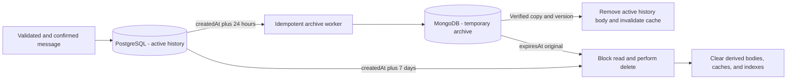

### Delivery and ordering

Chat assigns `messageId` and sequence per channel. The pair of sender and client
sending ID allows retries to be recognized, checking the content. Confirm sending after
persisting message and distribution event; the consumer only distributes confirmed
messages. Redis Pub/Sub performs fan-out between pods, but does not replace persisted
history or guarantee delivery recovery.

History and archive use stable cursor per channel/sequence, with deduplication by
`messageId` on storage transition. Reconnection retrieves allowed and unexpired
messages; retention gaps signal resynchronization. Deletion/moderation produces
tombstone to remove the message from projections and prevent an old retry from
publishing it again. Authorizations also apply to queries in MongoDB and search indexes.

### Retention jobs and failures

A reconciler scans messages whose deadlines have passed in batches by channel and
deadline. First upsert the archive record with the same ID, version and `expiresAt`;
verify the copy before removing the body from PostgreSQL. Concurrent editing uses
versioning to prevent an old copy from beating the new one. If MongoDB is unavailable,
preserve the recent copy temporarily and alert the delay, without deleting before
archiving. It no longer appears in the recent history after 24h; archive queries can use
the pending copy, maintaining scope and deduplication.

At 7 days, the expiration takes precedence over the archiving attempt: a delayed job
does not recreate an expired message. API and WS filter by `expiresAt` in every
query/replay. Cleanup removes bodies in both databases, cache, indexes, and unique
attachment objects subject to the same policy. Deduplication receipts can survive
without a body for the period necessary to prevent old replay.

Use a MongoDB TTL index on `expiresAt` as reinforcement, in addition to a deletion
worker and filters in the application. TTL does not guarantee removal at the exact
moment of expiration. The proposed goal in healthy operation is to reconcile every
minute and complete physical cleaning within five minutes of the deadline; delays
generate alerts and do not extend the visibility of the message. [Reference: MongoDB TTL indexes behavior](https://www.mongodb.com/docs/manual/core/index-ttl/).

Physical/PITR backups may contain old versions: online deletion does not instantly erase
existing WAL and backups. These copies have restricted access and documented retention;
any restore deletes expired messages before reopening the service. A requirement to also
delete all backup copies within seven days needs specific backup/key design; do not
claim this guarantee as a consequence of a `DELETE` or TTL.

## 21. File and media lifecycle

Files authenticates the owner and creates an `uploadId` with size, allowed MIME,
duration limit, and temporary object. The upload goes through the service or a
restricted signed URL; completing the upload does not prove that the file is valid.
Files checks bytes, actual file type, dimensions, hash and processing limits, and
registers `pending → uploaded → validated → ready`, or `rejected` with controlled reason.

Transformations, thumbnails and checks run on workers with CPU/memory/time limits.
Profile and message only receive ready and authorized reference; confirmation/retry uses
the same receipt. A reference that is still pending is not displayed as a confirmed
file. The service keeps track of references and performs collection of abandoned uploads
and orphaned objects with a safety window.

Deletion revokes authorized delivery, invalidates caches/CDN when applicable, and
schedules removal of the object, derivatives, and metadata permitted by retention.
Shared objects are only removed when there is no valid reference. Signed URLs, public
avatars, and private attachments have different policies. Local MinIO and production
storage, including R2 for releases, are exercised by the same S3 contract, without
assuming equality of all functionalities between providers.

## 22. Mandatory testing strategy

All layers below are part of the quality architecture. This is an implementation policy;
suites still need to be built at this checkout. A manual smoke test on the APK does not
replace automated E2E.

| Layer                 | Scope                                                                                  | Mandatory examples                                                                                                              |
| --------------------- | -------------------------------------------------------------------------------------- | ------------------------------------------------------------------------------------------------------------------------------- |
| **Unit Tests**        | Isolated functions and use cases, injectable clock/RNG, and controlled dependencies.   | Costs, limits, bonuses, rounding, permissions, transitions, offline production, retention and economic invariants.              |
| **Integration Tests** | Adapters with real, disposable databases, broker, ZooKeeper and storage.               | Transaction/rollback, concurrency, primary/replica, outbox/inbox, redelivery, change of owner, migrations, chat archive and S3. |
| **Snapshot Tests**    | Contracts, serialization, deterministic results and visual interfaces.                 | SFS frames, API JSON, WS events, combat state/trace, HTML SSR and web/dashboard screens.                                        |
| **E2E Tests**         | Flow from client to persistence and return, through the gateway and real applications. | Login, city, build/complete/reconnect, map, chat between two clients, moderation, files and panel commands.                     |
| **Mutation Tests**    | Evaluate whether the suite detects behavioral changes in the code.                     | Swap comparators, remove owner/epoch checks, change cost/rounding, and remove idempotency or retention limits.                  |

### Organization, tools and environments

Unit tests live close to their modules; integration tests live alongside the adapter/app
under test. `tests/` focuses on common synthetic contracts and fixtures and E2E
journeys. TypeScript is the initial engine and uses a runner validated for Bun; Python
uses its own suite for the bot. Rust/Go will have their own suites if they are adopted,
maintaining the same contract and replay tests. No suites use production credentials or
create players in the real realm.

Integration tests start isolated dependencies for each run, with their own
schemas/buckets/queues. Validate primary/replica PostgreSQL, Redis, MongoDB, RabbitMQ,
ZooKeeper and MinIO depending on the affected component. Staging also exercises
dedicated testing endpoints of Neon/Redis.io/MongoDB/CloudAMQP, without touching
production. Firebase Auth uses emulator/test project; Stripe uses test mode and
simulated signed events, with no real billing. Cleanup only removes resources created by
execution; does not perform reset/flush of shared volumes. Include dependency failures
and recovery in addition to the success path.

For E2E web/dashboard/landing, Playwright is the proposed tool. For APK, validate
automation on emulator/device with appropriate framework and maintain a matrix per
version; a test SFS client covers the protocol but does not prove native rendering. E2E
business flows maintain real services; unavailable third-party simulations are
explicitly identified in the report.

Data snapshots fix rules, random seed/transcript, clock, and relevant order. Normalize
only volatile data without semantics, never troops, balance, damage, recipient or
authorization. A snapshot change requires review of the diff and reason; do not
automatically accept a new baseline because the test failed. Screen snapshots fix
browser, fonts, resolution and environment, with visual tolerance separate from the
equality of authoritative values. [Reference: Playwright visual comparisons](https://playwright.dev/docs/test-snapshots).

Mutation testing uses StrykerJS with compatible runner for TypeScript and `cargo-mutants`
if Rust is adopted; Go tooling will be selected if there is a port to that language.
Integration with runner Bun must be proven; do not assume direct support. Python
tool/runner will be validated for modules that have their own relevant rules.
[References: StrykerJS](https://stryker-mutator.io/docs/stryker-js/introduction/), [cargo-mutants](https://mutants.rs/).

The catalog of critical mutations cannot have non-equivalent survivors in combat,
balance, ownership, idempotency, and retention paths. Equivalent mutants require
reviewed justification; timeout, broken test or incomplete execution do not
automatically count as validated behavior. The overall score has a baseline and
threshold per package, without using a high average to hide a surviving critical mutant.
Do not confuse mutation testing with fuzzing or testing commands that change the state
of the game.

### Auth and push validation

Test Guest → each of the six non-anonymous methods, bind multiple providers to the same
UID, re-enter on another device, and preserve both characters/realms. Cover credential
already linked to another UID, OAuth cancellation, Apple private email, password
recovery, expired/revoked token, per-environment callbacks, and provisioning
concurrency. Collisions cannot create duplicate balance/character or transfer ownership
by email coincidence. Validate real external flows using test accounts: the emulator
does not alone test OAuth configuration or native client behavior.

Push covers denied opt-in, foreground/background, rotated/invalid token, logout/account
switch, multiple devices, alliance revoked, TTL, duplicates, retries, and FCM
unavailability. Local tests use controlled adapter; actual delivery uses dedicated
project/staging devices, without production tokens. Validate authorized opening and
resynchronization, not just acceptance of the send call. In snapshots, use synthetic
identities and tokens.

### CI and release criteria

PRs run types/lint, unit tests, affected contracts and snapshots, integration of changed
adapters, and E2E of core journeys. Changes to critical modules perform targeted
mutation before merging. Complete mutation, client matrix, recovery, load and
cross-compatibility suites run periodically and are a requirement of the release
candidate.

Failure of mandatory test blocks promotion. Retries are used for diagnosis; recurrent
instability has responsibility and deadline, without converting failure into silent
success. Reports preserve commits, images, versions, seeds, fixtures, snapshot diffs,
coverage and mutation results, without real player data. Line coverage alone does not
approve a rule.

Chat retention tests the exact boundaries of 24h and 168h, UTC clock, edit and retry
without term renewal, race between archive and deletion, alliance authorization, old
cache, MongoDB unavailability, restoration and replay of expired jobs. Use a controlled
clock, without waiting one or seven real days.

## 23. Development environment and administrative tools

The implemented root `docker-compose.yml` starts PostgreSQL, a one-shot Drizzle
setup job and pgAdmin 4 under the `dev` / `all` profiles. Setup waits for database
health, creates/migrates the global database and both default kingdoms, and generates
a password-free pgAdmin server registration. Named volumes persist the cluster and
pgAdmin settings. The database/setup use the internal network; pgAdmin also uses the
external network. Compose explicitly configures local credentials and host ports;
application tools use the single root `.env`. The build context excludes private
files and mobile artifacts. The
[local environment guide](../infra/compose/README.md) documents startup, verification,
credential changes and recovery. This single-instance local environment does not
implement the production replica/managed-service topology.

The current development Compose uses `dev` and `all` on every service; both
profiles select the same complete stack. Redis Insight and Portainer have their
own persistent volumes. The isolated stack suite covers every declared service,
including the two one-shot setup jobs; its Portainer instance omits the host
Docker socket. Additional profile subdivisions remain a future proposal.
Administrative interfaces are developer tools and not game startup dependencies. Application CI does not need to start these interfaces to test the core.
Declarative configuration of the gateway remains versioned.

| Requested tool    | Development use                                                            | Boundary                                                                                                            |
| ----------------- | -------------------------------------------------------------------------- | ------------------------------------------------------------------------------------------------------------------- |
| **Konga**         | Lab Kong inspection/administration interface.                              | Validate a version/fork compatible with the chosen Kong; it is not the game's administrative panel.                 |
| **Mongo Express** | Inspection of collections and the temporary message archive.               | Access only to local/synthetic MongoDB, with authentication.                                                        |
| **pgAdmin 4**     | Inspection of schemas, transactions and PostgreSQL `rw`/`ro` endpoints.    | Credentials by environment; read permissions do not allow changes to the replica.                                   |
| **Redis Insight** | Inspection of caches, sessions, presence and Redis queues when applicable. | Identify instances to avoid confusing disposable cache and durable queues.                                          |
| **MinIO**         | Local S3 storage and console for uploads, assets, replays and testing.     | Buckets and local credentials; tests isolate your prefix/bucket and do not delete objects from another environment. |
| **Portainer**     | Inspection and operation of laboratory containers/stacks.                  | Runtime administration access; do not give application access to the Docker socket.                                 |

**Konga Compatibility:** Upstream states that as of 0.14.0, Kong 1.x is only supported.
Therefore presence on the dev plan does not prove compatibility with a modern version of
Kong. Select and test a compatible fork/version or register the interface replacement;
Don't downgrade the production gateway just to accommodate the tool. The choice remains
pending before activating this profile. [Reference: compatibility declared by Konga](https://github.com/pantsel/konga#compatibility).

Development interfaces are in loopback/private network, without public game routes and
without real credentials. Relevant manual operations generate a reproducible procedure
in the repository; a change made to the UI does not replace migration, versioned
configuration or testing. Profiles are not automatically copied to production. The
production operation uses the restricted access defined for each service, with its own
authorization and auditing.

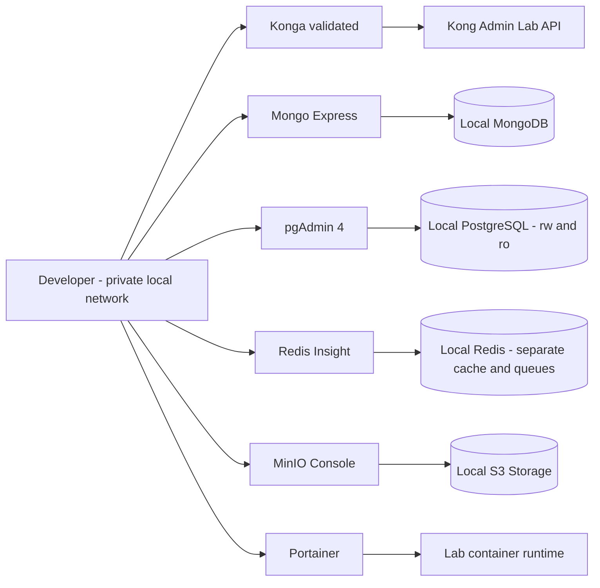

## 24. Operational goals, capacity and incidents

The values below are **initial targets proposed for validation**, not measured results
or guarantees of the current checkout. Load and failure tests must validate the values
on the chosen hardware and topology before release.

| Indicator                     | Proposed target and scope                                                                                                                                                                                           |
| ----------------------------- | ------------------------------------------------------------------------------------------------------------------------------------------------------------------------------------------------------------------- |
| Core/API availability         | 99.9% monthly, with definition of success/error by operation and maintenance accounted for in the published policy.                                                                                                 |
| Common synchronous command    | p95 up to 150 ms and p99 up to 500 ms in the application path, without internet RTT or explicitly asynchronous tasks.                                                                                               |
| Confirmed economic durability | RPO/RTO linked to the guarantees and recovery of the contracted Neon plan; validate uncertain commits and restore. Do not declare RPO 0 just for using two computes.                                                |
| VPS Recovery                  | Initial goal of resuming API and realm within 15 minutes after the host becomes available; measure rebuild, secrets, reconciliation and reconnection. This does not guarantee physical replacement by the provider. |
| Chat retention                | Messages become invisible to queries at the 7-day boundary; reconciliation every minute and physical cleaning in up to 5 minutes in healthy operation.                                                              |
| Capacity by realm             | Publish the baseline of simultaneous connections, commands/s and battles/s sustainable, with p99, CPU/memory and database budget, before admitting the corresponding population.                                    |

Capacity testing includes normal load, peak and backlog recovery; separately measures
players and bots, external chat, SSR on Vercel, combat and workers. The VPS does not
take over the memory of services hosted outside of it. Configure simulated population
and concurrency limits based on this baseline. HPA does not exceed the database's
connections/pools or the broker's recovery capacity. Metrics include overdue tasks,
backlog, archiving/purge delay, and backpressure rejects, as well as CPU and memory.

Each alert has responsibility, severity and procedure: identify impact, contain new
operations when necessary, preserve receipts/private evidence, recover the component,
reconcile pending issues and verify invariants. Do not resolve inconsistencies with
database/cache reset. Economic corrections use audited commands, and queue reprocessing
keeps the original idempotent keys.

Realm maintenance uses an announced drain mode, blocks new affected operations,
checkpoints state, and resumes service. Regional disaster recovery has its own RPO/RTO
and exercise, including storage, secrets and backups external to the cluster's fault
domain; do not infer regional recovery from the failover of a Neon read replica or pods
on the same host. Key rotation, restoration and revocation of access are part of the
versioned operational procedures.

### 24.1. Initial VPS budget for the two default kingdoms

16GB is a deployment hypothesis, not a proven capacity. Check actual memory in GiB, node
`allocatable`, number/type of vCPUs, and sustained CPU performance. The budget below is
**provisional, without measurements**, and includes both realms to guide testing; it is
not a ready-made configuration of requests/limits.

| Local component                     | Planning reserve in GiB |
| ----------------------------------- | ----------------------: |
| Operating System and Kubernetes/K3s |                     2.5 |
| Traefik and Kong                    |                     1.0 |
| Shared API                          |                     0.5 |
| Files                               |                     0.5 |
| ZooKeeper                           |                     0.5 |
| Workers and relay                   |                     0.5 |
| Shared Combat TypeScript pool       |                     1.5 |
| Realm Server 1                      |                     1.5 |
| Realm Server 2, default topology    |                     1.5 |
| **Planning subtotal**               |                **10.0** |

The remaining usable memory is reserved for spikes, system cache, network, and operating
margin. Adjust requests, limits and concurrency to measured data; a low limit can kill a
process that would otherwise fit on the host. External databases, brokers, chats, bots
and SSRs do not consume the local RAM of these services, but their connections and
buffers do. Don't add the full stack of observability or development tools without
re-budgeting.

Measure simultaneous battles and completed battles per second separately. As a demand
estimate, `CPU cores ≈ battles/s × CPU-ms/battle / 1000`, in addition to the cost of Server, network, serialization and
persistence. The estimate does not replace actual load: formations, rounds and skills
change the cost a lot. The Combat pool has a bounded queue and concurrency, with
fairness and quotas per realm; do not create a process/thread per attack nor block the
API event loop with calculation. Mathematical equivalence remains a requirement before
optimization.

Validate normal load, dozens of continuous combats, throne and KVK, including
simultaneous peaks of both realms, workers, files and reconnections. Record
command/calculation p99, CPU, maximum memory, runtime pauses, queue delay, RTT and
provider quotas. Validate both default kingdoms with measurable margin and section 24
goals met, without harming API and node control. If capacity is insufficient, increase CPU/RAM or move a
Server to another VPS; the API remains shared. More RAM does not alone solve CPU
bottleneck or remote latency.

## 25. Compatibility between versions and promotion criteria

The release matrix links client version, protocol, rules, resource hash, server build,
combat engine version and schema. For each combination, record supported operations,
tests performed, limitations, and upgrade/rollback plan. APK v12.06.0 is the reference
from the previous experiment; other clients are only supported after their own
validation.

Client artifacts and resources have manifests and hashes, authorized origin, and
declared compatibility. Updating rules on the server does not authorize serving the APK
with incompatible resources. Discovery reports version/capability and blocks invalid
combinations in a client-recognizable way.

Internal contracts have producer and consumer testing. During gradual deployment,
maintain compatibility between old and new versions of participating services; unknown
fields, enums and new events follow explicit policy. Incompatible change requires new
contract/endpoint and transition window, not replacing a schema in place. Old jobs
remain associated with their rules version until completion or validated migration.

Migrations follow expansion → compatible application → data migration → verification →
contraction after removing old readers/jobs. Image Rollback does not automatically roll
back data already recorded by a new rule. The release defines the return limits and
required reconciliation. Promotion requires the five layers of Section 22 testing, data
integrity, client compatibility, validated operational goals, and exercised restoration.

## 26. Stripe payments and package grants

The initial catalog has one-time packages of **US$1, US$2, US$3, US$4 and US$5**,
represented as 100, 200, 300, 400 and 500 U.S. cents. The API maintains the package
versioned map → Stripe Price ID → benefits/rules. Price, currency, quantity and bonuses
are not accepted as authority from the client.

The API authenticates the account and registers an order with package, version,
character and beneficiary realm before creating Checkout. The beneficiary remains
immutable in that order. Use an idempotent key when creating the session and save Stripe
references; card data remains in the provider's payment flow. Explicit states
distinguish order created, payment pending, paid, delivery pending, delivered, and
refund/dispute events. The success page queries the order; Its redirect and Firebase
Analytics events do not grant resources.

The webhook passes through Traefik/Kong to the API preserving the raw body needed to
verify the Stripe signature. Validate signature, maintain a durable inbox and only then
confirm receipt; persistence failure does not receive success. Process events in worker
with retries, accepting duplicates and different order. Deduplicate by event ID as well
as payment, order, and effect identity: different Stripe events can represent the same
payment. [Reference: Stripe webhook delivery, signatures, and retries](https://docs.stripe.com/webhooks).

Delivery depends on confirmed payment, including asynchronous payment methods that may
remain pending; completing Checkout does not mean every payment method has settled. The
worker registers the transition and grant outbox. The Realm Server applies a single
entry to the economic ledger with `grantId` and order reference, then publishes the
receipt. Failure between credit and receipt allows retry without new credit. The API
manages the order; Server maintains authority over resources. Reconcilers recover paid
orders without delivery and uncertain results.

Delayed events do not revert final states based on arrival order. Refunds and disputes
have compensatory effects identified and audited, with an explicit policy for benefits
already consumed; do not delete the history or execute a blind debit that violates
invariants. The order/payment/grant relationship must make it possible to verify that
each benefit was applied at most once.

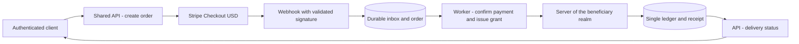

Validate with Stripe in test mode: invalid signature, repeated event, reorder,
pending/failed payment, crashes before/after credit, realm unavailable, refund and
dispute. No suite charges real cards. Before launching, confirm region/account
availability, accepted methods, settlement, restrictions and fees for $1–5 tickets; this
document does not assume fees or financial viability of a plan not yet contracted.

## 27. Transition client, R2 update and possible Flutter rewrite

### 27.1. Current APK and Lua/native boundary

Continue with the validated Elex APK while the backend and tools evolve. The proposal is
to add Lua scripts maintained by the project to the client prepared to check releases,
present version/notes/progress and coordinate downloads. Before implementing, identify
the APK version, Lua runtime/loader and exposed APIs for HTTPS, files, encryption and
call to the Android platform. There is no evidence in this checkout that this update
bridge is already functional.

The first prepared APK needs to contain the trusted bootstrap and, when necessary, the
native Android bridge. Lua can only call truly exposed capabilities: it does not change
the Manifest, Firebase SDK, permissions, native libraries, or package signature on its
own. Changes to these parts require a new APK build. Mobile originals remain read-only;
Extracting, patching, and packaging use a separate working directory and do not place
private keys or artifacts in Git.

Distinguish **Lua/resource bundle**, activatable by the validated loader, from **full
APK**, installed by Android. Script change does not replace an application update when
the required native capability does not exist. The client continues sending commands;
economy and combat results remain authoritative on the Server even when local scripts
are updated.

### 27.2. Manifest, delivery and publishing on Cloudflare R2

R2 is defined for APK releases and update bundles. The client queries the HTTPS manifest
by channel (`internal`, `beta`, `stable`) and downloads the objects directly
from R2/Cloudflare, avoiding binary traffic through the VPS. Use your own download
domain, the name of which has yet to be chosen, or a controlled delivery route; do not
adopt `r2.dev` as production endpoint. Configure caching of immutable objects by
hash and short revalidation of the channel manifest. [Reference: public delivery and R2 domains](https://developers.cloudflare.com/r2/buckets/public-buckets/).

The versioned manifest declares platform, application ID, `versionCode`, display version,
minimum ABI/Android, supported base client, protocol, Lua bundle, minimum bootstrap
capacity, URL, size, SHA-256, expected APK signing certificate, deadline, and
optional/required policy. It is signed by a publishing key; the trusted public key comes
in bootstrap. Hash downloaded with the artifact without a root of trust does not prove
authenticity. Do not download the trust key without validation from the same location as
the package.

The pipeline checks the client/server matrix, builds/signs, tests, and publishes the
immutable objects before promoting the channel's signed manifest. APK and manifest
signing keys have distinct functions, restricted access, and planned rotation. Uploads
and private chat bodies use separate buckets/policies; the release bucket does not
contain player data or R2 credentials on the client. Release withdrawal stops new
offers, but does not make an already installed version reliable: maintain published
compatibility and correction.

Download uses temporary file, maximum size, timeout and limited retry; check manifest,
hash and metadata before running/installing. Interruption, lack of space, or invalid
check does not remove the working version. Bundle Lua is applied at a safe
point/restart, with atomic activation and last valid recoverable version; consider local
state migrations before allowing fallback. A corrected APK uses a new increasing
version: bundle rollback does not imply that Android accepts an APK downgrade.

### 27.3. Android update and identity preservation

The initial flow is **check → offer → download → validate → open the Android installer →
confirm result on next opening**. The native bridge uses the platform's supported
mechanism and handles cancellation/permission denied. On Android 8+, consider allowing
installation from unknown sources by origin and `REQUEST_INSTALL_PACKAGES` depending on the target/API
and mechanism used. The alternative when the bridge is not ready is to offer download in
the browser and manual installation. [Reference: Android alternative distribution](https://developer.android.com/distribute/marketing-tools/alternative-distribution).

Don't promise silent installation on legacy APK. The flow must support player
confirmation; exceptions without interaction depend on specific conditions of version,
target, permissions and owner of the installation, which have not yet been validated.
Lua does not bypass these conditions. Installation started or download complete does not
mean update is complete. [Reference: User action in PackageInstaller](<https://developer.android.com/reference/android/content/pm/PackageInstaller.SessionParams#setRequireUserAction(int)>).

Updating the existing installation requires the same application ID, compatible
signature (or recognized rotation) and version supported by Android; the project release
policy uses increasing `versionCode`. Re-signing an original APK with another key does
not automatically produce a compatible update. Identify the test client's certificate
and maintain an authorized project key for the prepared line, without assuming access to
the Elex key. Do not guide uninstallation as an automatic part of the updater.
[Reference: Android update conditions](https://developer.android.com/google/play/app-updates).

Changing the package/signature may require separate initial installation/migration.
Before that, preserve Firebase link and test Guest account recovery: progress on the
server does not guarantee access if local credentials are lost. Never delete app,
session or character data to resolve update errors. Mandatory update only blocks
incompatible combinations with a clear message and recovery path; optional update
unavailable does not block login. iOS installations and store channels require their own
strategy, without assuming they accept the Android APK installer.

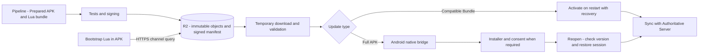

### 27.4. Flutter as a possible future direction

The long-term intention is to evaluate the rewrite of the client/game in Flutter/Dart,
without a committed replacement deadline. The current APK remains operational during
this work. Flutter can replace client interface and runtime; backend, database and
authoritative simulation remain independent services. Do not port the authoritative
economic calculation to the device.

Start with a small proof of concept: Firebase Auth/Guest, login, city, building and map
in the same test realm. Validate map rendering, sprites/animations, memory, battery and
performance on representative devices before choosing the definitive graphic
composition. SDKs, graphics engine, asset tools and monorepo integration will still be
selected; Don't treat Flutter like a Bun build or try to import TypeScript packages
directly into Dart.

The new client uses the same versioned contracts and preserves account, characters,
inventory and purchases on the backend. Adapters maintain SFS/TCP in the APK while the
new client uses the validated transport, without creating another set of game rules.
Coexistence requires compatibility matrix and E2E tests per client; Firebase, FCM and
updater have their own integrations on each platform. A Flutter application directory
will be proposed when the proof of concept is validated; this document does not create a
Dart implementation.

The Web Game SSR at Vercel remains a distinct experiment. Considering Flutter Web later
does not prove SSR or automatically replace the current design of `apps/web`; this
choice requires rendering/hosting evaluation.

### 27.5. Updater and transition validation

Test base APK v12.06.0 and each prepared variant with identified
Android/ABI/certificates: valid update, incompatible signature/package, tampered with or
old manifest, invalid hash, partial download, outdated cache, low space, cancellation,
permission denied and process interruption. Rollout starts in an internal channel and
progresses through controlled groups, with filtered success/failure metrics and the
possibility of suspending offers.

Validate bootstrap without native bridge, Lua bundle rollback after failure, Guest
session recovery and city/map persistence after installation. Snapshots cover manifests
and screens; integration covers R2/MinIO publishing with recorded differences; Mobile
E2E proves installation and reopening on device/emulator. Apply the five layers of
testing in section 22 to the relevant project-authored code, including mutations in
version, signature, hash, and compatibility validators. None of this is evidence that an
APK has already been patched or published.
