# OpenCoK — arquitetura de produção

**Estado:** arquitetura alvo, documentada em 23/10/2026. Os diagramas descrevem
o destino do projeto, não uma infraestrutura já implantada. Este checkout contém
a estrutura inicial do monorepo; diretórios e pacotes não comprovam implementação.

O objetivo é um monorepo modular com servidor autoritativo, chat WebSocket,
arquivos e serviços auxiliares independentes, painel administrativo, landing
page, cliente web experimental e bots Python. TypeScript/Bun é a base proposta
dos serviços de aplicação, preservando a possibilidade de processos em outras
linguagens quando houver uma necessidade medida.

A prova anterior com o APK v12.06.0 abriu cidade e tela do mapa usando Bun,
MariaDB, Redis e ZooKeeper. Essa evidência não valida PostgreSQL, Kubernetes,
o cliente web nem todos os sistemas do jogo. A passagem para a arquitetura
abaixo exige migração de dados e testes de compatibilidade próprios.

O cliente móvel de transição continua sendo o APK Elex homologado. Está planejada
a adaptação com scripts Lua para consultar releases e iniciar atualização por
Cloudflare R2, dependendo de suporte nativo verificado. A reescrita do cliente
em Flutter/Dart está em avaliação de longo prazo; não é condição para manter o
jogo atual. A direção de produto fica em [PRODUCT.md](../PRODUCT.md).

## 1. Visão geral — implantação definida

A implantação inicial é híbrida: Kubernetes centraliza os processos próprios
na **VPS europeia de 16 GB**, enquanto frontends e serviços gerenciados ficam
nos provedores abaixo. A API é **única e compartilhada**, inicialmente com uma
réplica; não se cria uma API por reino. Cada reino tem um **Server autoritativo
separado**, com uma instância lógica ativa. O limite inicial é **dois reinos**.

| Local | Componentes definidos |
| --- | --- |
| VPS Europa / Kubernetes | API compartilhada, API Gateway, Traefik, ZooKeeper, um Server por reino, Combat TypeScript, workers/relay e Files. |
| Cloudflare Pages | Landing page, documentação pública e WebAdmin. |
| Vercel | Web Game experimental em SSR; runtime/adaptador compatível com o framework escolhido. |
| Redis.io / Redis Cloud | Redis de cache, sessões, presença e, somente se adotado, Redis separado de filas BullMQ. |
| Neon | PostgreSQL: compute de escrita e compute/réplica de leitura da mesma branch de produção. |
| MongoDB Cluster gerenciado | Documentos volumosos e arquivo temporário do chat; provedor/plano exato ainda a selecionar. |
| CloudAMQP | RabbitMQ gerenciado. |
| Firebase | Auth (Guest, Facebook, Google, Email/Password, Apple, Microsoft e GitHub), telemetria de produto e notificações push via FCM. |
| Stripe | Checkout/pagamentos em USD, pacotes de US$ 1 a US$ 5. |
| Hospedagem externa a definir | Chat WS e bot Python; fora da VPS principal na topologia inicial. |
| Cloudflare R2 | Distribuição de releases APK e bundles Lua/recursos homologados; downloads diretos, sem passar pela VPS. |
| Destinos a definir | Storage dos demais objetos privados e backend de observabilidade. MinIO permanece definido em desenvolvimento. |

Um único nó Kubernetes não fornece alta disponibilidade da VPS. Queda dessa
máquina afeta API e reinos hospedados nela; os dados remotos não tornam os
processos disponíveis. Começar com um reino e admitir o segundo somente depois de
medir memória, CPU, latência dos provedores e picos de combate.

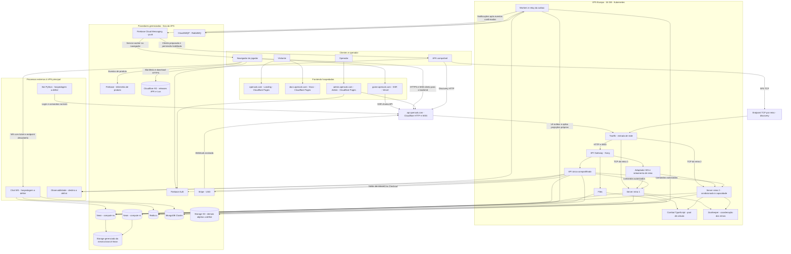

Os Servers compartilham infraestrutura gerenciada com isolamento por reino.
Nenhuma seta autoriza um serviço a editar tabelas de outro domínio. A conexão
do navegador com o jogo usa WSS no backend; a renderização SSR na Vercel não
é um novo proprietário da simulação. Chat usa endpoint externo descoberto pela
API, evitando retransmitir todas as suas conexões pela VPS sem necessidade.

## 2. Mapa mental do projeto

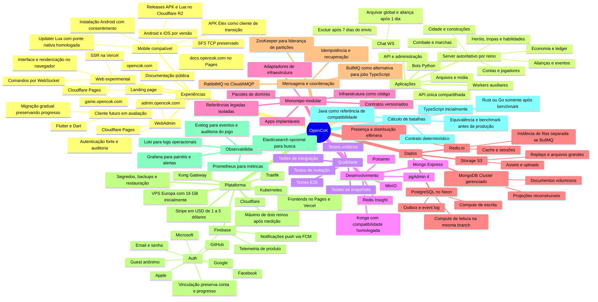

## 3. Aplicações e limites de responsabilidade

| Aplicação/componente | Local e execução definidos | Responsabilidade |
| --- | --- | --- |
| `apps/api` | Uma API compartilhada na VPS/Kubernetes, TypeScript/Bun | Discovery, validação Firebase, vínculo de identidade, preferências/dispositivos push, consultas, backend do Admin, pedidos Stripe e webhooks. Não é replicada por reino. |
| `apps/server` | Um processo/pod lógico ativo por reino na VPS, TypeScript/Bun | Autoridade sobre cidade, economia, tropas, habilidades, marchas e combate. No máximo dois reinos nesta etapa. |
| API Gateway + Traefik | VPS/Kubernetes | Entrada, roteamento, políticas HTTP/WSS e passagem TCP; configuração em `infra/`, sem regra de gameplay. |
| `apps/combat` | VPS/Kubernetes, TypeScript inicialmente | Pool limitado de cálculo, separado da rede e da aplicação econômica. Rust ou Go são alternativas futuras após benchmark e equivalência. |
| `apps/workers` | VPS/Kubernetes, TypeScript/Bun | Outbox, filas CloudAMQP, projeções, retenção, envio push via FCM e tarefas auxiliares; quotas por workload. |
| `apps/files` | VPS/Kubernetes, TypeScript/Bun | Uploads, validação, metadados e acesso ao storage externo. CPU de transformação tem limites próprios. |
| `apps/chat` | Serviço externo à VPS, hospedagem a definir | Chat WS, canais, autorização, histórico, moderação e retenção de 1/7 dias. |
| `apps/bot` | Serviço externo à VPS, Python | Simuladores autenticados com quotas, sem acesso direto ao estado do reino. |
| `apps/admin` | Cloudflare Pages, `admin.opencok.com` | Painel administrativo; usa a API compartilhada e identidade autorizada. |
| `apps/www` | Cloudflare Pages, `opencok.com` | Landing page pública. |
| `apps/docs` — planejado | Cloudflare Pages, `docs.opencok.com` | Site de documentação; conteúdo e publicação versionados. |
| `apps/web` | Vercel, `game.opencok.com` | Web Game SSR experimental, com renderização contínua e conexão de jogo no navegador. |

Vercel é responsável pelo frontend SSR, não pelo estado autoritativo dos reinos.
Homologar framework, adaptador e runtime do deploy; compartilhar TypeScript não
significa que todos os ambientes executem a mesma composição Bun do backend.
A estratégia escolhida conecta o navegador diretamente ao WSS do backend,
sem usar o SSR como relay permanente das mensagens da partida.
[Referência: Vercel Functions](https://vercel.com/docs/functions/limitations).

Cloudflare Pages hospeda Landing, Docs e Admin. Se usarem Functions, seu código
servidor segue o runtime de Workers e as permissões próprias desse ambiente.
Os frontends não recebem credenciais de banco, Stripe secret key ou Firebase
Admin. [Referência: Pages Functions](https://developers.cloudflare.com/pages/functions/).

## 4. Organização do monorepo

Os diretórios `apps/admin`, `apps/bot`, `apps/chat`, `apps/server`, `apps/web` e
`apps/www` já existem como estrutura inicial. `apps/api`, `apps/files`,
`apps/workers`, `apps/combat`, `apps/docs` e as subdivisões abaixo são
propostas de organização; este documento não cria os serviços.

```text
opencok/
├── apps/
│   ├── server/         # composição do servidor autoritativo
│   ├── chat/           # chat WS em hospedagem externa
│   ├── files/          # planejado: serviço de arquivos
│   ├── api/            # planejado: descoberta, consultas e backend do painel
│   ├── admin/          # admin.opencok.com -> Cloudflare Pages
│   ├── www/            # opencok.com -> Cloudflare Pages
│   ├── docs/           # planejado: docs.opencok.com -> Cloudflare Pages
│   ├── web/            # game.opencok.com -> Vercel SSR
│   ├── bot/            # simulador Python em hospedagem externa
│   ├── workers/        # planejado: execução de tarefas auxiliares
│   └── combat/         # cálculo TypeScript isolado; Rust/Go futuros
├── packages/           # domínios, contratos e adaptadores compartilhados
├── infra/              # definições de execução e infraestrutura
│   ├── compose/        # proposto: desenvolvimento e testes locais
│   ├── kubernetes/     # proposto: workloads da VPS e políticas
│   ├── cloudflare/     # proposto: Pages, DNS e configuração de borda
│   ├── vercel/         # proposto: deploy SSR e ambientes de preview
│   ├── providers/      # proposto: configuração dos SaaS e segredos referenciados
│   ├── observability/  # proposto: painéis, métricas, logs e alertas
│   └── migrations/     # proposto: migrações e procedimentos de dados
├── mobile/             # clientes autorizados, patches e artefatos privados
├── legacy/             # referência de compatibilidade, isolada da aplicação
├── assets/             # assets próprios e manifestos autorizados
├── tests/              # proposto: E2E, contratos e fixtures sintéticas comuns
├── docs/               # contratos, decisões, operação e compatibilidade
├── .specs/             # especificações e critérios verificáveis
└── .github/            # contribuição, automações e arquitetura
```

### Grupos de pacotes

| Grupo | Pacotes existentes que podem assumir o papel | Regra de dependência |
| --- | --- | --- |
| Domínios | `account`, `player`, `building`, `city`, `hero`, `troops`, `combat`, `alliance`, `kvk`, `campaigns`, `npc`, `rules`, `ledger` | Regras puras e casos de uso; não importam sockets, controllers, ORM ou broker. |
| Contratos | `contracts`, `api-contracts`, `dtos`, `messages`, `events`, `enums`, `validations` | Schemas e envelopes versionados, com testes de compatibilidade. |
| Entrada e aplicação | `api`, `api-client`, `command`, `connection`, `controllers`, `middlewares`, `guard`, `identity`, `policy` | Validam e autorizam; chamam os casos de uso. Não duplicam regras econômicas. |
| Persistência e integração | `repositories`, `drizzle`, `mongoose`, `storage`, `queues`, `webhooks`, `notifications`, `email` | Implementam interfaces dos casos de uso. Escritas respeitam o proprietário do domínio. |
| Configuração e suporte | `config`, `env`, `errors`, `resources`, `i18n`, `constants`, `scripts`, `generators` | Dependências pequenas e explícitas, com validação de ambiente e recursos. |

Nomes como `core`, `base`, `share`, `helpers` e `utils` não devem acumular regras
de todos os domínios. Definir uma API pública para cada pacote e verificar ciclos
de importação no CI. Ter muitos pacotes não implica criar muitos microsserviços:
os módulos do jogo começam compostos em um servidor modular, com processos
separados onde existe uma responsabilidade ou carga independente.

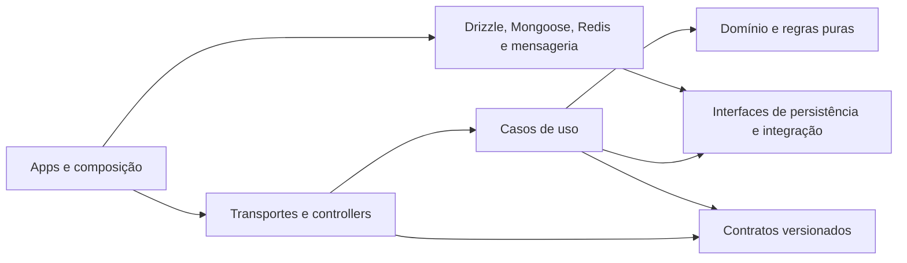

Python, um eventual cliente Flutter/Dart e um futuro motor Rust/Go recebem contratos gerados a partir de schemas
JSON ou Protobuf; não importam arquivos TypeScript nem compartilham acesso livre
ao banco. Recursos de regras têm versão e hash, independentemente da linguagem.

## 5. Domínios, rede e gateways

| Domínio definido | Destino | Uso |
| --- | --- | --- |
| `opencok.com` | Cloudflare Pages / `apps/www` | Landing page. |
| `docs.opencok.com` | Cloudflare Pages / `apps/docs` | Documentação pública. |
| `admin.opencok.com` | Cloudflare Pages / `apps/admin` | Painel administrativo. |
| `game.opencok.com` | Vercel / `apps/web` | Web Game SSR. |
| `api.opencok.com` | Entrada HTTPS/WSS da VPS → Traefik → Kong | API compartilhada, discovery, WS do jogo, arquivos e webhooks Stripe. |

Frontend SSR, chamadas de API e conexão de partida têm destinos distintos.
O navegador em `game.opencok.com` usa HTTPS/WSS de `api.opencok.com`, com origem
autorizada. Admin e landing usam os endpoints apropriados dessa mesma API.
Credenciais privadas ficam nos backends; cookies, CORS e proteção CSRF são
configurados para os domínios explícitos, não para um wildcard indiscriminado.

Traefik cuida da entrada HTTP/WSS e L4 no cluster. Kong é o serviço de API
Gateway, com autenticação aplicável, quotas, limites de corpo, correlação e
rotas para a API única, Files e adaptador WS. Serviços internos usam a rede
privada do Kubernetes. SFS TCP não atravessa plugins HTTP do Kong.

O gateway resolve `realmId` para `server-realm-1` ou `server-realm-2`; a API
não se duplica com o reino. Conexões duráveis do jogo vão ao proprietário
correto, sem transformar a API compartilhada no loop de cada ataque.
Chat tem endpoint externo retornado pelo discovery e ticket com escopo.
Sua hospedagem/domínio adicional será definido sem mover o SSR para a VPS.

Para APK, discovery anuncia endpoint L4 e porta específicos do reino (por
exemplo, portas distintas na VPS). `game.opencok.com` pertence ao frontend
Vercel e não deve ser anunciado como servidor SFS. Um host com proxy HTTP
Cloudflare não passa automaticamente TCP em 9933: usar IP/host DNS direto ou
Spectrum homologado para o endpoint legado.
[Referências: portas Cloudflare](https://developers.cloudflare.com/fundamentals/reference/network-ports/),
[roteamento Traefik](https://doc.traefik.io/traefik/v3.2/routing/routers/).

TLS protege conexões HTTP/WSS e conexões aos provedores gerenciados. O APK
precisa validar seu transporte realmente suportado antes de mudar SFS para
TLS. APIs de administração do gateway, Kubernetes e ZooKeeper não são públicas.
Aliases `.php` continuam como adaptação de clientes legados enquanto necessários;
URLs novas não alteram assinaturas ou formatos de protocolo automaticamente.

## 6. PostgreSQL no Neon: escrita, leitura e autoridade

PostgreSQL fica no **Neon, fora da VPS**. Os dois papéis são um compute de
escrita `rw` e um read replica/compute `ro` na mesma branch de produção. Não
criar duas branches independentes como se fossem escrita e leitura sincronizadas.
No Neon, os computes leem o storage gerenciado compartilhado: não representam
duas cópias locais ligadas por uma replicação WAL administrada pelo projeto.
A réplica de leitura ainda tem consistência eventual.
[Referência: arquitetura de read replicas Neon](https://neon.com/docs/introduction/read-replicas).

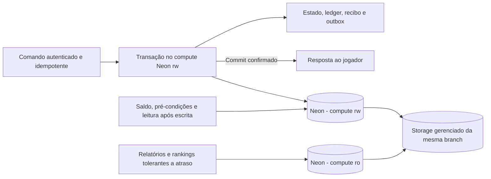

Saldo, inventário, tropas, custos e pré-condições usam `rw`. Uma leitura após
construção confirmada usa esse compute ou o resultado da transação. Rankings
e relatórios podem usar `ro` com orçamento de atraso; GET não implica leitura
segura na réplica. Separar pools e permissões de API, cada reino, Chat e workers,
com limite global de conexões compatível com o plano Neon.

Transações críticas não fazem uma sequência desnecessária de round trips entre
a Europa e outra região. Selecionar região Neon próxima à VPS e medir RTT,
cold start, pool e latência de commit. Uso de pooler e scale-to-zero depende do
workload e do plano homologado; não pressupor que o plano gratuito atende o jogo.

Alta disponibilidade, persistência de WAL, recuperação e backups são recursos
do serviço/plano contratado. A read replica não é, por si só, backup nem uma
promessa de RPO 0. Definir e testar as metas de recuperação com as garantias
reais do Neon, sem documentar uma promoção manual de primário dentro da VPS.
Após resultado incerto de commit, consultar o recibo antes de repetir a mutação.

## 7. MongoDB, Redis e armazenamento de arquivos

| Tecnologia | Dados previstos | Autoridade e recuperação |
| --- | --- | --- |
| PostgreSQL no Neon | Progresso, economia, contas, metadados, chat ativo e outbox | Autoridade transacional. Chat global/aliança sai do histórico ativo após 24h e expira aos 7 dias; detalhes na seção 20. Backup com recuperação pontual e testes de restauração. |
| MongoDB Cluster gerenciado | Relatórios detalhados de batalha, documentos de simulação, projeções e arquivo temporário de chat | Documentos versionados por ID e schema. Chat global/aliança arquivado expira aos 7 dias contados do envio, não do arquivamento. Documentos únicos exigem backup próprio. |
| Redis.io / Redis Cloud | Cache de consultas, sessões, presença, fan-out efêmero e limites de tráfego | TTL, invalidação e recuperação definidos. Não é o único registro de saldo, conclusão ou combate. |
| Redis.io separado de filas — se BullMQ | Jobs, retries e agendamentos auxiliares | Instância separada do cache, persistência e política `noeviction`. |
| Cloudflare R2 — releases | APKs, bundles Lua e manifestos de atualização | Artefatos versionados, verificação de integridade/autenticidade e canal de release; ver seção 27. |
| S3 compatível — demais objetos | Avatares, assets, anexos, replays grandes, exportações e backups | Provedor por operação ainda a definir; MinIO em desenvolvimento, com políticas de acesso/retenção. |

MongoDB alivia consultas e documentos que não precisam participar da transação
econômica. O primário guarda ID, versão e resumo necessários à consistência; um
worker publica o documento após o commit. Não fazer uma escrita obrigatória e
sem coordenação em PostgreSQL e MongoDB para aceitar o mesmo comando.

Filas, outbox, inbox e projeções têm retenção e limpeza por política explícita.
Históricos volumosos são particionados/arquivados por data, com índices e
orçamentos medidos. A janela de deduplicação cobre o período permitido de retry
e replay. A limpeza de jobs e projeções não remove o ledger autoritativo nem
registros necessários para recuperar uma operação ainda pendente.

“Dados maiores” não significa colocar arquivos arbitrários num documento BSON:
o limite por documento é 16 MiB. Replays ou binários grandes vão ao storage,
com referência e hash no documento; GridFS é alternativa apenas se houver um
caso operacional específico.
[Referência: MongoDB e GridFS](https://www.mongodb.com/docs/manual/core/gridfs/).

Selecionar regiões europeias próximas para VPS e provedores sempre que houver
suporte no plano escolhido. Medir RTT real por operação, limites de conexões,
quotas e comportamento de cold start/auto-suspend quando aplicável. A escolha
de um serviço gerenciado não comprova capacidade ou latência do plano. Usar
TLS, segredos restritos por ambiente e acesso de rede limitado conforme o
provedor. Pools, retries e buffers têm limites; não manter transações econômicas
abertas enquanto se espera telemetria ou outro terceiro opcional.

## 8. Mensageria: RabbitMQ e BullMQ

**Escolha definida:** RabbitMQ hospedado no CloudAMQP para comunicação entre
linguagens e serviços. A presença do bot Python e de um possível motor de
cálculo favorece um contrato independente do runtime TypeScript.

BullMQ é uma alternativa para jobs controlados pelos workers TypeScript,
especialmente retries e agendamentos auxiliares. Não é necessário adotar os
dois para o mesmo trabalho. Se ambos existirem, cada fila terá proprietário,
contrato e responsabilidade definidos; não haverá publicação dupla informal.

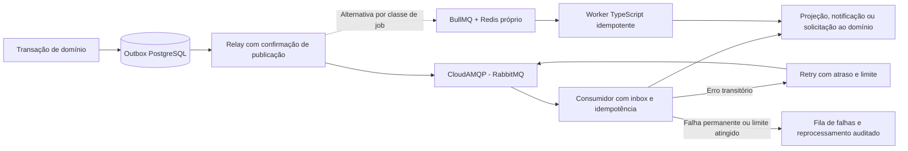

Eventos contêm `eventId`, `eventType`, `schemaVersion`, `aggregateId`,
`aggregateVersion`, `occurredAt` e `correlationId`. Payloads grandes são
referenciados por ID; tokens e segredos não entram na fila. Consumidores lidam
com duplicatas, eventos fora de ordem e versões ainda não suportadas.

Assumir entrega **pelo menos uma vez**. O relay marca a publicação depois da
confirmação do broker; o consumidor confirma depois de persistir seu resultado.
Uma falha entre confirmação e atualização da outbox pode repetir o evento.
Inbox/recibos e chaves únicas impedem aplicar a mesma alteração duas vezes.
RabbitMQ exige tratar confirmações, reconexão e redelivery na aplicação.
[Referência: confiabilidade RabbitMQ](https://www.rabbitmq.com/docs/reliability).

No BullMQ, manter o Redis de filas separado das políticas de descarte do cache,
configurar persistência e testar recuperação de jobs interrompidos. Reiniciar
um worker não pode repetir uma recompensa.
[Referência: BullMQ em produção](https://docs.bullmq.io/guide/going-to-production).

Timers autoritativos de construção, marcha e combate permanecem registrados
como estado e prazos no PostgreSQL. Uma fila acorda o executor, mas não é a
única prova de que algo venceu; reconciliação recupera tarefas atrasadas.
Solicitações de jobs de outras linguagens usam contratos de broker/API, sem
escrever diretamente nas estruturas internas do BullMQ.

## 9. Servidor autoritativo, ZooKeeper e escala

O jogo inicia com um Server modular por reino, separado da API compartilhada.
Há um reino inicial e no máximo dois após homologação de capacidade. Combat,
Files e workers têm limites próprios na VPS; Chat, bots e SSR ficam fora dela.
Os reinos podem compartilhar a VPS se os picos couberem com margem. Aumentar
RAM/vCPU ou mover um reino para outra VPS não cria outra API global.
Particionar um reino em regiões continua sendo uma evolução, não o ponto de partida.

ZooKeeper mantém registro de membros e eleição do proprietário de partições,
usando sessões e registros efêmeros. A perda de sessão suspende novas mutações
da partição até recuperar autoridade. Consultar ZooKeeper a cada ataque ou
movimento não faz parte do caminho normal de um comando.
[Referência: receitas ZooKeeper](https://zookeeper.apache.org/doc/current/recipes.html).

O protocolo de liderança inclui um `ownerEpoch` monotônico persistido no
PostgreSQL. Cada escrita autoritativa no Neon verifica o epoch vigente, bloqueando um
proprietário antigo que volte após pausa ou falha de rede. Uma eleição no
ZooKeeper, isoladamente, não impede esse processo antigo de continuar escrevendo.
Kubernetes fornece descoberta de serviços; ZooKeeper fica restrito à coordenação
do jogo, sem duplicar o controle do cluster ou o failover do PostgreSQL.

Não escalar um reino stateful apenas aumentando réplicas num Deployment.
Roteamento associa a sessão ao proprietário correto; troca de proprietário
requer drenagem, checkpoint, reconstrução do estado e reconexão. Ordenação por
agregado, locks/transações e versões de estado continuam necessários mesmo com
um único executor lógico por partição.

## 10. Cálculo de batalhas e bots

```mermaid
flowchart LR
  player[Jogador ou bot autenticado] --> command[Comando de combate]
  command --> reserve[Server valida e reserva recursos e tropas]
  reserve --> snapshot[Snapshot persistido e versionado]
  snapshot --> compute[Cálculo local ou serviço especializado]
  compute --> result[Resultado determinístico e hash]
  result --> check[Server verifica versões, epoch e idempotência]
  check --> commit[Transação aplica perdas, recompensas e evento]
  commit --> report[Worker produz relatório detalhado]
```

O motor recebe `battleId`, `rulesVersion`, `numericPolicyVersion`,
`rngAlgorithmVersion`, seed, versões dos agregados e snapshot completo. Produz
um resultado reproduzível, sem buscar estado mutável ou alterar bancos. O
servidor aplica o resultado uma única vez, validando reservas, versões e
`ownerEpoch`. Recursos não ficam presos em uma transação SQL aberta durante
o cálculo externo. Para comparar com o Java antigo, uma seed isolada não basta:
é necessário controlar todas as fontes de aleatoriedade, conforme abaixo.

### 10.1. Decisão atual de linguagem e critério de exatidão

**O motor começa em TypeScript**, mantendo os contratos do monorepo e o runtime
Bun do backend. A recomendação anterior de partir diretamente para Rust fica
substituída por esta decisão. Rust e Go são candidatas futuras se medições
mostrarem que o cálculo, e não banco/rede/fila, é o gargalo relevante.

Combat executa em processos/workers de CPU separados do loop de rede dos
Servers e da API. Há um pool limitado compartilhável pelos dois reinos, com
quotas e justiça por reino. Não criar um processo por ataque nem aceitar
concorrência ilimitada. O Server valida e aplica o resultado, independentemente
da linguagem do cálculo.

**Java permanece como referência de compatibilidade.** Um modo de combate
TypeScript só é liberado após a equivalência e as invariantes definidas nesta
seção. A homologação também vale para qualquer porte posterior a Rust/Go:
migrar por desempenho não autoriza alterar baixas, sorteios ou recompensas.
Não existe linguagem que elimine erros de regra ou fórmula automaticamente.

| Opção | Papel definido |
| --- | --- |
| **TypeScript/Bun** | Implementação inicial. Camada explícita para semântica numérica Java; cálculo isolado da rede, com orçamento de CPU/memória. |
| **Java** | Oráculo da migração e executor de referência em laboratório. O jogo não depende de reintroduzir todo o servidor Java em produção para usar TypeScript. |
| **Rust** | Candidata futura para reduzir custo de CPU/latência/alocações, se um benchmark justificar. Exige nova homologação da matemática e do contrato. |
| **Go** | Candidata futura, também sujeita a medição de CPU, alocações, pausas de GC e equivalência numérica. Não presumir que trocar para Go torna a fórmula exata ou mais rápida. |
| **C++** | Sem adoção planejada neste estágio. |
| **Python** | Bots e ferramentas de análise, sem loop autoritativo de cálculo de batalha. |

### 10.2. Escopo e evidências da revisão Java

Revisão realizada em 23/10/2026 sobre as referências locais autorizadas do
workspace de recuperação, separado deste checkout de arquitetura. O levantamento
percorreu **3.586 arquivos Java** em `apps/server/modules`, identificou **28
arquivos e 6.002 linhas** no pacote central de batalha e **16 arquivos com
construção direta dos managers**. São contagens estáticas, não porcentagens de
cobertura de testes nem prova de que todos os caminhos foram executados.

A leitura dirigida acompanhou preparação, execução, resultados e aplicação
das perdas. A varredura também inventariou 34 arquivos de handlers/fábrica de
batalha do mundo, quatro arquivos de suporte a efeitos e os fluxos de bosses.
Dependências como perfis, marcha, hospital e eventos tornam o domínio maior
que uma única função de dano.

| Área da referência | O que foi observado e precisa entrar na especificação |
| --- | --- |
| `battle/manager/AbstractFightManager` | Preparação de participantes; turnos/subturnos; movimento; seleção de alvo; ataques de tropas, generais e dragões; dano; proteção do defensor; vitória e relatório. Os managers PVP, PVE, torre e desafio usam esse núcleo. |
| `battle/info/*`, `battle/role/*` | Atributos provenientes de XML e perfis, habilidades ponderadas, efeitos temporários, posições, forças, mortes e resto fracionário de dano. |
| `battle/manager/FightCalCache` | Cache contextual por papel/efeito/habilidade, invalidação por dependências e modo de comparação com recálculo. Mudar o cache pode mudar resultados se a invalidação estiver incorreta. |
| `gameengine/battle/*`, `UserProfile.getGameEffect` | Efeitos agregam várias fontes: VIP, equipamento, heróis, aliança, território, mundo, dragões e condições de evento. Parte depende de estado global e contexto de execução. |
| `world/normal/AbstractWorldFightHandler` e subclasses | Contexto PVP, cidade, recursos, território, reforços e outras modalidades; montagem das marchas; cálculo; distribuição de perdas; efeitos posteriores. |
| `WorldMarchGeneralArmy`, `FightResultObject`, bosses e relíquias | Perdas por participante, conversão de mortos em feridos, cura, proteção e modificadores por modo, além de efeitos periódicos fora do loop central. |
| `battle/report/*` | O contrato inclui a sequência de eventos/turnos usada pelo cliente, não apenas o lado vencedor. |

Para reduzir o risco de confiar numa reconstrução do decompilador, seis métodos
críticos foram confrontados com o **bytecode do JAR original**, usando `javap`
no JDK 8: dano convertido em baixas, ataque, defesa, poder, movimento e decisão
de acerto/dano. O bytecode confirma operações de ponto flutuante de 32 bits,
promoções para 64 bits e conversões para inteiro. Isso não constitui equivalência
integral entre todas as fontes recuperadas e todos os artefatos originais.

### 10.3. Riscos numéricos e comportamentais encontrados

| Evidência observada | Consequência para o motor novo |
| --- | --- |
| Mistura de `float`, `double`, `int`, parsing decimal e promoções intermediárias | `f32` e `f64` devem aparecer nos pontos correspondentes da avaliação. Um resultado guardado em `double` pode já ter perdido precisão numa multiplicação `float` anterior. |
| Uso de `Math.pow` com expoentes derivados de configuração | Copiar a fórmula para `powf` não prova equivalência de últimos bits ou de limiares inteiros. Fixar e homologar a implementação matemática. |
| Casts para inteiro, `floor`, `ceil` e `round` em lugares diferentes | Não substituí-los por uma função genérica de arredondamento. Preservar o momento de cada conversão, saturação e tratamento dos valores excepcionais. |
| `hurtAcc` conserva a parte fracionária do dano | Arredondar cada ataque sem carregar o resto muda o total de baixas ao longo da batalha. |
| Turnos, subturnos, ordem por lado/posição, torres, armadilhas e término antecipado | Paralelizar os ataques de uma batalha ou reorganizar o loop pode alterar alvos vivos, habilidades e vencedor. |
| `HashMap`, listas e multimap na formação, nas habilidades e nas somas | Ordenar tudo de outro modo não é uma otimização neutra. Capturar a ordem efetiva de entrada e explicitar os desempates. |
| `ThreadLocalRandom`, `Math.random`, `RandomUtil` com `SecureRandom`, `RandomUtils` e `Random` em helpers | Uma única seed não controla o legado. Comparação exige interceptar/reproduzir todas as chamadas aleatórias, seus tipos, limites e ordem. |
| Testes probabilísticos com limites e comparadores diferentes | Intervalos abertos/fechados, `<` e `<=` precisam de testes de fronteira; não normalizar todas as chances para uma Bernoulli genérica. |
| Efeitos podem consultar perfil, flags de função, reino e contexto durante o cálculo | Snapshot precisa capturar essas dependências e preservar os efeitos condicionais ao turno/alvo. Apenas serializar contagens de tropas é insuficiente. |
| Cálculo de resultado também contém regras e sorteios de recuperação | O replay deve cobrir a geração do resultado final, não terminar quando acaba o último ataque. Getters com efeitos não viram leituras livres e repetíveis. |
| Conversão para feridos e modificadores de modo acontecem fora do manager central | Comparar apenas dano ou vitória deixa de fora perdas reais, hospital e estado persistido. |
| Alguns inicializadores de habilidades capturam exceções e continuam | O Java de referência também pode produzir resultado degradado. Erros de configuração devem bloquear a homologação e exigir investigação, em vez de serem tratados como acerto do oráculo. |

O JDK também é parte do contrato. Fixar inicialmente o runtime de referência,
artefatos, arquitetura e recursos; não atualizar JDK ou trocar `Math` por
`StrictMath` e presumir resultados idênticos. A especificação de `Math.pow`
admite erro limitado em ulps, e não uma igualdade universal com qualquer
biblioteca nativa. [Referência: Java Math](https://docs.oracle.com/javase/8/docs/api/java/lang/Math.html).

### 10.4. Política numérica do TypeScript e portabilidade futura

O primeiro perfil do motor é **compatibilidade com a versão Java homologada**,
não uma tentativa de tornar a matemática antiga “mais precisa”. Reproduzir
os tipos, a ordem das operações e os pontos de arredondamento observados.
Ponto fixo, decimal exato ou racional só podem substituir essas operações numa
nova versão explícita das regras, com análise do impacto no balanceamento.
Expoentes fracionários também exigem uma aproximação especificada; ponto fixo
não torna automaticamente toda a fórmula exata.

Em TypeScript, `number` não reproduz automaticamente os intermediários `float`
Java. Materializar arredondamento binary32 nos pontos necessários, por exemplo
com `Math.fround`, e manter binary64 nos demais. Cast Java para inteiro não é
sinônimo de operador bitwise JavaScript: criar adaptadores para truncamento,
limites, NaN e infinitos, testados contra a referência. Usar `bigint` ou strings
validadas para inteiros de 64 bits quando o contrato exigir.

Conversões de quantidade, overflow e divisão recebem funções com política
explícita. Quantidades do estado usam inteiros com limites e operações
verificadas; intermediários podem usar largura maior para verificar limites.
Onde o perfil legado exigir uma semântica específica, ela fica numa função
testada, sem depender do comportamento diferente entre build debug e release.
Overflow ou entrada fora do domínio permitido não autoriza uma recompensa
negativa, wraparound ou saturação silenciosa no estado econômico.
[Referência: operadores e conversões Rust](https://doc.rust-lang.org/reference/expressions/operator-expr.html).

Criar adaptadores de semântica Java para arredondamento e conversões, com
vetores de fronteira. Por exemplo, `Math.round(-1.5f)` resulta em `-1`, enquanto
`f32::round(-1.5)` resulta em `-2`. Não trocar uma API pela outra por terem o
mesmo nome. [Referências: Java Math](https://docs.oracle.com/javase/8/docs/api/java/lang/Math.html),
[Rust f32](https://doc.rust-lang.org/std/primitive.f32.html#method.round).

`f64::powf` tem precisão não especificada entre plataformas/versões, portanto
Rust sozinho não garante replay idêntico. Homologar uma biblioteca ou
implementação matemática específica contra a referência; fixar toolchain,
dependências, flags e alvo. Começar com uma plataforma suportada e exigir os
mesmos vetores antes de liberar outra arquitetura. Não habilitar fast-math,
reassociação, aproximações ou FMA explícito sem provar equivalência da operação
afetada. [Referência: precisão de powf](https://doc.rust-lang.org/std/primitive.f64.html#method.powf).

No motor inicial, `Math.pow` e demais funções matemáticas do runtime JavaScript
também precisam passar pelos vetores Java. Fixar a versão Bun/engine, arquitetura
e dependências; TypeScript não promete equivalência numérica ao legado por si só.
Os exemplos Rust acima são riscos de um porte futuro, não uma mudança da escolha
atual por TypeScript.

IDs, timestamps e inteiros de 64 bits não atravessam JSON como `number` quando
isso perde precisão. Usar campos inteiros no contrato binário ou strings
decimais validadas; floats de referência podem exigir preservação dos bits no
snapshot e no replay. Versão e hash cobrem regras, política numérica e contrato.

### 10.5. Aleatoriedade, replay e aplicação segura

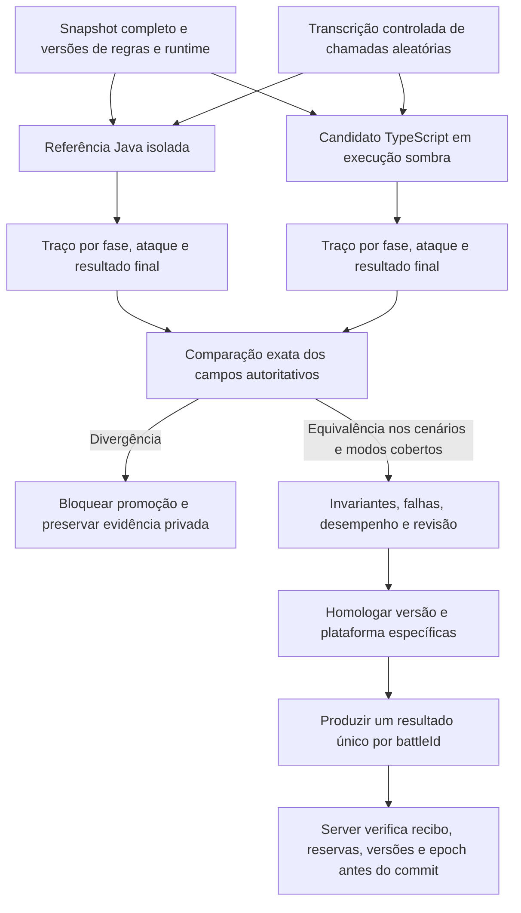

Na migração, registrar uma transcrição de sorteios com ponto de chamada,
índice, intervalo, tipo e valor/bits retornados. Java e TypeScript consomem a mesma
transcrição; chamada extra, ordem diferente ou transcrição não consumida são
divergências. Para o motor novo, especificar um PRNG e um mapeamento de intervalos
versionados, com seed de origem segura e estado independente por batalha.
Esse PRNG não torna o Java antigo reproduzível sem a adaptação de todas as fontes.

O snapshot captura participantes, formações, habilidades, atributos, efeitos
condicionais, flags, tipo de batalha, contexto de reino e configurações completas
necessárias. O cálculo não busca `UserProfile`, XML mutável, banco, relógio real
ou serviços globais durante o replay. O instante efetivo do combate faz parte
da entrada quando uma regra depende do tempo.

Uma solicitação produz um resultado final imutável e um hash; consultar ou
reenviar a mesma solicitação não sorteia cura novamente nem reaplica perdas.
O recibo de aplicação, ledger, alterações e evento são confirmados na mesma
transação autoritativa. Em timeout, resultado incerto ou falha de infraestrutura,
consultar o recibo e retomar a mesma operação. Se o cálculo violar um invariante,
ficar pendente para investigação/reprocessamento seguro; não escolher o vencedor
por fallback ou confirmar o resultado parcialmente.

### 10.6. Testes e critérios para liberar um modo de batalha

1. **Referência congelada:** inventário de artefatos originais, recursos, flags,
   runtime e protocolo; cenários sintéticos e dados privados somente no ambiente
   autorizado. Confrontar trechos ambíguos do decompilador com bytecode.
2. **Primitivas numéricas:** parsing, promoções `f32`/`f64`, casts, overflow,
   divisão, potências, limites, negativos, NaN e infinitos. Rejeitar valores
   excepcionais fora do contrato antes de aplicar o resultado.
3. **Equivalência por fase:** formação, alvos, sorteios, habilidades, status,
   dano inteiro, resto fracionário, forças, proteção, vencedor, cura, feridos,
   mortes e distribuição por participante. UUIDs e tempos de geração do
   relatório podem ser normalizados; perdas e decisões não recebem tolerância.
4. **Cobertura de modos:** PVE/PVP, cidade, recurso, território, tropas com
   estrelas, armadilhas/torres, generais, dragões, bosses e modos especiais
   autorizados, cada um com limites e flags próprios. Modos ainda não validados
   permanecem indisponíveis no motor novo.
5. **Casos de fronteira e propriedades:** entrada vazia ou inválida, uma unidade,
   dano quase inteiro, efeitos negativos e máximos, chance zero/total, empate,
   limite de turnos, reativação de status, proteção e capacidade de hospital.
   Conservação de tropas usa categorias disjuntas; cura é uma transição, não
   criação de unidades. Fuzzing gera casos e minimiza divergências.
6. **Efeitos colaterais:** retry, crash após cálculo, crash após commit, entrega
   duplicada, resultado atrasado, mudança de proprietário e versão antiga de
   regras. Provar que perdas e recompensas só são aplicadas uma vez.
7. **Liberação controlada:** execução sombra, comparação com referência,
   inspeção independente e ativação por versão/modo. Divergência autoritativa
   conhecida bloqueia a promoção. Guardar entradas, sorteios e versões para
   auditoria e replay privado.

O Java é referência de comportamento, não prova de correção absoluta. Uma
inconsistência confirmada no legado precisa de decisão de regra e teste de
regressão próprios; não copiar um erro silenciosamente nem corrigi-lo no meio
de uma migração sem versionamento. Ausência de divergências num conjunto de
testes também não é uma prova matemática de ausência de bugs.

### 10.7. Verificações executadas e desempenho ainda pendente

Além da inspeção estática e da leitura de bytecode, foram executadas sondas
numéricas independentes em **Temurin 8.0.504** e **Rust 1.99.0 com otimização**.
Elas são exemplos sintéticos de semântica, não um porte do código privado nem
batalhas completas. Exemplos observados:

| Sonda sintética | Resultado observado | Implicação |
| --- | --- | --- |
| Quantidade `16.777.217` passa por `float` antes de retornar a inteiro | `16.777.216`; o caminho só em `double` mantém `16.777.217` | Promover tudo para 64 bits pode mudar uma unidade. |
| Dez incrementos com resto fracionário, usando `0.1f` promovido a `double` ou `0.1` diretamente | Primeiro caminho contabiliza `1`; o segundo contabiliza `0` nessa sequência de piso e transporte do resto | Parsing e precisão intermediária afetam acumuladores. |
| Arredondamento de `-1.5` | Java `-1`; Rust padrão `-2` | A tradução direta de arredondamento já diverge. |
| Piso e cast de `-1.2` | Piso `-2`; cast para inteiro `-1` | Truncar e arredondar para baixo são operações diferentes. |

Não foram executados nesta revisão testes diferenciais de batalhas completas,
benchmark de throughput/p99, homologação de Rust para combate ou prova de
correção de todos os efeitos. Nenhum motor, regra, dado de jogador ou deploy
foi alterado por esta revisão documental.

Antes da extração, medir preparação do snapshot, cálculo, serialização, fila,
rede, validação e commit separadamente. Comparar primeiro Java e TypeScript
no mesmo hardware, entradas, sorteios e regras, incluindo batalhas pequenas,
grandes e muitas batalhas simultâneas. Registrar CPU por batalha, alocações,
memória máxima, throughput, p50/p95/p99 e tempo total percebido pelo jogador.
Os orçamentos de capacidade devem ser definidos antes de selecionar o vencedor
do benchmark. Uma chamada remota por ataque não faz parte do desenho.

Otimizar primeiro dados compactos, configuração compilada/versionada, redução
de parsing e alocações, cache validado e paralelismo entre batalhas independentes.
A sequência interna de uma batalha permanece serial até que uma transformação
seja provada equivalente. Isolar o Combat TypeScript em processos de CPU e
medir o custo dessa fronteira. Se necessário, comparar Rust e Go sob o mesmo
contrato, hardware e carga antes de selecionar uma migração. As sondas Rust
acima são evidência histórica de semântica, não benchmark do motor TypeScript.

### 10.8. Bots e NPCs

Bots Python consomem os mesmos comandos, custos, limites e autorizações de um
jogador. Contas simuladas têm marcação explícita, quotas, limite de concorrência
e chave de desligamento no painel. Eles não escrevem diretamente no banco.
Bots que se comportam como jogadores são diferentes de NPCs internos do mundo:
estes últimos pertencem ao módulo `npc` e à simulação autoritativa.
Execução em produção começa com cenários e população limitados, medindo impacto
na economia e capacidade, sem privilégios administrativos implícitos.

## 11. WebAdmin e controle das regras

O painel gerencia configurações, estatísticas, habilidades e regras por comandos
administrativos versionados. Cada alteração registra operador, motivo, valor
anterior, novo valor e escopo. Uma operação econômica usa os mesmos invariantes
do servidor e gera ledger; não é um editor SQL exposto no navegador.

Regras seguem o fluxo `rascunho → validação → simulação → publicação versionada`.
Batalhas já aceitas continuam vinculadas à sua versão; uma atualização não
muda silenciosamente cálculos em andamento. Rollback ativa uma versão anterior
para novas operações, com migração explícita se o estado persistido exigir.

Cloudflare Access/identidade corporativa pode proteger a entrada do painel,
mas o backend também valida identidade, funções e escopo de reino. Operações
críticas exigem autenticação reforçada e têm limites próprios. Frontends usam
HTTPS, cookies/tokens apropriados, proteção CSRF quando aplicável e CORS por
origens autorizadas; páginas privadas não entram no cache público.

## 12. Observabilidade, Evelog e busca

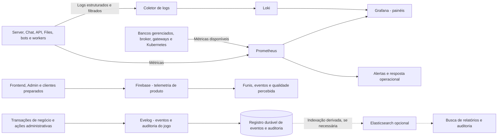

Firebase coleta telemetria de produto: entrada no jogo, fluxos de tela, erros
controlados e eventos de uso. Não é autoridade para saldo, compra ou resultado
de batalha. Integração móvel depende do SDK e da preparação da versão do APK;
não presumir que o cliente legado já envie esses eventos. Analytics não recebe
segredos, tokens, corpo de mensagens ou dumps de jogadores. Sua indisponibilidade
não bloqueia o jogo.
[Referência: Google Analytics para Firebase](https://firebase.google.com/docs/analytics).

Prometheus coleta métricas operacionais; Loki centraliza logs; Grafana consulta
os dois. Firebase não substitui a visibilidade do runtime e da infraestrutura.
Para manter o orçamento da VPS, destino/hospedagem desses backends será definido
fora do nó principal ou somente após reserva explícita de capacidade. Alertas cobrem atraso de filas, falhas de comando, conexões, consumo de
CPU/memória, replicação, latência por operação e falha de proprietário de partição.
Definir SLOs e capacidade a partir de testes de carga, não de uma quantidade
presumida de jogadores por pod.

Logs operacionais registram correlação, componente, operação conhecida, duração
e motivo controlado. Evitar payloads de jogadores, credenciais, tokens e chaves.
IDs de alta cardinalidade não viram labels de Loki ou séries por jogador no
Prometheus; a busca usa campos estruturados quando autorizados.
[Referência: cardinalidade no Loki](https://grafana.com/docs/loki/latest/get-started/labels/cardinality/).

**Evelog:** denominação do registro de eventos e auditoria do jogo, conforme
confirmado pelo operador; não representa uma ferramenta externa. O desenho
propõe um registro append-only no PostgreSQL, ligado à outbox, com detalhes
volumosos arquivados em MongoDB/storage conforme retenção. Eventos registram
ação, origem, versão de regras, correlação e resultado, com acesso restrito.
Isso não exige adotar event sourcing para todo o estado do jogo e não substitui
os logs operacionais do Loki.

Elasticsearch permanece opcional: usar somente se buscas e filtros em relatórios
justificarem o custo de um índice separado. Ele recebe projeções reconstruíveis,
com controle de acesso e deleção; sua indisponibilidade não bloqueia combate,
login ou gravação de progresso. Loki permanece o destino principal de logs.

### Notificações push com Firebase Cloud Messaging

FCM é o canal de avisos fora da sessão: por exemplo, construção concluída,
marcha retornando, alerta de ataque ou evento da aliança, conforme preferências
e permissões. Não substitui o WS, o histórico de chat nem o estado persistido.
Firebase Auth, Analytics e FCM têm responsabilidades e falhas independentes.

Server/Chat confirma o evento e sua outbox; o worker consome a intenção de
notificação e envia via FCM de ambiente confiável. Ele roda em `apps/workers`
na VPS, usando a mensageria definida, sem um novo servidor por reino. A chamada
externa não entra na transação de gameplay. Usar SDK/Admin ou HTTP v1 com
adaptador homologado para Bun e credenciais restritas ao backend.
[Referência: arquitetura do FCM](https://firebase.google.com/docs/cloud-messaging/fcm-architecture).

A API associa cada instalação/token FCM à conta autenticada, plataforma,
ambiente e preferências; o destinatário por personagem/reino é validado pelo
backend. Uma conta pode ter vários dispositivos. Token FCM não é token de
login. Atualizar tokens rotacionados, remover os inválidos e desvincular a
instalação no logout/troca de conta para não enviar avisos do usuário anterior.
Não registrar tokens em logs ou telemetria; restringir acesso ao cadastro.
[Referência: ciclo de vida de tokens FCM](https://firebase.google.com/docs/cloud-messaging/manage-tokens).

Manter `notificationId`, causa, destinatário, prazo e estado da tentativa.
Retries usam backoff e limite; notificação vencida não é reenviada. A fila deduplica
intenções e o cliente deduplica o ID quando controla a apresentação; uma falha
após o envio pode causar duplicata, portanto não prometer entrega única nem
confirmar leitura porque o FCM aceitou a mensagem. TTL e colapso são definidos
por categoria: um alerta de ataque atrasado não deve aparecer como atual.
Push não é garantia de aviso em tempo real; abrir/reconectar consulta a API.
[Referência: prazo de mensagens FCM](https://firebase.google.com/docs/cloud-messaging/customize-messages/setting-message-lifespan).

Preferências incluem categorias, silêncio e opt-out. Enviar texto mínimo e
rotas de navegação validadas; nunca tokens de sessão, corpo completo de chat ou
dados privados desnecessários na tela bloqueada. Antes de enviar avisos de
aliança, revalidar destinatário e escopo. Clicar exige sessão e autorização
atuais; o payload não autoriza comando nem concede benefício. Não usar tópicos
públicos como mecanismo de autorização para mensagens privadas.

Web Push depende de suporte do navegador, HTTPS, permissão, service worker e
configuração VAPID; não é executado pelo SSR. Mobile exige SDK/configuração e
permissões por versão/plataforma, incluindo APNs no cliente Apple. O APK legado
não ganha push só pela configuração do backend. Negar permissão ou perder o
FCM não impede login, construção ou combate. Homologar cada plataforma sem
presumir que todas recebam notificações nas mesmas condições.
[Referências: integração Web FCM](https://firebase.google.com/docs/cloud-messaging/web/get-started),
[recebimento por plataforma](https://firebase.google.com/docs/cloud-messaging/receive-messages).

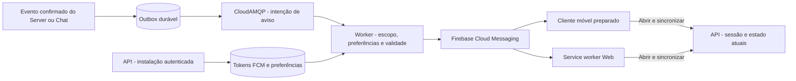

## 13. Kubernetes da VPS, entrega e continuidade

A infraestrutura executável da VPS fica no Kubernetes. Serviços SaaS e
frontends não são pods desse cluster. A implantação inicial é de **um único
nó**; uma distribuição leve como K3s é candidata, após medir seu custo real.
[Referência: requisitos K3s](https://docs.k3s.io/installation/requirements).

| Camada | Implantação inicial |
| --- | --- |
| Entrada | Traefik e Kong/API Gateway no Kubernetes da VPS, com configuração declarativa. |
| API | Um Deployment compartilhado, inicialmente uma réplica; não duplicado por reino. |
| Reinos | `server-realm-1` e, se admitido, `server-realm-2`; um proprietário ativo por reino e configurações/pools separados. |
| Cálculo e auxiliares | Combat TypeScript, workers/relay e Files com limites independentes. |
| Coordenação | Uma instância ZooKeeper com volume persistente no nó inicial; não é uma instalação HA. Ensemble distribuído é evolução para múltiplos hosts. |
| Dados e filas | Neon, Redis.io, MongoDB Cluster e CloudAMQP externos; não instalar suas cópias de produção na VPS. |
| Frontends | Pages para WWW/Docs/Admin; Vercel para Web Game SSR. |
| Chat e bots | Serviços externos à VPS; hospedagens e quotas ainda a selecionar. |
| Observabilidade | Coletores/exporters leves no cluster; destino de Prometheus/Loki/Grafana fora do orçamento principal ou capacidade dedicada ainda a definir. |

Três pods ZooKeeper na mesma VPS não sobrevivem à perda da máquina. Kubernetes
não cria RAM, vCPU nem disponibilidade física. Também não duplica automaticamente
o Server de um reino. `ownerEpoch`, estado durável e reconexão continuam fazendo
parte da recuperação após reboot ou substituição da VPS.

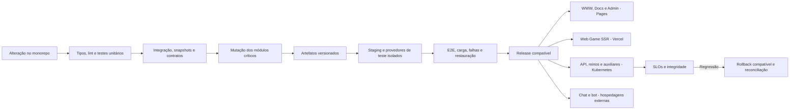

Deploys drenam conexões e permitem reconexão. Workers e cálculo só aumentam
concorrência dentro do orçamento da VPS e dos provedores. API permanece única
nesta etapa; nenhuma política de HPA cria uma API por reino. Chat externo
segue seu próprio mecanismo de escala e recuperação.

Backups e restauração incluem Neon, documentos únicos MongoDB, storage,
configurações de regras, estado operacional e segredos. Validar restauração
por provedor e coerência das referências, sem supor que snapshots do disco da
VPS contenham os dados mantidos fora dela. Desastre da VPS e desastre regional
são cenários distintos, ambos com procedimentos testados.

## 14. Falhas e degradação esperada

| Falha | Comportamento requerido |
| --- | --- |
| Neon / compute de escrita | Suspender novas mutações; reconectar com timeout; resolver resultado incerto por recibo/idempotência. Não confirmar economia somente em memória. |
| Neon / compute ro atrasado ou indisponível | Consultar o compute rw para dados consistentes; reduzir relatórios ou informar atraso, sem sobrecarregar o primário com fallback ilimitado. |
| Redis de cache | Reduzir funcionalidades dependentes e aplicar fallback com limite; autenticação e quotas falham de forma explícita quando não houver alternativa segura. |
| Broker ou worker | Preservar a outbox e mostrar pendência; reprocessar sem duplicar efeitos. Impor limites de backlog e contrapressão. |
| ZooKeeper/sessão | Parar mutações da partição afetada até reafirmar propriedade; recusar epochs antigos. |
| Chat | Jogo continua; chat informa indisponibilidade e recupera histórico pela fonte persistida. |
| Files/MongoDB/busca | Upload, documentos e buscas degradam; comandos centrais não esperam indefinidamente por esses serviços. |
| Motor de batalha externo | Manter reserva recuperável e resultado pendente; timeout, retry idempotente e reconciliação. Não criar vitória fictícia. |
| Observabilidade | Conservar comportamento do jogo; buffers limitados e descarte controlado de logs operacionais, sem perder o registro transacional de auditoria. |
| Bots | Parar os simuladores sem interromper jogadores; permitir desligamento rápido por escopo. |
| Firebase Auth | Login/renovação podem ficar indisponíveis; sessões existentes obedecem validade e política de revogação. Não aceitar token inválido para contornar a falha. |
| Firebase telemetria | Descartar/bufferizar eventos de forma limitada; não bloquear comandos do jogo. |
| Firebase Cloud Messaging / permissão push negada | Jogo continua; retry limitado aos avisos ainda válidos, com descarte após expiração. Recuperar o estado ao abrir/reconectar, sem depender da notificação. |
| Stripe | Suspender novas compras ou mostrar pendência; receber/reconciliar eventos depois, sem conceder crédito pela página de sucesso. |
| VPS / único nó Kubernetes | API e reinos locais param até recuperar o host; serviços de dados externos preservam o que foi confirmado conforme suas garantias. |

## 15. Sequência de evolução e decisões pendentes

1. **Contratos e core:** estabilizar login, cidade, construção persistente e mapa;
   criar testes diferenciais e cenários sintéticos por versão de cliente.
2. **Servidor modular:** consolidar domínios e adaptadores; separar Chat, Files,
   API compartilhada e workers, com limites de conexão e recursos.
3. **Migração PostgreSQL:** mapear tipos e inteiros de 64 bits, IDs, timestamps,
   saldos, sentinelas de filas e transações; ensaiar cópia e reconciliação. Não
   trocar apenas o driver nem manter escrita dupla informal com MariaDB.
4. **Corte de dados:** copiar com backup, verificar contagens e invariantes,
   sincronizar o delta final numa janela controlada e escolher um único
   escritor. O retorno após novas escritas exige reconciliação planejada.
5. **Painel e borda:** publicar WWW/Docs/Admin no Pages e Web Game na Vercel; integrar Firebase,
   auditoria e versionamento de regras; habilitar Kong e contratos de API.
6. **Produção controlada:** validar Kubernetes, replicação, backups, failover,
   observabilidade e carga antes de ampliar reinos e população de bots.
7. **Experimentos independentes:** evoluir o porte web e medir a necessidade
   de MongoDB, Elasticsearch, BullMQ complementar e motor de cálculo separado.
   Avaliar o cliente Flutter em paralelo, mantendo o APK atual; homologar o
   updater Lua/nativo e a distribuição R2 antes de habilitar atualizações.

Decisões ainda abertas: homologação numérica e benchmark do Combat TypeScript;
framework/adaptador SSR na Vercel; planos e regiões de Neon, Redis.io,
MongoDB Cluster e CloudAMQP; hospedagens de Chat/bot; storage dos demais objetos;
backend de observabilidade; homologação da VPS de 16 GB e admissão do segundo
reino; eventual migração do Combat TypeScript para Rust/Go; uso complementar de
BullMQ e versão/fork de Konga; viabilidade da ponte Lua/nativa, identidade de
assinatura dos APKs e escopo/renderização do eventual cliente Flutter.
Os provedores de Auth, pagamento, releases R2 e hospedagem
principal definidos neste documento não permanecem em aberto.

Clientes em `mobile/` e referências em `legacy/` mantêm separação entre entradas
originais, patches e artefatos de instalação. Originais extraídos e chaves são
somente leitura; builds usam área separada. Materiais privados, dados de
jogadores e credenciais não entram no código ou nos diagramas. Nenhuma etapa
deste documento autoriza reset de progresso, execução de migrações ou deploy.

## 16. Execução da simulação e progresso offline

O Server executa uma fila lógica de comandos por agregado/partição, com
transações para conflitos entre agregados. Prazos são instantes UTC persistidos;
o relógio monotônico mede duração e timeout dentro do processo. Relógio de
cliente não determina término, produção ou recompensa. Testes recebem um
relógio injetável para avançar dias sem esperar dias reais.

| Sistema | Estado e transições autoritativas |
| --- | --- |
| Construção, pesquisa e treino | `queued → running → completed`; cancelamento permitido usa uma transição exclusiva com política de devolução versionada. |
| Recursos e produção | Registrar `lastSettledAt`, taxas, limites e mudanças de taxa; liquidar o intervalo ainda não processado uma única vez. |
| Marchas | `scheduled → marching → arrived → returning → returned`, com prazo, destino e reservas de tropas. Combate/ocupação são transições explícitas na chegada. |
| Efeitos e habilidades temporárias | Início, término, sobreposição e fonte versionados; expiração altera o estado e invalida caches dependentes. |
| Eventos de reino | Agenda e versão de regras fixadas; abertura, fechamento e recompensa têm recibos próprios. |
| Recompensas, inventário e missões | Transições por comando/evento com idempotência; consultar uma tela não cria uma recompensa nova. |

Um scheduler procura prazos vencidos e acorda o executor responsável. Cada
atividade tem ID, versão, instante de vencimento e estado esperado. Vários
workers podem descobrir a mesma atividade, mas somente uma transação aplica
a transição. Duplicação de jobs, reconexão e reinício não repetem a conclusão.

Progresso offline usa os mesmos prazos e regras. Ao iniciar, o proprietário
reconcilia atividades pendentes e liquida intervalos de produção em lotes
limitados. Mudanças de bônus durante um intervalo exigem segmentação por instante
efetivo; não multiplicar a taxa atual por todo o período offline. Operações
que dependam de uma atividade ainda não reconciliada aguardam/reconciliam esse
agregado com limite, em vez de aceitar estado incorreto.

Expiração, conclusão e cancelamento concorrentes verificam a mesma versão de
estado e o mesmo recibo. Política de atraso não depende da ordem acidental dos
jobs; o ordenamento entre eventos simultâneos faz parte das regras. Recompensas
periódicas e horários de eventos usam timezone de regra explícito, sem depender
do fuso local do container. O instante persistido continua em UTC.

## 17. Modelo de dados e propriedade das escritas

O modelo físico será versionado por migrations. A organização lógica abaixo
define os proprietários e as invariantes que essas migrations devem preservar.
`identity` representa o vínculo com Firebase e as permissões internas; credenciais
de login são gerenciadas pelo Firebase Auth. A conta/personagem de um reino
pertence ao jogo. Essa separação resolve a sobreposição entre API e Server.

| Domínio/schema proposto | Entidades centrais | Escritor autorizado |
| --- | --- | --- |
| `identity` | Vínculo único de Firebase UID para conta interna, estado Guest/vinculado, sessão/ticket de jogo, revogação interna e papéis administrativos | API compartilhada; credenciais e vínculos de provedores no Firebase Auth. |
| `notifications` | Instalações e tokens FCM, preferências, escopo conta/personagem/reino, intenção de envio, validade e tentativas | API registra dispositivos/preferências; worker envia notificações de eventos autorizados. |
| `game` | Jogador por reino, cidade, edifício, atividade, pesquisa, tropas, marcha, inventário e versão de agregado | Server proprietário da partição. |
| `economy` | Carteira, lançamento, reserva, consumo, devolução e recibo de operação | Casos de uso econômicos do Server; API administrativa solicita comandos. |
| `combat` | Batalha, snapshot, reservas, versão do motor, resultado e recibo de aplicação | Orquestrador autoritativo do Server. O processo Combat TypeScript calcula somente. |
| `social` | Aliança, associação, cargos, permissões e intervalos de associação | Domínio de alianças do Server. Chat consulta a autorização derivada. |
| `chat` | Canal, mensagem, sequência, recibo, metadados de arquivo e estado de retenção | Chat e seu worker de retenção, com permissões específicas. |
| `files` | Upload, proprietário, objeto, hash, transformação e referência | Files e workers de mídia. |
| `billing` | Catálogo USD, pedido, Checkout Session, pagamento, eventos recebidos e estado de entrega | API/worker de pagamentos; concessão de itens/moeda somente pelo Server do reino e ledger. |
| `operations` | Versão de regras, publicação e auditoria administrativa | Casos de uso administrativos autorizados; publicação passa pelo Server quando afeta gameplay. |
| Integração | Outbox e inbox/recibos por serviço | Produtor grava sua outbox na transação; consumidor grava sua inbox ao aplicar o evento. |

Invariantes mínimas: saldo disponível não negativo; reserva não consumida duas
vezes; inventário e tropas com quantidades válidas; atividade com uma única
conclusão ou cancelamento; participante vinculado ao reino correto; apenas um
resultado aplicado por batalha. Chaves únicas e verificações de versão no banco
complementam a validação da aplicação.

O ledger registra a causa e as entradas/saídas de cada operação, inclusive
transferências, consumo e devolução. Categorias e unidades são explícitas;
saldo materializado deve reconciliar com os lançamentos confirmados. Não corrigir
saldo com SQL avulso: usar ajuste administrativo identificado e auditável.
Limites superiores também são regras, não apenas o tamanho do tipo SQL.

Uma transação de comando confirma estado, ledger, recibo e outbox em conjunto.
Reuso de um `requestId` com o mesmo conteúdo retorna o resultado registrado;
com conteúdo diferente é rejeitado. Alterações por workers em domínio alheio
passam pelo comando/evento do proprietário, nunca por acesso SQL irrestrito.
Índices cobrem propriedade, estado/prazo, paginação e chaves idempotentes;
relatórios usam projeções ou consultas com orçamento próprio.

## 18. Identidade, protocolos e reconexão

### Identidade e autorização

Firebase Auth cuida do login e das credenciais. A API verifica o ID token com
assinatura, emissor, projeto/audience e expiração, e aplica a política de
revogação; decodificar um JWT não autentica uma sessão. O Firebase UID se vincula
uma única vez à conta interna, que pode possuir personagem em até dois reinos.
Verificação comum do token não verifica revogação automaticamente: esse controle
deve ser habilitado/implementado conforme o escopo.
[Referência: verificação de tokens Firebase](https://firebase.google.com/docs/auth/admin/verify-id-tokens).

A API troca o ID token validado por uma sessão de jogo com escopo de conta,
personagem e reino. Permissões e banimentos vêm do estado autoritativo. O APK
legado não passa a suportar Firebase só por configurar o backend: SDK ou ponte
de autenticação exigem homologação por versão, preservando o protocolo aceito.
Nunca fabricar um Firebase UID ou uma sessão autenticada a partir de um UUID
de dispositivo recebido sem prova de identidade.

Cadastro e vínculo de conta criam identidade e personagem em etapas
idempotentes, com estado de provisionamento explícito. Login identifica reino,
personagem e versão de protocolo. Renovação e recuperação de acesso não criam
outro personagem nem apagam progresso. Integrações externas ausentes retornam
estado explícito de indisponibilidade.

Sessões registram expiração, revogação e versão de autorização. Tickets de
chat e jogo têm escopo e duração próprios. Logout, banimento e remoção de cargo
devem invalidar o acesso correspondente, inclusive sockets já abertos. Rotação
de chaves mantém uma janela controlada de verificação das sessões válidas.
Administração usa identidade de operador, funções por reino e auditoria;
credencial de jogador não concede autoridade administrativa.

Associação à aliança é revalidada ao entrar no canal e ao enviar/consultar
histórico. Saída/expulsão revoga a inscrição e o acesso ao arquivo; acesso a
mensagens de períodos anteriores exige o intervalo de associação autorizado.
Uma notificação de mudança perdida é recuperada pela versão da associação,
sem depender exclusivamente do Pub/Sub Redis.

### Métodos de login e vínculo da conta Guest

Todos os métodos abaixo convergem para Firebase Auth → UID → conta interna.
O Server recebe a mesma identidade autorizada, independentemente do provedor.
Esta é a matriz alvo; habilitar o método exige configuração do provedor e
homologação no Web Game e em cada versão móvel suportada.

| Método | Integração alvo | Preparação e comportamento |
| --- | --- | --- |
| **Guest** | Firebase Anonymous Auth | Criar identidade anônima real, com sessão validada; manter progresso associado à conta interna. Não usar UUID local como autenticação. |
| **Facebook** | `facebook.com` | Aplicativo Meta, credenciais e callbacks configurados; solicitar somente os escopos necessários. |
| **Google** | `google.com` | Configuração OAuth e identificadores/assinaturas da plataforma móvel homologados. |
| **Email/Password** | `password` | Cadastro, verificação de e-mail, recuperação e política de senha pelo Firebase; não guardar senha no PostgreSQL. |
| **Apple** | `apple.com` | Identificadores, chaves e callbacks Apple; tratar e-mail privado/relay e consentimento de vínculo conforme o fluxo. |
| **Microsoft** | `microsoft.com` | Registro OAuth Microsoft; definir contas pessoais/organizacionais e política de tenant aceitos. |
| **GitHub** | `github.com` | Aplicativo OAuth GitHub, callback autorizado e escopos mínimos; não pedir acesso a repositórios para jogar. |

Referências de configuração: [Guest](https://firebase.google.com/docs/auth/web/anonymous-auth),
[Facebook](https://firebase.google.com/docs/auth/web/facebook-login),
[Google](https://firebase.google.com/docs/auth/web/google-signin),
[Email/Password](https://firebase.google.com/docs/auth/web/password-auth),
[Apple](https://firebase.google.com/docs/auth/web/apple),
[Microsoft](https://firebase.google.com/docs/auth/web/microsoft-oauth) e
[GitHub](https://firebase.google.com/docs/auth/web/github-auth).

Converter Guest em conta vinculada usa o fluxo de **account linking**,
preservando Firebase UID, conta interna, personagens e progresso dos reinos.
Entrar em outro provedor como se fosse uma conta nova não substitui esse fluxo.
Vários provedores podem pertencer à mesma conta; e-mail, nome e avatar não são
chaves de propriedade. Não fundir contas automaticamente por e-mails iguais.
Se a credencial já pertencer a outro UID, interromper o vínculo e oferecer
recuperação com prova das identidades; eventual transferência/fusão de progresso
exige procedimento separado, auditado e idempotente, sem apagar a conta Guest.
[Referência: vínculo de provedores mantendo o UID](https://firebase.google.com/docs/auth/web/account-linking).

Guest é persistido, mas sem método vinculado pode perder o acesso após perda
da sessão/reinstalação; explicar isso e oferecer vínculo antes que ocorra.
Não habilitar limpeza automática de identidades anônimas com progresso sem
uma política explícita de preservação/recuperação. Aplicar quotas de criação e
abuso, sem usar um identificador de aparelho como prova de posse. Um provedor
fora do ar não autoriza substituir uma conta existente por Guest silenciosamente.

Vincular/desvincular e mudar credenciais exigem autorização e reautenticação
recente quando aplicável. Não remover o último método recuperável sem um fluxo
explícito; atualizar o vínculo interno após validar o estado no Firebase.
Secrets OAuth ficam no ambiente confiável de configuração, fora de clientes e
logs. Autorizar domínios e callbacks por ambiente, inclusive o domínio Firebase
usado pelo fluxo; validar redirects no deploy Pages/Vercel e no APK. Guest não
é identidade de operador do painel. Logar por um provedor não concede função
administrativa ou acesso a outro personagem.

### Contrato de comandos e eventos

O contrato interno é independente de SFS ou WebSocket. Transportes adaptam
os campos existentes do cliente para este envelope, sem exigir que um APK
antigo passe a enviar campos desconhecidos.

| Campo | Regra |
| --- | --- |
| `protocolVersion`, `schemaVersion` | Validar antes de interpretar comandos ou eventos. |
| `requestId`, tipo de comando e hash do conteúdo | Correlacionar resposta e permitir retry sem duplicar uma mutação. |
| Identidade, reino e escopo | Derivados da sessão validada; IDs enviados pelo cliente não provam propriedade. |
| `aggregateId`, `expectedVersion` | Aplicar controle de concorrência quando necessário. |
| `eventId`, `sequence`, `occurredAt` | Identificar, ordenar por stream e recuperar eventos duráveis. Não existe ordem global implícita entre canais/reinos. |
| Erro e estado da operação | Distinguir rejeição, pendência, confirmação e resultado incerto. Timeout não é prova de que um comando não ocorreu. |

Ao reconectar, o cliente identifica a sessão e o último cursor confirmado.
O serviço valida o escopo e entrega eventos ainda retidos; se o cursor expirou
ou houver lacuna, envia um novo snapshot autorizado e reinicia a sequência de
sincronização. Pushes perdidos após um commit devem ser recuperáveis por outbox
ou consulta de estado; a conexão não é o único registro de uma alteração.

Filas de saída por socket têm limite. Cliente lento recebe contrapressão,
ressincronização ou desconexão controlada; não pode causar crescimento ilimitado
de memória. Eventos obsoletos de presença podem ser agregados/descartados;
respostas econômicas e eventos duráveis seguem política de recuperação.
Heartbeats, timeout e retomada são testados por cliente e versão. O adaptador
legado mantém os mecanismos efetivamente suportados pelo APK; capacidades novas
de cursor/ACK não são presumidas como já existentes nele.

## 19. Reinos, partições e operações entre proprietários

A primeira configuração de produção mantém um proprietário lógico por reino,
com Servers separados e API compartilhada; o máximo inicial é dois reinos.
Divisão regional é habilitada somente depois de validar transferências e
operações entre partições. Identidade do agregado não muda quando ele muda
de pod; roteamento consulta um diretório versionado de propriedade.

Uma transferência usa um registro durável com `transferId`, origem, destino,
versão e estado: preparar → suspender novas mutações do agregado na origem →
persistir checkpoint → trocar propriedade/epoch atomicamente → destino carregar
o checkpoint → confirmar. Repetir uma etapa não duplica a entidade. Falha antes
da troca permite retomar na origem; depois da troca, a recuperação usa o novo
proprietário. Requisições atrasadas recebem o roteamento atual ou são rejeitadas
pelo epoch e pelo recibo.

Enquanto os agregados compartilham o mesmo PostgreSQL, operações que reservam
tropas/recursos de vários participantes usam transação e ordem de locks definida.
Nenhuma partição publica vitória antes de confirmar a aplicação autoritativa.
Se uma evolução distribuir participantes por bancos independentes, será
necessário um protocolo versionado de reservas, coordenação e compensação;
não transformar automaticamente uma transação em vários RPCs. Esse modo fica
desabilitado até sua homologação. Eventos entre reinos seguem a mesma fronteira.

Conquista do trono e KVK integram os cenários obrigatórios de pico. Cada batalha
tem um coordenador autoritativo, `battleId` global e reservas versionadas dos
participantes. Em KVK, dois Servers não calculam/aplicam independentemente a
mesma batalha: o coordenador recebe os snapshots reservados, pede o cálculo e
confirma os efeitos pelo protocolo de aplicação idempotente. Enquanto houver
um único banco, a transação pode validar reservas e epochs dos dois reinos em
ordem definida; ela não fica aberta durante o cálculo remoto. Falha de qualquer
participante exige recuperação durável, sem liberar as tropas antes de decidir
a reserva. KVK permanece desabilitado até homologar concorrência, recuperação e
aplicação entre reinos; abrir dois reinos não comprova suporte a KVK.

## 20. Chat global e de aliança: entrega, arquivo e exclusão

### Política de retenção definida

Os prazos são durações corridas, contadas de `createdAt` **do envio confirmado
pelo servidor em UTC**. `archiveAt = createdAt + 24h` e
`expiresAt = createdAt + 168h`. Edição, retry, importação e arquivamento não
renovam esses prazos. Exclusão antecipada por moderação continua permitida.

| Idade da mensagem | Estado e armazenamento | Acesso |
| --- | --- | --- |
| Menos de 1 dia | Ativa; corpo no histórico recente PostgreSQL, com cache limitado. | Histórico recente e entrega WS aos membros autorizados. |
| De 1 dia até antes de 7 dias | Arquivada; corpo no MongoDB, com metadados/cursor mínimos quando necessários no PostgreSQL. | Endpoint de arquivo paginado, com a mesma autorização do canal. Sai do histórico recente. |
| 7 dias completos ou mais | Expirada; exclusão do corpo e das cópias operacionais. | Não retornar em histórico, arquivo, busca ou replay, mesmo se a limpeza física estiver atrasada. |

Essa regra se aplica a **chat global e chat da aliança**. Mensagens privadas e
outros canais precisam de política explícita própria, sem herdar retenção por
acidente. Não arquivar o corpo dessas mensagens permanentemente em Evelog ou
Loki; eventos operacionais de moderação guardam somente metadados necessários.

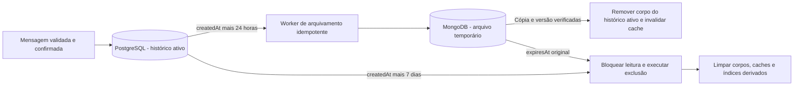

### Entrega e ordenação

Chat atribui `messageId` e sequência por canal. O par de remetente e ID de
envio do cliente permite reconhecer retries, conferindo o conteúdo. Confirmar
o envio após persistir mensagem e evento de distribuição; o consumidor só
distribui mensagens confirmadas. Pub/Sub Redis faz fan-out entre pods, mas
não substitui o histórico persistido nem garante recuperação de entrega.

Histórico e arquivo usam cursor estável por canal/sequência, com deduplicação
por `messageId` na transição de armazenamento. Reconexão recupera mensagens
permitidas e não expiradas; lacunas por retenção sinalizam ressincronização.
Exclusão/moderação produz tombstone para retirar a mensagem das projeções e
impedir que um retry antigo a publique de novo. Autorizações valem também para
consultas em MongoDB e índices de busca.

### Jobs de retenção e falhas

Um reconciliador varre mensagens vencidas em lotes por canal e prazo. Primeiro
faz upsert do arquivo com o mesmo ID, versão e `expiresAt`; verifica a cópia
antes de remover o corpo do PostgreSQL. Edição concorrente usa versão para
impedir que uma cópia antiga vença a nova. Se MongoDB estiver indisponível,
preservar a cópia recente temporariamente e alertar o atraso, sem apagar antes
de arquivar. Ela já não aparece no histórico recente a partir das 24h; a
consulta ao arquivo pode usar a cópia pendente, mantendo escopo e deduplicação.

Aos 7 dias, a expiração prevalece sobre a tentativa de arquivamento: um job
atrasado não recria mensagem expirada. API e WS filtram por `expiresAt` em toda
consulta/replay. Cleanup remove corpos em ambos os bancos, cache, índices e
objetos de anexos exclusivos sujeitos à mesma política. Recibos de deduplicação
podem sobreviver sem corpo pelo prazo necessário para impedir replay antigo.

Usar TTL MongoDB em `expiresAt` como reforço, além de um worker de exclusão e
filtros na aplicação. TTL não garante remoção no instante exato do vencimento.
A meta proposta em operação saudável é reconciliar a cada minuto e concluir
a limpeza física até cinco minutos após o prazo; atrasos geram alerta e não
estendem a visibilidade da mensagem.
[Referência: comportamento dos índices TTL MongoDB](https://www.mongodb.com/docs/manual/core/index-ttl/).

Backups físicos/PITR podem conter versões antigas: a exclusão online não apaga
instantaneamente WAL e backups existentes. Essas cópias têm acesso restrito e
retenção própria documentada; qualquer restauração elimina mensagens expiradas
antes de reabrir o serviço. Uma exigência de eliminação também de todas as
cópias de backup em sete dias precisa de desenho de backup/chaves específico;
não declarar essa garantia como consequência de um `DELETE` ou TTL.

## 21. Ciclo de vida de arquivos e mídia

Files autentica o proprietário e cria um `uploadId` com tamanho, MIME permitido,
limite de duração e objeto provisório. O envio ocorre ao serviço ou a uma URL
assinada restrita; concluir o upload não prova que o arquivo é válido. Files
confere bytes, tipo real, dimensões, hash e limites de processamento, e registra
`pending → uploaded → validated → ready`, ou `rejected` com motivo controlado.

Transformações, miniaturas e verificações executam em workers com limites de
CPU/memória/tempo. Perfil e mensagem só recebem referência pronta e autorizada;
a confirmação/repetição usa o mesmo recibo. Uma referência ainda pendente não
é exibida como arquivo confirmado. O serviço mantém registro de referências e
executa coleta de uploads abandonados e objetos órfãos com janela de segurança.

Exclusão revoga entrega autorizada, invalida caches/CDN quando aplicável e
agenda remoção do objeto, derivados e metadados permitidos pela retenção.
Objetos compartilhados só são removidos quando não houver referência válida.
URLs assinadas, avatares públicos e anexos privados têm políticas diferentes.
MinIO local e storage de produção, incluindo R2 para releases, são exercitados pelo mesmo contrato S3,
sem presumir igualdade de todas as funcionalidades entre provedores.

## 22. Estratégia obrigatória de testes

Todas as camadas abaixo fazem parte da arquitetura de qualidade. Esta é uma
política de implementação; as suítes ainda precisam ser construídas neste
checkout. Um smoke test manual no APK não substitui E2E automatizado.

| Camada | Escopo | Exemplos obrigatórios |
| --- | --- | --- |
| **Testes Unitários** | Funções e casos de uso isolados, relógio/RNG injetáveis e dependências controladas. | Custos, limites, bônus, arredondamento, permissões, transições, produção offline, retenção e invariantes econômicas. |
| **Testes de Integração** | Adaptadores com bancos, broker, ZooKeeper e storage reais e descartáveis. | Transação/rollback, concorrência, primário/réplica, outbox/inbox, redelivery, troca de proprietário, migrações, arquivo do chat e S3. |
| **Testes de Snapshots** | Contratos, serialização, resultados determinísticos e interfaces visuais. | Frames SFS, JSON de API, eventos WS, estado/traço de combate, HTML SSR e telas web/painel. |
| **Testes E2E** | Fluxo do cliente até persistência e retorno, pelo gateway e pelas aplicações reais. | Login, cidade, construir/concluir/reconectar, mapa, chat entre dois clientes, moderação, arquivos e comandos do painel. |
| **Testes de Mutação** | Avaliar se a suíte detecta alterações de comportamento no código. | Trocar comparadores, retirar verificações de dono/epoch, mudar custo/arredondamento e remover idempotência ou limites de retenção. |

### Organização, ferramentas e ambientes

Unitários ficam próximos dos módulos; integração fica junto do adaptador/app
testado. `tests/` concentra contratos e fixtures sintéticas comuns e jornadas
E2E. TypeScript é o motor inicial e usa runner homologado para
Bun; Python usa suíte própria para o bot. Rust/Go terão suítes próprias caso
sejam adotados, mantendo os mesmos testes de contrato e replay. Nenhuma suíte usa
credenciais de produção ou cria jogadores no reino real.

Integração sobe dependências isoladas por execução, com schemas/buckets/filas
próprios. Validar PostgreSQL primário/réplica, Redis, MongoDB, RabbitMQ,
ZooKeeper e MinIO conforme o componente afetado. Staging também exercita
endpoints dedicados de teste de Neon/Redis.io/MongoDB/CloudAMQP, sem tocar na
produção. Firebase Auth usa emulador/projeto de teste; Stripe usa modo de teste
e eventos assinados simulados, sem cobrança real. Cleanup remove apenas os
recursos criados pela execução; não executa reset/flush de volumes compartilhados.
Incluir falha e recuperação de dependências, além do caminho de sucesso.

Para E2E web/painel/landing, Playwright é a ferramenta proposta. Para APK,
homologar automação em emulador/dispositivo com framework apropriado e manter
uma matriz por versão; um cliente SFS de teste cobre protocolo, não comprova
a renderização nativa. Fluxos E2E de negócio mantêm os serviços reais; simulações
de terceiros indisponíveis ficam explicitamente identificadas no relatório.

Snapshots de dados fixam regras, seed/transcrição aleatória, relógio e ordem
relevante. Normalizar somente dados voláteis sem semântica, nunca tropas,
saldo, dano, destinatário ou autorização. Uma alteração de snapshot exige
revisão do diff e motivo; não aceitar automaticamente um baseline novo porque
o teste falhou. Snapshots de tela fixam browser, fontes, resolução e ambiente,
com tolerância visual separada da igualdade dos valores autoritativos.
[Referência: comparações visuais Playwright](https://playwright.dev/docs/test-snapshots).

Testes de mutação usam StrykerJS com runner compatível para TypeScript e
`cargo-mutants` se Rust for adotado; o tooling de Go será selecionado se houver
um porte para essa linguagem. A integração com o runner Bun deve ser comprovada;
não presumir suporte direto. Ferramenta/runner Python será homologado para os
módulos que tiverem regras próprias relevantes.
[Referências: StrykerJS](https://stryker-mutator.io/docs/stryker-js/introduction/),
[cargo-mutants](https://mutants.rs/).

O catálogo de mutações críticas não pode ter sobreviventes não equivalentes
nos caminhos de combate, saldo, propriedade, idempotência e retenção. Mutantes
equivalentes exigem justificativa revisada; timeout, teste quebrado ou execução
incompleta não contam automaticamente como comportamento validado. O score
geral tem baseline e limite por pacote, sem usar uma média alta para esconder
um mutante crítico sobrevivente. Não confundir teste de mutação com fuzzing ou
com testes de comandos que alteram o estado do jogo.

### Homologação de Auth e push

Testar Guest → cada um dos seis métodos não anônimos, vínculo de múltiplos
provedores ao mesmo UID, reentrada em outro dispositivo e preservação dos dois
personagens/reinos. Cobrir credencial já vinculada a outro UID, cancelamento
OAuth, e-mail privado Apple, recuperação de senha, token expirado/revogado,
callbacks por ambiente e concorrência de provisionamento. Colisões não podem
criar saldo/personagem duplicado ou transferir propriedade por coincidência de
e-mail. Homologar os fluxos externos reais em contas de teste: o emulador não
comprova sozinho configuração OAuth ou comportamento do cliente nativo.

Push cobre opt-in negado, foreground/background, token rotacionado/inválido,
logout/troca de conta, múltiplos dispositivos, aliança revogada, TTL, duplicatas,
retries e indisponibilidade do FCM. Testes locais usam adaptador controlado;
entrega real usa projeto/dispositivos dedicados de staging, sem tokens de
produção. Validar abertura autorizada e ressincronização, não somente o aceite
da chamada de envio. Nos snapshots, usar identidades e tokens sintéticos.

### Critérios de CI e release

PRs executam tipos/lint, unitários, contratos e snapshots afetados, integração
dos adaptadores alterados e E2E das jornadas centrais. Mudanças em módulos
críticos executam mutação direcionada antes do merge. Suítes completas de
mutação, matriz de clientes, recuperação, carga e compatibilidade cruzada
rodam periodicamente e são requisito do candidato a release.

Falha de teste obrigatório bloqueia promoção. Retries servem para diagnóstico;
instabilidade recorrente tem responsável e prazo, sem converter falha em
sucesso silencioso. Relatórios preservam commit, imagens, versões, seeds,
fixtures, diffs de snapshot, cobertura e resultado de mutação, sem dados reais
de jogadores. Cobertura de linhas isoladamente não aprova uma regra.

Retenção do chat testa as fronteiras exatas de 24h e 168h, relógio UTC, edição
e retry sem renovação do prazo, corrida entre arquivo e exclusão, autorização
da aliança, cache antigo, indisponibilidade de MongoDB, restauração e replay
de jobs expirados. Usar relógio controlado, sem esperar um ou sete dias reais.

## 23. Ambiente de desenvolvimento e ferramentas administrativas

Desenvolvimento usa Compose com perfis propostos `core`, `dev-tools` e `tests`.
As interfaces administrativas são ferramentas do desenvolvedor e não dependências
de startup do jogo. O CI de aplicação não precisa subir essas interfaces para
testar o core. Configuração declarativa do gateway continua versionada.

| Ferramenta solicitada | Uso em desenvolvimento | Fronteira |
| --- | --- | --- |
| **Konga** | Interface de inspeção/administração do Kong do laboratório. | Homologar versão/fork compatível com o Kong escolhido; não é o painel administrativo do jogo. |
| **Mongo Express** | Inspeção das coleções e do arquivo temporário de mensagens. | Acesso somente ao MongoDB local/sintético, com autenticação. |
| **pgAdmin 4** | Inspeção de schemas, transações e endpoints PostgreSQL `rw`/`ro`. | Credenciais por ambiente; permissões de leitura não permitem alterações na réplica. |
| **Redis Insight** | Inspeção de caches, sessões, presença e Redis de filas quando houver. | Identificar as instâncias para evitar confundir cache descartável e filas duráveis. |
| **MinIO** | Armazenamento S3 local e console para uploads, assets, replays e testes. | Buckets e credenciais locais; testes isolam seu prefixo/bucket e não apagam objetos de outro ambiente. |
| **Portainer** | Inspeção e operação dos containers/stacks do laboratório. | Acesso de administração do runtime; não dar acesso de aplicação ao socket do Docker. |

**Compatibilidade do Konga:** o upstream declara que, a partir de 0.14.0,
há compatibilidade somente com Kong 1.x. Portanto a presença no plano de dev
não prova compatibilidade com uma versão moderna do Kong. Selecionar e testar
um fork/versão compatível ou registrar a substituição da interface; não rebaixar
o gateway de produção apenas para acomodar a ferramenta. A escolha permanece
pendente antes de ativar esse perfil.
[Referência: compatibilidade declarada pelo Konga](https://github.com/pantsel/konga#compatibility).

Interfaces de desenvolvimento ficam em loopback/rede privada, sem rotas públicas
do jogo e sem credenciais reais. Operações manuais relevantes geram uma receita
reproduzível no repositório; uma mudança feita pela UI não substitui migration,
configuração versionada ou teste. Os perfis não são copiados automaticamente
para produção. A operação de produção usa os acessos restritos definidos para
cada serviço, com autorização e auditoria próprias.

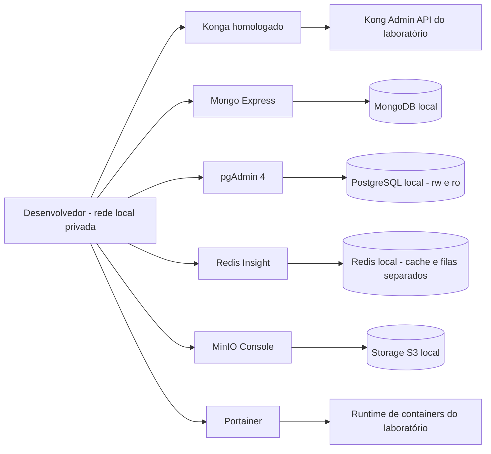

## 24. Metas operacionais, capacidade e incidentes

Os valores abaixo são **metas iniciais propostas para homologação**, não
resultados medidos nem garantias do checkout atual. Testes de carga e falha
devem validar os valores no hardware e na topologia escolhidos antes do release.

| Indicador | Meta proposta e escopo |
| --- | --- |
| Disponibilidade do core/API | 99,9% mensal, com definição de sucesso/erro por operação e manutenção contabilizada na política publicada. |
| Comando síncrono comum | p95 até 150 ms e p99 até 500 ms no caminho de aplicação, sem RTT de internet nem tarefas explicitamente assíncronas. |
| Durabilidade econômica confirmada | RPO/RTO vinculados às garantias e à recuperação do plano Neon contratado; validar commits incertos e restauração. Não declarar RPO 0 apenas por usar dois computes. |
| Recuperação da VPS | Meta inicial de retomar API e reino em até 15 minutos após o host ficar disponível; medir rebuild, segredos, reconciliação e reconexão. Não é garantia de substituição física do provedor. |
| Retenção do chat | Invisibilidade em consultas no limite de 7 dias; reconciliador a cada minuto e limpeza física em até 5 minutos em operação saudável. |
| Capacidade por reino | Publicar a baseline de conexões simultâneas, comandos/s e batalhas/s sustentáveis, com p99, CPU/memória e orçamento de banco, antes de admitir a população correspondente. |

O teste de capacidade inclui carga normal, pico e recuperação de backlog;
mede separadamente jogadores e bots, chat externo, SSR na Vercel, combate e workers.
A VPS não assume a memória dos serviços hospedados fora dela. Configurar
limites de população simulada e de concorrência com base nessa baseline. HPA
não ultrapassa conexões/pools do banco nem a capacidade de recuperação do broker.
Métricas incluem tarefas vencidas, backlog, atraso de arquivo/purge e rejeições
por contrapressão, além de CPU e memória.

Cada alerta tem responsável, severidade e procedimento: identificar impacto,
conter novas operações quando necessário, preservar recibos/evidência privada,
recuperar o componente, reconciliar pendências e confirmar invariantes. Não
resolver inconsistências com reset de banco/cache. Correção econômica usa comando
auditado, e reprocessamento de fila mantém as chaves idempotentes originais.

Manutenção de reino usa modo anunciado de drenagem, impedimento de novas
operações afetadas, checkpoint e retomada. Recuperação de desastre regional tem
RPO/RTO e exercício próprios, incluindo storage, segredos e backups externos
ao domínio de falha do cluster; não inferir recuperação regional do failover
de um read replica Neon ou de pods no mesmo host. Rotação de chaves, restauração e revogação de acessos
fazem parte dos procedimentos operacionais versionados.

### 24.1. Orçamento inicial da VPS e entrada do segundo reino

16 GB é uma hipótese de implantação, não uma capacidade comprovada. Conferir
memória real em GiB, `allocatable` do nó, número/tipo de vCPUs e desempenho de
CPU sustentado. O orçamento abaixo é **provisório, sem medições**, e inclui os
dois reinos para orientar os testes; não é configuração pronta de requests/limits.

| Componente local | Reserva de planejamento em GiB |
| --- | ---: |
| Sistema operacional e Kubernetes/K3s | 2,5 |
| Traefik e Kong | 1,0 |
| API compartilhada | 0,5 |
| Files | 0,5 |
| ZooKeeper | 0,5 |
| Workers e relay | 0,5 |
| Pool Combat TypeScript compartilhado | 1,5 |
| Server do reino 1 | 1,5 |
| Server do reino 2, condicional | 1,5 |
| **Subtotal de planejamento** | **10,0** |

A diferença para a memória efetiva fica reservada para picos, cache do sistema,
rede e margem operacional. Ajustar requests, limites e concorrência aos dados
medidos; um limite baixo pode matar um processo que caberia no host. Bancos,
broker, Chat, bot e SSR externos não consomem a RAM local desses serviços, mas
suas conexões e buffers consomem. Não acrescentar a pilha completa de
observabilidade ou ferramentas de desenvolvimento sem refazer o orçamento.

Medir batalhas simultâneas e batalhas concluídas por segundo separadamente.
Como estimativa de demanda, `CPU em núcleos ≈ batalhas/s × CPU-ms/batalha / 1000`,
além do custo de Server, rede, serialização e persistência. A estimativa não
substitui carga real: formações, rodadas e habilidades mudam muito o custo.
O pool Combat tem fila e concorrência limitadas, com justiça e cotas por reino;
não criar um processo/thread por ataque nem bloquear o event loop da API com
cálculo. Equivalência matemática continua sendo requisito antes de otimização.

Homologar carga normal, dezenas de combates contínuos, trono e KVK, incluindo
picos simultâneos dos dois reinos, workers, arquivos e reconexões. Registrar
p99 de comandos/cálculo, CPU, memória máxima, pausas do runtime, atraso de filas,
RTT e quotas dos provedores. Aceitar o segundo reino somente com margem
mensurável e metas da seção 24 atendidas, sem prejudicar API e controle do nó.
Se falhar, aumentar CPU/RAM ou mover um Server para outra VPS; a API continua
compartilhada. Mais RAM não resolve por si só gargalo de CPU ou latência remota.

## 25. Compatibilidade entre versões e critérios de promoção

A matriz de release vincula versão de cliente, protocolo, regras, hash dos
recursos, build do servidor, versão do motor de combate e schema. Para cada
combinação, registrar operações suportadas, testes executados, limitações e
plano de atualização/retorno. APK v12.06.0 é a referência do experimento anterior;
os demais clientes só entram como suportados depois de validação própria.

Artefatos de cliente e recursos têm manifestos e hashes, origem autorizada e
compatibilidade declarada. Atualizar regras no servidor não autoriza servir ao
APK recursos incompatíveis. Descoberta informa versão/capacidade e bloqueia
combinações inválidas de forma reconhecível pelo cliente.

Contratos internos têm testes de produtor e consumidor. Durante deploy gradual,
manter compatibilidade entre versões antiga e nova dos serviços participantes;
campos desconhecidos, enums e novos eventos seguem política explícita. Mudança
incompatível exige novo contrato/endpoint e janela de transição, não troca de
schema em lugar. Jobs antigos continuam associados à versão de suas regras
até conclusão ou migração validada.

Migrações seguem expansão → aplicação compatível → migração dos dados →
verificação → contração após retirar leitores/jobs antigos. Rollback de imagem
não reverte automaticamente dados já gravados por uma regra nova. O release
define os limites de retorno e a reconciliação necessária. Promoção exige as
cinco camadas de teste da seção 22, integridade dos dados, compatibilidade de
cliente, metas operacionais homologadas e restauração exercitada.

## 26. Pagamentos Stripe e concessão de pacotes

O catálogo inicial tem pacotes avulsos de **US$ 1, US$ 2, US$ 3, US$ 4 e US$ 5**,
representados como 100, 200, 300, 400 e 500 centavos de USD. A API mantém o mapa
versionado de pacote → Stripe Price ID → benefícios/regras. Preço, moeda,
quantidade e bônus não são aceitos como autoridade a partir do cliente.

A API autentica a conta e registra um pedido com pacote, versão, personagem e
reino beneficiário antes de criar Checkout. O beneficiário fica imutável nesse
pedido. Usar chave idempotente na criação da sessão e guardar as referências
Stripe; dados de cartão ficam no fluxo de pagamento do provedor. Estados
explícitos distinguem pedido criado, pagamento pendente, pago, entrega pendente,
entregue e eventos de reembolso/disputa. A página de sucesso consulta o pedido;
seu redirect e eventos Firebase Analytics não concedem recursos.

O webhook passa por Traefik/Kong até a API preservando o corpo bruto necessário
à verificação da assinatura Stripe. Validar assinatura, persistir uma inbox
durável e só então confirmar recebimento; falha de persistência não recebe
sucesso. Processar eventos em worker com retries, aceitando duplicatas e ordem
diferente. Deduplicar pelo ID do evento e também pela identidade do pagamento,
pedido e efeito: eventos Stripe distintos podem representar o mesmo pagamento.
[Referência: entrega, assinaturas e retries de webhooks Stripe](https://docs.stripe.com/webhooks).

A entrega depende de pagamento confirmado, incluindo o fluxo assíncrono de
meios que permaneçam pendentes; finalizar Checkout não implica que todo meio já
pagou. O worker registra a transição e outbox de concessão. O Server do reino
aplica uma entrada única no ledger econômico com `grantId` e referência do
pedido, depois publica o recibo. Falha entre crédito e recibo permite retry sem
novo crédito. API gerencia o pedido; Server mantém a autoridade sobre recursos.
Reconciliadores recuperam pedidos pagos sem entrega e resultados incertos.

Eventos atrasados não revertem estados finais por ordem de chegada. Reembolsos
e disputas têm efeitos compensatórios identificados e auditados, com política
explícita para benefícios já consumidos; não apagar o histórico nem executar
um débito cego que viole invariantes. A relação pedido/pagamento/concessão deve
permitir verificar que cada benefício foi aplicado no máximo uma vez.

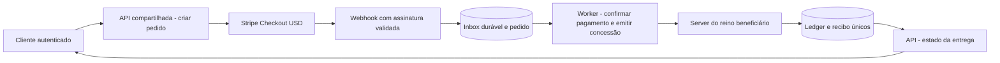

Homologar com Stripe em modo de teste: assinatura inválida, evento repetido,
reordenação, pagamento pendente/falhado, queda antes/depois do crédito, reino
indisponível, reembolso e disputa. Nenhuma suíte cobra cartões reais. Antes de
lançar, confirmar disponibilidade na região/conta, meios aceitos, liquidação,
restrições e tarifas para tickets de US$ 1–5; este documento não presume taxas
nem viabilidade financeira de um plano ainda não contratado.

## 27. Cliente de transição, atualização R2 e possível reescrita Flutter

### 27.1. APK atual e fronteira Lua/nativa

Continuar com o APK Elex homologado enquanto o backend e as ferramentas evoluem.
A proposta é adicionar scripts Lua de nossa manutenção ao cliente preparado
para verificar releases, apresentar versão/notas/progresso e coordenar download.
Antes de implementar, identificar a versão do APK, runtime/loader Lua e APIs
expostas para HTTPS, arquivos, criptografia e chamada à plataforma Android.
Não há evidência neste checkout de que essa ponte de atualização já funcione.

O primeiro APK preparado precisa conter o bootstrap confiável e, quando
necessário, a ponte nativa Android. Lua pode chamar somente capacidades
realmente expostas: não altera Manifest, SDK Firebase, permissões, bibliotecas
nativas ou assinatura do pacote por conta própria. Mudanças dessas partes
exigem uma nova build APK. Originais móveis permanecem somente leitura;
extração, patches e empacotamento usam diretório de trabalho separado e não
colocam chaves ou artefatos privados no Git.

Distinguir **bundle Lua/recursos**, ativável pelo loader homologado, de **APK
completo**, instalado pelo Android. Mudança de script não substitui uma
atualização do aplicativo quando a capacidade nativa requerida não existe.
O cliente continua enviando comandos; economia e resultado de combate seguem
autoritativos no Server mesmo quando scripts locais são atualizados.

### 27.2. Manifesto, entrega e publicação no Cloudflare R2

R2 fica definido para os releases APK e bundles de atualização. O cliente
consulta manifesto HTTPS por canal (`internal`, `beta`, `stable`) e baixa os
objetos diretamente do R2/Cloudflare, evitando tráfego de binários pela VPS.
Usar domínio próprio de download, cujo nome ainda será escolhido, ou rota de
entrega controlada; não adotar `r2.dev` como endpoint de produção. Configurar
cache de objetos imutáveis por hash e revalidação curta do manifesto do canal.
[Referência: entrega pública e domínios R2](https://developers.cloudflare.com/r2/buckets/public-buckets/).

O manifesto versionado declara plataforma, application ID, `versionCode`, versão
de exibição, ABI/Android mínimo, cliente base aceito, protocolo, bundle Lua,
capacidade mínima do bootstrap, URL, tamanho, SHA-256, certificado de assinatura
esperado do APK, prazo e política opcional/obrigatória. Ele é assinado por uma
chave de publicação; a chave pública confiável vem no bootstrap. Hash baixado
junto ao artefato sem uma raiz de confiança não prova autenticidade. Não baixar
a chave de confiança sem validação do mesmo local que o pacote.

A pipeline verifica a matriz cliente/servidor, constrói/assina, testa e publica
os objetos imutáveis antes de promover o manifesto assinado do canal. Chaves de
assinatura APK e de manifesto têm funções distintas, acesso restrito e rotação
planejada. Uploads e corpos privados de chat usam buckets/políticas separados;
o bucket de releases não contém dados de jogadores nem credenciais R2 no cliente.
Retirada de release interrompe novas ofertas, mas não torna confiável uma
versão já instalada: manter compatibilidade e correção publicadas.

Download usa arquivo temporário, tamanho máximo, timeout e retry limitado;
verificar manifesto, hash e metadados antes de executar/instalar. Interrupção,
falta de espaço ou verificação inválida não remove a versão funcional. Bundle
Lua é aplicado em ponto seguro/reinício, com ativação atômica e última versão
válida recuperável; considerar migrações de estado local antes de permitir
retorno. Um APK corrigido segue nova versão crescente: retorno de bundle não
implica que o Android aceite downgrade de APK.

### 27.3. Atualização Android e preservação de identidade

O fluxo inicial é **verificar → oferecer → baixar → validar → abrir o instalador
Android → confirmar resultado na próxima abertura**. A ponte nativa usa o
mecanismo suportado da plataforma e trata cancelamento/permissão negada. Em
Android 8+, considerar a autorização de instalação de fontes desconhecidas por
origem e `REQUEST_INSTALL_PACKAGES` conforme o target/API e mecanismo usados.
A alternativa quando a ponte não estiver pronta é oferecer o download no
navegador e instalação manual.
[Referência: distribuição alternativa Android](https://developer.android.com/distribute/marketing-tools/alternative-distribution).

Não prometer instalação silenciosa no APK legado. O fluxo deve suportar
confirmação do jogador; exceções sem interação dependem de condições específicas
de versão, target, permissões e proprietário da instalação, ainda não homologadas.
Lua não contorna essas condições. Instalação iniciada ou download completo não
significam atualização concluída.
[Referência: ação do usuário no PackageInstaller](https://developer.android.com/reference/android/content/pm/PackageInstaller.SessionParams#setRequireUserAction(int)).

Atualizar a instalação existente exige mesmo application ID, assinatura
compatível (ou rotação reconhecida) e versão aceita pelo Android; a política de
release do projeto usa `versionCode` crescente. Reassinar um APK original com
outra chave não produz atualização compatível automaticamente. Identificar o
certificado do cliente de teste e manter uma chave própria autorizada para a
linha preparada, sem presumir acesso à chave Elex. Não orientar desinstalação
como parte automática do updater.
[Referência: condições de atualização Android](https://developer.android.com/google/play/app-updates).

Mudança de package/assinatura pode exigir instalação inicial/migração separada.
Antes disso, preservar vínculo Firebase e testar recuperação de conta Guest:
o progresso no servidor não garante acesso se as credenciais locais forem
perdidas. Nunca apagar dados do app, sessão ou personagem para resolver erro de
update. Atualização obrigatória só bloqueia combinações incompatíveis com uma
mensagem clara e caminho de recuperação; atualização opcional indisponível não
bloqueia login. Instalações iOS e canais de loja precisam de estratégia própria,
sem pressupor que aceitem o instalador APK do Android.

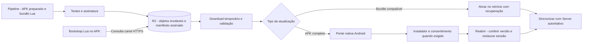

### 27.4. Flutter como evolução em avaliação

A intenção de longo prazo é avaliar a reescrita do cliente/jogo em Flutter/Dart,
sem um prazo de substituição comprometido. O APK atual continua operacional
durante esse trabalho. Flutter pode substituir interface e runtime cliente;
backend, banco e simulação autoritativa continuam serviços independentes.
Não portar o cálculo econômico autoritativo para o dispositivo.

Começar com uma prova pequena: Firebase Auth/Guest, login, cidade, construção e
mapa no mesmo reino de testes. Homologar renderização de mapa, sprites/animações,
memória, bateria e desempenho em aparelhos representativos antes de escolher a
composição gráfica definitiva. SDKs, engine gráfica, ferramentas de assets e
integração ao monorepo ainda serão selecionados; não tratar Flutter como uma
build Bun nem tentar importar pacotes TypeScript diretamente em Dart.

O novo cliente usa os mesmos contratos versionados e preserva conta,
personagens, inventário e compras no backend. Adaptadores mantêm SFS/TCP no APK
enquanto o novo cliente usa o transporte homologado, sem criar outro conjunto
de regras de jogo. Coexistência exige matriz de compatibilidade e E2E por
cliente; Firebase, FCM e updater têm integrações próprias em cada plataforma.
Um diretório de aplicação Flutter será proposto quando a prova for aprovada;
este documento não cria uma implementação Dart.

O Web Game SSR na Vercel permanece um experimento distinto. Considerar Flutter
Web posteriormente não comprova SSR nem substitui automaticamente o desenho
atual de `apps/web`; essa escolha exige avaliação de renderização/hospedagem.

### 27.5. Validação do updater e da transição

Testar APK base v12.06.0 e cada variante preparada com Android/ABI/certificados
identificados: atualização válida, assinatura/package incompatível, manifesto
adulterado ou antigo, hash inválido, download parcial, cache desatualizado,
pouco espaço, cancelamento, permissão negada e interrupção do processo. Rollout
começa em canal interno e avança por grupos controlados, com métricas filtradas
de sucesso/falha e possibilidade de suspender ofertas.

Validar bootstrap sem ponte nativa, retorno do bundle Lua após falha, recuperação
da sessão Guest e persistência de cidade/mapa depois da instalação. Snapshots
cobrem manifestos e telas; integração cobre publicação R2/MinIO com diferenças
registradas; E2E móvel comprova instalação e reabertura em dispositivo/emulador.
Aplicar as cinco camadas de testes da seção 22 ao código próprio pertinente,
inclusive mutações nos validadores de versão, assinatura, hash e compatibilidade.
Nada disso é evidência de que um APK já foi patchado ou publicado.
