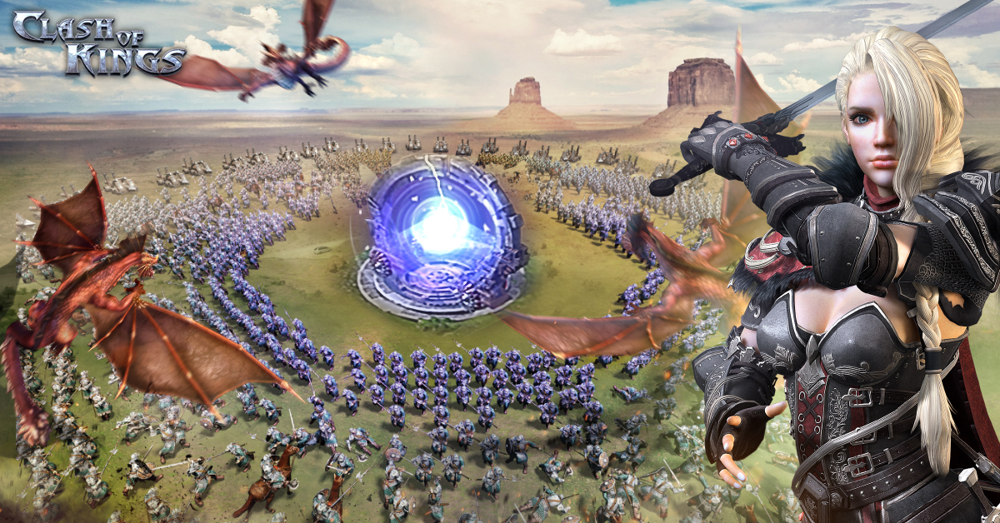
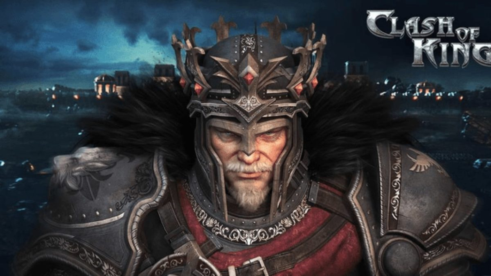

# OpenCok

**A self-hosted Clash of Kings private server.**

OpenCok brings the game server, Android client, and supporting services into a Docker-based environment. It provides a foundation for running your own kingdom, customizing game rules, and developing client/server compatibility.

## License

Repository-authored code is licensed under [PROPRIETARY](LICENSE). Third-party libraries, game assets, and client binaries retain their respective licenses and ownership.
