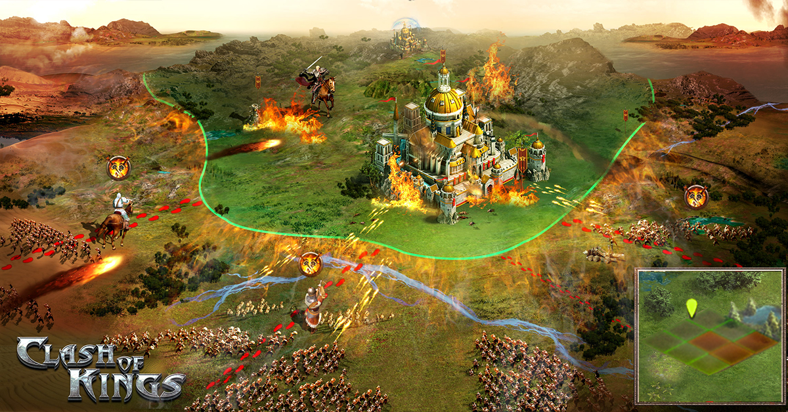
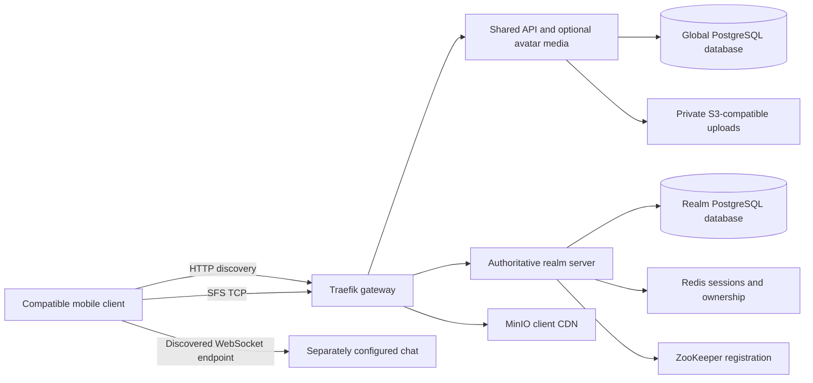

# OpenCok

**A self-hosted Clash of Kings-compatible game stack under active reconstruction.**



OpenCok combines an authoritative game server, shared HTTP API, WebSocket chat,
client resources and operator tooling in a TypeScript monorepo. The local Docker
stack makes service dependencies and persistent state reproducible while the
maintained backend replaces legacy components incrementally.

The repository contains project-authored code and configuration. Authorized game
resources, prepared client binaries, signing keys and player databases are local
inputs; they are not distributed with a clone. Read the [product definition](PRODUCT.md)
for scope and the [architecture](.github/ARCHITECTURE.md) for service boundaries.

## How it works



1. The API returns a client-reachable realm endpoint through the legacy discovery
   routes. Existing device/account bindings determine the player's realm;
   discovery does not fabricate an account or reactivate one.
2. The client connects through the gateway to the realm's SFS/TCP listener. The
   server authenticates the session and dispatches supported commands to shared
   controllers, rules and persistence adapters.
3. PostgreSQL stores accounts and authoritative progress. Global and kingdom
   databases have separate responsibilities; Redis caches and session leases do
   not replace durable player state. ZooKeeper supplies registration and
   coordination, not a database backup.
4. Static client resources come from the local CDN. Optional avatar uploads run
   inside the API, validate signed grants and image bytes, and store immutable
   JPEG receipts in a private S3-compatible bucket. Chat has its own HTTP/WS
   process and must be configured separately.

Each realm has one logical authoritative owner. The default database setup
prepares two kingdoms with the same schema; local Compose currently starts one
active realm server. A second database alone does not create a second playable
realm. The API is shared, rather than duplicated per kingdom.

## What is implemented

| Component            | Current behavior                                                                                                                                                |
| -------------------- | --------------------------------------------------------------------------------------------------------------------------------------------------------------- |
| API                  | Legacy HTTP realm discovery, readiness, optional public chat metadata and opt-in avatar media.                                                                  |
| Realm server         | SFS handshake/login, city/world/profile reads and selected settings, ranking, mailbox and avatar commands. See the [realm command list](apps/server/README.md). |
| Chat                 | Maintained WebSocket/HTTP service, session authorization and persistence; outside the default Compose services.                                                 |
| Media                | Signed JPEG/PNG uploads, JPEG delivery and private receipt confirmation in the API. Animated formats and the full lifecycle remain future work.                 |
| Web                  | Experimental browser scaffold; it is not a complete replacement game client.                                                                                    |
| Local infrastructure | PostgreSQL/setup, Redis, ZooKeeper, MinIO/CDN, gateway and development inspection tools.                                                                        |

Gameplay reconstruction is incomplete. Unsupported commands return an explicit
error; city reads do not silently complete queues or award resources. Combat
belongs to the realm/domain packages, with no standalone Combat app. Bot is a
planned TypeScript application, not an implemented simulator.

The recognized client tracks are v5.36.0, v6.12.20, v9.27.0 and v12.06.0. Recognition
does not establish support for every feature. Synthetic HTTP/SFS tests verify
contracts; device/emulator validation is still required for native screens.

## Repository layout

| Path                                               | Responsibility                                                                                                |
| -------------------------------------------------- | ------------------------------------------------------------------------------------------------------------- |
| `apps/api`, `apps/server`, `apps/chat`, `apps/web` | Executable application composition and configuration.                                                         |
| `packages/`                                        | Shared contracts, pure gameplay rules, DTOs, validations, mappings, repositories and infrastructure adapters. |
| `infra/`                                           | Development images, gateway, storage setup and deployment configuration.                                      |
| `tests/`                                           | Workspace boundaries and isolated stack scenarios; packages/apps also own their tests.                        |
| `docs/decisions/`                                  | Architecture decisions and their current statuses.                                                            |
| `docs/architecture/`                               | Detailed persistence, combat, operations, client and migration design.                                        |
| `data/`                                            | Ignored authorized inputs and local data; never a shared private dependency.                                  |

DTOs declare transferred data, Zod schemas validate external values, mappings
preserve SFS serialization, and repositories implement owned database operations.
Applications wire those packages together; packages do not import applications.

## Start the development stack

Use Bun **1.4.2**, Docker Engine with Compose v2, and Git. The version is declared
in `package.json`; dependencies are resolved by the committed `bun.lock`. Python 3
is needed only for the experimental web asset-preparation script, not the planned
Bot. Production runtime selection is open: the Node.js mandate is
[suspended](docs/decisions/0010-adopt-nodejs-for-production.md), and existing Bun
containers are development evidence.

Install dependencies and create a root environment file only if one is absent:

```sh
bun install --frozen-lockfile
test -f .env || cp .env.example .env
```

Configure the existing root `.env`, including the login secret that matches the
authorized prepared client. App-specific `.env` files are not used. The example
`DATABASE_URL` uses Compose DNS; commands run directly on the host need a reachable
host address. The example login-secret placeholder is not a working client secret.

Before starting, supply these authorized local inputs:

| Input                    | Required location                                                             |
| ------------------------ | ----------------------------------------------------------------------------- |
| Realm XML/rule resources | `data/reference/server/runtime/base/resource`                                 |
| Nickname word list       | `data/reference/server/runtime/base/gameconfig/badwords.txt`                  |
| CDN host trees           | `data/cdn/data/cok.eleximg.com/cok` and `data/cdn/data/asset.cok.chat/100001` |

The runtime mounts originals read-only and fails when required inputs are absent.
Do not force-add these files, keys, player records or prepared APKs to Git.
Set the advertised game host/port in `docker-compose.yml` to an address the client
can reach; the committed LAN address is a local development value.

```sh
docker compose --profile dev config --quiet
docker compose --profile dev up --build -d --wait
docker compose --profile dev ps -a
```

Profiles `dev` and `all` select the same local services. The setup jobs apply
PostgreSQL migrations and import the CDN; API/server and gateway wait for their
prerequisites. Development credentials and exposed inspection ports are for a
controlled local environment, not a public production deployment.

| Endpoint                                       | Host port          |
| ---------------------------------------------- | ------------------ |
| Gateway HTTP discovery, CDN and optional media | 80                 |
| Realm SFS/TCP                                  | 9933               |
| PostgreSQL                                     | 5432               |
| MinIO S3 / console                             | 9000 / 9001        |
| pgAdmin / Redis Insight / Portainer HTTPS      | 5050 / 5540 / 9443 |

Follow logs and stop without deleting persistent volumes:

```sh
docker compose logs --follow --tail=100 api server gateway
docker compose --profile dev down
```

Named volumes preserve databases, objects and tool state across service recreation.
Back up databases, buckets, keys and configuration consistently before migrations;
rolling back an image does not reverse committed SQL migrations. Do not remove
volumes or reset player state to repair a configuration error. The
[local stack guide](infra/compose/README.md) covers startup, recovery and direct
host/container settings.

## Optional services and integrations

Chat runs separately. Configure its advertised WebSocket endpoint and trusted
session-signing settings, `API_CHAT_URL` for public discovery and
`GAME_CHAT_SESSION_URL` for the realm's private session endpoint. See the
[chat guide](apps/chat/README.md) and [API discovery guide](apps/api/README.md).

Avatar media is disabled by default. Enable `API_FILES_ENABLED`, provision a
private uploads bucket and mount an existing protected signing key. The
[media guide](apps/api/MEDIA.md) includes a local Compose overlay, upload limits,
private confirmation, realm completion settings and rollback. There is no Files
container or separate media port.

Firebase identity/push, Stripe payments, managed production providers, Kubernetes,
R2 client updates and a future Flutter client are target capabilities rather than
features proven by a local startup. See the [architecture](.github/ARCHITECTURE.md)
for decisions, evidence and remaining work.

## Develop and verify

Run lint/format checks from the root and type-check the workspaces you change:

```sh
bun run lint
bun run format:check
bun run --cwd apps/api check-types
bun run --cwd apps/server check-types
bun run --cwd apps/chat check-types
bun run --cwd apps/web check:types
bun run test:packages
bun run --cwd packages/env test
bun run --cwd apps/api test
bun run --cwd apps/server test
```

The root `check-types` script is a known pending tooling repair; use the working
workspace commands above. Isolated integration commands require Docker:

```sh
bun run --cwd apps/api test:media
bun run test:stack
```

These create disposable resources and synthetic accounts/assets rather than
connecting to imported player databases. A passing suite does not prove all
client versions, production load, mobile rendering or provider recovery.

Use feature branches, focused Conventional Commits and small PRs in a `gh stack`.
The [contribution guide](.github/CONTRIBUTING.md) defines issue/discussion,
validation and review requirements. [Migration evidence](docs/migration-validation.md)
records implemented slices and their limits.

## License

Repository-authored code is licensed under [PROPRIETARY](LICENSE). Third-party
libraries, game assets and client binaries retain their respective licenses and
ownership. OpenCok is independent of the original publisher; the repository
license does not grant redistribution rights for private third-party material.
