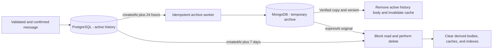
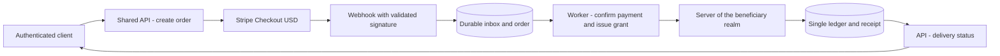
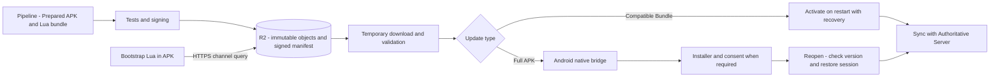

# Identity, chat, media, payments and clients

Detailed reference for the [architecture overview](../../.github/ARCHITECTURE.md).
Section numbers match that overview. Target designs and historical evidence below
do not establish implementation or production readiness. Component runbooks and
[the migration evidence](../migration-validation.md) track current behavior.

## 18. Identity, protocols and reconnection

### Identity and authorization

Firebase Auth takes care of login and credentials. The API checks the ID token for
signature, issuer, project/audience and expiration, and applies the revocation policy;
decoding a JWT does not authenticate a session. The Firebase UID is linked once to the
internal account, which can have a character in up to two realms. Standard token
verification does not automatically check for revocation: this control must be
enabled/implemented according to the scope. [Reference: Firebase token verification](https://firebase.google.com/docs/auth/admin/verify-id-tokens).

The API exchanges the validated ID token for a game session with account, character, and
realm scope. Permissions and bans come from the authoritative state. The legacy APK does
not support Firebase just by configuring the backend: SDK or authentication bridge
require version validation, preserving the accepted protocol. Never fabricate a Firebase
UID or authenticated session from a device UUID received without proof of identity.

Registration and account linking create identity and character in idempotent stages,
with explicit provisioning state. Login identifies realm, character and protocol
version. Renewal and access recovery do not create another character or erase progress.
Missing external integrations return explicit state of unavailability.

Sessions record expiration, revocation, and authorization version. Chat and game tickets
have their own scope and duration. Logout, ban and removal from position must invalidate
the corresponding access, including already opened sockets. Key rotation maintains a
controlled window of checking valid sessions. Administration uses operator identity,
roles by realm, and audit; player credentials do not grant administrative authority.

Membership in the alliance is revalidated when entering the channel and sending/checking
history. Leaving or being expelled revokes the subscription and archive access; access
to older messages requires an authorized membership interval. A missed change
notification is recovered using the membership version, without relying exclusively on
Redis Pub/Sub.

### Guest account login and linking methods

All methods below converge to Firebase Auth → UID → internal account. The Server
receives the same authorized identity regardless of the provider. This is the target
matrix; enabling the method requires provider configuration and validation in the Web
Game and in each supported mobile version.

| Method             | Target Integration      | Preparation and behavior                                                                                                                                 |
| ------------------ | ----------------------- | -------------------------------------------------------------------------------------------------------------------------------------------------------- |
| **Guest**          | Firebase Anonymous Auth | Create real anonymous identity, with validated session; maintain progress associated with the internal account. Do not use local UUID as authentication. |
| **Facebook**       | `facebook.com`          | Meta application, credentials and callbacks configured; request only the necessary scopes.                                                               |
| **Google**         | `google.com`            | OAuth configuration and validated mobile platform identifiers/signatures.                                                                                |
| **Email/Password** | `password`              | Registration, email verification, recovery and password policy through Firebase; do not save password in PostgreSQL.                                     |
| **Apple**          | `apple.com`             | Apple identifiers, keys and callbacks; handle private email/relay and link consent as per flow.                                                          |
| **Microsoft**      | `microsoft.com`         | Microsoft OAuth Registration; define accepted personal/organizational accounts and tenant policy.                                                        |
| **GitHub**         | `github.com`            | OAuth GitHub app, authorized callback and minimal scopes; do not ask for access to repositories to play.                                                 |

Configuration references: [Guest](https://firebase.google.com/docs/auth/web/anonymous-auth), [Facebook](https://firebase.google.com/docs/auth/web/facebook-login), [Google](https://firebase.google.com/docs/auth/web/google-signin), [Email/Password](https://firebase.google.com/docs/auth/web/password-auth),
[Apple](https://firebase.google.com/docs/auth/web/apple), [Microsoft](https://firebase.google.com/docs/auth/web/microsoft-oauth) and [GitHub](https://firebase.google.com/docs/auth/web/github-auth).

Converting Guest to linked account uses the **account linking** flow, preserving
Firebase UID, internal account, characters, and realm progress. Signing into another
provider as if it were a new account does not replace this flow. Multiple providers can
belong to the same account; email, name, and avatar are not ownership keys. Do not
automatically merge accounts using identical emails. If the credential already belongs
to another UID, interrupt the link and offer recovery with proof of identities; eventual
transfer/merger of progress requires separate, audited and idempotent procedure, without
deleting the Guest account. [Reference: Provider binding maintaining UID](https://firebase.google.com/docs/auth/web/account-linking).

Guest is persisted, but without a linked method it may lose access after session
loss/reinstallation; explain this and offer account linking before this happens. Do not
enable automatic cleanup of anonymous identities with player progress without an
explicit preservation/recovery policy. Enforce creation and abuse quotas without using a
device identifier as proof of ownership. An offline provider does not authorize
replacing an existing account with Guest silently.

Linking/unlinking and changing credentials require authorization and recent
reauthentication when applicable. Do not remove the last recoverable sign-in method
without an explicit flow; update the internal link after validating the state in
Firebase. OAuth Secrets live in the trusted configuration environment, outside of
clients and logs. Authorize domains and callbacks by environment, including the Firebase
domain used by the flow; validate redirects in the Pages/Vercel deployment and in the
APK. Guest is not the identity of the panel operator. Logging in through a provider does
not grant administrative functionality or access to another character.

### Command and event contract

The internal contract is independent of SFS or WebSocket. Transport adapters map the
client's existing fields to this envelope, without requiring an old APK to start sending
unknown fields.

| Field                                      | Rule                                                                                                                         |
| ------------------------------------------ | ---------------------------------------------------------------------------------------------------------------------------- |
| `protocolVersion`, `schemaVersion`         | Validate before interpreting commands or events.                                                                             |
| `requestId`, command type and content hash | Correlate response and allow retry without duplicating a mutation.                                                           |
| Identity, realm and scope                  | Derived from the validated session; client-supplied IDs do not prove ownership.                                              |
| `aggregateId`, `expectedVersion`           | Apply concurrency control when necessary.                                                                                    |
| `eventId`, `sequence`, `occurredAt`        | Identify durable events, order them per stream, and recover them. There is no implicit global order between channels/realms. |
| Error and operation status                 | Distinguish rejection, pending, confirmation and uncertain result. Timeout is not proof that a command did not occur.        |

When reconnecting, the client identifies the session and the last confirmed cursor. The
service validates the scope and delivers still retained events; if the cursor has
expired or there is a gap, it sends a new authorized snapshot and restarts the
synchronization sequence. Pushes lost after a commit must be recoverable by outbox or
status query; the connection is not the only record of a change.

Output queues per socket have a limit. Slow client receives controlled backpressure,
resynchronization, or disconnection; cannot cause unlimited memory growth. Obsolete
presence events can be aggregated/discarded; economic responses and durable events
follow recovery policy. Heartbeats, timeout and resume are tested per client and
version. The legacy adapter maintains the mechanisms actually supported by the APK; new
cursor/ACK capabilities are not assumed to already exist in it.

## 20. Global and alliance chat: delivery, archiving, and deletion

### Defined retention policy

The deadlines are elapsed durations, counted from `createdAt` **of the server-confirmed
send time in UTC**. `archiveAt = createdAt + 24h` and `expiresAt = createdAt + 168h`. Editing, retry, import and archiving
do not renew these deadlines. Early deletion due to moderation remains permitted.

| Message age                 | Status and storage                                                                 | Access                                                                                               |
| --------------------------- | ---------------------------------------------------------------------------------- | ---------------------------------------------------------------------------------------------------- |
| Less than 1 day             | Active; body in recent PostgreSQL history, with limited cache.                     | Recent history and WS delivery to authorized members.                                                |
| From 1 day to before 7 days | Archived; body in MongoDB, with minimal metadata/cursor when needed in PostgreSQL. | Paginated archive endpoint, with the same authorization as the channel. Removed from recent history. |
| 7 full days or more         | Expired; deletion of the body and operational copies.                              | Do not return to history, archive, search or replay, even if physical cleaning is delayed.           |

This rule applies to **global chat and alliance chat**. Private messages and other
channels need their own explicit policy, without inheriting retention by accident. Do
not archive the body of these messages permanently in Evelog or Loki; operational
moderation events store only necessary metadata.

### Delivery and ordering

Chat assigns `messageId` and sequence per channel. The pair of sender and client
sending ID allows retries to be recognized, checking the content. Confirm sending after
persisting message and distribution event; the consumer only distributes confirmed
messages. Redis Pub/Sub performs fan-out between pods, but does not replace persisted
history or guarantee delivery recovery.

History and archive use stable cursor per channel/sequence, with deduplication by
`messageId` on storage transition. Reconnection retrieves allowed and unexpired
messages; retention gaps signal resynchronization. Deletion/moderation produces
tombstone to remove the message from projections and prevent an old retry from
publishing it again. Authorizations also apply to queries in MongoDB and search indexes.

### Retention jobs and failures

A reconciler scans messages whose deadlines have passed in batches by channel and
deadline. First upsert the archive record with the same ID, version and `expiresAt`;
verify the copy before removing the body from PostgreSQL. Concurrent editing uses
versioning to prevent an old copy from beating the new one. If MongoDB is unavailable,
preserve the recent copy temporarily and alert the delay, without deleting before
archiving. It no longer appears in the recent history after 24h; archive queries can use
the pending copy, maintaining scope and deduplication.

At 7 days, the expiration takes precedence over the archiving attempt: a delayed job
does not recreate an expired message. API and WS filter by `expiresAt` in every
query/replay. Cleanup removes bodies in both databases, cache, indexes, and unique
attachment objects subject to the same policy. Deduplication receipts can survive
without a body for the period necessary to prevent old replay.

Use a MongoDB TTL index on `expiresAt` as reinforcement, in addition to a deletion
worker and filters in the application. TTL does not guarantee removal at the exact
moment of expiration. The proposed goal in healthy operation is to reconcile every
minute and complete physical cleaning within five minutes of the deadline; delays
generate alerts and do not extend the visibility of the message. [Reference: MongoDB TTL indexes behavior](https://www.mongodb.com/docs/manual/core/index-ttl/).

Physical/PITR backups may contain old versions: online deletion does not instantly erase
existing WAL and backups. These copies have restricted access and documented retention;
any restore deletes expired messages before reopening the service. A requirement to also
delete all backup copies within seven days needs specific backup/key design; do not
claim this guarantee as a consequence of a `DELETE` or TTL.

### Topic 24 implementation

The TypeScript Chat service now persists distribution events with messages, leases
instance cursors and bridges events to fenced native realm consumers. MongoDB archive
writes verify content/version before PostgreSQL compaction. Direct/private channels use
an explicit 30-day policy; other public channels retain 24 hours. Realm economic state
continues to own postbox, friendship mine rewards and paid notice costs/refunds.
[Implementation, deployment and validation](../social-chat-migration.md) document the
pinned adapter, recovery semantics and limits. Redis remains optional for delivery.

## 21. File and media lifecycle

The shared API media module authenticates the owner and creates an `uploadId` with size, allowed MIME,
duration limit, and temporary object. The upload goes through the service or a
restricted signed URL; completing the upload does not prove that the file is valid.
The API checks bytes, actual file type, dimensions, hash and processing limits, and
registers `pending → uploaded → validated → ready`, or `rejected` with controlled reason.

Transformations, thumbnails and checks run on workers with CPU/memory/time limits.
Profile and message only receive ready and authorized reference; confirmation/retry uses
the same receipt. A reference that is still pending is not displayed as a confirmed
file. The service keeps track of references and performs collection of abandoned uploads
and orphaned objects with a safety window.

Deletion revokes authorized delivery, invalidates caches/CDN when applicable, and
schedules removal of the object, derivatives, and metadata permitted by retention.
Shared objects are only removed when there is no valid reference. Signed URLs, public
avatars, and private attachments have different policies. Local MinIO and production
storage, including R2 for releases, are exercised by the same S3 contract, without
assuming equality of all functionalities between providers.

## 26. Stripe payments and package grants

The initial catalog has one-time packages of **US$1, US$2, US$3, US$4 and US$5**,
represented as 100, 200, 300, 400 and 500 U.S. cents. The API maintains the package
versioned map → Stripe Price ID → benefits/rules. Price, currency, quantity and bonuses
are not accepted as authority from the client.

The API authenticates the account and registers an order with package, version,
character and beneficiary realm before creating Checkout. The beneficiary remains
immutable in that order. Use an idempotent key when creating the session and save Stripe
references; card data remains in the provider's payment flow. Explicit states
distinguish order created, payment pending, paid, delivery pending, delivered, and
refund/dispute events. The success page queries the order; Its redirect and Firebase
Analytics events do not grant resources.

The webhook passes through Traefik/Kong to the API preserving the raw body needed to
verify the Stripe signature. Validate signature, maintain a durable inbox and only then
confirm receipt; persistence failure does not receive success. Process events in worker
with retries, accepting duplicates and different order. Deduplicate by event ID as well
as payment, order, and effect identity: different Stripe events can represent the same
payment. [Reference: Stripe webhook delivery, signatures, and retries](https://docs.stripe.com/webhooks).

Delivery depends on confirmed payment, including asynchronous payment methods that may
remain pending; completing Checkout does not mean every payment method has settled. The
worker registers the transition and grant outbox. The Realm Server applies a single
entry to the economic ledger with `grantId` and order reference, then publishes the
receipt. Failure between credit and receipt allows retry without new credit. The API
manages the order; Server maintains authority over resources. Reconcilers recover paid
orders without delivery and uncertain results.

Delayed events do not revert final states based on arrival order. Refunds and disputes
have compensatory effects identified and audited, with an explicit policy for benefits
already consumed; do not delete the history or execute a blind debit that violates
invariants. The order/payment/grant relationship must make it possible to verify that
each benefit was applied at most once.

Validate with Stripe in test mode: invalid signature, repeated event, reorder,
pending/failed payment, crashes before/after credit, realm unavailable, refund and
dispute. No suite charges real cards. Before launching, confirm region/account
availability, accepted methods, settlement, restrictions and fees for $1–5 tickets; this
document does not assume fees or financial viability of a plan not yet contracted.

## 27. Transition client, R2 update and possible Flutter rewrite

### 27.1. Current APK and Lua/native boundary

Continue with the validated Elex APK while the backend and tools evolve. The proposal is
to add Lua scripts maintained by the project to the client prepared to check releases,
present version/notes/progress and coordinate downloads. Before implementing, identify
the APK version, Lua runtime/loader and exposed APIs for HTTPS, files, encryption and
call to the Android platform. There is no evidence in this checkout that this update
bridge is already functional.

The first prepared APK needs to contain the trusted bootstrap and, when necessary, the
native Android bridge. Lua can only call truly exposed capabilities: it does not change
the Manifest, Firebase SDK, permissions, native libraries, or package signature on its
own. Changes to these parts require a new APK build. Mobile originals remain read-only;
Extracting, patching, and packaging use a separate working directory and do not place
private keys or artifacts in Git.

Distinguish **Lua/resource bundle**, activatable by the validated loader, from **full
APK**, installed by Android. Script change does not replace an application update when
the required native capability does not exist. The client continues sending commands;
economy and combat results remain authoritative on the Server even when local scripts
are updated.

The Android 12.06.0 native login response (`controller=0`, `action=1`, payload `p`)
announces the legacy hero resource bundle before the `init` extension through
the string fields `newHeroVersion` (`1.0.91`) and `newHeroMd5Android`
(`391e30cc9943d451b52c5137c83978f3`). The native loader uses this metadata for
`/cok/lua/dr_newHero1.0.91_android.zip`; operators must supply the matching authorized
archive through the CDN gateway. Bundling its textures alone does not initialize the
native resource check used by the Hero Palace. These fields preserve the legacy
download protocol and are separate from the signed release updater described below.

### 27.2. Manifest, delivery and publishing on Cloudflare R2

R2 is defined for APK releases and update bundles. The client queries the HTTPS manifest
by channel (`internal`, `beta`, `stable`) and downloads the objects directly
from R2/Cloudflare, avoiding binary traffic through the VPS. Use your own download
domain, the name of which has yet to be chosen, or a controlled delivery route; do not
adopt `r2.dev` as production endpoint. Configure caching of immutable objects by
hash and short revalidation of the channel manifest. [Reference: public delivery and R2 domains](https://developers.cloudflare.com/r2/buckets/public-buckets/).

The versioned manifest declares platform, application ID, `versionCode`, display version,
minimum ABI/Android, supported base client, protocol, Lua bundle, minimum bootstrap
capacity, URL, size, SHA-256, expected APK signing certificate, deadline, and
optional/required policy. It is signed by a publishing key; the trusted public key comes
in bootstrap. Hash downloaded with the artifact without a root of trust does not prove
authenticity. Do not download the trust key without validation from the same location as
the package.

The pipeline checks the client/server matrix, builds/signs, tests, and publishes the
immutable objects before promoting the channel's signed manifest. APK and manifest
signing keys have distinct functions, restricted access, and planned rotation. Uploads
and private chat bodies use separate buckets/policies; the release bucket does not
contain player data or R2 credentials on the client. Release withdrawal stops new
offers, but does not make an already installed version reliable: maintain published
compatibility and correction.

Download uses temporary file, maximum size, timeout and limited retry; check manifest,
hash and metadata before running/installing. Interruption, lack of space, or invalid
check does not remove the working version. Bundle Lua is applied at a safe
point/restart, with atomic activation and last valid recoverable version; consider local
state migrations before allowing fallback. A corrected APK uses a new increasing
version: bundle rollback does not imply that Android accepts an APK downgrade.

### 27.3. Android update and identity preservation

The initial flow is **check → offer → download → validate → open the Android installer →
confirm result on next opening**. The native bridge uses the platform's supported
mechanism and handles cancellation/permission denied. On Android 8+, consider allowing
installation from unknown sources by origin and `REQUEST_INSTALL_PACKAGES` depending on the target/API
and mechanism used. The alternative when the bridge is not ready is to offer download in
the browser and manual installation. [Reference: Android alternative distribution](https://developer.android.com/distribute/marketing-tools/alternative-distribution).

Don't promise silent installation on legacy APK. The flow must support player
confirmation; exceptions without interaction depend on specific conditions of version,
target, permissions and owner of the installation, which have not yet been validated.
Lua does not bypass these conditions. Installation started or download complete does not
mean update is complete. [Reference: User action in PackageInstaller](<https://developer.android.com/reference/android/content/pm/PackageInstaller.SessionParams#setRequireUserAction(int)>).

Updating the existing installation requires the same application ID, compatible
signature (or recognized rotation) and version supported by Android; the project release
policy uses increasing `versionCode`. Re-signing an original APK with another key does
not automatically produce a compatible update. Identify the test client's certificate
and maintain an authorized project key for the prepared line, without assuming access to
the Elex key. Do not guide uninstallation as an automatic part of the updater.
[Reference: Android update conditions](https://developer.android.com/google/play/app-updates).

Changing the package/signature may require separate initial installation/migration.
Before that, preserve Firebase link and test Guest account recovery: progress on the
server does not guarantee access if local credentials are lost. Never delete app,
session or character data to resolve update errors. Mandatory update only blocks
incompatible combinations with a clear message and recovery path; optional update
unavailable does not block login. iOS installations and store channels require their own
strategy, without assuming they accept the Android APK installer.

### 27.4. Flutter as a possible future direction

The long-term intention is to evaluate the rewrite of the client/game in Flutter/Dart,
without a committed replacement deadline. The current APK remains operational during
this work. Flutter can replace client interface and runtime; backend, database and
authoritative simulation remain independent services. Do not port the authoritative
economic calculation to the device.

Start with a small proof of concept: Firebase Auth/Guest, login, city, building and map
in the same test realm. Validate map rendering, sprites/animations, memory, battery and
performance on representative devices before choosing the definitive graphic
composition. SDKs, graphics engine, asset tools and monorepo integration will still be
selected; Don't treat Flutter like a Bun build or try to import TypeScript packages
directly into Dart.

The new client uses the same versioned contracts and preserves account, characters,
inventory and purchases on the backend. Adapters maintain SFS/TCP in the APK while the
new client uses the validated transport, without creating another set of game rules.
Coexistence requires compatibility matrix and E2E tests per client; Firebase, FCM and
updater have their own integrations on each platform. A Flutter application directory
will be proposed when the proof of concept is validated; this document does not create a
Dart implementation.

The Web Game SSR at Vercel remains a distinct experiment. Considering Flutter Web later
does not prove SSR or automatically replace the current design of `apps/web`; this
choice requires rendering/hosting evaluation.

### 27.5. Updater and transition validation

Test base APK v12.06.0 and each prepared variant with identified
Android/ABI/certificates: valid update, incompatible signature/package, tampered with or
old manifest, invalid hash, partial download, outdated cache, low space, cancellation,
permission denied and process interruption. Rollout starts in an internal channel and
progresses through controlled groups, with filtered success/failure metrics and the
possibility of suspending offers.

Validate bootstrap without native bridge, Lua bundle rollback after failure, Guest
session recovery and city/map persistence after installation. Snapshots cover manifests
and screens; integration covers R2/MinIO publishing with recorded differences; Mobile
E2E proves installation and reopening on device/emulator. Apply the five layers of
testing in section 22 to the relevant project-authored code, including mutations in
version, signature, hash, and compatibility validators. None of this is evidence that an
APK has already been patched or published.

Account creation and its global/realm recovery contract are documented in
[Account and initial-city provisioning](account-provisioning.md).
