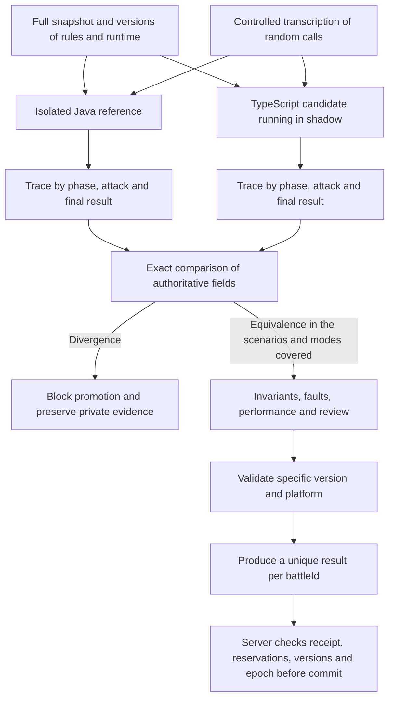

# Combat and bots

Detailed reference for the [architecture overview](../../.github/ARCHITECTURE.md).
Section numbers match that overview. Target designs and historical evidence below
do not establish implementation or production readiness. Component runbooks and
[the migration evidence](../migration-validation.md) track current behavior.

## 10. Battle computation and bots

```mermaid
flowchart LR
  player[Authenticated player or bot] --> command[combat command]
  command --> reserve[Server validates and reserves resources and troops]
  reserve --> snapshot[Persisted and versioned snapshot]
  snapshot --> compute[Realm-owned bounded calculation]
  compute --> result[Deterministic result and hash]
  result --> check[Server checks versions, epoch and idempotency]
  check --> commit[Transaction applies losses, rewards and event]
  commit --> report[Worker produces detailed report]
```

The engine receives `battleId`, `rulesVersion`, `numericPolicyVersion`, `rngAlgorithmVersion`, seed,
aggregate versions and complete snapshot. Produces a reproducible result, without
reading mutable state or modifying databases. The server applies the result once,
validating reservations, versions and `ownerEpoch`. Resources are not trapped in an open
SQL transaction during external calculation. To compare with old Java, an isolated seed
is not enough: it is necessary to control all sources of randomness, as shown below.

### 10.1. Current language choice and exactness criteria

**The engine starts in TypeScript**, maintaining the monorepo contracts and the backend
contracts, with Bun for development. The previous recommendation to go directly to Rust is replaced by this
decision. Rust and Go are future candidates if measurements show that the compute, not
database/network/queue, is the relevant bottleneck.

Combat is a module of the authoritative realm server, not a separately deployed
application. Each server owns a bounded CPU worker pool outside its network loop,
with explicit concurrency, queue and memory limits. Do not create a process per
attack. Pure rules remain in `packages/combat`; workers receive immutable snapshots
and return results to the same realm owner for validation and application.

**Java remains as a compatibility reference.** A TypeScript combat mode is only released
after equivalence and invariants defined in this section. The validation also applies to
any later port to Rust/Go: migrating based on performance does not authorize changes to
casualties, random draws, or rewards. There is no language that automatically eliminates
rule or formula errors.

| Option         | Defined role                                                                                                                                                                 |
| -------------- | ---------------------------------------------------------------------------------------------------------------------------------------------------------------------------- |
| **TypeScript** | Initial implementation. Explicit layer for Java numeric semantics; calculation isolated from networking, with CPU/memory budget.                                             |
| **Java**       | Migration oracle and reference executor in the laboratory. The game does not rely on reintroducing the entire production Java server to use TypeScript.                      |
| **Rust**       | Future candidate to reduce CPU cost/latency/allocations if a benchmark warrants it. Requires new validation of mathematics and contract.                                     |
| **Go**         | Future candidate, also subject to CPU measurement, allocations, GC pauses and numerical equivalence. Don't assume that switching to Go makes the formula accurate or faster. |
| **C++**        | No adoption planned at this stage.                                                                                                                                           |
| **Python**     | Authorized legacy/analysis tools only; maintained bots use TypeScript.                                                                                                       |

### 10.2. Java review scope and evidence

Review performed on 10/23/2026 on the authorized local references of the recovery
workspace, separate from this architecture checkout. The survey covered **3,586 Java
files** in `apps/server/modules`, identified **28 files and 6,002 lines** in the central battle
package and **16 files that directly instantiate the managers**. These are static
counts, not test coverage percentages or proof that all paths were executed.

The guided reading followed preparation, execution, results and application of losses.
The scan also inventoried 34 world handler/battle factory files, four effects support
files, and the boss flows. Dependencies such as profiles, marches, hospitals, and events
make the domain larger than a single damage function.

| Reference area                                                  | What was observed and needs to be included in the specification                                                                                                                                                          |
| --------------------------------------------------------------- | ------------------------------------------------------------------------------------------------------------------------------------------------------------------------------------------------------------------------ |
| `battle/manager/AbstractFightManager`                           | Preparation of participants; turns/subturns; movement; target selection; attacks by troops, generals and dragons; damage; defender protection; victory and report. PVP, PVE, tower and challenge managers use this core. |
| `battle/info/*`, `battle/role/*`                                | Attributes from XML and profiles, weighted abilities, temporary effects, positions, troop strengths, deaths, and fractional damage remainder.                                                                            |
| `battle/manager/FightCalCache`                                  | Contextual cache by role/effect/skill, invalidation by dependencies and comparison mode with recalculation. Changing the cache can change results if the invalidation is incorrect.                                      |
| `gameengine/battle/*`, `UserProfile.getGameEffect`              | Effects aggregate several sources: VIP, equipment, heroes, alliance, territory, world, dragons and event conditions. Part depends on global state and execution context.                                                 |
| `world/normal/AbstractWorldFightHandler` and subclasses         | PVP context, city, resources, territory, reinforcements and other modalities; march assembly; calculation; loss distribution; after effects.                                                                             |
| `WorldMarchGeneralArmy`, `FightResultObject`, bosses and relics | Losses per participant, conversion of dead to injured, healing, protection and modifiers per mode, as well as periodic effects outside the central loop.                                                                 |
| `battle/report/*`                                               | The contract includes the sequence of events/turns used by the client, not just the winning side.                                                                                                                        |

To reduce the risk of relying on a decompiler rebuild, six critical methods were checked
against the **original JAR bytecode**, using `javap` in JDK 8: damage converted to
casualties, attack, defense, power, movement, and hit/damage decision. The bytecode
confirms 32-bit floating point operations, promotions to 64 bits, and conversions to
integer. This does not constitute full equivalence between all recovered sources and all
original artifacts.

### 10.3. Numerical and behavioral risks found

| Observed evidence                                                                                           | Consequence for the new engine                                                                                                                                                    |
| ----------------------------------------------------------------------------------------------------------- | --------------------------------------------------------------------------------------------------------------------------------------------------------------------------------- |
| Mixture of `float`, `double`, `int`, decimal parsing and intermediate promotions                            | `f32` and `f64` must appear at the corresponding points in the evaluation. A result saved in `double` may have already lost precision in a previous `float` multiplication.       |
| Using `Math.pow` with Configuration Derived Exponents                                                       | Copying the formula to `powf` does not prove equivalence of last bits or integer thresholds. Pin and validate the mathematical implementation.                                    |
| Casts for integer, `floor`, `ceil` and `round` in different places                                          | Do not replace them with a generic rounding function. Preserve the moment of each conversion, saturation and treatment of exceptional values.                                     |
| `hurtAcc` preserves the fractional part of the damage                                                       | Rounding each attack without carrying the remainder changes the casualty total over the course of the battle.                                                                     |
| Turns, sub-turns, order by side/position, towers, traps and early termination                               | Parallelizing a battle's attacks or rearranging the loop can change live targets, abilities, and the winner.                                                                      |
| `HashMap`, lists and multimap in formations, skills, and sums                                               | Ordering everything differently is not a neutral optimization. Capture the effective order of entry and explain the tiebreakers.                                                  |
| `ThreadLocalRandom`, `Math.random`, `RandomUtil` with `SecureRandom`, `RandomUtils` and `Random` in helpers | A single seed does not control the legacy. Comparison requires intercepting/replaying all random calls, their types, thresholds and order.                                        |
| Probabilistic tests with different limits and comparators                                                   | Open/closed ranges, `<` and `<=` need boundary testing; do not normalize all chances to a generic Bernoulli.                                                                      |
| Effects can query profile, role flags, realm and context during calculation                                 | Snapshot needs to capture these dependencies and preserve turn/target-conditional effects. Just serializing troop counts is insufficient.                                         |
| Result calculation also contains recovery rules and draws                                                   | The replay must cover the generation of the final result, not end when the last attack ends. Getters with side effects must not become unrestricted, repeatable reads.            |
| Conversion to injured and mode modifiers happens outside of the central manager                             | Comparing only damage or victory leaves out real losses, hospital and persisted state.                                                                                            |
| Some skill initializers catch exceptions and continue                                                       | Reference Java may also produce degraded result. Configuration errors should block validation and require investigation, rather than being treated as a successful oracle result. |

The JDK is also part of the contract. Initially pin the reference runtime, artifacts,
architecture and resources; do not update JDK or swap `Math` for `StrictMath` and
assume identical results. The `Math.pow` specification allows for limited error in
ulps, not universal equality with any native library. [Reference: Java Math](https://docs.oracle.com/javase/8/docs/api/java/lang/Math.html).

### 10.4. TypeScript numerical policy and future portability

The first engine profile is **compatibility with the validated Java version**, not an
attempt to make old math “more accurate”. Reproduce the types, order of operations and
rounding points observed. Fixed point, exact decimal or rational can only replace these
operations in a new explicit version of the rules, with analysis of the impact on
balancing. Fractional exponents also require a specified approximation; Fixed point does
not automatically make the entire formula exact.

In TypeScript, `number` does not automatically reproduce Java `float`
intermediates. Materialize binary32 rounding at the necessary points, for example with
`Math.fround`, and keep binary64 at the rest. Java cast to integer is not synonymous with
JavaScript bitwise operator: create adapters for truncation, limits, NaN and infinities,
tested against the reference. Use `bigint` or strings validated for 64-bit integers
when the contract requires it.

Quantity conversions, overflow and division are given functions with explicit policy.
State quantities use integers with limits and checked operations; Intermediate values
can use greater width to check boundaries. Where the legacy profile requires specific
semantics, it remains in a tested function, without depending on the different behavior
between debug and release builds. Overflow or entry outside the permitted domain does
not authorize a negative reward, wraparound or silent saturation in the economic state.
[Reference: Rust operators and conversions](https://doc.rust-lang.org/reference/expressions/operator-expr.html).

Create Java semantic adapters for rounding and conversions, with boundary vectors. For
example, `Math.round(-1.5f)` results in `-1`, while `f32::round(-1.5)` results in
`-2`. Do not exchange one API for another because they have the same name.
[References: Java Math](https://docs.oracle.com/javase/8/docs/api/java/lang/Math.html), [Rust f32](https://doc.rust-lang.org/std/primitive.f32.html#method.round).

`f64::powf` has unspecified precision across platforms/versions, so Rust alone does not
guarantee identical replay. Validate a specific mathematical library or implementation
against the reference; pin the toolchain, dependencies, flags, and target. Start with a
supported platform and require the same vectors before releasing another architecture.
Do not enable fast-math, reassociation, approximations or explicit FMA without proving
equivalence of the affected operation. [Reference: powf accuracy](https://doc.rust-lang.org/std/primitive.f64.html#method.powf).

In the initial engine, `Math.pow` and other mathematical functions of the JavaScript
runtime also need to pass through Java vectors. Pin the selected production runtime and Bun development versions, architecture
and dependencies; TypeScript does not promise numerical equivalence to legacy per se.
The Rust examples above are risks of a future port, not a change from the current choice
of TypeScript.

IDs, timestamps, and 64-bit integers do not traverse JSON as `number` when doing so
loses precision. Use integer fields in the binary contract or validated decimal strings;
reference floats may require preservation of bits in snapshot and replay. Version and
hash cover rules, numeric policy, and contract.

### 10.5. Randomness, replay, and safe application

During migration, record a transcript of draws with call point, index, range, type and
returned value/bits. Java and TypeScript consume the same transcript; extra call,
different order or unconsumed transcript are discrepancies. For the new engine, specify
a PRNG and a mapping of versioned intervals, with seed of safe origin and independent
state per battle. This PRNG does not make old Java reproducible without adapting all
sources.

The snapshot captures participants, formations, skills, attributes, conditional effects,
flags, battle type, realm context and complete required settings. Calculation does not
look for `UserProfile`, mutable XML, database, real clock, or global services during
replay. The effective instant of combat is part of the input when a rule depends on
time.

A request produces an immutable end result and a hash; querying or resending the same
request does not draw healing again or reapply losses. The application receipt, ledger,
changes and event are confirmed in the same authoritative transaction. In case of a
timeout, uncertain result or infrastructure failure, consult the receipt and resume the
same operation. If the calculation violates an invariant, it is pending for safe
investigation/reprocessing; do not choose the winner by fallback or partially confirm
the result.

### 10.6. Tests and criteria for releasing a battle mode

1. **Frozen reference:** inventory original artifacts, resources, flags, runtime, and
   protocol; use synthetic scenarios and keep private data only in the authorized
   environment. Compare ambiguous decompiler output with bytecode.
2. **Numeric primitives:** parsing, `f32`/`f64` promotions, casts,
   overflow, division, powers, boundaries, negatives, NaN, and infinities. Reject
   exceptional values outside the contract before applying the result.
3. **Equivalence by phase:** formations, targets, random draws, skills, status, integer
   damage, fractional remainder, troop strengths, protection, winner, healing, wounded
   troops, deaths, and distribution per participant. UUIDs and report generation
   timestamps may be normalized; losses and decisions allow no tolerance.
4. **Mode coverage:** PVE/PVP, city, resource, territory, starred troops, traps/towers,
   generals, dragons, bosses, and authorized special modes, each with its own boundaries
   and flags. Modes not yet validated remain unavailable in the new engine.
5. **Boundary cases and properties:** empty or invalid input, a single unit, damage
   close to an integer, negative and maximum effects, zero/full probability, ties, turn
   limits, status reactivation, protection, and hospital capacity. Troop conservation
   uses disjoint categories; healing is a transition, not unit creation. Fuzzing
   generates cases and minimizes divergences.
6. **Side effects:** retries, crashes after calculation or commit, duplicate delivery,
   delayed results, ownership changes, and old rule versions. Prove that losses and
   rewards are applied only once.
7. **Controlled release:** shadow execution, reference comparison, independent
   inspection, and activation per version/mode. Known divergence in authoritative
   results blocks promotion. Preserve inputs, random draws, and versions for auditing
   and private replay.

Java is a reference for behavior, not proof of absolute correctness. A confirmed
inconsistency in the legacy needs its own rule decision and regression testing; Don't
copy an error silently or fix it in the middle of an unversioned migration. The absence
of divergences in a test suite is also not a mathematical proof of the absence of bugs.

### 10.7. Checks performed and performance still pending

In addition to static inspection and bytecode reading, independent numeric probes were
run on **Temurin 8.0.504** and **Rust 1.99.0 with optimization**. They are synthetic
examples of semantics, not a port of private code nor full battles. Observed examples:

| Synthetic probe                                                                               | Observed result                                                                                                  | Implication                                             |
| --------------------------------------------------------------------------------------------- | ---------------------------------------------------------------------------------------------------------------- | ------------------------------------------------------- |
| Quantity `16,777,217` passes through `float` before returning to integer                      | `16,777,216`; the path only in `double` keeps `16,777,217`                                                       | Promoting everything to 64-bit can change a unit.       |
| Ten increments with fractional remainder, using `0.1f` promoted to `double` or `0.1` directly | First path accounts for `1`; the second accounts for `0` in this sequence of flooring and carrying the remainder | Parsing and intermediate precision affect accumulators. |
| Rounding of `-1.5`                                                                            | Java `-1`; default Rust `-2`                                                                                     | The direct translation of rounding already diverges.    |
| Floor and cast by `-1.2`                                                                      | Floor `-2`; cast to integer `-1`                                                                                 | Truncate and round down are different operations.       |

Differential tests of complete battles, throughput/p99 benchmark, Rust validation for
combat or proof of correctness of all effects were not performed in this review. No
engines, rules, player data or deploys were changed by this document review.

Before extraction, measure snapshot preparation, calculation, serialization, queue,
network, validation, and commit separately. First compare Java and TypeScript on the
same hardware, entries, draws and rules, including small battles, large battles and many
simultaneous battles. Record CPU per battle, allocations, maximum memory, throughput,
p50/p95/p99 and total time perceived by the player. Capacity budgets must be defined
before selecting the benchmark winner. A remote call per attack is not part of the
design.

Optimize compact data first, compiled/versioned configuration, reduced parsing and
allocations, validated cache, and parallelism across independent battles. The internal
sequence of a battle remains serial until a transformation is proven equivalent. Isolate
TypeScript calculation in realm-owned CPU workers and measure that boundary. If necessary,
compare Rust and Go under the same contract, hardware, and load before selecting a
migration. The Rust probes above are historical semantic evidence, not TypeScript engine
benchmarking.

### 10.8. Bots and NPCs

TypeScript bots consume the same commands, costs, limits and authorizations as a player.
Simulated accounts have explicit tagging, quotas, concurrency limit, and kill switch on
the dashboard. They don't write directly to the database. Bots that behave like players
are different from internal NPCs in the world: the latter belong to the `npc`
module and the authoritative simulation. Production execution starts with limited
scenarios and population, measuring impact on economics and capacity, without implicit
administrative privileges.
