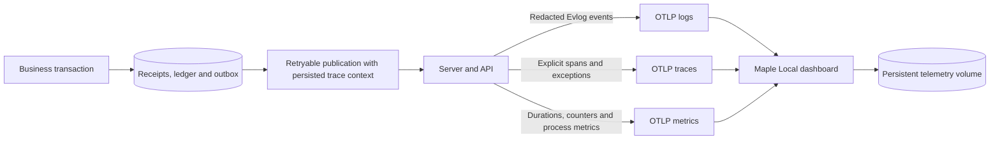
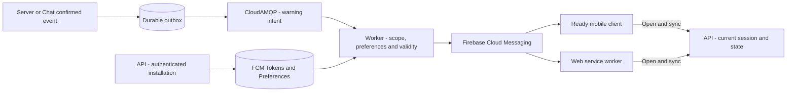
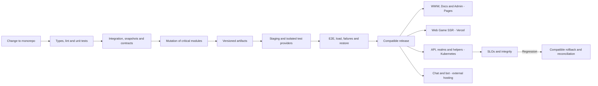
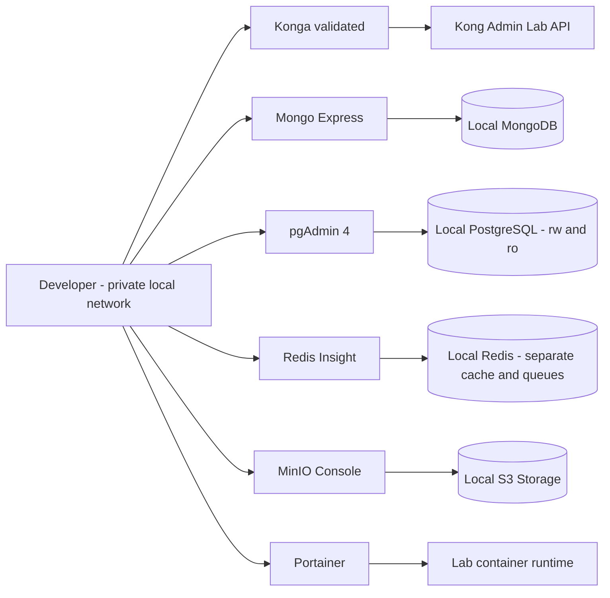

# Operations, testing and release

Detailed reference for the [architecture overview](../../.github/ARCHITECTURE.md).
Section numbers match that overview. Target designs and historical evidence below
do not establish implementation or production readiness. Component runbooks and
[the migration evidence](../migration-validation.md) track current behavior.

## 12. Observability, Evelog and search

[ADR-0013](../decisions/0013-adopt-maple-for-local-operational-observability.md) governs the
current local implementation. Server/API retain Evlog JSON output and export logs,
OpenTelemetry spans, controlled exception events, counters and duration histograms to
the official Maple Local container. Grafana, Loki, Prometheus, Axiom and Sentry adoption
is suspended for these signals while Maple continues to pass its integration checks.
Production hosting/capacity and infrastructure scraping remain separate work.

Composed services, domains, controllers and persistence/publication adapters emit start
and terminal events with controlled operation, outcome, duration and correlation.
Background workers have detached job/trace contexts. PostgreSQL statement instrumentation
records only statement kind, schema-allowlisted table and row count. Generated avatar
bytes and queued TCP frames have metadata events; queuing is not an acknowledgment of
client delivery. Confirmed effect events are deferred until the transaction commits and
are discarded on rollback. The outbox preserves W3C `traceparent` across retries/restarts.

Only controlled metadata enters operational records. Exclude SQL, parameters, arbitrary
URLs, headers, request/response bodies, player/device identities, tokens, keys and raw
exception messages/stacks. Evlog redacts before OTLP log export. Error groups use controlled
reason/event metadata. High-cardinality IDs remain searchable log/span fields, never
metric dimensions. See the [shared contract](../../packages/core/README.md#operational-logging).

Maple is available at `http://127.0.0.1:4318`, with separate ingest and dashboard/query
credentials, an offline bundled UI and a persistent `maple-data` volume. Its own external
telemetry/update checks are disabled. See the [Compose runbook](../../infra/compose/README.md#observability).
Default raw-log/trace retention is 30 days; metric retention is 90 days. Clean restart
preserves the store. Upstream checkpoint recovery after an unclean stop can lose recent
telemetry; back up the volume and keep transactional audit independent.

Log/span queues are bounded at 8192 entries per process, with 256-entry batches and a
one-second default export interval. Export failures produce controlled local diagnostics.
Maple outages do not block gameplay or invalidate committed state. Operational telemetry
can be lost after overflow, export failure or abrupt termination; it is not a durable
business audit. Slow operations emit warning events and in-flight metrics expose unfinished
work. Local Maple does not schedule automatic alerts or guarantee detection latency.

**Evelog** names the game's durable audit concept, not the Evlog library. PostgreSQL
receipts, economic postings and outbox already provide a foundation; a complete append-only
audit product and restricted operator search remain separate work. Voluminous details may
be archived under retention controls. Maple receives filtered operational projections and
does not become economic authority. Elasticsearch remains optional reconstructable search.

Firebase product analytics remains separate from runtime observability and state authority.
It must not receive secrets, message bodies or player dumps. Mobile integration depends on
the prepared client version; its unavailability never blocks gameplay. Firebase Cloud
Messaging remains the independent notification channel below.

### Push notifications with Firebase Cloud Messaging

FCM is the channel for notifications outside the session: for example, construction
completed, march returning, attack alert or alliance event, depending on preferences and
permissions. Does not replace WS, chat history, or persisted state. Firebase Auth,
Analytics, and FCM have independent responsibilities and faults.

Server/Chat confirms the event and its outbox; the worker consumes the notification
intent and sends it through FCM from a trusted environment. It runs on `apps/workers` on
the VPS, using the defined messaging, without a new server per realm. The external call
does not enter the gameplay transaction. Use SDK/Admin or HTTP v1 with an adapter
validated for the selected production runtime and credentials restricted to the backend. [Reference: FCM architecture](https://firebase.google.com/docs/cloud-messaging/fcm-architecture).

The API associates each FCM installation/token with the authenticated account, platform,
environment and preferences; recipient per character/realm is validated by the backend.
An account can have multiple devices. FCM token is not login token. Update rotated
tokens, remove invalid ones and unlink the installation upon logout/account switch so as
not to send warnings from the previous user. Do not record tokens in logs or telemetry;
restrict access to registration. [Reference: FCM token lifecycle](https://firebase.google.com/docs/cloud-messaging/manage-tokens).

Maintain `notificationId`, cause, recipient, deadline and status of the attempt. Retries use
backoff and limit; Expired notification is not resent. The queue deduplicates intents
and the client deduplicates the ID when controlling the presentation; a failure after
sending may cause duplicates, therefore do not promise single delivery or confirm
reading because FCM accepted the message. TTL and collapse are set by category: a
delayed attack alert should not appear as current. Push is not a guarantee of real-time
warning; opening or reconnecting queries the API. [Reference: FCM message deadline](https://firebase.google.com/docs/cloud-messaging/customize-messages/setting-message-lifespan).

Preferences include categories, mute, and opt-out. Send minimal text and validated
navigation routes; never session tokens, full chat body or unnecessary private data on
the locked screen. Before sending alliance notices, revalidate recipient and scope.
Clicking requires current session and authorization; the payload does not authorize
command or grant benefit. Do not use public topics as an authorization mechanism for
private messages.

Web Push depends on browser support, HTTPS, permission, service worker and VAPID
configuration; is not performed by SSR. Mobile requires SDK/configuration and
permissions per version/platform, including APNs in the Apple client. The legacy APK
does not gain push just because of the backend configuration. Denying permission or
losing FCM does not prevent login, construction or combat. Validate each platform
without assuming that they all receive notifications under the same conditions.
[References: FCM Web integration](https://firebase.google.com/docs/cloud-messaging/web/get-started), [receiving by platform](https://firebase.google.com/docs/cloud-messaging/receive-messages).

## 13. VPS Kubernetes, delivery, and continuity

The VPS's executable infrastructure lives on Kubernetes. SaaS services and frontends are
not pods in this cluster. Initial deployment is **a single node**; a lightweight
distribution like K3s is a candidate, after measuring its actual cost. [Reference: K3s requirements](https://docs.k3s.io/installation/requirements).

| Layer                       | Initial deployment                                                                                                                                   |
| --------------------------- | ---------------------------------------------------------------------------------------------------------------------------------------------------- |
| Entrance                    | Traefik and Kong/API Gateway on VPS Kubernetes, with declarative configuration.                                                                      |
| API                         | A shared Deployment, initially one replica; not duplicated per realm.                                                                                |
| Realms                      | `server-realm-1` and, if supported, `server-realm-2`; one active owner per realm and separate settings/pools.                                        |
| Calculation and auxiliaries | Realm-owned combat workers, API media and auxiliary workers/relay with independent limits.                                                           |
| Coordination                | A ZooKeeper instance with persistent volume on the initial node; it is not an HA installation. Distributed ensemble is evolution for multiple hosts. |
| Data and queues             | External Neon, Redis.io, MongoDB Cluster and CloudAMQP; do not install your production copies on the VPS.                                            |
| Frontends                   | Pages for WWW/Docs/Admin; Vercel for Web Game SSR.                                                                                                   |
| Chat and bots               | Services external to the VPS; hosting and quotas still to be selected.                                                                               |
| Observability               | Maple is verified locally; production telemetry hosting/capacity and collectors remain to be measured under ADR-0013.                                |

Three ZooKeeper pods on the same VPS cannot survive machine loss. Kubernetes does not
create RAM, vCPU, or physical availability. It also does not automatically duplicate a
realm's Server. `ownerEpoch`, durable state and reconnection remain part of recovery
after VPS reboot or replacement.

Deploys drain connections and allow reconnection. Workers and calculation only increase
concurrency within the VPS and providers budget. API remains unique at this stage; no
HPA policy creates one API per realm. External chat follows its own scaling and recovery
mechanism.

Backups and restores include Neon, unique MongoDB documents, storage, rule
configurations, operational state, and secrets. Validate restoration by provider and
consistency of references, without assuming that snapshots of the VPS disk contain data
kept outside of it. VPS disaster and regional disaster are different scenarios, both
with tested procedures.

## 14. Failures and expected degradation

| Failure                                           | Required behavior                                                                                                                                       |
| ------------------------------------------------- | ------------------------------------------------------------------------------------------------------------------------------------------------------- |
| Neon / writing compute                            | Suspend new mutations; reconnect with timeout; resolve uncertain result by receipt/idempotency. Do not confirm economic changes only in memory.         |
| Neon / compute ro delayed or unavailable          | Query compute rw for consistent data; reduce reporting or indicate lag, without burdening the primary with unlimited fallback.                          |
| Cache Redis                                       | Reduce dependent functionalities and apply limit fallback; Authentication and quotas explicitly fail when there is no safe alternative.                 |
| Broker or worker                                  | Preserve the outbox and show pending status; reprocess without duplicating effects. Impose backlog and backpressure limits.                             |
| ZooKeeper/session                                 | Stop mutations of the affected partition until reasserting ownership; refuse stale epochs.                                                              |
| Chat                                              | Game continues; chat reports unavailability and retrieves history via the persisted source.                                                             |
| API media/MongoDB/search                          | Uploading, documents and searches degrade; Central commands do not wait indefinitely for these services.                                                |
| Realm calculation workers                         | Maintain recoverable reserve and pending result; timeout, idempotent retry and reconciliation. Do not create fictitious victory.                        |
| Observability                                     | Maintain game behavior; limited buffers and controlled disposal of operational logs, without losing the transactional audit record.                     |
| Bots                                              | Stop simulators without interrupting players; allow quick shutdown by scope.                                                                            |
| Firebase Auth                                     | Login/renewal may be unavailable; Existing sessions comply with validity and revocation policy. Do not accept invalid token to work around the flaw.    |
| Firebase telemetry                                | Discard/buffer events in a limited way; do not block game commands.                                                                                     |
| Firebase Cloud Messaging / push permission denied | Game continues; retry limited to warnings still valid, with discard after expiration. Recover state on open/reconnect, without relying on notification. |
| Stripe                                            | Suspend new purchases or show pending status; receive/reconcile events later without granting credit based on the success page.                         |
| VPS/Single Node Kubernetes                        | API and local realms stop until host recovers; External data services preserve what has been confirmed according to their guarantees.                   |

## 22. Mandatory testing strategy

All layers below are part of the quality architecture. This is an implementation policy;
suites still need to be built at this checkout. A manual smoke test on the APK does not
replace automated E2E.

| Layer                 | Scope                                                                                  | Mandatory examples                                                                                                              |
| --------------------- | -------------------------------------------------------------------------------------- | ------------------------------------------------------------------------------------------------------------------------------- |
| **Unit Tests**        | Isolated functions and use cases, injectable clock/RNG, and controlled dependencies.   | Costs, limits, bonuses, rounding, permissions, transitions, offline production, retention and economic invariants.              |
| **Integration Tests** | Adapters with real, disposable databases, broker, ZooKeeper and storage.               | Transaction/rollback, concurrency, primary/replica, outbox/inbox, redelivery, change of owner, migrations, chat archive and S3. |
| **Snapshot Tests**    | Contracts, serialization, deterministic results and visual interfaces.                 | SFS frames, API JSON, WS events, combat state/trace, HTML SSR and web/dashboard screens.                                        |
| **E2E Tests**         | Flow from client to persistence and return, through the gateway and real applications. | Login, city, build/complete/reconnect, map, chat between two clients, moderation, files and panel commands.                     |
| **Mutation Tests**    | Evaluate whether the suite detects behavioral changes in the code.                     | Swap comparators, remove owner/epoch checks, change cost/rounding, and remove idempotency or retention limits.                  |

### Organization, tools and environments

Unit tests live close to their modules; integration tests live alongside the adapter/app
under test. Test suites and their fixtures stay within `apps/` and `packages/`;
there is no shared root test suite. TypeScript is the initial engine and uses a runner validated for Bun, including the planned TypeScript Bot application. Rust/Go will have their own suites if they are adopted,
maintaining the same contract and replay tests. No suites use production credentials or
create players in the real realm.

Integration tests start isolated dependencies for each run, with their own
schemas/buckets/queues. Validate primary/replica PostgreSQL, Redis, MongoDB, RabbitMQ,
ZooKeeper and MinIO depending on the affected component. Staging also exercises
dedicated testing endpoints of Neon/Redis.io/MongoDB/CloudAMQP, without touching
production. Firebase Auth uses emulator/test project; Stripe uses test mode and
simulated signed events, with no real billing. Cleanup only removes resources created by
execution; does not perform reset/flush of shared volumes. Include dependency failures
and recovery in addition to the success path.

For E2E web/dashboard/landing, Playwright is the proposed tool. For APK, validate
automation on emulator/device with appropriate framework and maintain a matrix per
version; a test SFS client covers the protocol but does not prove native rendering. E2E
business flows maintain real services; unavailable third-party simulations are
explicitly identified in the report.

Data snapshots fix rules, random seed/transcript, clock, and relevant order. Normalize
only volatile data without semantics, never troops, balance, damage, recipient or
authorization. A snapshot change requires review of the diff and reason; do not
automatically accept a new baseline because the test failed. Screen snapshots fix
browser, fonts, resolution and environment, with visual tolerance separate from the
equality of authoritative values. [Reference: Playwright visual comparisons](https://playwright.dev/docs/test-snapshots).

Mutation testing uses StrykerJS with compatible runner for TypeScript and `cargo-mutants`
if Rust is adopted; Go tooling will be selected if there is a port to that language.
Integration with runner Bun must be proven; do not assume direct support.
[References: StrykerJS](https://stryker-mutator.io/docs/stryker-js/introduction/), [cargo-mutants](https://mutants.rs/).

The catalog of critical mutations cannot have non-equivalent survivors in combat,
balance, ownership, idempotency, and retention paths. Equivalent mutants require
reviewed justification; timeout, broken test or incomplete execution do not
automatically count as validated behavior. The overall score has a baseline and
threshold per package, without using a high average to hide a surviving critical mutant.
Do not confuse mutation testing with fuzzing or testing commands that change the state
of the game.

### Auth and push validation

Test Guest → each of the six non-anonymous methods, bind multiple providers to the same
UID, re-enter on another device, and preserve both characters/realms. Cover credential
already linked to another UID, OAuth cancellation, Apple private email, password
recovery, expired/revoked token, per-environment callbacks, and provisioning
concurrency. Collisions cannot create duplicate balance/character or transfer ownership
by email coincidence. Validate real external flows using test accounts: the emulator
does not alone test OAuth configuration or native client behavior.

Push covers denied opt-in, foreground/background, rotated/invalid token, logout/account
switch, multiple devices, alliance revoked, TTL, duplicates, retries, and FCM
unavailability. Local tests use controlled adapter; actual delivery uses dedicated
project/staging devices, without production tokens. Validate authorized opening and
resynchronization, not just acceptance of the send call. In snapshots, use synthetic
identities and tokens.

### CI and release criteria

PRs run types/lint, unit tests, affected contracts and snapshots, integration of changed
adapters, and E2E of core journeys. Changes to critical modules perform targeted
mutation before merging. Complete mutation, client matrix, recovery, load and
cross-compatibility suites run periodically and are a requirement of the release
candidate.

Failure of mandatory test blocks promotion. Retries are used for diagnosis; recurrent
instability has responsibility and deadline, without converting failure into silent
success. Reports preserve commits, images, versions, seeds, fixtures, snapshot diffs,
coverage and mutation results, without real player data. Line coverage alone does not
approve a rule.

Chat retention tests the exact boundaries of 24h and 168h, UTC clock, edit and retry
without term renewal, race between archive and deletion, alliance authorization, old
cache, MongoDB unavailability, restoration and replay of expired jobs. Use a controlled
clock, without waiting one or seven real days.

## 23. Development environment and administrative tools

The implemented root `docker-compose.yml` starts PostgreSQL, a one-shot Drizzle
setup job and pgAdmin 4 under the `dev` / `all` profiles. Setup waits for database
health, creates/migrates the global database and both default kingdoms, and generates
a password-free pgAdmin server registration. Named volumes persist the cluster and
pgAdmin settings. The database/setup use the internal network; pgAdmin also uses the
external network. Compose explicitly configures local credentials and host ports;
application tools use the single root `.env`. The build context excludes private
files and mobile artifacts. The
[local environment guide](../../infra/compose/README.md) documents startup, verification,
credential changes and recovery. This single-instance local environment does not
implement the production replica/managed-service topology.

The development Compose uses `dev` for applications and `all` to include
administration tools. The `devops` profile selects administration tools and their
dependencies; `redis` and `database` select their respective inspection groups.
Redis Insight and Portainer have their own persistent volumes.
Administrative interfaces are developer tools and not game startup dependencies. Application CI does not need to start these interfaces to test the core.
Declarative configuration of the gateway remains versioned.

| Requested tool    | Development use                                                            | Boundary                                                                                                            |
| ----------------- | -------------------------------------------------------------------------- | ------------------------------------------------------------------------------------------------------------------- |
| **Konga**         | Lab Kong inspection/administration interface.                              | Validate a version/fork compatible with the chosen Kong; it is not the game's administrative panel.                 |
| **Mongo Express** | Inspection of collections and the temporary message archive.               | Access only to local/synthetic MongoDB, with authentication.                                                        |
| **pgAdmin 4**     | Inspection of schemas, transactions and PostgreSQL `rw`/`ro` endpoints.    | Credentials by environment; read permissions do not allow changes to the replica.                                   |
| **Redis Insight** | Inspection of caches, sessions, presence and Redis queues when applicable. | Identify instances to avoid confusing disposable cache and durable queues.                                          |
| **MinIO**         | Local S3 storage and console for uploads, assets, replays and testing.     | Buckets and local credentials; tests isolate your prefix/bucket and do not delete objects from another environment. |
| **Portainer**     | Inspection and operation of laboratory containers/stacks.                  | Runtime administration access; do not give application access to the Docker socket.                                 |

**Konga Compatibility:** Upstream states that as of 0.14.0, Kong 1.x is only supported.
Therefore presence on the dev plan does not prove compatibility with a modern version of
Kong. Select and test a compatible fork/version or register the interface replacement;
Don't downgrade the production gateway just to accommodate the tool. The choice remains
pending before activating this profile. [Reference: compatibility declared by Konga](https://github.com/pantsel/konga#compatibility).

Development interfaces are in loopback/private network, without public game routes and
without real credentials. Relevant manual operations generate a reproducible procedure
in the repository; a change made to the UI does not replace migration, versioned
configuration or testing. Profiles are not automatically copied to production. The
production operation uses the restricted access defined for each service, with its own
authorization and auditing.

## 24. Operational goals, capacity and incidents

The values below are **initial targets proposed for validation**, not measured results
or guarantees of the current checkout. Load and failure tests must validate the values
on the chosen hardware and topology before release.

| Indicator                     | Proposed target and scope                                                                                                                                                                                           |
| ----------------------------- | ------------------------------------------------------------------------------------------------------------------------------------------------------------------------------------------------------------------- |
| Core/API availability         | 99.9% monthly, with definition of success/error by operation and maintenance accounted for in the published policy.                                                                                                 |
| Common synchronous command    | p95 up to 150 ms and p99 up to 500 ms in the application path, without internet RTT or explicitly asynchronous tasks.                                                                                               |
| Confirmed economic durability | RPO/RTO linked to the guarantees and recovery of the contracted Neon plan; validate uncertain commits and restore. Do not declare RPO 0 just for using two computes.                                                |
| VPS Recovery                  | Initial goal of resuming API and realm within 15 minutes after the host becomes available; measure rebuild, secrets, reconciliation and reconnection. This does not guarantee physical replacement by the provider. |
| Chat retention                | Messages become invisible to queries at the 7-day boundary; reconciliation every minute and physical cleaning in up to 5 minutes in healthy operation.                                                              |
| Capacity by realm             | Publish the baseline of simultaneous connections, commands/s and battles/s sustainable, with p99, CPU/memory and database budget, before admitting the corresponding population.                                    |

Capacity testing includes normal load, peak and backlog recovery; separately measures
players and bots, external chat, SSR on Vercel, combat and workers. The VPS does not
take over the memory of services hosted outside of it. Configure simulated population
and concurrency limits based on this baseline. HPA does not exceed the database's
connections/pools or the broker's recovery capacity. Metrics include overdue tasks,
backlog, archiving/purge delay, and backpressure rejects, as well as CPU and memory.

Each alert has responsibility, severity and procedure: identify impact, contain new
operations when necessary, preserve receipts/private evidence, recover the component,
reconcile pending issues and verify invariants. Do not resolve inconsistencies with
database/cache reset. Economic corrections use audited commands, and queue reprocessing
keeps the original idempotent keys.

Realm maintenance uses an announced drain mode, blocks new affected operations,
checkpoints state, and resumes service. Regional disaster recovery has its own RPO/RTO
and exercise, including storage, secrets and backups external to the cluster's fault
domain; do not infer regional recovery from the failover of a Neon read replica or pods
on the same host. Key rotation, restoration and revocation of access are part of the
versioned operational procedures.

### 24.1. Initial VPS budget for the two default kingdoms

16GB is a deployment hypothesis, not a proven capacity. Check actual memory in GiB, node
`allocatable`, number/type of vCPUs, and sustained CPU performance. The budget below is
**provisional, without measurements**, and includes both realms to guide testing; it is
not a ready-made configuration of requests/limits.

| Local component                     | Planning reserve in GiB |
| ----------------------------------- | ----------------------: |
| Operating System and Kubernetes/K3s |                     2.5 |
| Traefik and Kong                    |                     1.0 |
| Shared API including media          |                     1.0 |
| ZooKeeper                           |                     0.5 |
| Workers and relay                   |                     0.5 |
| Realm Server 1 including combat     |                    2.25 |
| Realm Server 2 including combat     |                    2.25 |
| **Planning subtotal**               |                **10.0** |

The remaining usable memory is reserved for spikes, system cache, network, and operating
margin. Adjust requests, limits and concurrency to measured data; a low limit can kill a
process that would otherwise fit on the host. External databases, brokers, chats, bots
and SSRs do not consume the local RAM of these services, but their connections and
buffers do. Don't add the full stack of observability or development tools without
re-budgeting.

Measure simultaneous battles and completed battles per second separately. As a demand
estimate, `CPU cores ≈ battles/s × CPU-ms/battle / 1000`, in addition to the cost of Server, network, serialization and
persistence. The estimate does not replace actual load: formations, rounds and skills
change the cost a lot. Each realm-owned combat pool has bounded queue and concurrency; do not create a process/thread per attack nor block the
API event loop with calculation. Mathematical equivalence remains a requirement before
optimization.

Validate normal load, dozens of continuous combats, throne and KVK, including
simultaneous peaks of both realms, workers, API media and reconnections. Record
command/calculation p99, CPU, maximum memory, runtime pauses, queue delay, RTT and
provider quotas. Validate both default kingdoms with measurable margin and section 24
goals met, without harming API and node control. If capacity is insufficient, increase CPU/RAM or move a
Server to another VPS; the API remains shared. More RAM does not alone solve CPU
bottleneck or remote latency.

## 25. Compatibility between versions and promotion criteria

The release matrix links client version, protocol, rules, resource hash, server build,
combat engine version and schema. For each combination, record supported operations,
tests performed, limitations, and upgrade/rollback plan. APK v12.06.0 is the reference
from the previous experiment; other clients are only supported after their own
validation.

Client artifacts and resources have manifests and hashes, authorized origin, and
declared compatibility. Updating rules on the server does not authorize serving the APK
with incompatible resources. Discovery reports version/capability and blocks invalid
combinations in a client-recognizable way.

Internal contracts have producer and consumer testing. During gradual deployment,
maintain compatibility between old and new versions of participating services; unknown
fields, enums and new events follow explicit policy. Incompatible change requires new
contract/endpoint and transition window, not replacing a schema in place. Old jobs
remain associated with their rules version until completion or validated migration.

Migrations follow expansion → compatible application → data migration → verification →
contraction after removing old readers/jobs. Image Rollback does not automatically roll
back data already recorded by a new rule. The release defines the return limits and
required reconciliation. Promotion requires the five layers of Section 22 testing, data
integrity, client compatibility, validated operational goals, and exercised restoration.
