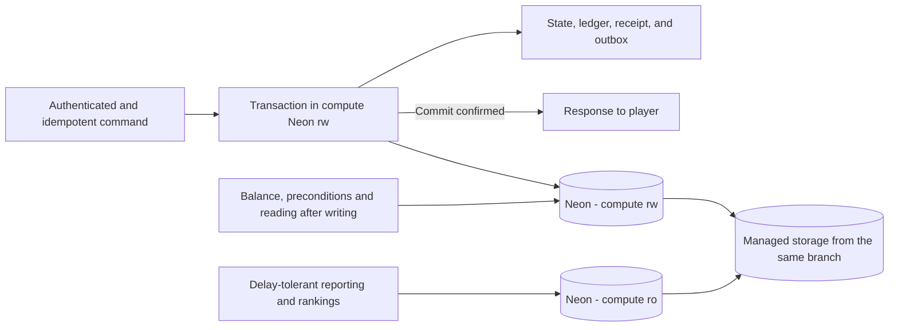
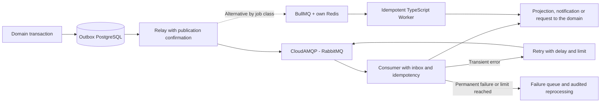

# Persistence, simulation and realm authority

Detailed reference for the [architecture overview](../../.github/ARCHITECTURE.md).
Section numbers match that overview. Target designs and historical evidence below
do not establish implementation or production readiness. Component runbooks and
[the migration evidence](../migration-validation.md) track current behavior.

## 6. PostgreSQL on Neon: writes, reads, and authority

PostgreSQL is on **Neon, outside of VPS**. The two roles are a write compute
`rw` and a read replica/compute `ro` on the same production branch. Do
not create two independent branches as if they were synchronized writes and reads. In
Neon, computes read from shared managed storage: they do not represent two local copies
linked by a project-managed WAL replication. The read replica still has eventual
consistency. [Reference: Neon read replica architecture](https://neon.com/docs/introduction/read-replicas).

Balance, inventory, troops, costs, and preconditions use `rw`. A read after a
confirmed construction operation uses this compute or transaction result. Rankings and
reports can use `ro` with delay budget; A GET request does not imply that
reading from the replica is safe. Separate connection pools and permissions for the API,
each realm, Chat, and workers, with a global connection limit compatible with the Neon
plan.

Critical transactions do not make an unnecessary sequence of round trips between Europe
and another region. Select Neon region close to the VPS and measure RTT, cold start,
pool and commit latency. Use of pooler and scale-to-zero depends on the workload and the
validated plan; do not assume that the free plan fits the game.

High availability, WAL persistence, recovery and backups are features of the contracted
service/plan. Read replica is not, in itself, backup nor a promise of RPO 0. Set and
test recovery goals with real Neon guarantees, without documenting a manual promotion of
primary within the VPS. After uncertain commit results, consult the receipt before
repeating the mutation.

## 7. MongoDB, Redis and file storage

| Technology                               | Planned data                                                                          | Authority and recovery                                                                                                                                                                          |
| ---------------------------------------- | ------------------------------------------------------------------------------------- | ----------------------------------------------------------------------------------------------------------------------------------------------------------------------------------------------- |
| PostgreSQL on Neon                       | Progress, economy, accounts, metadata, active chat and outbox                         | Transactional authority. Global/alliance chat leaves the active history after 24 hours and expires after 7 days; details in section 20. Backup with point-in-time recovery and restore testing. |
| Managed MongoDB Cluster                  | Detailed battle reports, simulation documents, projections and temporary chat archive | Documents versioned by ID and schema. Archived global/alliance chat expires 7 days after submission, not archiving. Unique documents require their own backup.                                  |
| Redis.io / Redis Cloud                   | Cache of queries, sessions, presence, ephemeral fan-out and traffic limits            | TTL, invalidation and recovery set. It is not the only record of balance, completion or combat.                                                                                                 |
| Separate Redis.io for queues — if BullMQ | Jobs, retries and auxiliary schedules                                                 | An instance separate from the cache, with persistence and a `noeviction` policy.                                                                                                                |
| Cloudflare R2 — releases                 | APKs, Lua bundles and update manifests                                                | Versioned artifacts, integrity/authenticity check and release channel; see section 27.                                                                                                          |
| S3 compatible — other objects            | Avatars, assets, attachments, large replays, exports and backups                      | Provider per operation yet to be defined; MinIO in development, with access/retention policies.                                                                                                 |

MongoDB alleviates queries and documents that do not need to participate in the economic
transaction. The primary stores the ID, version and summary necessary for consistency; a
worker publishes the document after commit. Do not require uncoordinated writes to both
PostgreSQL and MongoDB to accept the same command.

Queues, outbox, inbox and projections have retention and cleaning by explicit policy.
Voluminous histories are partitioned/archived by date, with measured indices and
budgets. The deduplication window covers the allowed retry and replay period. Cleaning
jobs and projections does not remove the authoritative ledger or records necessary to
recover a pending operation.

“Larger data” does not mean putting arbitrary files in a BSON document: the limit per
document is 16 MiB. Replays or large binaries go to storage, with reference and hash in
the document; GridFS is an alternative only if there is a specific operational case.
[Reference: MongoDB and GridFS](https://www.mongodb.com/docs/manual/core/gridfs/).

Select nearby European regions for VPS and providers whenever supported on your chosen
plan. Measure actual RTT per operation, connection limits, quotas, and cold
start/auto-suspend behavior when applicable. Choosing a managed service does not prove
the plan's capacity or latency. Use TLS, secrets restricted by environment and network
access limited depending on the provider. Pools, retries and buffers have limits; do not
keep economic transactions open while waiting for telemetry or another optional third
party.

## 8. Messaging: RabbitMQ and BullMQ

**Defined choice:** RabbitMQ hosted on CloudAMQP for communication between languages and
services. A possible future calculation engine favors a
contract independent of the TypeScript runtime.

BullMQ is an alternative for jobs controlled by TypeScript workers, especially retries
and auxiliary schedules. It is not necessary to adopt both for the same work. If both
exist, each queue will have a defined owner, contract, and responsibility; there will be
no informal double publication.

Events contain `eventId`, `eventType`, `schemaVersion`, `aggregateId`, `aggregateVersion`,
`occurredAt`, and `correlationId`. Large payloads are referenced by ID; tokens and secrets
are not queued. Consumers deal with duplicates, out-of-order events, and versions not
yet supported.

Assume **at-least-once** delivery. The relay marks publication complete after broker
confirmation; the consumer acknowledges it after persisting its result. A failure
between confirmation and updating the outbox may repeat the event. Inbox/receipts and
unique keys prevent applying the same change twice. RabbitMQ requires handling
confirmations, reconnection and redelivery in the application. [Reference: RabbitMQ reliability](https://www.rabbitmq.com/docs/reliability).

In BullMQ, keep Redis queues separate from cache discard policies, configure
persistence, and test recovery from stopped jobs. Restarting a worker cannot repeat a
reward. [Reference: BullMQ in production](https://docs.bullmq.io/guide/going-to-production).

Authoritative construction, march, and combat timers remain recorded as state and
deadlines in PostgreSQL. A queue wakes the executor, but it is not the only evidence
that a deadline has passed; reconciliation recovers late tasks. Job requests from other
languages use broker/API contracts, without writing directly to BullMQ's internal
structures.

## 9. Authoritative server, ZooKeeper, and scaling

The game starts with a modular Server per realm, separate from the shared API. There is
one initial realm and a maximum of two after capacity validation. Realm-owned calculation, API media and
Workers have explicit limits on the VPS; Chat, bots and SSR are outside of it. Realms
can share the VPS if the peaks fit with margin. Increasing RAM/vCPU or moving a realm to
another VPS does not create another global API. Partitioning a realm into regions
remains an evolution, not the starting point.

ZooKeeper keeps track of membership and partition owner election using sessions and
ephemeral records. Session loss suspends further partition mutations until authority is
restored. Querying ZooKeeper for each attack or movement is not part of the normal
command path. [Reference: ZooKeeper recipes](https://zookeeper.apache.org/doc/current/recipes.html).

The leadership protocol includes a monotonic `ownerEpoch` persisted in PostgreSQL. Each
authoritative write in Neon checks the current epoch, blocking an old owner from
returning after a pause or network failure. A ZooKeeper election alone does not stop
this stale process from continuing to write. Kubernetes provides service discovery;
ZooKeeper is restricted to game coordination, without duplicating cluster control or
PostgreSQL failover.

Do not scale a stateful realm just by increasing replicas in a Deployment. Routing
associates the session with the correct owner; changing ownership requires draining,
checkpointing, rebuilding the state, and reconnecting. Aggregate ordering,
locks/transactions, and state versions are still necessary even with a single logical
executor per partition.

## 16. Simulation execution and offline progress

The Server executes a logical queue of commands per aggregate/partition, with
transactions for conflicts between aggregates. Deadlines are persisted UTC instants; the
monotonic clock measures duration and timeout within the process. The client clock does
not determine completion, production or reward. Tests are given an injectable clock to
advance days without waiting for real days.

| System                              | State and authoritative transitions                                                                                                                              |
| ----------------------------------- | ---------------------------------------------------------------------------------------------------------------------------------------------------------------- |
| Construction, research and training | `queued → running → completed`; permitted cancellation uses an exclusive transition with a versioned refund policy.                                              |
| Resources and production            | Record `lastSettledAt`, production rates, caps, and rate changes; settle the unprocessed range once.                                                             |
| Marches                             | `scheduled → marching → arrived → returning → returned`, with deadline, destination and troop reserves. Combat/occupation are explicit transitions upon arrival. |
| Temporary effects and abilities     | Versioned start, end, overlap, and source; expiration changes state and invalidates dependent caches.                                                            |
| Realm Events                        | Pinned schedule and rule version; opening, closing and reward have their own receipts.                                                                           |
| Rewards, inventory and quests       | Transitions by command/event with idempotency; consulting a screen does not create a new reward.                                                                 |

A scheduler looks for past deadlines and wakes the responsible executor. Each activity
has an ID, version, due date and expected state. Multiple workers can discover the same
activity, but only one transaction applies the transition. Job duplication,
reconnection, and restart do not repeat completion.

Offline progress uses the same deadlines and rules. When starting, the owner reconciles
outstanding activities and settles production intervals in limited batches. Bonus
changes during an interval require splitting the interval at the effective time; do not
multiply the current rate by the entire offline period. Operations that depend on an
activity that has not yet been reconciled wait for or reconcile that aggregate within a
bounded time, rather than accepting incorrect state.

Concurrent expiration, completion, and cancellation check the same state version and the
same receipt. Delay policy does not depend on the accidental order of jobs; the ordering
between simultaneous events is part of the rules. Periodic rewards and event times use
explicit rule timezone, without depending on the container's local zone. The persisted
instant remains in UTC.

The implemented common activity and city-production slice, transaction ports,
compatibility limits and recovery procedure are documented in
[timed activities and city production](timed-economy.md).

## 17. Data model and write ownership

The physical model will be versioned by migrations. The logical organization below
defines the owners and invariants that these migrations must preserve. `identity`
represents the Firebase link and internal permissions; login credentials are managed by
Firebase Auth. A realm's account/character belongs to the game. This separation resolves
the overlap between API and Server.

| Proposed domain/schema | Central entities                                                                                                                         | Authorized Writer                                                                                         |
| ---------------------- | ---------------------------------------------------------------------------------------------------------------------------------------- | --------------------------------------------------------------------------------------------------------- |
| `identity`             | Unique Firebase UID binding for internal account, Guest/linked state, game session/ticket, internal revocation, and administrative roles | Shared API; provider credentials and bindings in Firebase Auth.                                           |
| `notifications`        | FCM installations and tokens, preferences, account/character/realm scope, send intent, expiration, and attempts                          | API registers devices/preferences; worker sends notifications of authorized events.                       |
| `game`                 | Player by realm, city, building, activity, research, troops, march, inventory and aggregate version                                      | Partition owner server.                                                                                   |
| `economy`              | Wallet, ledger entry, reservation, consumption, refund, and operation receipt                                                            | Economic Server use cases; administrative API requests commands.                                          |
| `combat`               | Battle, snapshot, reservations, engine version, result and application receipt                                                           | Server authoritative orchestrator. Realm-owned calculation workers only calculate.                        |
| `social`               | Alliance, Membership, Roles, Permissions, and Membership Ranges                                                                          | Server alliance domain. Chat queries derived authorization.                                               |
| `chat`                 | Channel, message, sequence, receipt, archive metadata, and retention state                                                               | Chat and its retention worker, with specific permissions.                                                 |
| `files`                | Upload, owner, object, hash, transformation and reference                                                                                | Shared API media and its bounded background jobs.                                                         |
| `billing`              | USD Catalog, order, Checkout Session, payment, received events and delivery status                                                       | API/payments worker; granting items/currency only by the Realm Server and Ledger.                         |
| `operations`           | Rules version, publication and administrative audit                                                                                      | Authorized administrative use cases; publication passes through the Server when it affects gameplay.      |
| Integration            | Outbox and inbox/receipts per service                                                                                                    | The producer writes its outbox in the transaction; the consumer writes its inbox when applying the event. |

Minimum invariants: non-negative available balance; reservation not consumed twice;
inventory and troops with valid quantities; activity with a single completion or
cancellation; participant linked to the right realm; only one result applied per battle.
Unique keys and version checks in the database complement application validation.

The ledger records the cause and credits/debits of each operation, including transfers,
consumption and refunds. Categories and units are explicit; materialized balance must
reconcile with confirmed postings. Do not correct balance with separate SQL: use
identified and auditable administrative adjustment. Upper bounds are also rules, not
just the size of the SQL type.

A command transaction confirms state, ledger, receipt and outbox together. Reusing a
`requestId` with the same content returns the recorded result; reuse with different
content is rejected. Changes by workers in someone else's domain go through the owner's
command/event, never through unrestricted SQL access. Indexes cover ownership,
state/deadline, pagination, and idempotent keys; reports use projections or queries with
their own budgets.

## 19. Realms, partitions and operations between owners

The first production configuration maintains one logical owner per realm, with separate
Servers and shared API; the initial maximum is two realms. Regional splitting is enabled
only after validating cross-partition transfers and operations. Aggregate identity does
not change when it changes pods; routing queries a versioned ownership directory.

A transfer uses a durable record with `transferId`, source, destination, version, and
state: prepare → suspend new aggregate mutations in source → persist checkpoint → switch
ownership/epoch atomically → destination load checkpoint → commit. Repeating a step does
not duplicate the entity. Failure before switching allows resuming at origin; after the
switch, recovery uses the new owner. Late requests receive the current routing or are
rejected by epoch and receipt.

While aggregates share the same PostgreSQL, operations that reserve troops/resources
from multiple participants use transaction and defined lock order. No partition
publishes victory before confirming authoritative application. If an evolution
distributes participants across independent databases, a versioned protocol for
reservations, coordination, and compensation will be required; do not automatically
transform a transaction into multiple RPCs. This mode is disabled until validation.
Events between realms follow the same border.

Throne conquest and KVK are part of the mandatory peak scenarios. Each battle has an
authoritative coordinator, global `battleId` and versioned reserves of the
participants. In KVK, two Servers do not independently calculate/apply the same battle:
the coordinator receives the reserved snapshots, requests the calculation and confirms
the effects via the idempotent application protocol. As long as there is a single
database, the transaction can validate reserves and epochs of the two realms in a
defined order; it is not open during remote calculation. Failure of any participant
requires durable recovery without releasing troops before resolving the reservation. KVK
remains disabled until concurrency, recovery, and application are validated between
realms; opening two realms does not prove support for KVK.
