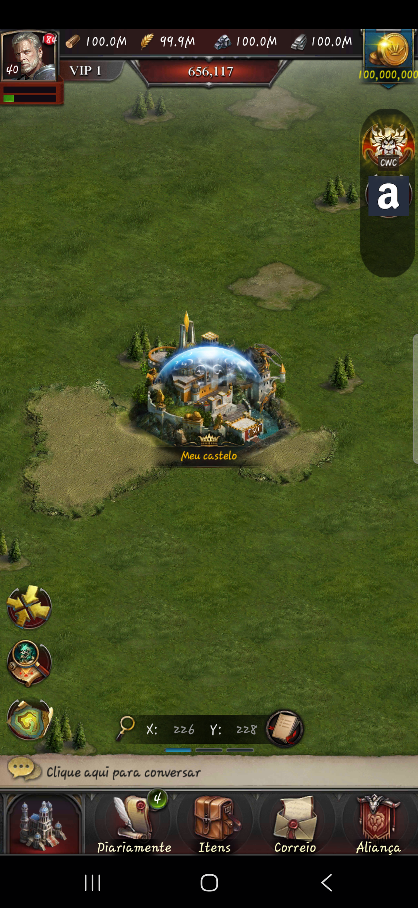
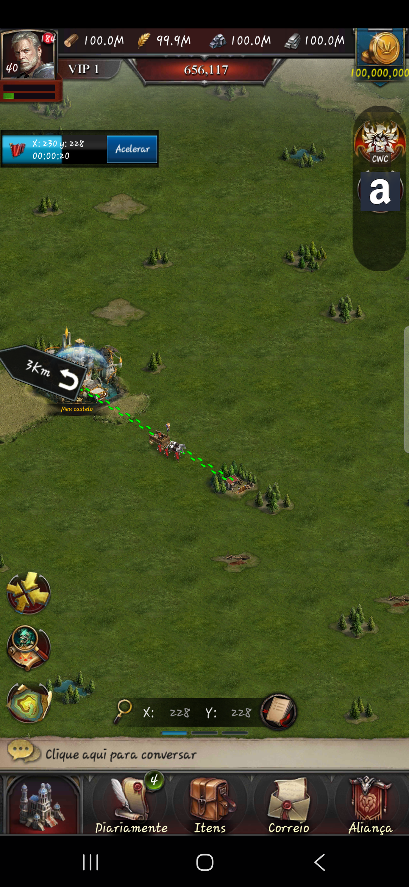

# Samsung native validation for issue 521

This record accompanies [issue 521](https://github.com/ReeseArch64/opencok/issues/521)
and its parent [issue 385](https://github.com/ReeseArch64/opencok/issues/385).
The requested delivery contains the compatibility fixes found through Samsung
ADB execution. It does not certify all eight original native acceptance groups.
The maintainer requested committing the current work and opening the closing PR
before the remaining device scenarios were completed.

## Environment and preservation

Execution used a Samsung Galaxy A34, model SM-A346M, Android 16, ARM64,
on 2026-10-27. The server started from `4758f971` with this change applied.
PostgreSQL 17, Redis and ZooKeeper ran in disposable containers with separate
physical global and realm databases. The 1201 by 1201 free terrain was synthetic;
this run does not certify the authored terrain dataset.

The prepared native client targets protocol 12.06.0, version code 10374.
Authorized inputs were the existing generated installation artifacts after
numbered patches through 034. Their SHA-256 fingerprints were:

| Input             | SHA-256                                                            |
| ----------------- | ------------------------------------------------------------------ |
| Base APK          | `633177785d65b8ef880bc1c723fffb113db8a626f642c72c02097f46a80b8a01` |
| InstallPack split | `a066455e256f850fc510fcc784d29783705ec839c0cc14c9a6bb79574aef2912` |

Private patch 035 prepared a side-by-side package, `org.opencok.native521`, labeled
`OpenCok QA521`, with isolated loopback game endpoints and provider authorities.
The installed variant retained Android version name `1.0.0`; its protocol identity
was 12.06.0. A subsequent 035 variant with Android version name `12.06.0` was built
but was not installed or tested. The first variant's output fingerprint was not
retained before that rebuild, so the input fingerprints above must not be
misrepresented as the exact tested output fingerprints. A certification rerun
must freeze the installed APK and split hashes before execution.

ADB forwarded game HTTP and SFS traffic to the disposable realm. The native client
issued the gameplay commands; a passive SFS witness observed their identities and
response shapes. Database reads independently checked troop reservations and
resource credits. Synthetic server tests are reported separately below.

Original extracted inputs and signing material remained read-only. The existing
`com.hcg.cok.gp` installation and active player databases were not updated, cleared
or used for these fixtures. APKs, keys, raw logcat, session values and private
harness configuration remain outside tracked content.

## Fixtures

The synthetic account was named `Native521`, with 100 million of each ordinary
resource, dedicated dragon resources, synthetic inventory and 1,000 militia.
Starter buildings were raised to level 25. Advanced UI exploration subsequently
set the castle to 30 and lord to 40 and aligned their pending level-reward markers.
The castle's saved world projection was also aligned to level 30.

A level-one wood node was placed four cells from the castle with 50,000 wood and
an explicit future expiry. The first exploratory node expired because its fixture
had not assigned an expiry; it was replaced before the recorded gathering run.
The account had no active hatched dragon. Incubation, feeding and travel were not
completed through native controls.

The first chat-session loop came from omitting the maintained chat service in the
private harness. Composing that service stopped the repeated session errors; this
was an environment correction, not a gameplay implementation change.

## Observations and fixes

| Observation           | Before                                                                                                                     | Delivered behavior and evidence                                                                                                                                                                                                                                                                   |
| --------------------- | -------------------------------------------------------------------------------------------------------------------------- | ------------------------------------------------------------------------------------------------------------------------------------------------------------------------------------------------------------------------------------------------------------------------------------------------- |
| Dynamic resources     | Native logcat reported missing versions for `world_city`, dragon and other bundles.                                        | Login now announces 58 additional locally verified Android bundles with their version and MD5. The existing hero fingerprint remains unchanged. The Samsung downloaded the world and dragon archives after this correction.                                                                       |
| World sections        | The response contained city points, but the native map remained empty and offered occupation at the owned city coordinate. | The legacy serializer probe showed JSON objects inside section strings. The replacement emitted JSON strings inside those arrays. Sections now contain objects while preserving the SFS array-of-sections envelope and UTF size bounds. The Samsung rendered the saved level-30 city and shield.  |
| Gathering departure   | A native march selected 1,000 militia and showed 8,000 carrying capacity.                                                  | The client rendered the march route and destination. Saved troops changed from free 1,000/march 0 to free 0/march 1,000.                                                                                                                                                                          |
| Gathering completion  | The first run used the existing authoritative march lifecycle.                                                             | Saved wood rose from 100,000,000 to 100,008,000; all 1,000 militia returned to free troops with no remaining march. This observation does not establish native duplicate-reward recovery across a restart.                                                                                        |
| Collection inspection | The client repeatedly requested unsupported `common.res.syn`; its collection panel showed zero quantity and speed.         | The command now uses the fenced world mutation boundary and owned march checkpoint. Ordinary gathering projections include saved quantity, float speed and timestamps. Integration tests cover retry, foreign ownership and troop restoration. The corrected panel still requires a native rerun. |

## Original acceptance groups

| Group                             | Result in this device run                                                                                                                                                                   |
| --------------------------------- | ------------------------------------------------------------------------------------------------------------------------------------------------------------------------------------------- |
| Authentication and initialization | Native authentication, initialization, city interaction and world rendering observed. Some unrelated passive requests still returned explicit unavailability.                               |
| Dragon progression                | Not completed. No active dragon was available; the maintainer confirmed the absence of a dragon and requested delivery. No feeding, skill, travel or reward compatibility claim is made.    |
| Civilization research             | Not exercised through its native research controls.                                                                                                                                         |
| Civilization castle and totems    | A native `civilizationCastle.info` request was observed. Placement, movement, recycling and activation were not exercised.                                                                  |
| Local events and one-time rewards | Not exercised with a native enabled-event fixture.                                                                                                                                          |
| Gathering and world movement      | Native gathering departure and rendered route, troop reservation and saved completion observed. Acceleration, recall, teleport and a second native interested viewer remain unverified.     |
| Reconnect and realm restart       | The synthetic account reauthenticated against restarted realm processes and retained its city. Pending-work recovery and duplicate-cost/reward assertions were not completed on the device. |
| Combat unavailability             | Unavailable passive requests produced the native unavailability message. No attack scenario was completed; no battle victory, damage or loot is claimed.                                    |

The remaining rows are unverified native coverage, not passing results inferred
from server tests. Future native certification must complete them and freeze the
installed artifact fingerprints. Historical calendars and unsupported combat
engines retain the gates documented in the architecture.

## Automated validation

The full server unit suite passed 1,621 tests with 277,804 assertions and one
snapshot. The focused PostgreSQL march suite passed six tests with 57 assertions,
including native resource synchronization, duplicate operation replay, foreign
march rejection, acceleration, recall, teleport and final troop conservation.
The additional TCP and PostgreSQL integration group passed 18 tests with 444
assertions across core realm isolation, cosmetics, march companions and shared
resources. Lint, formatting and the eight affected workspace type checks passed.
